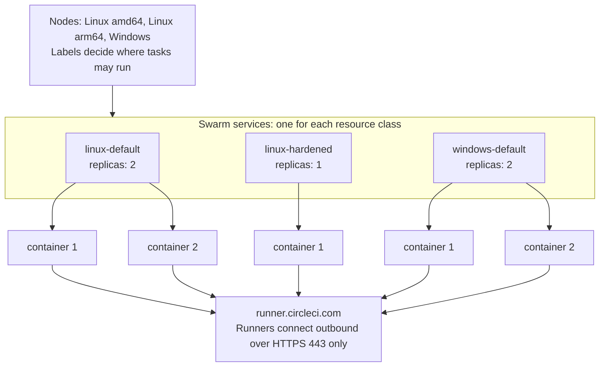

# Machine runner swarm: CircleCI machine runner 3 on Docker Swarm

Run CircleCI machine runner 3 as Docker Swarm services. Each service is one resource class, `deploy.replicas` sets how many runners it has, and every job runs in a new container.

[](https://dl.circleci.com/status-badge/redirect/gh/CircleCI-Labs/scalable-machine-runner/tree/main)
[](https://github.com/CircleCI-Labs/scalable-machine-runner/releases)
[](./LICENSE)
[](https://discuss.circleci.com/)

**Disclaimer:**

CircleCI Labs, including this repo, is a collection of solutions developed by members of CircleCI's field engineering teams through our engagement with various customer needs.

- ✅ Created by engineers @ CircleCI
- ✅ Used by real CircleCI customers
- ❌ **not** officially supported by CircleCI support

> [!NOTE]
> If you can run Kubernetes, CircleCI recommends [container runner](https://circleci.com/docs/guides/execution-runner/container-runner-installation/) for containerized jobs. This repository is for teams that run Docker Swarm, need Windows containers, or want a clean container for every job without Kubernetes. CircleCI also documents a plain [machine runner 3 on Docker](https://circleci.com/docs/guides/execution-runner/install-machine-runner-3-on-docker/) setup.

## Support

CircleCI support does not cover this repository. Field engineering handles issues on a best-effort basis, without an SLA. Open a [GitHub issue](https://github.com/CircleCI-Labs/scalable-machine-runner/issues) for a bug or a feature request, or ask the community on [CircleCI Discuss](https://discuss.circleci.com/).

Problems with the CircleCI platform or the runner agent itself go to [CircleCI support](https://support.circleci.com/hc/en-us). To report a security vulnerability, read [SECURITY.md](SECURITY.md).

## Contents

- [How it works](#how-it-works)
- [Quickstart on Linux](#quickstart-on-linux)
- [Supported platforms](#supported-platforms)
- [Security summary](#security-summary)
- [Documentation](#documentation)
- [Upgrade and uninstall](#upgrade-and-uninstall)
- [Releases](#releases)
- [Development](#development)
- [Contributing](#contributing)
- [License](#license)

## How it works

A Docker Swarm cluster holds the nodes. One stack file for each operating system defines one service for each resource class, and optional overlay files add the persistent and docker-build classes, and on Windows a class with your own image. The replicas of a service are runner containers that poll `runner.circleci.com` for jobs over outbound HTTPS.



- **A clean environment for every job.** The runner runs in single-task mode, so each container claims one job and exits. The Swarm restart policy `condition: any` then creates a new container. Swarm never reuses a container.
- **Stock images.** On Linux, the statically linked runner is mounted read-only from the host into images such as `cimg/base` and `cimg/openjdk`. On Windows, the runner and portable Git are mounted into the Server Core image. This repository publishes no images.
- **Placement with labels.** Services carry constraints, and nodes advertise capabilities, such as the OS, the architecture, the network zone, and the Windows build.
- **Optional helpers.** `linux/setup.sh` and `windows/Setup.ps1` run the setup steps with checks. The documentation covers every step without them.

Refer to [Concepts](docs/concepts.md) for the model, the job lifecycle, and what a clean environment covers.

## Quickstart on Linux

This example runs one node with three resource classes. For the full steps, including RHEL and the checks, refer to [Install on Linux with Docker Swarm](docs/install-linux.md).

Prerequisites: Docker Engine 24 or later, root access, the [CircleCI CLI](https://circleci.com/docs/guides/toolkit/circleci-cli/), and an organization admin who agreed to the [CircleCI Runner Terms](https://circleci.com/legal/runner-terms/).

1. Get the files, and create a resource class and token for each service in `linux/stack/runners.yaml`.

   ```bash
   git clone https://github.com/CircleCI-Labs/scalable-machine-runner.git
   cd scalable-machine-runner
   for class in linux-default linux-java linux-hardened; do
     circleci runner resource-class create <namespace>/$class --generate-token
   done
   ```

2. As root, install the runner and the entrypoint into `/opt/machine-runner-swarm/<version>`, and point `current` at it.

   ```bash
   repo=$PWD; v=3.1.12
   case "$(uname -m)" in x86_64) arch=amd64 ;; aarch64) arch=arm64 ;; esac
   base=https://circleci-binary-releases.s3.amazonaws.com/circleci-runner
   cd "$(mktemp -d)"
   curl -fsSLO --proto '=https' --tlsv1.2 "$base/$v/circleci-runner_linux_$arch.tar.gz"
   curl -fsSL --proto '=https' --tlsv1.2 "$base/$v/checksums.txt" | grep "linux_$arch.tar.gz" | sha256sum -c -
   tar -xzf "circleci-runner_linux_$arch.tar.gz" --no-same-owner circleci-runner
   d=/opt/machine-runner-swarm
   install -d -m 0755 -o root -g root "$d" "$d/$v" "$d/$v/bin"
   install -m 0755 -o root -g root circleci-runner "$repo/linux/entrypoint/circleci-runner-entrypoint" "$d/$v/bin/"
   echo "$v" > "$d/$v/VERSION"
   ln -s "$v" "$d/.current.new" && mv -T "$d/.current.new" "$d/current"
   cd "$repo"
   ```

3. Start Swarm on the loopback address, so nothing is exposed.

   ```bash
   docker swarm init --advertise-addr 127.0.0.1 --listen-addr 127.0.0.1:2377
   ```

4. Create one secret for each service. Each secret is a runner config file with the token.

   ```bash
   for class in linux-default linux-java linux-hardened; do
     read -rsp "Token for $class: " TOKEN; echo
     printf 'api:\n  auth_token: %s\n' "$TOKEN" | docker secret create "$class-token" -
   done
   unset TOKEN
   ```

5. Deploy the stack, and check that the replicas run.

   ```bash
   docker stack deploy -c linux/stack/runners.yaml runners
   docker stack services runners
   ```

6. Run a job on the class:

   ```yaml
   jobs:
     build:
       machine: true
       resource_class: <namespace>/linux-default
       steps:
         - checkout
         - run: echo "runner $CIRCLECI_RUNNER_NAME"
   ```

Windows works the same way with `windows/stack/runners.yaml`. Two things differ. Stage `C:\machine-runner-swarm` before you start Swarm. Stopping a busy container from outside, for example in an update, kills its job after about 5 seconds, so change a Windows class while it is idle. Refer to [Install on Windows Server with Docker Swarm](docs/install-windows.md).

## Supported platforms

| Platform | Versions | Architecture | Status |
|---|---|---|---|
| Linux | Ubuntu LTS | amd64, arm64 | Tested in CI |
| Linux | RHEL 8 and later | amd64, arm64 | Steps documented, not tested in CI |
| Windows Server | 2025 | amd64 | Tested in CI |
| Windows Server | 2022 | amd64 | Tested in CI |
| Windows Server | 2019 | amd64 | Supported by machine runner 3. Untested here, and the stack files have no label for it |
| Windows Server | 2016 and older | | Not compatible with machine runner 3 |
| macOS | | | Out of scope. Refer to the [FAQ](docs/faq.md#does-it-support-macos) |

| Component | Requirement |
|---|---|
| Machine runner 3 | 3.1.12 or later. The helpers pin 3.1.12 |
| Docker Engine | 24 or later on Linux. Windows hosts run the engine in Windows-container mode |
| CircleCI | Cloud. CircleCI server is not tested |
| Network | Outbound HTTPS only. Refer to [Egress hosts](docs/security.md#egress-hosts) |

## Security summary

- The resource class token is a Swarm secret. It reaches the container as a file, and it is never in an environment variable or a stack file.
- **Linux default classes** give jobs passwordless sudo, like the Docker executor. A job that uses sudo can read the token. The protection is against accidental exposure.
- **Linux hardened classes** (`MACHINE_RUNNER_SWARM_JOB_SUDO=false`) remove sudo and step jobs down with `setpriv --no-new-privs`, so the token is unreadable from jobs and a setuid binary cannot lift a job to root.
- **Windows classes** run jobs and the runner as the same account, so a job can read the token. Swarm stores a Windows secret in clear text on the container disk. Treat each class as a trust boundary, and enable BitLocker on the Docker volume.
- **Docker builds are opt-in.** A job that reaches the Docker engine has root on the node. The build classes run only on dedicated worker nodes.
- **Persistent classes** give up the clean environment. Use them only for trusted projects.
- Restrict classes to projects with config policies and context restrictions. Never use self-hosted runners for public projects that build forked pull requests.

Refer to [Security](docs/security.md) for the threat model and the controls, and to [SECURITY.md](SECURITY.md) to report a vulnerability.

## Documentation

| Page | Contents |
|---|---|
| [Concepts](docs/concepts.md) | Services as resource classes, replicas, job lifecycle, clean environments, sudo and the hardened class |
| [Install on Linux with Docker Swarm](docs/install-linux.md) | Ubuntu and RHEL, manual steps first, with the optional `setup.sh` |
| [Install on Windows Server with Docker Swarm](docs/install-windows.md) | Server 2022 and 2025, manual steps first, with the optional `Setup.ps1` |
| [Multi-Node Clusters](docs/multi-node.md) | Linux, Windows, and Arm nodes, labels, network zones, registries, ports, and quorum |
| [Resource Classes](docs/resource-classes.md) | Define classes, size them, choose replica counts, persistent mode, and the configuration reference |
| [Images](docs/images.md) | Stock images with the mounted runner, and your own images on each OS |
| [Docker Builds](docs/docker-builds.md) | The opt-in host engine pattern and the alternatives |
| [Security](docs/security.md) | Threat model, token model on each OS, hardening, CircleCI-side controls, egress, BitLocker |
| [Operations](docs/operations.md) | Status, upgrades, token rotation, node drain, and uninstall |
| [Troubleshooting](docs/troubleshooting.md) | Symptoms, causes, and fixes |
| [FAQ](docs/faq.md) | Compose, container runner, macOS, support, and more |
| [Migrate from Docker Compose](docs/migration.md) | Move from the old `docker-compose.yml` |
| [CI/CD](https://github.com/CircleCI-Labs/scalable-machine-runner/blob/main/docs/ci.md) | The pipeline of this repository |

Example job configs for every class are in [`examples/`](examples).

## Upgrade and uninstall

Refer to [Upgrade the runner and images](docs/operations.md#upgrade-the-runner-and-images) and [Uninstall](docs/operations.md#uninstall). Review the [changelog](CHANGELOG.md) before you upgrade, because a `0.x` release can contain breaking changes.

## Releases

This repository uses [Semantic Versioning](https://semver.org/) and starts at `0.x`. Version `1.0.0` is reserved for general availability or official adoption. A CircleCI job cuts each release on merge to `main` from the Conventional Commits since the last release, after every test job has passed. Refer to [Releasing](https://github.com/CircleCI-Labs/scalable-machine-runner/blob/main/docs/releasing.md).

Each [GitHub release](https://github.com/CircleCI-Labs/scalable-machine-runner/releases) carries a `tar.gz` and a `zip` bundle with the stack files, the entrypoint, the setup scripts, the documentation, and the examples. It also carries a `SHA256SUMS` file and a keyless cosign signature that was made with the CircleCI OIDC token. Refer to [Verify a release](docs/install-linux.md#verify-a-release) to check a download. The release notes are in the releases, and [CHANGELOG.md](CHANGELOG.md) explains how they are made.

## Development

```bash
linux/tests/run-all.sh                  # Linux suite: a Swarm inside Docker-in-Docker, about 10 minutes
linux/tests/stack-config.sh             # stack file checks, no Swarm needed
pwsh -File windows/tests/Invoke-UnitTests.ps1 -InstallModules   # PowerShell lint and Pester tests
```

The Windows Swarm tests need a Windows host. [CI/CD](https://github.com/CircleCI-Labs/scalable-machine-runner/blob/main/docs/ci.md) describes the pipeline and how to run each check locally, and [CONTRIBUTING.md](CONTRIBUTING.md) lists the checks for pull requests.

## Contributing

We welcome issues and pull requests. In short:

- Use [Conventional Commits](https://www.conventionalcommits.org/) for every commit.
- Run the tests for the platform you changed.
- Write the commit messages and the pull request title as Conventional Commits. They become the release notes.
- Keep tokens, host names, and customer names out of the diff.

Read [CONTRIBUTING.md](CONTRIBUTING.md) for the details.

## License

This repository is licensed under the MIT license. Refer to [LICENSE](./LICENSE) for the text.
