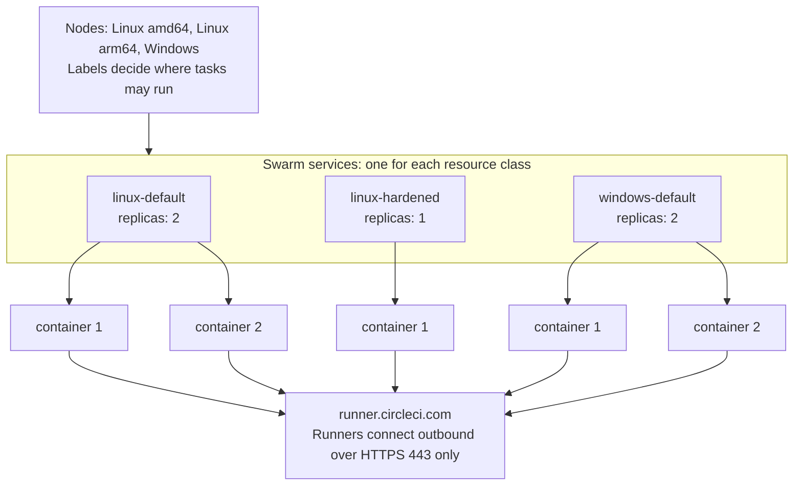

# Machine runner swarm: CircleCI machine runner 3 on Docker Swarm

Run CircleCI machine runner 3 as Docker Swarm services. Each service is one resource class, `deploy.replicas` sets how many runners it has, and every job runs in a new container, on Linux and on Windows Server.

**Disclaimer:** CircleCI Labs, including this repository, is a collection of solutions that members of CircleCI's field engineering teams developed through their work with customers.

- Created by engineers at CircleCI.
- Used by real CircleCI customers.
- **Not** officially supported by CircleCI support.

## When to use it

- **You run Kubernetes:** use [container runner](https://circleci.com/docs/guides/execution-runner/container-runner-installation/). CircleCI documents it, and it runs jobs in pods.
- **You need a boundary stronger than a container**, privileged or KVM jobs, or autoscaling: use the [machine runner orchestrator](https://circleci.com/docs/guides/execution-runner/machine-runner-orchestrator/). It runs each job in its own virtual machine.
- **You want a runner on a host or in one container:** use [machine runner 3](https://circleci.com/docs/guides/execution-runner/runner-overview/#choosing-a-runner-execution-environment), or [on Docker](https://circleci.com/docs/guides/execution-runner/install-machine-runner-3-on-docker/). Jobs share the host, or a container that is reused.
- **You run Docker hosts or Windows containers without Kubernetes**, and want a clean container for every job: use this repository. It has no support and no autoscaling, and the containers share the host kernel.

The [FAQ](docs/faq.md#why-swarm-and-not-container-runner-or-another-runner) has the full comparison, and [Security](docs/security.md#compared-with-the-official-runner-installs) compares what a job can reach.

## How it works

One stack file for each operating system defines one service for each resource class, and add-on stack files add the persistent and docker-build classes, and on Windows a class with your own image. The replicas of a service are runner containers that poll `runner.circleci.com` for jobs over outbound HTTPS. The runner is in single-task mode, so a container claims one job and exits, and Swarm creates a new container. Nodes carry labels, and services carry constraints, so you decide where each class runs.

Nothing is built. On Linux, the global service `runner-distributor` keeps the runner in a volume on every node, and the stack mounts it into stock images such as `cimg/base`, so `docker stack deploy` is the whole install. On Windows, the stack mounts the runner from the host into Windows Server Core. Refer to [Concepts](docs/concepts.md) for the model, the job lifecycle, and what a clean environment covers.

## Quickstart

You need Docker Engine 24 or later, the [CircleCI CLI](https://circleci.com/docs/guides/toolkit/circleci-cli/) 1.4.0 or later, root access to the node, and an organization admin who agreed to the [CircleCI Runner Terms](https://circleci.com/legal/runner-terms/). The quickstarts take you from nothing to a first job in a dozen commands:

- [Quickstart on Linux](docs/quickstart-linux.md): one node as a trial, or the start of a cluster. Start Swarm, create the secrets, and deploy. Nothing is installed on a node by hand.
- [Quickstart on Windows Server](docs/quickstart-windows.md): Server 2022 or 2025, in six steps.

Linux runs on Ubuntu LTS and RHEL 8 or later, on amd64 and arm64. Refer to the [FAQ](docs/faq.md#which-operating-systems-does-it-support) for what CI tests on each, and to [Security](docs/security.md) before you give a class to a team.

## Documentation

| Page | Contents |
|---|---|
| [Quickstart on Linux](docs/quickstart-linux.md), [on Windows Server](docs/quickstart-windows.md) | A first job in a dozen commands |
| [Concepts](docs/concepts.md) | Services as resource classes, add-on stack files, the job lifecycle, clean environments, and a glossary |
| [Install on Linux](docs/install-linux.md) | Ubuntu and RHEL, every step by hand, with the optional `setup.sh` and how to verify a release |
| [Install on Windows Server](docs/install-windows.md) | Server 2022 and 2025, every step by hand, with the optional `Setup.ps1` |
| [Multi-Node Clusters](docs/multi-node.md) | Linux, Windows, and Arm nodes, labels, network zones, ports, and quorum |
| [Resource Classes](docs/resource-classes.md) | Define and size classes, choose replica counts, persistent mode, and the configuration reference |
| [Images](docs/images.md) | Stock images with the mounted runner, and your own images |
| [Docker Builds](docs/docker-builds.md) | The opt-in host engine pattern and the alternatives |
| [Security](docs/security.md) | Threat model, token model, a comparison with the official installs, hardening, and egress |
| [Operations](docs/operations.md) | Status, running the cluster, runner upgrades and rollbacks, token rotation, node drain, and uninstall |
| [Troubleshooting](docs/troubleshooting.md) | Symptoms, causes, and fixes |
| [FAQ](docs/faq.md) | What to build, how it compares, scaling, jobs that cannot run, and node loss |
| [Migrate from Docker Compose](docs/migration.md) | Move from the old `docker-compose.yml` |
| [Examples](examples) | Job configs for every class, starting with [`linux-hello.yml`](examples/linux-hello.yml) |
| [CI/CD](docs/ci.md), [Releasing](docs/releasing.md), [Contributing](CONTRIBUTING.md) | What the pipeline tests, how a release is made, and how to contribute |

Each [release](https://github.com/CircleCI-Labs/scalable-machine-runner/releases) carries a bundle with the stack files, the entrypoint, the runner-distributor script, the setup scripts, the documentation, and the examples, with a keyless signature. Refer to [Verify a release](docs/install-linux.md#verify-a-release). The project uses [Semantic Versioning](https://semver.org/) and starts at `0.x`, so review the [changelog](CHANGELOG.md) before you upgrade.

## Support

CircleCI support does not cover this repository. Field engineering handles issues on a best-effort basis, without an SLA. Open a [GitHub issue](https://github.com/CircleCI-Labs/scalable-machine-runner/issues) for a bug or a feature request, or ask the community on [CircleCI Discuss](https://discuss.circleci.com/). Problems with the CircleCI platform or the runner agent itself go to [CircleCI support](https://support.circleci.com/hc/en-us). To report a security vulnerability, read [SECURITY.md](SECURITY.md).

## License

This repository is licensed under the MIT license. Refer to [LICENSE](./LICENSE) for the text.
