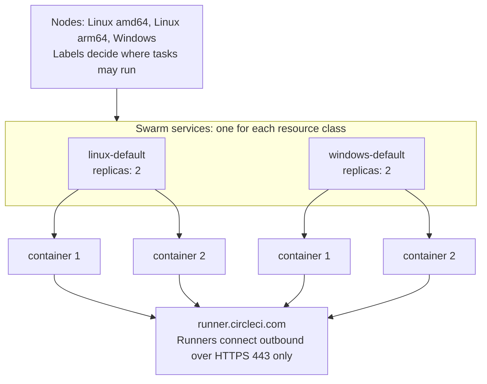

# Machine runner swarm: CircleCI machine runner 3 on Docker Swarm

Run CircleCI self-hosted runners (machine runner 3) as Docker Swarm services. Each service is one resource class, `deploy.replicas` sets how many runners it has, and every job runs in a new container, on Linux and on Windows Server. The project is for platform teams that run Docker hosts or Windows Server and want a clean container for every job on self-hosted runners, without Kubernetes.

**Disclaimer:** CircleCI Labs, including this repository, is a collection of solutions that members of CircleCI's field engineering teams developed through their work with customers.

- Created by engineers at CircleCI.
- Pre-release `0.x`: interfaces and stack files can change in any minor release. The Swarm design is new, and this repository has no history of production use to point to.
- **Not** officially supported by CircleCI support.

The repository is named `scalable-machine-runner`, and its bundles and image are named `machine-runner-swarm`. The maintainers plan to rename the repository to `machine-runner-swarm` after the first release. GitHub redirects the old address, so the links on these pages keep working. The documentation site, [circleci-labs.github.io/scalable-machine-runner](https://circleci-labs.github.io/scalable-machine-runner/), follows `main`, and the `docs/` folder of a release bundle is the documentation of that release.

## When to use it

- **You do not need machines of your own:** use CircleCI cloud executors. Self-host only for what the cloud cannot give you, such as static IP addresses, access to a private network, IAM permissions on your own hosts, or an environment that CircleCI does not offer. [CircleCI's runner overview](https://circleci.com/docs/guides/execution-runner/runner-overview/) lists the use cases.
- **You run Kubernetes:** use [container runner](https://circleci.com/docs/guides/execution-runner/container-runner-installation/). CircleCI documents it, and it runs jobs in pods.
- **You need a boundary stronger than a container, a full operating system, privileged or KVM jobs, or autoscaling:** use the [machine runner orchestrator](https://circleci.com/docs/guides/execution-runner/machine-runner-orchestrator/). It runs each job in its own virtual machine on Kubernetes. This repository has an experimental microVM add-on for a similar need on Docker hosts. It is not proven with real jobs.
- **You want a runner on a host or in one container:** use [machine runner 3](https://circleci.com/docs/guides/execution-runner/runner-overview/#choosing-a-runner-execution-environment), or [on Docker](https://circleci.com/docs/guides/execution-runner/install-machine-runner-3-on-docker/). Jobs share the host, or a container that is reused.
- **You run Docker hosts or Windows containers without Kubernetes**, and want a clean container for every job: use this repository. It has no support from CircleCI, and the containers share the host kernel.

Do not use this repository when you need autoscaling or cloud node integration (the number of replicas is fixed, and the nodes are yours), CircleCI server, macOS, privileged or KVM jobs, or a host with no internet access. Capacity is fixed, so you pay for the peak, whether or not jobs are waiting. The product names and pages in this list were checked against circleci.com on 17 October 2026. The [FAQ](docs/faq.md#why-swarm-and-not-container-runner-or-another-runner) has the full comparison, and [Security](docs/security.md#compared-with-the-official-runner-installs) compares what a job can reach.

## What is tested

The table is the short answer. [CI/CD](docs/ci.md#what-is-tested) lists every test and every gap. A statement in these pages that the table does not support is an overclaim, so please report it.

| What | Status | How it is checked |
|---|---|---|
| Linux, Ubuntu amd64, one node: install, token proxy, clean container for every job, default and hardened class | Tested | Stack tests without Swarm, a fresh VM for the install and the Swarm tests, and real CircleCI jobs in the end-to-end group |
| Windows Server 2022 and 2025, one host, amd64 | Tested | The same, on real Windows hosts |
| Linux arm64 | Partly tested | CI checks that the stack installs the runner and starts. Refer to [CI/CD](docs/ci.md#what-is-tested) for what else runs on Arm |
| A mixed cluster of a Linux manager and a Windows worker | Verified by hand | Real jobs ran on both operating systems. CI cannot run it, because its Linux and Windows VMs do not reach each other |
| Multi-host clusters, and day-two operations: a drain with a busy job, a rolling update during a job, token rotation, manager loss and restore | Documented, not tested | CI runs two Swarm nodes as containers on one VM, and every Windows test runs on one host |
| RHEL 8 or later | Documented, not tested | The steps follow Docker's documentation |
| ppc64le and s390x | Emulated start only | CI starts the distributor and the token proxy image under emulation. No job runs |
| CircleCI server, hosts without internet access, proxies and private certificate authorities | Not tested | The stack is tested against CircleCI cloud only. Refer to [What needs internet](docs/security.md#what-needs-internet) |
| MicroVM classes (Kata Containers) | Experimental | A fake CircleCI API on nested KVM on one cloud and one CPU architecture. No real job runs in CI |
| Docker-build, persistent, and Rerun job with SSH classes | Experimental | CI checks that the files merge and keep their contract. The persistent classes run with a fake or idle runner. The Swarm side of SSH was proven once by hand, and the Windows file is untested |
| Windows Server 2019, Hyper-V isolation, `add_ssh_keys` | Not tested | Not exercised, and the pages say so |

Known limits of this project:

- **Fixed capacity.** Swarm has no autoscaling, and this project creates and removes no nodes. You choose the replicas, you run the nodes, and an idle replica holds its reservation. There is no metrics export: the signals are `docker` commands and log lines ([Operations](docs/operations.md)).
- **Availability.** One token proxy runs on a manager, and every runner API call goes through it. While it is down, no new job starts, and Swarm restarts it. A production cluster needs three managers. This is not a high-availability product.
- **Shared kernel.** Jobs run in containers. The default class gives jobs passwordless sudo.
- **Windows.** Stopping a busy container from outside kills its job after about 5 seconds, the overlay network is not encrypted, and process isolation is not a security boundary.
- **Secrets.** Class tokens are Swarm secrets, and a user in the `docker` group of a manager can read them. There is no external secret manager.
- **Not in this release:** autoscaling, a metrics export, a hardened Windows class, CircleCI server, air-gapped installs, macOS.

## How it works

The main stack file for each operating system ships one default resource class (`linux-default` on Linux, `windows-default` on Windows), the token proxy, and the runner distributor. Add-on stack files add the persistent, docker-build, and microVM classes, on Linux `linux-java` and `linux-hardened` in `linux/stack/classes-extra.yaml`, and on Windows a class with your own image. The replicas of a service are runner containers that poll `runner.circleci.com` for jobs over outbound HTTPS. The runner is in single-task mode, so a container claims one job and exits, and Swarm creates a new container. Nodes carry labels, and services carry constraints, so you decide where each class runs.

You build nothing. The one image that the project publishes is the token proxy, `ccilabs/machine-runner-swarm-proxy`, which holds the class tokens. `ccilabs` is the Docker Hub organization of CircleCI Labs. The stack pulls the image, and a release bundle names the image of that release by digest. The trust root is the signature check, not the name: [Verify the token proxy image](docs/security.md#verify-the-token-proxy-image) shows how to check it, and you can build the image from `proxy/` and use a registry of your own. On Linux, the global service `runner-distributor` keeps the runner in a volume on every node, and the stack mounts it into stock images such as `cimg/base`, so `docker stack deploy` is the whole install. On Windows, the global service `runner-distributor-windows` does the same for the runner and portable Git, which the stack mounts into stock Windows Server Core. Refer to [Concepts](docs/concepts.md) for the model, the job lifecycle, and what a clean environment covers.

## Quickstart

You need the [CircleCI CLI](https://circleci.com/docs/guides/toolkit/circleci-cli/) 1.4.0 or later, signed in with `circleci auth login`, root access to the node, and an organization admin who accepted the [CircleCI Runner Terms](https://circleci.com/legal/runner-terms/) (in the web app, or by using the CLI for self-hosted runners, as CircleCI documents). Linux needs Docker Engine 24 or later; Windows Server needs Docker Engine and CLI 28.0 or later ([why](docs/install-windows.md#prerequisites)). The stack is tested against CircleCI cloud only: CircleCI server is not tested, and the nodes need outbound internet access ([what needs internet](docs/security.md#what-needs-internet)). Which plans can use self-hosted runners, and what concurrency each has, is in the [CircleCI runner documentation](https://circleci.com/docs/guides/execution-runner/runner-overview/). The quickstarts take you from nothing to a first job in a dozen commands, plus the verification of the release:

- [Quickstart on Linux](docs/quickstart-linux.md): one node as a trial, or the start of a cluster. Start Swarm, create the secrets, and deploy. Nothing is installed on a node by hand.
- [Quickstart on Windows Server](docs/quickstart-windows.md): Server 2022 or 2025, in six steps.

Linux runs on Ubuntu LTS. Tested in CI: Ubuntu 26.04 on amd64, and the start of the stack on arm64. Documented, not tested: RHEL 8 or later. Emulated start only: ppc64le and s390x. Refer to the [FAQ](docs/faq.md#which-operating-systems-does-it-support) for what CI tests on each, and to [Security](docs/security.md) before you give a class to a team.

## Documentation

| Page | Contents |
|---|---|
| [Quickstart on Linux](docs/quickstart-linux.md), [on Windows Server](docs/quickstart-windows.md) | A first job in a dozen commands |
| [Concepts](docs/concepts.md) | Services as resource classes, the token proxy, add-on stack files, the job lifecycle, clean environments, and a glossary |
| [Install on Linux](docs/install-linux.md) | Ubuntu and RHEL, every step by hand, with the optional `setup.sh` and how to verify a release |
| [Install on Windows Server](docs/install-windows.md) | Server 2022 and 2025, every step by hand, with the optional `Setup.ps1` |
| [Multi-Node Clusters](docs/multi-node.md) | Linux, Windows, and Arm nodes, labels, network zones, ports, and quorum |
| [Resource Classes](docs/resource-classes.md) | Define and size classes, choose replica counts, persistent mode (experimental), and the configuration reference |
| [Images](docs/images.md) | Stock images with the mounted runner, and your own images |
| [Docker Builds](docs/docker-builds.md) | Experimental: the opt-in host engine pattern and the alternatives |
| [MicroVM jobs](docs/microvm.md) | Experimental: the opt-in add-on that runs each job in a Kata Containers microVM, with Docker inside the VM, and the Windows counterpart |
| [Security](docs/security.md) | Threat model, token model, a comparison with the official installs, hardening, egress, and what needs internet |
| [Operations](docs/operations.md) | Status, running the cluster, runner upgrades and rollbacks, token rotation, node drain, and uninstall |
| [Troubleshooting](docs/troubleshooting.md) | Symptoms, causes, and fixes |
| [FAQ](docs/faq.md) | What to build, how it compares, scaling, jobs that cannot run, and node loss |
| [Migrate from Docker Compose](docs/migration.md) | Move from the old `docker-compose.yml` |
| [Examples](examples) | Job configs for every class, starting with [`linux-hello.yml`](examples/linux-hello.yml) |
| [CI/CD](docs/ci.md), [Releasing](docs/releasing.md), [Contributing](CONTRIBUTING.md) | What the pipeline tests, how a release is made, and how to contribute |

Each [release](https://github.com/CircleCI-Labs/scalable-machine-runner/releases) carries a bundle with the stack files, the entrypoint, the runner-distributor script, the setup scripts, the documentation, and the examples, with a keyless signature. The bundle is the way to install: both quickstarts download it, verify it and unpack it. Refer to [Verify a release](docs/install-linux.md#verify-a-release). The project uses [Semantic Versioning](https://semver.org/) and starts at `0.x`, so read the [release notes on GitHub](https://github.com/CircleCI-Labs/scalable-machine-runner/releases) before you upgrade ([CHANGELOG.md](CHANGELOG.md) points there).

## Support

CircleCI support does not cover this repository. Field engineering handles issues on a best-effort basis, without an SLA. Before you open an issue, search [Troubleshooting](docs/troubleshooting.md) and the existing issues, and include the output of the commands in [Collect information for a bug report](docs/troubleshooting.md#collect-information-for-a-bug-report). Open a [GitHub issue](https://github.com/CircleCI-Labs/scalable-machine-runner/issues) for a bug or a feature request, or ask the community on [CircleCI Discuss](https://discuss.circleci.com/). Problems with the CircleCI platform or the runner agent itself go to [CircleCI support](https://support.circleci.com/hc/en-us). To report a security vulnerability, read [SECURITY.md](SECURITY.md).

## License

This repository is licensed under the MIT license. Refer to [LICENSE](./LICENSE) for the text.
