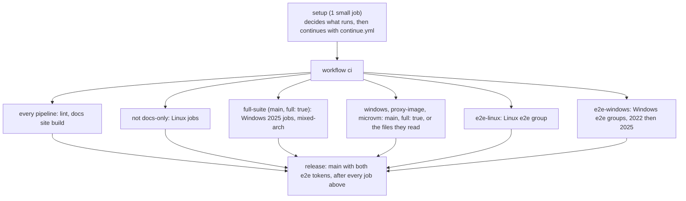

# CI/CD for this repository

The pipeline lints everything, tests the Linux and Windows Swarm stacks, and proves with real
CircleCI jobs that every job runs in a fresh container, whether the runner is hosted by a
Swarm service on Linux or on Windows. It publishes one image, the token proxy, from `main` only, and makes
the signed releases ([Releasing](releasing.md)). Scan reports and logs are kept as job artifacts.

- Setup config: [`.circleci/config.yml`](../.circleci/config.yml)
- Pipeline: [`.circleci/continue.yml`](../.circleci/continue.yml)
- E2E helpers and their simulation: [`ci/`](../ci)
- Lint settings: `.hadolint.yaml`, `.yamllint.yaml`, `.shellcheckrc`,
  `PSScriptAnalyzerSettings.psd1`, `.trivyignore`, `lychee.toml` (repository root)

## What is tested

This section is the short answer for users and reviewers. The pipeline sections below give the details. A claim in the user documentation that this section does not support is an overclaim, so report it.

### Tested

| Area | What is checked | How |
|---|---|---|
| Stack files | Every file parses, merges and interpolates, and each service keeps the contract: secrets, mounts, placement, limits, capabilities. Every Swarm config is named after the content of its file | `lint-stack`, `ci/config-names.sh`, `linux/tests/stack-config.sh` and `windows/tests/Stack.Tests.ps1`, with no Swarm |
| Install on Linux | `setup.sh` checks the node and starts Swarm twice, and the second run changes nothing. The shipped stack is deployed, and its `runner-distributor` installs the runner that the stack pins (the newest release that CI tests) from the real manifest with nothing installed by hand. The volume is root-owned and has the record of the binary, and the runner runs in a stock `cimg/base` | `linux-setup` on a fresh VM, and `linux-arm64` for the same on Arm |
| Clean environment | A new container for every job and no residue from the job before. A negative control shows that a plain restart reuses the container | `ephemerality.sh`, `Test-Ephemerality.ps1`, and real CircleCI jobs in the e2e on Linux and on Windows 2022 and 2025 |
| Step-down and the token | The default class keeps sudo and sudo can read the runner's config file. The hardened class has no sudo, and a setuid binary cannot lift the job, because of `setpriv --no-new-privs`. The token is in no environment or command line | `token.sh`, `task.sh` (the real runner binary against a fake API) and the e2e probes with real jobs |
| Token proxy | Each class claims with its own token and no other call carries one (a start with no state asks the scale call, and nothing else). No class token is in a runner container, as root, in files, environments and command lines. One claim for each container, 403 for a second claim and for a container that is not a runner, a restarted proxy refuses only the runners that claimed, and the proxy runs from its image, hardened, healthy through the healthcheck of the image, and logs no token | `proxy-test` (Go unit tests, with a fake API that answers the scale call) and `proxy.sh` (the real runner, the real stack file and the image built from `proxy/`, against a fake API that checks the class tokens) |
| Token proxy failover | A proxy that starts with no state for a class (a first start, a lost state, no state directory, a class that is new to the state) calls `GET /api/v3/runner/scale` with the token of that class: no running task and the runners present may claim; running tasks, or no usable answer, and every runner present of that class is refused. The shapes of the answer, the retries, and a null or negative count that must not read as 0 | `proxy-test`, and the phases `order`, `lost`, `unknown` and `fresh` of `proxy.sh` |
| Token proxy image | The Linux image builds and runs for linux/amd64, arm64, ppc64le and s390x (QEMU), non-root with a read-only root and no capabilities, takes a token file and a state volume, and is healthy. The Windows image builds and runs the same way for ltsc2022 and ltsc2025. The publication (one Linux index, one manifest list with both Windows images tagged `sha-<12>`, `edge` by its own last job, the rule for an older commit, a missing part, the release tags and `X.Y.Z` that never moves) runs against a registry of its own. Pushing to Docker Hub is **not** tested in a pull request, and without the credentials it is skipped. The keyless signing and the check of its ref are rehearsed on a throwaway image in every pipeline | `proxy-image-linux`, `proxy-image-windows-ltsc2022` and `-ltsc2025`, `ci/tests/proxy-image.sh`, `signing-rehearsal` |
| Placement | A service stays pending until a node has its label. The docker-build node runs no other class | `placement.sh` and `Test-Placement.ps1`, in a one-node and a two-node Swarm on Linux |
| Runner distributor on Linux | The runners wait for the distributor and then exit 80, and start in the same container once it is released. A fresh node and a node that joins later get the runner by themselves. An upgrade under three busy jobs: the jobs finish on their version, and the runner service is not touched. A rollback needs no download. An exact pin never changes by itself and asks the manifest no more once installed. `3.1`, `3` and `current` follow the manifest with no redeploy (never another line or major), and pruning keeps 3 versions. A tampered binary makes new containers exit 80 and is repaired by itself, and a wrong SHA-256 installs nothing. CircleCI's real manifest works too | `distributor.sh`, with a local HTTP mirror in the test harness |
| Runner distributor on Windows | The distributor installs the pinned runner and portable Git from CircleCI's real manifest and the pinned GitHub downloads, with a record of the binary. Against a local mirror: a pin, the floating `3.1` and `3`, the arm64 file names, `current` by SHA-256, the major-version guard, a rollback with no network, a wrong SHA-256, pruning, a changed binary, and a running container that keeps its version and keeps Windows from removing it | `Test-Install.ps1` and `Test-Distributor.ps1` |
| Stop and runner drain | On Linux, SIGTERM lets a running job finish and the container exits 0. On Windows, a stock container is killed after about 5 seconds (the control), and an idle real runner drains | `drain.sh` (fake job) and `Test-StopHandling.ps1` |
| Persistent class | One container serves many jobs, and the named volume survives a recycle | `persistent.sh` and `Test-Persistent.ps1`, with a fake runner on Linux |
| Limits and network | `pids`, `ulimits`, capabilities, and reservations that leave replicas pending. Classes cannot reach each other, and replicas of one class can | `limits.sh` and `network.sh` |
| Bad configuration | The runner and the entrypoint exit 80 and do not loop hot | `exit80.sh` and `Test-Exit80.ps1` |
| Entrypoint | The unit tests on `cimg`, Alpine and UBI, including the wait for the runner, the check against its SHA-256 record, and the version that a container resolves once | `bats` in the Linux suite |
| MicroVM add-on | `microvm.yaml` merged with the main file. Jobs run in a Kata VM with their own kernel, DNS works through the forwarder, each VM downloads and verifies its own runner (no shared volume to write: a rewrite in one VM changes nothing for the next, a wrong SHA-256 exits 80), dockerd builds inside the VM, and the entrypoint exits 80 on runc | `linux/tests/microvm.sh`: skipped without `/dev/kvm`, run by the job `linux-microvm` on the Android machine image ([below](#linux-microvm)) |
| Workspaces and caches | A real workspace and cache round trip on Windows, including the Git `tar` | `ci/E2E-Storage.ps1` in the Windows e2e |
| Documentation | Markdown rules, relative links and anchors, and every Mermaid diagram. The documentation site builds, and its links and anchors resolve | `lint-markdown`, `lint-docs-links`, `lint-docs-mermaid`, `docs-site-build` |

### Not tested

| Gap | What it means |
|---|---|
| A real multi-host cluster, and a mixed Linux and Windows cluster | The Linux suite runs two Swarm nodes as containers on one VM, and every Windows test runs on one host |
| Overlay traffic between nodes | Only the isolation between classes on one Swarm is tested |
| `docker node update --availability drain` with a busy replica | The stop paths are tested, and the node-level command is not |
| A rolling update on Linux with a real runner in the middle of a job | The drain is tested with a fake job, and a real runner only while idle |
| The order of a rolling update with several busy replicas, a scale-down while jobs run, and `--update-parallelism` | Not exercised. `limits.sh` scales a service only to test reservations |
| Token rotation and the leaked-token procedure | The steps in [Operations](operations.md#rotate-a-runner-token) are documented, not run in CI |
| Manager loss, quorum, backup, restore, autolock and certificate rotation | Documented in [Operations](operations.md#run-the-cluster), not run in CI |
| A drain that lasts hours | The `stop_grace_period` of 5h5m is a setting, and no test waits for it |
| The persistent class with a real task agent | Linux and Windows run a fake or an idle runner |
| The docker-build add-on stack file with a real job | The Windows named pipe is never used by a test |
| Real jobs in a microVM, Kata on arm64 or on AMD CPUs, and clouds other than AWS | `microvm.sh` runs the real runner against a fake API on nested KVM on AWS (Intel). Checkout, caches and artifacts over virtiofs are not exercised |
| Real jobs on arm64 | The e2e group `e2e-linux-arm64` runs the same three probes on a real arm64 runner, which the distributor installed on an Arm VM. `linux-arm64` is the smoke test before it: the install by the distributor and the start of the stack |
| A mirror over `https` with a private certificate authority, and a download through a proxy | The distributor test serves its mirror over plain HTTP, and `linux-setup` downloads from the real bucket over `https` |
| RHEL and SELinux | The steps follow Docker's documentation |
| Rerun job with SSH (`ssh-rerun.yaml`) | CI checks that the files parse and merge and keep the contract, including the host-mode port 54782, `max_replicas_per_node: 1` and the advertise address. The Swarm side was proven by hand on a Linux Swarm with a real runner: the **Enable SSH** step runs, and the task agent answers on port 54782 of the node. No test logs in over SSH, and the Windows file is untested |
| Windows Server 2019, Hyper-V isolation, group managed service accounts, proxies, and `add_ssh_keys` | Not exercised, and the docs say so |
| `publish()` of the release job | It stops before publishing without `GITHUB_TOKEN`, so the first release is its first real run. The signing, the verification and the check of the ref in the certificate are not part of that gap: `signing-rehearsal` runs them in every pipeline on a throwaway image. The push to Docker Hub, the tags, the GitHub release and the `gh-pages` push are real only on `main` |

## Pipeline shape

There is one workflow, `ci`, and a small second one, `docs-site`, that publishes the documentation site on `main` ([Docs site](#docs-site)). Every job of both is listed in `.circleci/continue.yml`. The `setup` job passes eleven boolean parameters, and expression filters (`filters: pipeline.parameters.<name>`) switch jobs in and out, so a job that does not apply is never scheduled. The setup phase itself has three mutually exclusive workflows that run the same `setup` job: `setup-e2e` for `main` and `smr-swarm/*`, with the e2e context, `setup-plain` for every other branch, without any context, and `setup-scan` for the weekly scan, without any context either ([below](#when-things-run-and-the-setup-gate)).



| Runs when | Job | Executor | What it does |
|---|---|---|---|
| every pipeline | `lint-shell` | `koalaman/shellcheck-alpine:v0.11.0` | `shellcheck -S warning` on every `*.sh` file and every sh/bash shebang script |
| every pipeline | `lint-dockerfiles` | `hadolint/hadolint:v2.15.1-debian` | Linux, Windows and token proxy Dockerfiles. Warnings fail; only `docker.io`, `registry.access.redhat.com`, `mcr.microsoft.com` and `gcr.io` (distroless) are allowed in `FROM` |
| every pipeline | `lint-yaml` | `cimg/python:3.14.8` + yamllint 1.38.0 | `yamllint --strict .` |
| not docs-only | `proxy-test` | `golang:1.27.2` (by digest) | `gofmt`, `go vet` and `go test -race` on `proxy/`, then `ci/build-proxy.sh`: the static builds for linux amd64, arm64, ppc64le and s390x and windows amd64 and arm64 (the list of `ci/build-proxy.sh --list`), each checked for `CGO_ENABLED=0`, the right OS and architecture, and the version `sha-<12 characters of the commit>`. The windows/amd64 build goes on in the workspace to the Windows image jobs and the Windows e2e |
| `proxy-image`, and not `publish` | `proxy-image-linux` | `ubuntu-2604:2026.05.1` | The Linux image for four platforms with buildx and QEMU (`ci/proxy-image.sh test`: each image runs, non-root, read-only, healthy), then `ci/tests/proxy-image.sh` against a registry of its own. [The token proxy image](releasing.md#the-token-proxy-image) |
| `proxy-image` (2025: `full-suite`), and not `publish` | `proxy-image-windows-ltsc2022`, `proxy-image-windows-ltsc2025` | `windows-server-2022-gui:2026.05.1`, `windows-server-2025-gui:2026.05.1` | The Windows image on Nano Server for that tag (`ci/Build-ProxyImage.ps1 -Test`), run with a token file and a state directory |
| `publish` (main) | `proxy-image-linux-publish`, `proxy-image-windows-ltsc2022-publish`, `proxy-image-windows-ltsc2025-publish` | the same, context `scalable-machine-runner-dockerhub` | The same jobs in place of the plain ones, then the push of `sha-<12>-linux` and `sha-<12>-windows-<tag>`. Without the credentials: `NOT PUSHED`, and the job passes |
| `publish` (main) | `proxy-image-publish` | `cimg/base:2026.10`, small, context `scalable-machine-runner-dockerhub`, `serial-group` | The manifest list, tagged `sha-<12>` only, the signatures (checked for `refs/heads/main`), the check of every platform, and the [deploy](#deploys) of `token-proxy-image`. Skipped with a message without the credentials |
| `release` (main, both e2e tokens), optional for the release | `proxy-image-edge` | `cimg/base:2026.10`, small, context `scalable-machine-runner-dockerhub`, `serial-group` | The last job: after `proxy-image-publish`, `linux-swarm` and every e2e group it checks the signature of `sha-<12>` and tags it `edge` (`ci/proxy-image.sh edge`) |
| every pipeline | `lint-stack` | `docker:29.9.0-cli` | `docker stack config -c` on every file in `linux/stack` and `windows/stack` alone, on all files of each OS together (the optional files are add-on stack files), and on `windows/tests/stack.e2e.yaml`: the stack files must parse, merge and interpolate. `ci/config-names.sh` checks that every Swarm config is named after the content of its file: a Swarm config cannot change, so a changed file needs a new name, and `ci/config-names.sh --write` renames it. No daemon or Swarm needed |
| every pipeline | `lint-powershell` | `mcr.microsoft.com/powershell:7.5-ubuntu-24.04`, medium (the 5.1-compatibility analysis needs about 2.7 GB) | PSScriptAnalyzer 1.25.0 over `windows/` and `ci/` (errors and warnings fail), then `windows/tests/Invoke-UnitTests.ps1` on PowerShell 7: an ASCII check and the Pester 5.7.1 suites, including `Stack.Tests.ps1`, which keeps the stack files' invariants (no entrypoint script, the runner as the entrypoint, the secret target, Git's mount path, PATH, and that every named volume and secret is declared: `docker stack config` does not catch an undeclared volume, `docker stack deploy` fails with `undefined volume`). Pester runs without a terminal (it hangs under CircleCI's pseudo-terminal) |
| every pipeline | `lint-circleci` | `cimg/base:2026.10` + CircleCI CLI 1.4.0 | `circleci config validate` on both config files, `circleci config process` with every parameter on (`validate` alone does not compile the filtered jobs), the table test of the setup gate (`ci/tests/setup-gate.sh`), a compile of `config.yml` for a table of branches that proves only `main` and `smr-swarm/*` get the e2e context and the scan never does (`ci/tests/setup-config.sh`), the tests of `ci/changed-files.sh`, `ci/deploy-marker.sh`, `ci/tests/security-scan.sh` (an infra image that Trivy cannot scan fails the weekly scan; a report-only one does not), `ci/tests/signature-ref.sh`, `ci/tests/require-credentials.sh` and `ci/tests/bundle-links.sh` (the links of the release bundle), a check that every job of `ci` besides the lint jobs and `docs-site-build` is switched off by a docs-only change, and a check that the `release` job requires every other job (below) |
| every pipeline | `lint-markdown` | `davidanson/markdownlint-cli2:v0.18.1` | `.markdownlint-cli2.yaml` on every Markdown file; `docs/ci.md` with the same rules (the repository config ignores it) |
| every pipeline | `lint-docs-links` | `lycheeverse/lychee:0.24.2` | Relative links and `#heading` anchors in every Markdown file, offline (external URLs are not fetched: the job is fast and never flaky) |
| every pipeline | `lint-docs-mermaid` | `minlag/mermaid-cli:12.0.1`, medium | Renders every `mermaid` block in every Markdown file; a syntax error fails the job |
| every pipeline | `docs-site-build` | `cimg/go:1.27.2`, small, no context | The documentation site ([below](#docs-site)): `site/stage.sh`, `hugo --minify --panicOnWarning` and `site/check.sh` (lychee offline on the built site). The site is stored as the artifact `docs-site.tgz`, and a [preview](#docs-site-previews) as the artifacts `docs-site-preview` |
| a pull request (`pull-request`), optional for the release | `docs-site-comment` | `cimg/base:2026.10`, small, context `scalable-machine-runner-pr-comments` | Posts or updates one comment with the address of the preview on the pull request (`site/preview-comment.sh`). The only job with the context that can comment on a pull request |
| not docs-only | `signing-rehearsal` | `cimg/base:2026.10` and `registry:2` (by digest), small, no context | `ci/proxy-image.sh rehearse`: signs a throwaway image in the local registry with the OIDC token of the job (no context needed), verifies it with the function that `main` uses, for the ref `refs/heads/<branch>`, and checks that the signature is refused for another ref. The signing of `main` is rehearsed in every pipeline ([The signing rehearsal](releasing.md#the-signing-rehearsal)) |
| not docs-only | `e2e-simulation` | `ubuntu-2604:2026.05.1` | `ci/tests/e2e-sim.sh`: the Linux e2e host and probe scripts against a fake runner in `docker:dind` (below) |
| not docs-only | `linux-swarm` | `ubuntu-2604:2026.05.1`, xlarge (two test nodes share the VM) | `linux/tests/run-all.sh`: stack validation (with the config names), the setup helper, ephemerality with a negative control, exit 80, token readability, real runner tasks through the step-down (`task.sh`), placement, persistent mode, draining, network isolation, limits, the runner distributor (a node with no install, a joining node, an upgrade under load, a rollback, `current` following the manifest, the major-version guard, pruning, a tampered binary, a wrong SHA-256, and CircleCI's real manifest) and the entrypoint unit tests. The distributor downloads from a local HTTP mirror of the harness. Everything runs in a single-node and a two-node Swarm inside privileged `docker:dind` containers: the CI VM's own engine never becomes a Swarm node for these |
| not docs-only | `linux-image-example` | `ubuntu-2604:2026.05.1` | Builds `linux/images/example`, checks that the tools it adds run, then Trivy (below) |
| not docs-only | `linux-setup` | `ubuntu-2604:2026.05.1` | `ci/linux-smoke.sh`: `linux/setup.sh` and the shipped stack end to end on a fresh VM with no real token, with the distributor installing the runner (below) |
| `microvm` | `linux-microvm` | `android:current`, `large.gen2` (the only CircleCI image with `/dev/kvm`) | `linux/tests/microvm.sh` with `SWARM_TEST_REQUIRE_KVM=1`: the microVM add-on on two Docker-in-Docker nodes with Kata. It downloads Kata 4.2.0 (about 1 GB, SHA-256 verified). [Details](#linux-microvm) |
| not docs-only | `linux-arm64` | `ubuntu-2604:2026.05.1`, `arm.medium` | The same script on an Arm VM: the arm64 runner installed by the distributor runs unmodified in a stock `cimg/base` through the volume, and the shipped stack starts |
| `full-suite`, optional | `linux-mixed-arch` | `ubuntu-2604:2026.05.1`, xlarge | `linux/tests/mixed-arch.sh`: the shipped stack on an amd64 manager and an arm64 worker emulated by QEMU (the script registers the `qemu-aarch64` binfmt handler in the VM). Each node installs the runner of its own architecture and verifies that architecture's tarball SHA-256, and classes constrained by `node.platform.arch` stay on their architecture. A last phase runs the distributor script alone in a stock Alpine under QEMU for `ppc64le` and `s390x`, the other architectures of CircleCI's manifest: it installs the runner of that architecture. The token proxy image of those architectures is run under emulation by `proxy-image-linux`. About 2 minutes on an 8-core machine. It is not in the `requires` of the release (the release check of `lint-circleci` names it as optional): make it a requirement once it has been green for a while. A skip counts as a failure in this job |
| `windows` | `windows-swarm-ltsc2022` | `windows-server-2022-gui:2026.05.1`, windows.medium | The stock-image path on Windows (below) |
| `full-suite` | `windows-swarm-ltsc2025` | `windows-server-2025-gui:2026.05.1` | The same on Server 2025 |
| `e2e-linux` | `e2e-linux-host`, `e2e-linux-b1`, `-b2`, `-b3` | host: `ubuntu-2604:2026.05.1`; probes: `cci-labs/scalable-machine-runner-e2e-linux` | Real runner e2e (below) |
| `e2e-linux-arm64` | `e2e-linux-arm64-host`, `e2e-linux-arm64-b1`, `-b2`, `-b3` | host: `ubuntu-2604:2026.05.1`, `arm.medium`; probes: the same class | The same e2e with the arm64 runner. It uses the class and the token of `e2e-linux` and runs after it in the same serial group. Every probe records `uname -m`, and the host requires it to equal its own `aarch64` |
| `e2e-windows` | `e2e-windows-2022-host` and `-b1`, `-b2`, `-b3`; then the same for 2025 | host: `windows-server-2022-gui:2026.05.1` / `windows-server-2025-gui:2026.05.1`; probes: `cci-labs/scalable-machine-runner-e2e-windows` | Real runner e2e (below) |
| `release` | `release` | `cimg/base:2026.10`, contexts `scalable-machine-runner-release` and `scalable-machine-runner-dockerhub` | The release (below), with the digest of the token proxy image of its commit, and its release tags. It requires every job above except the optional `linux-mixed-arch` |
| `main` only, workflow `docs-site` | `docs-site-publish` | `cimg/go:1.27.2`, small, context `scalable-machine-runner-docs`, `serial-group` | The same build, then `site/publish.sh` pushes the site to the `gh-pages` branch, and the publication is recorded as a [deploy](#deploys). The release does not wait for it ([below](#docs-site)) |
| scheduled, workflow `security-scan` | `security-scan-images`, `security-scan-go` | `ubuntu-2604:2026.05.1`; `golang:1.27.2`, small | The weekly [security scan](#security-scan). Never part of the `ci` workflow |

**Test results.** `lint-powershell` and `windows-swarm` (Pester 5, `OutputFormat = 'JUnitXml'` in `windows/tests/Invoke-UnitTests.ps1`) and `proxy-test` (`go test` through [gotestsum](https://github.com/gotestyourself/gotestsum), `--junitfile`) store JUnit XML with `store_test_results`, also when a test fails, so CircleCI's Test Insights shows the tests, their timing and the flaky ones, and a rerun can start from the failed tests. The shell tests print `CHECK` and `RESULT` lines and produce no XML.

**Executor images.** These were checked against the CircleCI docs on 2026-10-12:

- `ubuntu-2604:2026.05.1` is the newest Linux machine image and also the one that the Arm resource classes (`arm.medium`) offer.
- Windows containers run on the Windows machine images through Docker Engine.
- `windows-server-2025-gui` is the newest Windows image.

Process isolation needs the container's OS build to match the host. That is why the 2022 jobs use `ltsc2022` images and the 2025 jobs `ltsc2025`.

## Facts about the CI machines that the design depends on

These were measured on 2026-10-12 and shaped the scripts. Check them first when something Swarm-related breaks in CI.

| Fact | Consequence |
|---|---|
| Linux machine image `ubuntu-2604:2026.05.1`: Docker 29.4.2 with the containerd image store (`overlayfs` snapshotter), on x86_64 and on arm64 | The writable layer is `upperdir=/var/lib/containerd/io.containerd.snapshotter.v1.overlayfs/snapshots/N/fs`; the probes hash it |
| A service with `hostname: "{{.Node.Hostname}}-<service>-{{.Task.Slot}}"` (the shipped Linux stack) gives every container of a slot the same hostname | Probes cannot use the hostname. They read the full container ID from `/proc/self/mountinfo` (Docker bind-mounts `/etc/hostname` from `/var/lib/docker/containers/<ID>/`) and compare the writable-layer hash. The host maps the container ID to the Nth `start` event of the service |
| `docker events` prints an empty `exitCode` for `start` events | The event format uses `{{or (index .Actor.Attributes "exitCode") "-"}}`, or the columns shift |
| Windows machine images (Server 2022 build 20348, Server 2025 build 26100): Docker 29.4.0, default isolation `process` | Containers share the host kernel; the node must carry `machine-runner-swarm.windows-<tag>=true` for the stack's placement constraint (a Server 2025 node carries both `windows-ltsc2022` and `windows-ltsc2025`) |
| `docker swarm init` on a Windows machine image fails with `could not find the system's IP address - specify one with --advertise-addr` | Pass `--advertise-addr` with the IPv4 address of the `Ethernet` adapter (the `vEthernet (nat)` adapter has a 172.x address). The Windows jobs and the documentation do this |
| For a few seconds after `docker swarm init` on a Windows VM, outbound connections and DNS fail (`Unable to connect to the remote server`, `lookup mcr.microsoft.com: no such host`) | Every Windows job downloads and pulls first, and runs `docker swarm init` last |
| The CircleCI Windows image has `PsExec64.exe` on the host's PATH | The task agent would use a desktop wrapper if it were on the container's PATH. The host's PATH never reaches the containers: the stack sets theirs in full, `windows\Setup.ps1` ignores the host's PsExec, and an image build checks only the image's own PATH |
| In Windows PowerShell 5.1, piping a string to a native command appends CR LF | The Windows host writes the runner config with `[IO.File]::WriteAllText` into a file that exists only while `docker secret create` reads it |
| On Windows a Swarm secret is a file under `C:\ProgramData\Docker\secrets`, readable by `Administrators` and `SYSTEM` only; jobs run as `ContainerAdministrator` | A job can read the runner config, so the token, on Windows. The probe records this instead of asserting a protection. The token is not in the job environment: the runner reads it from the config file |
| `docker stop` and `docker service update` end a stock Server Core container about 5 seconds after the shutdown event (HCS waits only `WaitToKillServiceTimeout`; exit code `3221225786`, `0xC000013A`), whatever it is running | Every Windows service runs the stock image, and no image is built. `Test-StopHandling.ps1` measures the rule (an informational `NOTE control` line: the job is killed after a stop), and the e2e no longer stops a busy container. A job that finishes ends its container cleanly, which is what the e2e checks. The DIY image that lifts the limit is in [Stop a busy Windows container](operations.md#stop-a-busy-windows-container) and is not tested here |
| Pulling `mcr.microsoft.com/windows/servercore:ltsc2022` (about 2.2 GB compressed) onto a fresh Windows VM takes about 10 minutes | Every Windows job pays it, in a step of its own with `no_output_timeout: 30m`; it is most of the cost (below) |
| A Windows host runs images of its own release and older ones: a 2025 host also runs `ltsc2022` images, a 2022 host cannot run `ltsc2025` images (`0xc0370101`), and nested virtualisation is not available, so only process isolation works | The Windows jobs pick the image tag from the host's build number (20348: `ltsc2022`, 26100: `ltsc2025`) |
| The Android machine image (`android:current`) supports nested virtualization (documented), and no other CircleCI image does: the Windows hosts and the other Linux images have no `/dev/kvm` and no Hyper-V isolation | Only `linux-microvm` runs on it. A `microvm.sh` that finds no `/dev/kvm` skips locally and fails there (`SWARM_TEST_REQUIRE_KVM=1`) |
| A CircleCI step shell starts with SIGHUP ignored | Nothing here relies on SIGHUP |

## When things run, and the setup gate

| Branch or trigger | Setup workflow | Parameters set by `setup` | Jobs |
|---|---|---|---|
| any branch other than the two below | `setup-plain`, no context | `windows`, `proxy-image` and `microvm` for the changed files that each suite reads ([below](#the-heavy-suites)) | the `every pipeline` and `not docs-only` rows, and those suites |
| the same, with the pipeline parameter `full: true` (API call or a schedule) | `setup-plain`, no context | `full-suite`, and the three heavy suites | adds the Server 2025 jobs, `linux-mixed-arch` and every heavy suite. Never e2e, never release |
| `smr-swarm/*` | `setup-e2e`, with the e2e context | the heavy suites for the changed files, as on any branch; `e2e-linux` and `e2e-windows` for the tokens that are present | the e2e groups. The Server 2025 jobs and `linux-mixed-arch` do not run here |
| `main` | `setup-e2e`, with the e2e context | `full-suite`, `windows`, `proxy-image`, `microvm` | adds the Server 2025 jobs, `linux-mixed-arch` and every heavy suite |
| `main` with `E2E_RUNNER_TOKEN_LINUX` present | `setup-e2e` | adds `e2e-linux` | adds the Linux e2e group |
| `main` with `E2E_RUNNER_TOKEN_WINDOWS` present | `setup-e2e` | adds `e2e-windows` | adds the Windows e2e groups |
| `main` with both tokens | `setup-e2e` | adds `release` and `strict` | adds the `release` job and `proxy-image-edge`, and a missing publishing credential fails ([below](#publishing-fails-closed-on-main)) |
| `main` (with or without the tokens) | `setup-e2e` | adds `publish` | swaps the token proxy image jobs for their publish variants, with the Docker Hub context, and adds `proxy-image-publish` |
| any of the above, when the push changes documentation only ([below](#documentation-only-changes)) | the same workflow | `docs-only`, and `full-suite`, the heavy suites, `e2e-*`, `publish` and `release` off (`strict` stays) | the lint jobs and `docs-site-build` only |
| the schedule of the [security scan](#security-scan) | `setup-scan`, no context | `security-scan` | the workflow `security-scan` only |
| a tag | none runs a job | nothing | nothing: the setup job has no tag filter, so CircleCI runs no job for the tag |

The two setup workflows for pushes are exclusive: `setup-e2e` has `when` the branch is `main` or starts with `smr-swarm/`, and `setup-plain` has `when` it is not. The `setup` job of `setup-e2e` has the `scalable-machine-runner-e2e` context attached, which holds the runner tokens, and the job of `setup-plain` has no context at all, so the tokens exist in no job of any other branch. A job of another branch could otherwise name the e2e runner class and read the token of the runner that claims it. The e2e jobs are added to the pipeline only when the context's job sees a non-empty `E2E_RUNNER_TOKEN_LINUX` or `E2E_RUNNER_TOKEN_WINDOWS`. Without the context or its secrets the pipeline still runs lint, builds and the local tests, and stays green. The third workflow, `setup-scan`, runs only when the pipeline parameter `security-scan` is `true`, on whatever branch the schedule names, and the other two do not run then: the scan never has the e2e context, not even on `main`.

The decision lives in [`ci/setup-gate.sh`](../ci/setup-gate.sh), which the `setup` job calls with `--e2e true` (the job with the context) or `--e2e false` (the plain job, which never enables e2e, whatever its environment holds) and the `full` parameter. Two tests keep it honest, both in `lint-circleci`:

- `ci/tests/setup-gate.sh` is a table of branches, contexts, parameters and tokens, and the parameters the gate must print. It needs only bash and jq.
- `ci/tests/setup-config.sh` compiles `.circleci/config.yml` with `circleci config process` for a table of branch names and checks that exactly one setup workflow is left, that the e2e context appears only for `main` and `smr-swarm/*`, and that every other branch gets a job without a context and with `--e2e false`.

### The heavy suites

Three suites cost most of a pipeline, and a change to the shell scripts of Linux or to a README does not need them. The setup gate switches them on from the files that the push changes (`ci/changed-files.sh`):

| Parameter | Jobs | Runs on `main` and with `full: true`, and on any other branch when a changed path is |
|---|---|---|
| `windows` | `windows-swarm-ltsc2022` | `windows/`, `ci/`, `.circleci/` or `PSScriptAnalyzerSettings.psd1` |
| `proxy-image` | `proxy-image-linux`, `proxy-image-windows-ltsc2022` | `proxy/`, `ci/`, `.circleci/` or `windows/tests/` |
| `microvm` | `linux-microvm` | `linux/stack/`, `linux/tests/`, `docs/microvm.md`, `ci/` or `.circleci/` |

`ci/` and `.circleci/` are in every row: they hold the scripts and the jobs of all the suites. When the changed files are not known (the first build of a branch, a pipeline started through the API), every suite runs, as for [documentation-only changes](#documentation-only-changes). `full-suite` is for `main` and `full: true` only: the Windows Server 2025 jobs (`windows-swarm-ltsc2025`, `proxy-image-windows-ltsc2025`) and `linux-mixed-arch`. A branch such as `smr-swarm/*` gets neither. `ci/tests/setup-gate.sh` has the table of paths and the answers that the gate must print.

To get everything on a branch, for example before a risky merge, start a pipeline for it with the parameter `full: true`. A schedule that sets `full: true` on `main` or on a branch gives a nightly full run. Neither runs the e2e or the release job: only `main` does.

### Publishing fails closed on main

A missing publishing credential must not leave `main` green with nothing published. The setup gate sets the pipeline parameter `strict` to `true` for `main` when both e2e tokens are present, which is the production project (the same condition as `release`, and a documentation-only change does not turn it off). The jobs that publish get it as `REQUIRE_CREDENTIALS=true`: `proxy-image-linux` and `proxy-image-windows` (the publish variants, in a first step, before the long build), `proxy-image-publish`, `proxy-image-edge`, `release` and `docs-site-publish`. When `DOCKERHUB_USERNAME`, `DOCKERHUB_TOKEN` or `GITHUB_TOKEN` is missing, renamed, emptied or kept from the job by a context restriction, the job fails with a message that names the context.

Everywhere else the publication is skipped with a message and the pipeline stays green, as before: a project that has not created the contexts yet, a fork of this repository, and any branch. `ci/tests/require-credentials.sh` tests both behaviors, and the table test of the gate has a row for `strict`.

### Documentation-only changes

A pull request that changes only documentation runs the lint jobs and the docs site build, and skips the builds, the Swarm tests, the Windows jobs, the e2e and the release. The setup job runs [`ci/changed-files.sh`](../ci/changed-files.sh) after `checkout`, and `ci/setup-gate.sh` decides from its answer. A change is documentation when every path is under `docs/` or `site/`, or is a Markdown file anywhere (`README.md`, `CHANGELOG.md`, `*.md`). The exception is `docs/microvm.md`: `linux/tests/microvm.sh` reads its Docker configuration from it, so a change to it runs everything.

- **Which commits.** On a branch: everything since the merge base with `origin/main`, so a push that holds only a docs commit still runs the full pipeline when an earlier commit of the same pull request changed code. On `main`: everything since the commit of the build that ran before (the pipeline value `pipeline.git.base_revision`), so a push of several commits is judged as a whole.
- **When it is not known, everything runs.** The first build of a branch, a pipeline started through the API, a base that the clone does not hold, a failed `git fetch` and an empty list all mean "not known". The pipeline parameter `full: true` also turns the shortcut off.
- **The release gate stays whole.** `docs-only` turns `release` off together with the e2e flags, because the release requires every job and those jobs do not run. That is safe because [`cliff.toml`](../cliff.toml) makes no release for a commit of the type `docs`, `test`, `ci`, `chore`, `style`, `refactor` or `build`. It does release for `fix(docs):`, `feat(docs):` and any breaking change (`docs!:` or a `BREAKING CHANGE:` footer), because the docs ship in the release bundle. So on `main` the gate asks `ci/changed-files.sh --releasable` (it reads the skip pattern from `cliff.toml`): when a commit of the push would make a release, `docs-only` stays `false` and the whole pipeline runs, with the release. The answer errs towards a release. A `docs:` push that the release job would have ended as `Nothing to release` is the only one that loses a job.
- **Publishing continues.** The workflow `docs-site` is not affected: a docs change on `main` is published and recorded as a deploy.
- **Required checks.** GitHub gets one status for each workflow, not one for each job, and a docs-only pipeline still ends the workflow `ci` green. Require the status of the workflow `ci` and nothing else ([A ruleset for main](#a-ruleset-for-main)).

`ci/tests/setup-gate.sh` has the table of rows (paths, branch, releasable, full), and `ci/tests/changed-files.sh` runs the script on throwaway repositories: a push of several commits, a base that is not known, a shallow clone, and one commit of each type against `cliff.toml`. `lint-circleci` also checks that every job of `ci` that is not a lint job or `docs-site-build` has a filter that a docs-only change turns off.

A pipeline of `main` or `smr-swarm/*` that is started through the API, or an SSH rerun of such a job, is refused by the context restriction (below): its `setup` job fails with an authorization error. Start the full suite on another branch with `full: true` instead, or push a commit.

**Why the gate is in the setup phase.** A guard job that runs `circleci-agent step halt` is not enough on its own.

- The probe jobs target a self-hosted runner class. Once a pipeline schedules them, they queue until a runner claims them, and CircleCI keeps runner jobs queued for days.
- Halting a guard job ends only that job, so the probes would still be scheduled.

The decision therefore has to happen before the e2e jobs are compiled into the workflow. The setup job also calls the continuation API itself, rather than through the `circleci/continuation` orb, because the orb prints the request body, and with it the continuation key, into a public log.

## Linux jobs without a token

`linux-swarm` runs the Linux suite and needs no secret. `linux-setup` and `linux-arm64` run [`ci/linux-smoke.sh`](../ci/linux-smoke.sh) on a fresh VM:

1. `linux/setup.sh --check`, then `--swarm-init` twice (the second run must be a no-op).
2. The shipped stack is deployed by `setup.sh --deploy` with a made-up token (the runner gets 401 from CircleCI, which does not matter here). Nothing is installed by hand: the `runner-distributor` service downloads the pinned release of CircleCI from CircleCI's real manifest, and the job waits for its link `current`. The volume `runner-bin` is root-owned and not writable by others, its record `SHA256` equals the hash of the binary, and `/opt/machine-runner-swarm` does not exist on the host. The runner reports its version unmodified inside a stock `cimg/base` through `-v runners_runner-bin:/opt/machine-runner-swarm:ro`, the container's architecture equals the host's, the runner binary is built for it (`file`), and `circleci-runner-entrypoint` with a config file but no runner name exits 80.
3. Inside the running `linux-default` and `linux-hardened` containers:
   - the runner runs as `circleci-runner`;
   - the container mounts only the placeholder config, the job user cannot read `/run/secrets/circleci_runner_config.yaml`, nor any other user's process environment;
   - `linux-default` keeps sudo, and sudo can read the placeholder config (the class token is in the token proxy, which this test stops);
   - `linux-hardened` has no sudo at all.

`linux-image-example` builds the bring-your-own-image example and scans it. **Trivy policy:**

- The SBOM (CycloneDX) and the HIGH/CRITICAL reports of the image are artifacts: `reports/sbom-example.cdx.json`, `reports/trivy-example.{json,txt}`.
- The gate fails on a fixable CRITICAL finding that the image **adds on top of `cimg/base`** (the same scan of the base image is subtracted). The base is upstream: it bundles Docker, Compose and yq with their own findings, and those stay visible in the reports. What this repository owns is what it puts on top, the example's packages. The runner is not in the image.
- Exceptions go in `.trivyignore`, one CVE per line, with a reason, an owner and an `exp:` date. Trivy stops honouring an entry after that date. An exception is only for findings that this repository cannot fix.

### linux-microvm

`linux-microvm` runs `linux/tests/microvm.sh` on the Android machine image, because it is the only CircleCI machine image with nested virtualization. The job loads `vhost_vsock` and `vhost_net`, installs `zstd`, and runs the script with `SWARM_TEST_REQUIRE_KVM=1`, so a missing `/dev/kvm` fails the job instead of skipping the test. The script downloads the pinned Kata release and checks its SHA-256, starts a runc manager and a Kata worker in Docker-in-Docker containers, and deploys the real `runners.yaml` and `microvm.yaml` with the real entrypoint, the real runner against a fake API, and a fake runner. Refer to [MicroVM jobs](microvm.md#what-is-tested) for the checks.

The job passes on CircleCI: the Android image has `/dev/kvm`, `/dev/vhost-vsock`, and a Docker that runs privileged containers, and the job was green in each of the first three pipelines that ran it, so it is in the `release` requirements like every job of the workflow. Run the same script locally on any host with KVM; it skips without `/dev/kvm`.

## Windows jobs

`windows-swarm` runs on the stock Server Core image. There is no entrypoint script: the runner (`circleci-runner.exe machine --config C:\ProgramData\Docker\secrets\circleci_runner_config.yaml`) is the container's main process, and the runner and portable Git come from the read-only mounts `C:\machine-runner-swarm` and `C:\Program Files\Git` of the volume `runner-bin`, which the distributor of the stack fills. The steps are:

1. Engine check: `docker info` must report `OSType windows`.
2. Windows PowerShell 5.1 unit tests (`Invoke-UnitTests.ps1`, Pester 5.7.1; the image registers both a `Nuget` and a `PSGallery` repository, so modules are installed with `-Repository PSGallery`).
3. `docker pull` of the stock image, then `windows\Setup.ps1 -InitSwarm -AdvertiseAddr <ip>` (docker swarm init and the `machine-runner-swarm.windows-ltsc*` node labels). Pulling comes first because the network is down for a few seconds after the swarm is created. Then `Test-Install.ps1` deploys the shipped stack with no runner replicas, so that the distributor installs the runner and Git from the real manifest, and checks what it installed. The volume stays for the tests that follow.
4. The Windows tests, each printing `CHECK` lines and a `RESULT` line: `Test-Injection.ps1 -Online`, `Test-Ephemerality.ps1`, `Test-Exit80.ps1`, `Test-Placement.ps1`, `Test-StopHandling.ps1 -Online` (stock Server Core is killed 5 s after a stop, the control, an idle real runner drains on a stop, a Swarm secret is read), `Test-Persistent.ps1`, and `Test-Distributor.ps1` (the distributor against a local mirror of fake releases). `ci\Invoke-Test.ps1` runs each in a child PowerShell and keeps its complete output as an ASCII report under `reports/` (artifacts). `Tee-Object` would write UTF-16 and would miss what a script writes with `[Console]::Out`.

The bring-your-own-image example `windows/images/example` (stock Server Core plus Node.js, pinned with a SHA-256) is built in the same job and runs `node`, `npm` and `git` with the runner and Git mounted and the `PATH` of `custom-image.yaml`.

### What a Windows pass looks like

Every Windows test prints `CHECK <name> PASS|FAIL <detail>` lines and one `RESULT ...` line, and exits 0 only on a pass. A CircleCI PowerShell step does not stop on a failed native command by itself, so `ci\Invoke-Test.ps1` checks the exit code of each test. The `CHECK` details in the reports are the evidence.

| Test | Final line (shape) | What it proves |
|---|---|---|
| `Test-Injection.ps1` | `RESULT injection mode=injected ... verdict=PASS` | OS build, the runner and Git mounts (read-only), toolchain (`bash`, GNU `tar`, administrator, symlink privilege), `tar-agent-style` (the flags and forward-slash operands of the task agent), long paths, the default PATH, exit 80, the config file, and with `-Online` a real start of the runner with a bogus token. `NOTE` lines record the exit code of a missing config file (1) |
| `Test-Ephemerality.ps1` | `RESULT mode=restart-policy jobs=3 distinct_containers=1 jobs_with_residue=2`, then `RESULT mode=swarm jobs=3 distinct_containers=3 jobs_with_residue=0` | The negative control (a plain `docker --restart` reuses the container and sees residue) and a stack with `restart_policy: any` (a new container each time) |
| `Test-Exit80.ps1` | `RESULT exit80 ... swarm_exits=<2..8> window=60s delay=10s verdict=PASS` | Exit 80 for a missing name, token or an invalid name, and no hot loop under Swarm (about 70 s) |
| `Test-Placement.ps1` | `RESULT placement ... host_tag=ltsc2022 verdict=PASS` | Constrained services stay pending until the node has the label (about 2 to 4 min) |
| `Test-StopHandling.ps1 -Online` | `RESULT stop ... job_seconds=40 verdict=PASS` | The real runner drains on `docker stop` and exits 0, and a Swarm secret is read as the runner config. A `NOTE control` line shows that a busy stock container is KILLED by a stop (`job_finished=False`, exit 3221225786, about 6 s) |
| `Test-Install.ps1` | `RESULT install checks=7 failed=0 stack=runners verdict=PASS` | The distributor of the shipped stack installs the release that the stack pins, which the real manifest lists, with the SHA-256 record, the two relative links, and Git, and the stock mounts run `circleci-runner.exe`, `git`, `bash` and GNU `tar` and are read-only (the first download takes minutes) |
| `Test-Distributor.ps1` | `RESULT distributor checks=<n> failed=0 verdict=PASS` | The script in a Server Core container against a mirror read through `file://` URLs: a pin, the record, `3.1` and `3` as the newest of their line, the arm64 file names, `current` resolved by SHA-256, the major-version guard, a rollback with the mirror gone, a wrong SHA-256 and a list that holds the right one, pruning to 3, a changed binary replaced, and a container that keeps its version while `current` moves and keeps its version directory from removal |
| `Test-Persistent.ps1` | `RESULT persistent ... verdict=PASS` | Continuous mode: one long-lived container, and a named volume that survives its replacement (about 2 min) |

### Windows tests: where to look first

| Symptom | Likely cause | What to do |
|---|---|---|
| `Test-Install.ps1` fails at `distributor` | The distributor could not download or unpack, or its post-install of Git warned | The report prints the log of the service: look for `cannot download`, `SHA-256 mismatch`, `7zr.exe exited` and `Git post-install` lines |
| `docker run` fails creating a mount (`invalid mount config` or `cannot access path`) | The engine refuses a subpath that is a junction or an absolute link, or the link `current` does not exist yet | The links are relative directory symbolic links, which the distributor creates; for the Git destination under `C:\Program Files`, the task agent needs Git at exactly that path, so check the engine version |
| `toolchain` fails: `bash` or `git` not found | The stack's `PATH` is wrong for this image | The detail prints the container's `PATH`; compare it with `path-default`, and fix the PATH string in `runners.yaml` and `stack.e2e.yaml` |
| `toolchain` fails: no `SeCreateSymbolicLinkPrivilege`, or `symlink_made=False` | The container user is not an administrator | The stock Server Core default is `ContainerAdministrator`; check that no `user:` is set |
| `path-default` lists lost entries | The image's own PATH has directories that the stack's string lacks (for example on Server 2025) | Add them to the `PATH` strings in `runners.yaml` and `stack.e2e.yaml` |
| `online` hangs and times out | The task-agent download failed (egress to `circleci-binary-releases.s3.amazonaws.com`), or the symlink was refused | Container logs (printed): look for `A required privilege is not held by the client` |
| `stop-real-runner` fails: not drained, exit not 0 | The shutdown event does not reach the Go runtime | The printed log tail of the container |
| `Test-Placement` `*-pending` fails with `state='Running'` | The label or OS constraint was not evaluated as expected | `docker node inspect self --format '{{json .Spec.Labels}}'` |
| `swarm` deploy fails creating a network | HNS or overlay problems on a single-NIC VM | `docker network ls`, delete a leftover `transparent` network, retry |

## E2E: a runner hosted inside a CircleCI job

Both e2e groups follow one pattern. Job A (the host, a cloud VM with the context attached) installs the stack and hosts the runner as a Swarm service for the resource class `cci-labs/scalable-machine-runner-e2e-<os>`. The probe jobs (B) are ordinary jobs on that class, without the context. B1 leaves residue, B2 is scheduled after B1 and must find a different container and none of the residue. A verifies independently of the probes, from `docker events`, and prints the verdict.

### Linux

```text
e2e-linux (job group, serial-group <project slug>/e2e-linux)
  e2e-linux-host (A)  ci/e2e-host.sh prepare | run | cleanup | sweep
  e2e-linux-b1 (B1)   service linux-default
  e2e-linux-b2 (B2)   service linux-default, requires B1; holds 75 s while the host restarts the token proxy
  e2e-linux-b3 (B3)   service linux-hardened, requires B2
e2e-linux-arm64 (job group, the same serial-group, requires e2e-linux)
  e2e-linux-arm64-host and -b1, -b2, -b3: the same on arm.medium
```

**Host.**

1. `prepare` is `sudo linux/setup.sh --swarm-init` (a manager, where the token proxy runs with no label), the documented path: the shipped `runner-distributor` runs in the stack and installs the runner. It also builds the token proxy image of the checkout (`docker build proxy/`) on the VM, which is the only node, because this job has no registry: `run` deploys the shipped stack with `MACHINE_RUNNER_SWARM_PROXY_IMAGE` set to it.
2. `run` creates the two secrets `linux-default-token` and `linux-hardened-token` from `E2E_RUNNER_TOKEN_LINUX` through `setup.sh --secret`, and the placeholder `runner-placeholder-token` that the runners read. The token proxy mounts the two class secrets, so the real token reaches the real API only through it. Each secret is a runner config file (`api.auth_token`), the target is `circleci_runner_config.yaml`, owned by uid 2000 with mode 0400. The token travels on stdin, never in a file or on a command line. The stack's other secret gets a placeholder.
3. It deploys the **shipped** `linux/stack/runners.yaml` (the optional classes live in `docker-build.yaml` and `persistent.yaml` and are not deployed) with a generated override that gives the active service one replica of a digest-pinned stock `cimg/base`, a 5 minute idle timeout, and a bind mount for the evidence directory; every other runner service gets zero replicas. The `runner-distributor` stays as shipped and installs the pinned release of CircleCI from the real manifest, and the runner service waits up to 10 minutes for it. The runner and the entrypoint come through the stack's own read-only volume `runner-bin` and the Swarm config of the entrypoint.
4. Phase 1 is `linux-default` (the job user keeps sudo) for B1 and B2. While B2 holds its job (the probe sleeps 75 s first), the host restarts the token proxy, and B2 must pass: this runs the real runner and the real task agent through a proxy restart against the real API, and the restart must restore the runner that claimed (the start line says `state restored` and `1 runner(s) have claimed` for the class). When B2 reports, the host removes the stack at once, so that its replacement container cannot claim the next probe. Phase 2 is `linux-hardened` (`MACHINE_RUNNER_SWARM_JOB_SUDO=false`) for B3. Both services use the same class token, so only one is deployed at a time.

**Probes** (`ci/e2e-probe.sh`):

- The first step checks that `/e2e-evidence/host` names this workflow: a probe claimed by a stray runner fails there.
- Residue: B1 plants files in `$HOME`, `/tmp`, `/var/tmp` and (with sudo) `/etc`; every probe fails if it finds an earlier probe's files.
- Identity: the container ID (from `/proc/self/mountinfo`) and the writable layer hash must differ from the previous probe's. The step-down is checked too: the job runs as `circleci` (the image's user), the runner as `circleci-runner`, the entrypoint logged `stepdown=sudo` for the default service and `stepdown=setpriv no_new_privs=yes` for the hardened one, and `sudo -n true` works in the default service only. This is the first real check of jobs through the `sudo -niHu circleci --` prefix and through the `setpriv --no-new-privs` prefix of the hardened class.
- Token readability, recorded in the evidence and printed in the verdict. As the job user, without and with sudo, it tries to read `/run/secrets/circleci_runner_config.yaml` (only byte counts are kept, never the content), it counts other users' `/proc/PID/environ` that it can read, and it checks the job environment, every process's command line and, through sudo, the runner's environment for the token's variable and key names (names only, never values). The token must be in none of them. A read without sudo must fail in both services. In the hardened service sudo must be unusable and the token unreadable with it; in the default service the sudo outcome is recorded and not asserted, because root can read the token.
- Each probe's last step writes `passed` or `failed` to `/e2e-evidence/<probe>.<workflow>.status`, so the host stops at once on a failed probe.

**Verdict** (`ci/e2e-host.sh`). It requires:

- three containers with distinct IDs and exit code 0, each the one that Swarm started for its probe (the container ID in the evidence equals the Nth `start` event of that service);
- distinct writable layers, and `residue=[]` for every probe;
- the entrypoint's step-down in the runner log, `sudo` for the default class and `setpriv` with `no_new_privs=yes` for the hardened class, job user `circleci` and runner user `circleci-runner` in every probe;
- B3 without working sudo, and no probe able to read the token without sudo.

It prints, for example:

```text
RESULT e2e=linux probes=3 distinct_containers=3 b2_residue=[] job_user=circleci runner_user=circleci-runner stepdown=hardened:setpriv,default:sudo token_in_job_env=absent token_on_command_line=absent token_default_nosudo=denied token_default_sudo=readable runner_env_via_sudo_default=no token_hardened_nosudo=denied token_hardened_sudo=no-sudo hardened_sudo_works=no verdict=PASS
```

### Windows

```text
e2e-windows-2022 (job group, serial-group <project slug>/e2e-windows)
  e2e-windows-2022-host (A), -b1, -b2, -b3
e2e-windows-2025 (the same group on Server 2025, requires e2e-windows-2022)
```

The host (`ci/E2E-Host.ps1`) follows the same shape, with one service and three probes:

1. `Prepare` pulls the stock image, runs `windows\Setup.ps1 -InitSwarm -AdvertiseAddr` (docker swarm init and the node label), and then deploys the shipped stack with no runner replicas until its distributor has installed the runner and Git from the real manifest. It removes the stack again; the volume stays. See the facts above for the order.
2. `Run` takes the shipped `windows/stack/runners.yaml` as text, replaces `ltsc2022` with the host's tag (`ltsc2025` on Server 2025), layers an override on it (one replica of `windows-default` on the stock image, an idle timeout, the evidence mount). `runners.yaml` holds only `windows-default`: the optional classes are the add-on stack files `persistent.yaml`, `custom-image.yaml` and `docker-build.yaml`, and the e2e deploys none of them, and deploys it with `--resolve-image never` (the image is local).
3. The Swarm secret `windows-default-token` is the runner config file (`api:` with `auth_token: <token>` under it), built from `E2E_RUNNER_TOKEN_WINDOWS`, and only the token proxy mounts it; the runner reads `runner-placeholder-token`. The windows/amd64 proxy of `proxy-test` is installed by the distributor from a local mirror (`C:\e2e-proxy`, a bind mount).
4. Each probe's `MACHINE_RUNNER_SWARM_INSTANCE_ID` must equal the Swarm task ID of the container that Swarm started for it (the stack sets the variable to `{{.Task.ID}}`), and the computer name must be that container's ID. The host stops its `docker events` and `docker service logs` followers before it exits: a child started with `-NoNewWindow` keeps the step's console open, and the step would hang until its `no_output_timeout`.
5. The probes plant residue in the user profile, `%TEMP%`, `C:\ProgramData`, `C:\Users\Public`, the registry (`HKLM:\SOFTWARE\SwarmE2E`) and the machine environment (`SWARM_TEST_E2E`). Windows has no step-down: the runner and the jobs are the same account, so the probe records, and does not assert, whether the job can read the token.
6. **Normal flow only.** Every probe's job finishes by itself, and every container exits **0** after its job. The e2e does not stop a busy container: on stock Server Core that kills the job after about 5 seconds, which `Test-StopHandling.ps1` measures and [Stop a busy Windows container](operations.md#stop-a-busy-windows-container) explains.
7. **Workspace and cache, with real jobs** (`ci/E2E-Storage.ps1`). B1 creates a file tree (a text file, directories `tmp` and `test-results`, `t.txt`, a symbolic link) and a cache file, records their SHA-256 sums outside the workspace, and runs `persist_to_workspace` and `save_cache`. B2 runs `attach_workspace` and `restore_cache` and compares every sum; the link must arrive as a link or a copy with the same content. The host prints `workspace=ok cache=ok symlink=...` and which tar the agent used (`use_go_tar`: when `false`, the workspace goes through Git's `tar.exe` and `gzip` in the container, the path that the stack's Git mount exists for).

**Not covered by the e2e.** The persistent (continuous) class runs only in `Test-Persistent.ps1` and `linux/tests`, without real jobs. The e2e stack leaves `hostname:` unset on Windows: a fixed hostname would make `COMPUTERNAME` identical across the containers of a slot and defeat the probes (and a Windows computer name is limited to 15 characters).

### Stray claims, timeouts and cleanup

- **Dedicated resource classes.** Nothing else targets the two e2e classes.
- **Serial groups.** Host and probes form one job group with a `serial-group` per project, so two pipelines never run e2e runners at the same time. Both Windows groups share one key, because they share a resource class and token. A group that the filter removes takes its lock jobs with it, and its host and probes are skipped too: they depend only on the lock, and CircleCI does not run a job whose requirements are all filtered out.
- **Evidence and identity.** A probe that was not claimed by this workflow's host fails at its first step. A host whose container exits without the expected probe's evidence fails at once (the runner idled out, or ran a job that is not ours).
- **Timeouts.** Each runner has `idle_timeout` 5m (every claim happens within seconds, so waiting longer only delays a failure) and `max_run_time` 10m on Linux and 15m on Windows. The host fails after 40 minutes. Steps have `no_output_timeout`. A 401 from the runner API fails the host within seconds; the fix is to rotate the token.
- **Cleanup** always runs: the stack and secrets are removed and the VM leaves the swarm.
- **A cancel removes the stack.** Cancelling an e2e workflow releases the serial-group lock at once, and the idle Swarm service of the cancelled host would claim the B1 of the next pipeline, which fails by design. So the host removes its stack when it is terminated: `ci/e2e-host.sh run` traps SIGTERM and SIGINT and runs `docker stack rm` (`ci/tests/e2e-sim.sh` has a scenario, `terminated`). `ci/E2E-Host.ps1 -Mode Run` does the same when PowerShell exits without having ended the run itself (an engine event on `PowerShell.Exiting`, with a file `run-ended` that every exit the script chooses writes first, so that a failed run keeps its stack for the logs that `Cleanup` reads). Windows has no SIGTERM, and a kill that PowerShell cannot see leaves nothing to run, so there the rule is a rerun. **Turn "Auto-cancel redundant workflows" off** (below), because on a branch that is not the default one every new push cancels the running workflow, and the idle service of the cancelled host is what makes rapid pushes red.
- **Sweep after a failure.** If the host fails while a probe may still be queued, it runs a throwaway runner (the pinned official `circleci/runner-agent` image on Linux; the SHA-256-verified `circleci-runner.exe` on Windows) for up to 2 minutes so that the probe is claimed and fails fast instead of holding the serial-group lock. If that cannot help (the token was rejected), cancel the workflow in the UI; no API token is kept in the context, so CI cannot cancel workflows itself.

### Secrets and public logs

The project is public, so job logs and artifacts are public.

- The runner tokens live only in the `scalable-machine-runner-e2e` context, and only the `setup` job of the `setup-e2e` workflow and the host jobs attach it. Its restrictions are this project and an expression that allows only the branches that may use it, an SSH rerun excluded, and a pipeline started through the API excluded:

  ```text
  (pipeline.git.branch == "main" or pipeline.git.branch starts-with "smr-swarm/") and not job.ssh.enabled and not (pipeline.config_source starts-with "api")
  ```

  A restriction of the context is a setting of the CircleCI organization, and the config file cannot change it, so a maintainer sets it. With the CLI, where `<org>` is the organization slug and `<project-id>` is `7bbdbb66-6ba8-4f6c-982e-d4fb401ec257`:

  ```bash
  circleci context restriction create scalable-machine-runner-e2e --org <org> --type project --value <project-id>
  circleci context restriction create scalable-machine-runner-e2e --org <org> --type expression \
    --value '(pipeline.git.branch == "main" or pipeline.git.branch starts-with "smr-swarm/") and not job.ssh.enabled and not (pipeline.config_source starts-with "api")'
  ```

  The expression is the second line of defence: the `when` of the setup workflows already keeps the context out of every other branch, and the restriction keeps an API pipeline (which can name any branch and, where the organization allows it, bring its own config) from using it. In the organization's advanced settings, leave pipelines with an unversioned config off.
- **Project settings.** The project is connected through the GitHub OAuth integration, not the GitHub App. Its slug is `gh/CircleCI-Labs/scalable-machine-runner`, not `circleci/<org-id>/<project-id>`. The settings **Build forked pull requests** and **Pass secrets to builds from forked pull requests** (Project Settings, Advanced) exist for OAuth projects, and both must be **off**: a fork pull request would otherwise run its own `.circleci/config.yml` on this project. Also turn on the setting that requires an administrator to change project settings, and turn off SSH reruns, if the organization offers them. **Auto-cancel redundant workflows must be off** (Project Settings, Advanced): with it on, every push to `smr-swarm/*` or to any branch that is not the default cancels the e2e workflow that is running, and the host of a cancelled workflow can leave a Swarm service that claims the next pipeline's job. The e2e workflows of two pushes then fail each other. With it off, the `serial-group` of each group lets one run at a time and the newer one waits.
- On Linux the token goes to `docker secret create` on stdin and is never on disk. On Windows it is in a file for the instant `docker secret create` reads it, outside the artifact directory. It is never printed.
- The probes never print their environment, and read the token only to count bytes.
- The context is attached only to `setup` and the host jobs. The probes are ordinary runner jobs.

## The e2e simulation

`ci/tests/e2e-sim.sh` runs `ci/e2e-host.sh` and `ci/e2e-probe.sh` in a privileged `docker:dind` container with a fake runner that runs the next queued probe as an unprivileged user and exits 0, as a single-task runner does. Swarm, the stack deploy, the restart policy, `docker events`, the secrets and the evidence handling are real. Three scenarios: pass, no job queued (the host must fail with "exited without evidence"), and a probe failure (the host must fail). It also checks that the token never reaches the output. The `e2e-simulation` job runs it in about 2 minutes; run it before changing the e2e scripts, so that a real e2e run is not spent on a typo.

## Running the checks locally

```sh
shellcheck -S warning ci/*.sh ci/tests/*.sh linux/setup.sh linux/stack/runner-distributor.sh linux/stack/circleci-runner-entrypoint
hadolint --config .hadolint.yaml linux/images/example/Dockerfile windows/images/servercore/Dockerfile
yamllint --strict .
docker stack config -c linux/stack/runners.yaml > /dev/null
ci/config-names.sh                   # every Swarm config is named after its file (--write renames the stale ones)
docker stack config -c windows/stack/runners.yaml > /dev/null
docker stack config -c windows/stack/custom-image.yaml > /dev/null
circleci config validate .circleci/config.yml && circleci config validate .circleci/continue.yml
ci/tests/setup-gate.sh               # the setup gate: which suites a branch gets
ci/tests/setup-config.sh             # only main and smr-swarm/* get the e2e context (compiles config.yml per branch)
ci/security-scan.sh refs             # the images that the weekly scan covers (the scan itself: Docker and network)
ci/tests/changed-files.sh            # the changed files and the release question of a push, on throwaway repositories
ci/tests/deploy-marker.sh            # the deploy markers, against a stub of the circleci command
ci/tests/security-scan.sh            # an infra image that Trivy cannot scan fails the weekly scan
ci/tests/signature-ref.sh            # the ref in the certificate of a signature (refs/heads/main)
ci/tests/require-credentials.sh      # a production main fails without its publishing credentials
ci/tests/bundle-links.sh             # the relative links of the release bundle that point at files it leaves out
circleci config process .circleci/continue.yml --pipeline-parameters '{full-suite: true, windows: true, proxy-image: true, microvm: true, e2e-linux: true, e2e-windows: true, release: true}' > /dev/null

site/stage.sh && (cd site && hugo --minify --panicOnWarning) && site/check.sh   # the docs site and its links (needs Hugo, Go and lychee)

ci/tests/e2e-sim.sh                  # the Linux e2e scripts against a fake runner (needs privileged Docker)
linux/tests/run-all.sh               # the Linux suite
```

PowerShell (in a container, if `pwsh` is not installed):

```sh
docker run --rm -v "$PWD:/w" -w /w mcr.microsoft.com/powershell:7.5-ubuntu-24.04 pwsh -c '
  Set-PSResourceRepository PSGallery -Trusted; Install-PSResource PSScriptAnalyzer -Version 1.25.0
  Invoke-ScriptAnalyzer -Path ci, windows -Recurse -Settings ./PSScriptAnalyzerSettings.psd1'
```

## Release

The `release` job is part of the `ci` workflow. On `main`, when both e2e tokens are present, the setup phase passes `release: true` together with `full-suite`, the three heavy suites, `e2e-linux` and `e2e-windows`, so every job that the release requires really runs. The job requires every other job of the workflow, and the release waits for every test. Pipelines of other branches never run it, and neither do tag pipelines (the release creates the tag; CircleCI schedules no job for a tag).

| Job | Executor | What it does |
|---|---|---|
| `release` | `cimg/base:2026.10`, contexts `scalable-machine-runner-release` and `scalable-machine-runner-dockerhub`, `serial-group` | `ci/release.sh`: the check of the Swarm config names, version, notes, the digest of the token proxy image pinned in the stack files, bundles, `SHA256SUMS`, keyless signature, the signature check and the release tags of the image, GitHub release. Without `GITHUB_TOKEN` or without the Docker Hub credentials it stops before publishing |

**Add a new job to `requires` of the release job.** `lint-circleci` fails when a job of the workflow is missing from it: it compiles the workflow and checks that every job that no other job requires is a requirement of the release (in the compiled workflow the release waits for one lock job, which requires them).
Refer to [Releasing](releasing.md) for the rules, the setup of the token, and how to recover from a failed release.

## Docs site

The documentation is also a site on GitHub Pages: <https://circleci-labs.github.io/scalable-machine-runner/>. CircleCI builds it with [Hugo](https://gohugo.io/) and the [Hextra](https://github.com/imfing/hextra) theme and pushes it to the `gh-pages` branch. No GitHub Actions workflow is involved. The Markdown of `README.md`, `docs/`, `CHANGELOG.md` and `CONTRIBUTING.md` stays the only source, and nothing in it is written for the site: `README.md` is the home page.

| Path | What it is |
|---|---|
| `site/hugo.yaml` | The Hugo configuration: `baseURL`, the menu, the "not officially supported" banner, search and Mermaid |
| `site/go.mod`, `site/go.sum` | Pin the Hextra module |
| `site/nav.txt` | The order, the groups and the sidebar labels of the pages |
| `site/stage.sh` | Copies the Markdown into `site/content/` (generated, not tracked) and leaves the sources unchanged |
| `site/check.sh` | lychee, offline, on the built site: links and heading anchors |
| `site/publish.sh` | Pushes the built site to `gh-pages` |
| `site/preview.sh` | Builds the pull request preview with relative URLs and prints its address |
| `site/preview-comment.sh` | Posts or updates one comment with that address on the pull request (optional) |

### Preview locally

Install Hugo extended 0.168.0 and Go (Hugo downloads the theme as a Go module), then run from the repository root:

```sh
site/stage.sh
cd site && hugo server
```

Run `site/stage.sh` again after you change a page. To run the check of the pipeline, add lychee and run `(cd site && hugo --minify --panicOnWarning) && site/check.sh`.

### What the staging script changes

`site/stage.sh` writes a copy of each page and never touches the sources. In the copy it:

- maps `page-title` to `title`, `page-description` to `description` and every other `page-*` key to `params`, and takes the first heading as the title of a page without front matter,
- removes the first level-one heading, because the theme prints the title,
- adds `weight` and the sidebar label from `site/nav.txt`,
- points a relative link to another page at that page, and turns a link to any other file or directory of the repository (`../examples/linux-hello.yml`, `../.circleci/continue.yml`, `../ci`) into a link to GitHub at the branch `main`,
- writes the `_index.md` file of every sidebar group and of the documentation root.

**Add every new, renamed or removed page to `site/nav.txt`.** The script fails on a `docs/*.md` file that the list misses and on a listed file that does not exist, so `docs-site-build` catches a page that would be missing from the sidebar. `STAGE_LENIENT=1` turns both errors into warnings while you restructure.

What Hextra does with the Markdown of this repository:

- GitHub alerts (`> [!NOTE]`, `[!TIP]`, `[!IMPORTANT]`, `[!WARNING]`, `[!CAUTION]`), tables, fenced code blocks inside lists, `{{ }}` and `<placeholder>` text in code, and Mermaid blocks render as on GitHub.
- A row of linked badge images, as in the README, shows one badge on each line and not side by side.
- A Mermaid block renders in the browser: without JavaScript the reader sees the diagram source.

### Jobs and why there are two

| Job | Workflow | When | What |
|---|---|---|---|
| `docs-site-build` | `ci` | every pipeline | Stage, `hugo --minify --panicOnWarning` and `site/check.sh`, then the [preview](#docs-site-previews). No context. The release requires it |
| `docs-site-comment` | `ci` | a push that has a pull request | The optional comment with the preview address, in a job of its own with the context that holds the token. The release does not wait for it |
| `docs-site-publish` | `docs-site` | `main` only | The same build steps, then `site/publish.sh`, and a [deploy marker](#deploys) |

`lint-circleci` fails when a job of `ci` that no other job requires is not a requirement of the release. A publication in `ci` would therefore make every release wait for it, and a failed publication would block a release. The publication is a job of its own workflow, `docs-site`, on `main`. It rebuilds the site with the same `docs-site` command and does not wait for the other tests, because the pages describe `main`. `serial-group` allows one publication at a time.

`site/publish.sh` replaces everything on `gh-pages` with `site/public`, adds `.nojekyll`, and commits only when something changed. The first run creates the branch without a parent. The commit message ends with `[skip ci]`, so the push starts no pipeline. The commit contains the bytes as built: the pages carry integrity hashes for their scripts, and the script switches off every line-ending conversion of git.

### Docs site previews

`docs-site-build` runs on every pipeline, so every branch and pull request gets a preview of its site, and writes its address into a workspace for `docs-site-comment`. The production build links to its pages under `/scalable-machine-runner/`, so it can work only at the GitHub Pages address. CircleCI serves the artifacts of a job from `https://output.circle-artifacts.com/output/job/<job id>/artifacts/<node>/<path>`, and the job id is new on every run. [`site/preview.sh`](../site/preview.sh) therefore builds a second copy, `site/public-preview`, that works from any address:

- Hugo builds it with relative URLs (a link from `docs/maintainers/ci.html` to the home page is `../../index.html`) and with `uglyURLs`, so that a page is a file (`ci.html`).
- The script then makes every relative link name a file: a server of artifacts does not serve the `index.html` of a directory, and the menu links to directories. It also rewrites the `url(/fonts/...)` of the inline style, and removes the `integrity` attributes: CircleCI sends script and style files to storage on another origin, and a browser refuses a script with an integrity hash from there.
- lychee then checks the links and the anchors of the preview with directory links turned off, and the script stops on a link that begins with a slash. The GitHub links of the pages point at the commit of the build, so a file that the pull request adds has a link that works.

The job stores the preview as the artifacts `docs-site-preview`, and prints and stores the address:

```text
Docs preview: https://output.circle-artifacts.com/output/job/<job id>/artifacts/0/docs-site-preview/index.html
```

The same line is in the file `docs-site/preview-url.txt` among the artifacts of the job. CircleCI has no job summary page, so the log line, that file and the **Artifacts** tab are the places to look. Who can open the link follows the visibility of the project on CircleCI, and the artifacts expire (30 days by default). Search and the Mermaid diagrams load files by absolute path and may not work from the artifacts. To see the exact site, download `docs-site.tgz` or run the commands of [Preview locally](#preview-locally).

**A comment on the pull request (optional).** `docs-site-build` has no context, so no token is in the environment of Hugo, lychee, the Go modules or the scripts of `site/`, and a pipeline that an API call starts (for example with `full: true`) is never refused for the restriction of a context that it does not use. A second job, `docs-site-comment`, holds the context `scalable-machine-runner-pr-comments`. It requires `docs-site-build`, takes the address from its workspace, and runs only for a push that has a pull request (the setup phase passes `pull-request: true` when `CIRCLE_PULL_REQUEST` is a GitHub pull request address). It is not a requirement of the release: `lint-circleci` lists it as optional. When the job has a `GITHUB_PR_COMMENT_TOKEN`, `site/preview-comment.sh` posts ONE comment with the address, and updates that comment on later pushes (it finds it by a hidden marker, and posts a new one only if the update fails). Without the token, without a pull request (CircleCI sets `CIRCLE_PULL_REQUEST` only when the branch has one at the time of the push), or when GitHub refuses a call, it skips the comment and the job stays green. It sends the token to `curl` on its standard input, so the token is in no command line and no log. `ci/tests/preview-comment.sh` tests all of this against a fake `curl`.

To turn the comment on, a maintainer does this once:

1. Create a fine-grained personal access token with the resource owner `CircleCI-Labs`, **only** this repository, and the repository permission **Pull requests: Read and write**, and nothing else.
2. Create the context `scalable-machine-runner-pr-comments` with the variable `GITHUB_PR_COMMENT_TOKEN`. The `docs-site-comment` job already names the context. Without the variable the job posts nothing.
3. Restrict the context to this project, and refuse SSH reruns:

   ```bash
   circleci context restriction create scalable-machine-runner-pr-comments --org <org> --type project --value <project-id>
   circleci context restriction create scalable-machine-runner-pr-comments --org <org> --type expression \
     --value 'not job.ssh.enabled and not (pipeline.config_source starts-with "api")'
   ```

   The context cannot be limited to one branch: pull requests come from branches of any name. So anyone who can push a branch to the repository can make a job print the token. That is why the token can only comment on pull requests and is not the release token. A pull request from a fork gets no secret ([Secrets and public logs](#secrets-and-public-logs)), so it gets no comment.

### GitHub Pages and the token

A maintainer does this once:

1. Create the context `scalable-machine-runner-docs` with the variable `GITHUB_TOKEN`: a fine-grained token for this repository only, with the repository permission **Contents: read and write** and nothing else. Without the variable the job builds and checks the site and publishes nothing, as the release does without its token.
2. Restrict the context like the e2e context ([Secrets and public logs](#secrets-and-public-logs)), to this project and to `main`:

   ```bash
   circleci context restriction create scalable-machine-runner-docs --org <org> --type project --value <project-id>
   circleci context restriction create scalable-machine-runner-docs --org <org> --type expression \
     --value 'pipeline.git.branch == "main" and not job.ssh.enabled and not (pipeline.config_source starts-with "api")'
   ```

3. After the first publication, open Settings, Pages, and set **Source** to **Deploy from a branch**, the branch to `gh-pages` and the folder to `/ (root)`. GitHub then deploys every push to that branch with its own managed `pages-build-deployment` run. There is no workflow file to maintain.

The site has its own context and not the release context. The release token can publish releases, and the docs job downloads and runs a theme, a Mermaid script and a Hugo binary at build time, so it gets only the token that it needs. If one token for both is wanted, attach `scalable-machine-runner-release` to `docs-site-publish` instead: that context holds a `GITHUB_TOKEN` that can write to the repository, and no other change is needed.

When the repository is renamed to `machine-runner-swarm`, the Pages address changes with it and GitHub does not redirect the old one. Change the two lines of `site/hugo.yaml` that name the repository (`baseURL` and the GitHub link of the menu). The publication follows the repository that the pipeline runs in.

## What a maintainer creates once

Nothing below is created by the repository. Without an item the pipeline still runs and stays green, and the part that needs it does nothing.

| What | Where | Needed for | Details |
|---|---|---|---|
| Context `scalable-machine-runner-e2e` | CircleCI organization | The e2e jobs on `main` and `smr-swarm/*` | [Secrets and public logs](#secrets-and-public-logs) |
| Context `scalable-machine-runner-release` | CircleCI organization | Publishing a GitHub release | [Enable publishing](releasing.md#enable-publishing) |
| Context `scalable-machine-runner-dockerhub` (created, **without values** until the maintainer adds them) | CircleCI organization | Pushing the token proxy image to Docker Hub, and a release | [The Docker Hub context](#the-docker-hub-context) |
| Context `scalable-machine-runner-docs` | CircleCI organization | Publishing the site to GitHub Pages, and Pages set to `gh-pages` | [GitHub Pages and the token](#github-pages-and-the-token) |
| Context `scalable-machine-runner-pr-comments` (optional) | CircleCI organization | The comment with the preview address on a pull request, by `docs-site-comment` | [Docs site previews](#docs-site-previews) |
| A schedule `weekly-security-scan` | The CircleCI project | The weekly security scan | [Create the schedule](#create-the-schedule) |
| A ruleset on `main`, and one on `smr-swarm/*` | The GitHub repository | A `main` that nobody can push to, and e2e tokens that a stranger's branch cannot reach | [A ruleset for main](#a-ruleset-for-main), [The e2e context and smr-swarm/*](#the-e2e-context-and-smr-swarm) |
| The project settings (auto-cancel off, no forked pull request builds) | The CircleCI project | Stable e2e runs, and no code of a fork on this project | [Secrets and public logs](#secrets-and-public-logs) |

The Renovate GitHub App is already installed on the organization, and [`renovate.json`](../renovate.json) is its configuration ([Pinned versions](#pinned-versions)). The deploys of the [Deploys](#deploys) section need nothing: CircleCI creates the components and the environments on the first deploy.

### A ruleset for main

A push to `main` publishes the token proxy image, makes a release and writes the `gh-pages` branch, and the context `scalable-machine-runner-docs` holds a token with **Contents: Read and write** on the whole repository, so a job of `main` could also push to `main` itself. Nothing in the repository protects `main`: a maintainer adds a branch ruleset (Settings, Rules, Rulesets, **New branch ruleset**, target: the default branch) with:

- **Require a pull request before merging**, with the number of reviews that you want. The release job never pushes a commit to `main`, so nobody and no job needs to.
- **Block force pushes** and **restrict deletions**.
- **No bypass list**, not even for administrators.
- **Require status checks to pass**, with ONE check: the status of the workflow `ci`. Do not require anything else:
  - GitHub gets one status for each workflow, not for each job. The workflows are `ci`, `docs-site`, the setup workflow of the branch (`setup-e2e` on `main` and `smr-swarm/*`, `setup-plain` elsewhere, `setup-scan`) and `security-scan`. A job name (`lint-shell`, `docs-site-build`, `linux-swarm`) is not a status, so a ruleset cannot require it.
  - The setup workflow has a different name on different branches, so requiring `setup-plain` would block every pull request from `smr-swarm/*`, and the other way round.
  - `ci` is on every pipeline, a docs-only one included, and it ends red when any job in it fails, so it stands for every lint and test job. Find the exact name of the status in a recent commit: `gh api repos/CircleCI-Labs/scalable-machine-runner/commits/main/status --jq '.statuses[].context'`.

### The e2e context and smr-swarm/*

The context `scalable-machine-runner-e2e` holds the runner tokens, and its restriction names `main` and every branch that starts with `smr-swarm/` ([Secrets and public logs](#secrets-and-public-logs)). The configuration of a job comes from its own branch, so anyone who can push a branch named `smr-swarm/anything` can change `.circleci/` in it, print the tokens in a public log, and read them. That is a deliberate trade for the time that the e2e work lives on a branch of its own, and it has an end:

1. **After the merge, rotate both runner tokens** (`circleci runner token create <class> --nickname ci-YYYYMM`, replace the secret in the context, delete the old token: [Troubleshooting](#troubleshooting)). Any token that a branch could read before is untrusted.
1. **Limit the context to `main`**, or to exact branch names: change the `when` of `setup-e2e` in `.circleci/config.yml`, the expression restriction of the context, `eligible` in `ci/setup-gate.sh` and the rows of `ci/tests/setup-gate.sh` and `ci/tests/setup-config.sh`.
1. **Restrict who can create the branches** with a second ruleset: target `smr-swarm/**`, **Restrict creations** and **Restrict updates**, and a bypass list of the maintainers only. A stranger's push then cannot create a branch that the context accepts. Until the context is limited to `main`, the ruleset is what keeps the tokens in the hands of the maintainers.

## Security scan

A weekly workflow, `security-scan`, looks for known vulnerabilities in what the repository pins. It is a workflow of its own in `.circleci/continue.yml`, started by a schedule trigger, and it never runs the `ci` workflow: no build, no e2e job and no release. It has no context, so it holds no secret.

| Job | Executor | What it does |
|---|---|---|
| `security-scan-images` | `ubuntu-2604:2026.05.1`, Docker | [`ci/security-scan.sh images`](../ci/security-scan.sh): Trivy on every image that the repository pins, in two lists: an infra image fails on a CRITICAL finding with a fix, and the other images are only reported. The script finds them in the files: every reference with a digest (`name:tag@sha256:...`: the CI jobs, the tests, the stack files) and the `image:` of every stack file, so the `cimg` classes, CoreDNS and `alpine:3.24` are in too. Trivy pulls each image from its registry (`--image-src remote`) and builds nothing |
| `security-scan-go` | `golang:1.27.2`, small | `ci/security-scan.sh go`: `govulncheck` on `proxy/` with the Go toolchain of the proxy builds. It fails on any vulnerability that the proxy calls (a standard library fix means a new Go release) |

- **Two lists of images.** [`ci/security-scan-images.txt`](../ci/security-scan-images.txt) is the one place that says how an image is treated, by repository name:
  - `infra`: what a stack runs as infrastructure on a user's cluster, today `alpine` (the distributor), `ccilabs/machine-runner-swarm-proxy` (the token proxy, the tag `edge` that the stack files name: until the first publication the scan reports that it cannot pull it) and `coredns/coredns` (the microVM DNS forwarder). A CRITICAL finding with a fix fails `security-scan-images`, and so does an infra image that Trivy cannot scan.
  - `report`: the job images that users choose (`cimg/*`, which the CircleCI image team maintains) and the images that only CI or a test uses (the linters, Hugo's `cimg/go`, lychee, Trivy, Docker-in-Docker, `busybox`, `binfmt`). Their HIGH and CRITICAL findings are listed and never fail the run.
  - `skip`: listed, not scanned (the Windows images).

  The images themselves still come from the files that pin them. **To add an image, choose its list**: add a line to `ci/security-scan-images.txt`. An image on no list fails the scan, and `lint-circleci` runs `ci/security-scan.sh lists` and fails the pull request that adds it, so the choice is made when the image is added.
- **What fails.** A CRITICAL finding that has a fixed version fails an infra image, and so does an infra image that Trivy cannot scan (the totals name how many are unscannable). The report-only images never fail, because most of them carry some HIGH or CRITICAL finding in any given week, from upstream packages and bundled Go binaries that this repository cannot patch. For every image the log has one line, the end of the log has the totals (`infra: 3 images, 0 failing (0 unscannable, … HIGH with a fix reported); report-only: 18 images, 107 CRITICAL and 2097 HIGH with a fix listed`), and the artifact `findings-<image>.txt` lists every HIGH and CRITICAL finding, CRITICAL first, with the installed and the fixed version (`-` when there is none yet). A finding with no fix yet is counted and never fails. `govulncheck` is stricter, because the proxy is code that we own: any vulnerability that the proxy calls fails `security-scan-go`, with a fix or not. The script also stops when its Go is not the Go that builds the proxy (`ci/build-proxy.sh` and `ci/release.sh` must name the same version as the job image), so the scan reads what is released.
- **What to do about a failure.** The log ends with the answer: bump the digest (a Renovate pull request does it, [Pinned versions](#pinned-versions)), or add a justified `.trivyignore` entry (the CVE, the reason, an owner and an expiry date: the policy is in that file). An ignore entry also applies to the `trivy` command of `linux-image-example`, which reads the same file. Read the tables of the report-only images at your own pace: they are the list of what the next Renovate pull requests, and the next `cimg` tag, should clear.
- **Windows images.** `mcr.microsoft.com/windows/servercore` is listed and skipped. Trivy finds no operating system in a Windows image when it runs on Linux (it returns an empty, clean report), so the scan would claim a result that it does not have. Follow the Microsoft container release notes for Server Core.
- **Reports.** The job stores `trivy-<image>.json` and `findings-<image>.txt` for every image, `govulncheck-proxy.json`, and the summary of each command as artifacts (`reports/`).

The existing `trivy` command of `linux-image-example` is a different check: it gates the image that this repository builds, against its base.

### Create the schedule

The workflow runs when the pipeline parameter `security-scan` is `true`. Nothing in the repository creates the schedule: a maintainer does this once, with a token or in the web app. Use the branch `main`, so the scan reads the pins of `main`. The schedule below runs every Monday at 06:00 UTC, after Renovate has opened its pull requests (it runs before 06:00 UTC on Monday).

**In the web app.** Open the project, **Project Settings**, **Project Setup** (or **Triggers**). Next to the pipeline, select **Schedule +** and fill in the form:

| Field | Value |
|---|---|
| Name | `weekly-security-scan` |
| Branch | `main` |
| Pipeline attribution | The scheduling system |
| Parameters | `security-scan` = `true` |
| Repeats | Weekly, on Monday |
| Start time (UTC) | 06 |
| Times per hour | 1 |

Enable the trigger and save.

**With the API.** The CircleCI CLI has no command for schedules. Create a personal API token, keep it in `CIRCLECI_TOKEN` (never in a file of the repository, and never printed), and run:

```bash
curl --request POST "https://circleci.com/api/v2/project/gh/CircleCI-Labs/scalable-machine-runner/schedule" \
  --header "circle-token: ${CIRCLECI_TOKEN}" \
  --header "Content-Type: application/json" \
  --data '{
    "name": "weekly-security-scan",
    "description": "Trivy on every pinned image and govulncheck on the proxy (docs/ci.md, Security scan)",
    "attribution-actor": "system",
    "parameters": {"branch": "main", "security-scan": true},
    "timetable": {"per-hour": 1, "hours-of-day": [6], "days-of-week": ["MON"]}
  }'
```

To try it once before the first Monday, start a pipeline with the same parameter. Use the branch of the pull request to try a change, or `main` afterwards:

```bash
curl --request POST "https://circleci.com/api/v2/project/gh/CircleCI-Labs/scalable-machine-runner/pipeline" \
  --header "circle-token: ${CIRCLECI_TOKEN}" \
  --header "Content-Type: application/json" \
  --data '{"branch": "main", "parameters": {"security-scan": true}}'
```

The pipeline shows the workflow `security-scan` and the jobs `security-scan-images` and `security-scan-go` (and the `setup` job of the workflow `setup-scan`). With the scheduling system as the actor, CircleCI sends no failure e-mail to a person. To hear about a failed scan, add the project to the CircleCI Slack app (**Project Settings**, **Notifications**) or set `attribution-actor` to `current` so that the actor of the token gets the e-mail. To stop the scan, disable or delete the schedule in the same place.

### The Docker Hub context

The context `scalable-machine-runner-dockerhub` holds two variables for the publication of the token proxy image ([The token proxy image](releasing.md#the-token-proxy-image)):

| Variable | Value |
|---|---|
| `DOCKERHUB_USERNAME` | The Docker Hub user (or organization service account) that may push to `ccilabs/machine-runner-swarm-proxy` |
| `DOCKERHUB_TOKEN` | An access token of that user with the permission to read and write that repository. Never the password |

Restrict the context to this project and to `main`, like the other contexts, so that no other branch, no rerun with SSH and no pipeline started through the API can read the token. Anyone who can push a branch could otherwise add the context to a job of that branch, print the token, and push a malicious image under the tag that the stack files name. Two restrictions, where `<org>` is the organization slug and `<project-id>` is `7bbdbb66-6ba8-4f6c-982e-d4fb401ec257`:

```console
circleci context restriction create scalable-machine-runner-dockerhub --org <org> --type project --value <project-id>
circleci context restriction create scalable-machine-runner-dockerhub --org <org> --type expression \
  --value 'pipeline.git.branch == "main" and not job.ssh.enabled and not (pipeline.config_source starts-with "api")'
```

The flag is `--value` (not `--restriction-value`), and the first command is needed: an expression alone does not tie the context to this project. The live context of this repository has both restrictions already (the maintainers created them with these commands). The CLI cannot list restrictions. Check them in the web app (Organization Settings, then Contexts, then the context), or with the API: `curl --header "circle-token: ${CIRCLECI_TOKEN}" https://circleci.com/api/v2/context/<context-id>/restrictions` (the id is in the output of `circleci context list --org <org>`). It must show one `project` and one `expression` restriction.

Only jobs that run on `main` carry the context (the publish variants of the image jobs, `proxy-image-publish`, `proxy-image-edge` and `release`), and the setup phase never attaches it. **Until both values exist, a pipeline that is not the production `main` pushes nothing and stays green:** the image jobs build and test, then print `NOT PUSHED` with the reason, and the release builds its bundle but does not create the release. On the production `main` (both e2e tokens present) the missing values fail those jobs ([Publishing fails closed on main](#publishing-fails-closed-on-main)).

## Deploys

The pipeline records its deployments in the Deploys view of CircleCI (**Deploys** in the web app), with deploy markers: `circleci run release plan` creates the deploy as pending, and `circleci run release update` moves it to `RUNNING` and then to `SUCCESS` or `FAILED`.

| Deploy | Job | Component | Environment | Version |
|---|---|---|---|---|
| A GitHub release | `release` | `machine-runner-swarm` | `github-releases` | The release tag, for example `v0.2.0` |
| The docs site | `docs-site-publish` | `docs-site` | `github-pages` | The commit SHA |
| The token proxy image of a commit | `proxy-image-publish` | `token-proxy-image` | `docker-hub` | `sha-<12 characters of the commit>` |
| The release tags of the image | `release` | `token-proxy-image` | `docker-hub` | The release number, `X.Y.Z` |

CircleCI creates the components and the environments on the first deploy: nobody sets them up. [`ci/deploy-marker.sh`](../ci/deploy-marker.sh) makes the calls, and [`ci/tests/deploy-marker.sh`](../ci/tests/deploy-marker.sh) tests it in `lint-circleci` against a stub of the `circleci` command.

- **Only a real deploy is recorded.** The release job plans its deploy after it has the version, and only when it will publish (`GITHUB_TOKEN` is set). `Nothing to release` and a run without the token record nothing. The docs job records a deploy only with `GITHUB_TOKEN` as well, because without it nothing is published, and the image jobs record theirs only with the Docker Hub credentials.
- **Failure.** The release script gives the deploy the status `FAILED`, with the exit status as the reason, on every way out of the script: a failed check, a failed signature, a failed `gh` call. A failed or canceled deploy gives the live version back to the last successful one in the Deploys view. The docs job does the same in a step with `when: on_fail`, with a link to the job as the reason.
- **Cancel.** A cancel that reaches `ci/release.sh` as a signal records `CANCELED`. The long step of `docs-site-publish` and of `proxy-image-publish` runs under `ci/deploy-marker.sh guard NAME COMMAND`, which stops the command on SIGTERM or SIGINT, gives the deploy `CANCELED` and exits 143. A canceled step runs no later step (not even one with `when: on_fail`), so without the guard the deploy would stay `RUNNING`. Whether CircleCI sends the signal to the step is the one thing that only a real cancel shows: the script and its test (`ci/tests/deploy-marker.sh`) cover the rest.
- **The plan comes after the build.** `docs-site-publish` builds the site first and plans its deploy afterwards, so a site that does not build is a failed job and not a `FAILED` deploy.
- **One job.** Plan and updates are steps of one job. A rerun from failed that starts a new job would break the link between them, and CircleCI refuses a second final status for a deploy.
- **A marker never fails a job.** If the task agent refuses a call (for example the organization has no Deploys), the script prints a warning and exits 0.

## Pinned versions

Every tool image is pinned by tag and digest, and every download by version and SHA-256 value. [Renovate](https://docs.renovatebot.com/), the GitHub App of the organization, keeps them current. [`renovate.json`](../renovate.json) is its whole configuration: the repository needs no workflow or token for it, and no GitHub Actions workflow is involved.

- **When.** Renovate opens pull requests on Monday before 06:00 UTC, at most six at a time. A major version waits for approval on the Dependency Dashboard (the issue that Renovate keeps).
- **Groups.** One pull request for each group: `CI images`, `stack images`, `proxy image bases`, `CI tools`, `Go toolchain`, `Windows distributor tools`, `lychee` (the image and the binary move together) and `docs site theme`.
- **Commit types.** A pull request that changes what users run (`stack images`, `proxy image bases`, `Go toolchain` for the proxy image, `Windows distributor tools`) is a `fix(deps)` commit, so the release job makes a release for it. `proxy image bases` is the base images of the token proxy image: the distroless base of `proxy/Dockerfile` and the Nano Server digests of `ci/Build-ProxyImage.ps1`. A new digest of a base would otherwise be `ci(deps)`, which [`cliff.toml`](../cliff.toml) skips, and the published image would keep stale base layers until an unrelated `feat` or `fix` lands. The CI-only groups are `ci(deps)` and the theme is `docs(deps)`: they make no release ([Releasing](releasing.md#versions)).
- **Digests.** Renovate pins every image that carries a digest, refreshes the digest of a tag, and moves the tag and the digest together. `cimg/base` and the e2e sweeper image `circleci/runner-agent` get a new digest but never a new tag: the tag is named in the stack files, the tests and the docs, or moves with the runner build, so a person changes it.

| Pin | Where | How Renovate finds it |
|---|---|---|
| Images with a digest | `.circleci/*.yml`, `linux/stack/*.yaml`, `windows/stack/*.yaml`, `ci/`, the tests, the docs | One regex manager for `name:tag@sha256:...` in any file |
| Hugo, lychee, the CircleCI CLI | `docs-site` command and `lint-circleci` in `.circleci/continue.yml` | A `# renovate:` comment above the version variable |
| git-cliff, cosign, crane, gh, Go, govulncheck | `ci/release.sh`, `ci/tools.sh` (cosign, crane), `ci/security-scan.sh` | The same comment |
| yamllint | `lint-yaml` | A regex for `yamllint==X` (PyPI) |
| Kata Containers | `KATA_VERSION` in `linux/tests/microvm.sh` | A regex (GitHub releases) |
| PortableGit, 7-Zip | `ReleaseTag` and `SevenZipVersion` in `windows/stack/runner-distributor.ps1` | A regex each (GitHub releases) |
| Node.js of the Windows example image | `NODE_VERSION` in `windows/images/example/Dockerfile`, kept on the 24 line | A regex (Node.js releases) |
| The Hextra theme | `site/go.mod`, `site/go.sum` | The `gomod` manager |
| The proxy module | `proxy/go.mod` | The `gomod` manager. It has no dependency today. The `go` directive is the oldest Go that can build it, so Renovate leaves it alone |

To pin a new tool, put its version in one variable and add the comment `# renovate: datasource=github-releases depName=<owner>/<repo> extractVersion=^v(?<version>.*)$` on the line above it. The comment is the whole configuration.

### A pull request that needs a checksum

Renovate cannot compute a SHA-256 value. For a tool that is pinned with one (Hugo, lychee, the CircleCI CLI, git-cliff, cosign, gh, Go, Kata, PortableGit, 7-Zip, Node.js), the pull request changes the version only, carries the label `checksum` and a note in its description, and its CI fails on the checksum. To finish it:

1. Take the new value from the checksums file of the release (the table in [Pinned tools](releasing.md#pinned-tools) names the file), or download the asset and run `sha256sum` on it.
2. Replace the old value next to the version, in the same branch, and push.
3. For PortableGit, also set `Version` (`X.Y.Z.N` for the tag `vX.Y.Z.windows.N`) and run `ci/config-names.sh --write`: the distributor is a Swarm config.
4. Update the version in the prose that names it (this table, [Releasing](releasing.md#pinned-tools), `docs/microvm.md` for Kata).

### Pins that stay by hand

Renovate does not touch these. Change the version and its checksum together, and run the check of the job that uses it.

- Images without a digest in the stack files (`coredns/coredns`, `alpine:3.24` of the token proxy, the `cimg` classes) and the Windows `servercore` tags: the tag is a choice for users, and Windows tags must match the host. The weekly [security scan](#security-scan) still scans them (not the Windows images).
- The Linux and Windows machine images (`executors` in `.circleci/continue.yml`): `ubuntu-2604:2026.05.1`, `windows-server-2022-gui:2026.05.1` and `windows-server-2025-gui:2026.05.1`. They use dated tags and not `current`, which CircleCI moves every three months: an image that changes under an unrelated pull request would turn it red. Renovate cannot update them. Every quarter, read the [image changelog](https://circleci.com/changelog/images/), move those three tags together, and start a pipeline for the branch with `full: true`.
- The Android machine image for `linux-microvm`: `android:current`. CircleCI publishes quarterly tags plus `current` (gen2) and `default` (gen1), not dated tags on the ubuntu cadence. Renovate cannot update it; bump it by hand when the [image changelog](https://circleci.com/changelog/images/) says to.
- PSScriptAnalyzer and Pester (`lint-powershell`, `windows-swarm`, `windows/tests/Invoke-UnitTests.ps1`).
- The Mermaid script of the site (`params.mermaid.base` in `site/hugo.yaml`): it must match the version that the `lint-docs-mermaid` image bundles.
- The runner build of the e2e sweeper: the image tag in `ci/e2e-host.sh` and the `circleci-runner.exe` URL and SHA-256 in `ci/E2E-Host.ps1` move together.

To bump one of them by hand:

1. Resolve the new digest with `docker buildx imagetools inspect <image>:<tag>`.
2. Update the tag and digest together.
3. Run `circleci config validate`.

The versions in use:

| What | Version | Where |
|---|---|---|
| shellcheck | 0.11.0 | `lint-shell` |
| hadolint | 2.15.1 | `lint-dockerfiles` |
| yamllint | 1.38.0 | `lint-yaml` |
| Docker CLI (`docker stack config`) | 29.9.0 | `lint-stack` |
| PowerShell / PSScriptAnalyzer / Pester | 7.5 / 1.25.0 / 5.7.1 | `lint-powershell`, `windows-swarm` |
| CircleCI CLI | 1.4.0 (SHA-256 checked) | `lint-circleci` |
| lychee | 0.24.2 | `lint-docs-links` (image), `docs-site` command (binary, SHA-256 checked) |
| Hugo (extended) | 0.168.0 (SHA-256 checked) | `docs-site` command |
| `cimg/go` (Go for the Hugo modules) | 1.27.2 by digest | `docs-site-build`, `docs-site-publish` |
| Hextra theme | v0.13.0 | `site/go.mod` and `site/go.sum` |
| Mermaid script of the site | 12.0.0, the version of the `lint-docs-mermaid` image | `params.mermaid.base` in `site/hugo.yaml` |
| markdownlint-cli2 | 0.18.1 | `lint-markdown` |
| Trivy | 0.75.0 | `trivy` command |
| gotestsum | 1.13.0 (installed with `go install`, checked by the Go checksum database) | `proxy-test` |
| git-cliff, cosign, crane, gh, Go (the release job; cosign and crane also in the image jobs) | 2.14.2, 3.1.3, 0.22.1, 2.102.0, 1.27.2, each SHA-256 checked | `ci/release.sh install-tools`, `ci/tools.sh` |
| BuildKit, QEMU installer, `registry:2` (the image jobs and their test) | `moby/buildkit:v0.33.1`, `tonistiigi/binfmt`, `registry:2`, by digest | `ci/proxy-image.sh`, `ci/tests/proxy-image.sh` |
| Nano Server bases of the Windows image | `ltsc2022` and `ltsc2025`, by digest | `ci/Build-ProxyImage.ps1` |
| The Go builder and the distroless base of the Linux image | `golang:1.27.2` and `gcr.io/distroless/static-debian13:nonroot`, by digest | `proxy/Dockerfile` |
| Go (`proxy-test`, the proxy builds of the tests) | 1.27.2 (`golang` image, pinned by digest) | `.circleci/continue.yml`, `ci/build-proxy.sh` |
| Stock Linux image of the e2e | `cimg/base:2026.10` by digest | `ci/e2e-host.sh`, `ci/linux-smoke.sh` |
| Image of the `runner-distributor` service | `alpine:3` by digest | `linux/stack/runners.yaml` |
| Docker-in-Docker for the simulation | `docker:29.9.0-dind` by digest | `ci/tests/e2e-sim.sh` |
| e2e sweeper | `circleci/runner-agent:machine-3.1.12-9831-dca4a16`, `circleci-runner.exe` 3.1.12 | `ci/e2e-host.sh`, `ci/E2E-Host.ps1` |

## Cost and duration

Measured on 2026-10-13 (pipeline `9aed4106`, a full run on `smr-swarm/ci`). Credits use the published per-minute rates (Windows medium 40, Linux xlarge 40, Linux medium and Arm medium 10, Docker small 5 and medium 10); the e2e probes run on the self-hosted classes and cost no compute credits.

| Job | Executor | Duration |
|---|---|---|
| `setup` and the small lint jobs | Docker small | 5 to 15 s each |
| `lint-powershell`, `lint-docs-mermaid` | Docker medium | 56 s, 50 s |
| `e2e-simulation` | Linux VM medium | 100 s |
| `linux-setup`, `linux-arm64` | Linux VM medium, Arm medium | 31 s, 29 s |
| `linux-image-example` | Linux VM medium | 96 s |
| `linux-swarm` (the whole Linux suite) | Linux VM xlarge | 7 min 14 s |
| `windows-swarm-ltsc2022` | Windows | 12 min 31 s |
| `windows-swarm-ltsc2025` | Windows | about 17 min |
| `e2e-linux-host` (B1, B2, B3: 2 s each on the runner) | Linux VM medium | about 1.5 min |
| `e2e-windows-2022-host`, `-2025-host` (B1, B2: 22 s each) | Windows | 7 min 30 s, 8 min |

| Pipeline | Credits (about) | Wall clock |
|---|---|---|
| Feature branch that changes a file that every heavy suite reads (the jobs of every pipeline, measured with both Windows jobs) | 1,500, of which the two Windows jobs are 1,200 | 18 min |
| The same branch now: the Server 2025 jobs run on `main` and with `full: true` only, and each heavy suite runs only for the files it reads ([The heavy suites](#the-heavy-suites)) | 1,500 minus about 700 for the 2025 job, and minus about 500 when no Windows file changes | 18 min |
| `main` (every job except `release`) | 3,800 | 25 min |

The measurements above predate the gating, and the second row is an estimate from them. Windows dominates the cost: every Windows job pulls the 2 GB Server Core image onto a fresh VM (about 5 to 10 minutes). A pull request that changes documentation only costs about 200 credits. The only schedule is the weekly [security scan](#security-scan), about 150 credits a run.

## Troubleshooting

| Symptom | Cause and fix |
|---|---|
| `e2e-*-b1` stays queued and the host job failed | The sweep could not claim it (the token was rejected, or Docker Hub was unreachable). Cancel the workflow in the UI; the serial-group lock is then released |
| Host fails with "token was rejected (401)" | Rotate the token: `circleci runner token create <class> --nickname ci-YYYYMM`, update the context secret, delete the old token |
| Host fails with "container for probe bN exited without evidence" | The runner idled out without claiming the probe, or claimed someone else's job on the e2e class. Check the probe job's status and `e2e/logs/service.log` (the runner output) in the artifacts |
| Probe fails "not claimed by the e2e host of workflow …" | A runner outside this workflow holds the e2e token, or the host's sweeper claimed the probe on purpose after a failure. A third cause: **cancelling** an e2e workflow releases the serial-group lock at once, but the cancelled host VM's idle Swarm service can live on for a few minutes and claim the next pipeline's B1, which fails here by design. The Linux host removes its stack when it is terminated, and a Windows host when PowerShell sees the end, so this should be rare. Check that **Auto-cancel redundant workflows** is off ([Secrets and public logs](#secrets-and-public-logs)), and rerun the workflow |
| The job fails and the runner log says `failed to remove working directory` or `could not clean up task`, with `permission denied` | Only if `CIRCLECI_RUNNER_CLEANUP_WORK_DIR` is `true` on a Linux service; the entrypoint and the stack files default it to `false`. See [Error: failed to remove working directory](troubleshooting.md#error-failed-to-remove-working-directory-permission-denied) |
| `Test-StopHandling.ps1` or the e2e fails with a container exit code of `3221225786` | A container that ran a job was ended about 5 seconds after a stop from outside. The e2e never stops a busy container, so look for something else that stopped the stack (a second pipeline, a cleanup that ran too early). Check `reports/stop-*.txt` |
| `Test-Injection.ps1` fails `tar-agent-style` | GNU tar from the mounted Git failed on the operands the task agent passes (forward slashes, `--force-local`, `MSYS=winsymlinks:nativestrict`). Read the check's detail in `reports/injection-*.txt`; the e2e's workspace round trip is the end-to-end proof |
| `setup` says an e2e group is skipped | The context is missing, or lacks the secret. The log says which token is absent. Only the `setup-e2e` workflow (`main` and `smr-swarm/*`) has the context at all |
| `setup` of `main` or `smr-swarm/*` fails with an authorization error | The context's expression restriction refused the pipeline: it was started through the API, or it is an SSH rerun. Push a commit, or rerun without SSH |
| A Windows step fails right after `docker swarm init` with `Unable to connect to the remote server` or `no such host` | The network drops for a few seconds after the swarm is created. Download and pull first |
| A Windows host step hangs instead of failing | A child process started with `-NoNewWindow` (`docker events`, `docker service logs`) keeps the step's console open. `E2E-Host.ps1` kills the child process trees on every failure path; keep that if it changes |
| A Windows step dies with `NativeCommandError` on a harmless warning | In Windows PowerShell 5.1 a native command's stderr redirected with `2>&1` under `$ErrorActionPreference = 'Stop'` is a terminating error. Run docker through `Invoke-Docker` in `E2E-Host.ps1` |
| Trivy fails with "no space left on device" | `/tmp` on the machine image is too small for a large image tarball plus Trivy's Java DB. The `trivy` command keeps both under `$HOME/trivy` |
| `lint-stack`, `linux-swarm` or the release job fails with `config machine-runner-swarm-... is stale` | A file that a Swarm config carries (the entrypoint or a distributor script) changed, and the name in the stack files did not. Run `ci/config-names.sh --write` and commit the new names. Refer to [Swarm config names](../CONTRIBUTING.md#swarm-config-names) |
| `lint-shell` fails with SC2154 on an uppercase variable | `.shellcheckrc` enables `check-unassigned-uppercase`. Assign the variable (`${NAME:-}`) or add a `# shellcheck disable=SC2154` with the reason |
