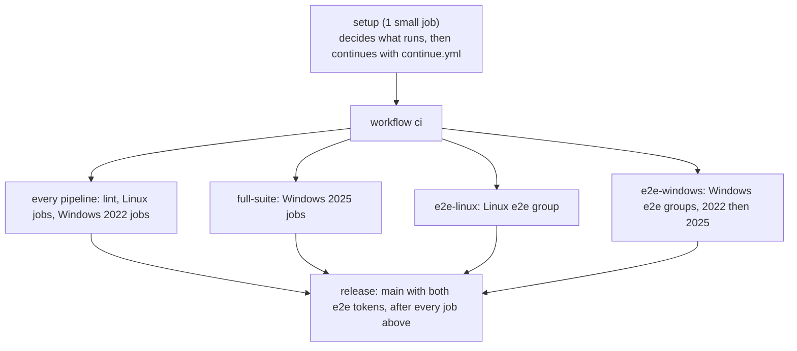

# CI/CD for this repository

The pipeline lints everything, tests the Linux and Windows Swarm stacks, and proves with real
CircleCI jobs that every job runs in a fresh container, whether the runner is hosted by a
Swarm service on Linux or on Windows. It never publishes images. Scan reports and logs are kept
as job artifacts.

- Setup config: [`.circleci/config.yml`](../.circleci/config.yml)
- Pipeline: [`.circleci/continue.yml`](../.circleci/continue.yml)
- E2E helpers and their simulation: [`ci/`](../ci)
- Lint settings: `.hadolint.yaml`, `.yamllint.yaml`, `.shellcheckrc`,
  `PSScriptAnalyzerSettings.psd1`, `.trivyignore`, `lychee.toml` (repository root)

## What is tested

This section is the short answer for users and reviewers. The pipeline sections below give the details. A claim in the user documentation that this section does not support is an overclaim, so report it.

### Tested

| Area | What is checked | How |
|---|---|---|
| Stack files | Every file parses, merges and interpolates, and each service keeps the contract: secrets, mounts, placement, limits, capabilities. Every Swarm config is named after the content of its file | `lint-stack`, `ci/config-names.sh`, `linux/tests/stack-config.sh` and `windows/tests/Stack.Tests.ps1`, with no Swarm |
| Install on Linux | `setup.sh` checks the node and starts Swarm twice, and the second run changes nothing. The shipped stack is deployed, and its `runner-distributor` installs the current release of CircleCI from the real manifest with nothing installed by hand. The volume is root-owned and has the record of the binary, and the runner runs in a stock `cimg/base` | `linux-setup` on a fresh VM, and `linux-arm64` for the same on Arm |
| Clean environment | A new container for every job and no residue from the job before. A negative control shows that a plain restart reuses the container | `ephemerality.sh`, `Test-Ephemerality.ps1`, and real CircleCI jobs in the e2e on Linux and on Windows 2022 and 2025 |
| Step-down and the token | The default class keeps sudo and sudo can read the runner's config file. The hardened class has no sudo, and a setuid binary cannot lift the job, because of `setpriv --no-new-privs`. The token is in no environment or command line | `token.sh`, `task.sh` (the real runner binary against a fake API) and the e2e probes with real jobs |
| Token proxy | Each class claims with its own token and no other call carries one. No class token is in a runner container, as root, in files, environments and command lines. One claim for each container, 403 for a second claim and for a container that is not a runner, a restarted proxy refuses the runners it finds, and the proxy is hardened and logs no token | `proxy-test` (Go unit tests) and `proxy.sh` (the real runner and the real stack file against a fake API that checks the class tokens) |
| Placement | A service stays pending until a node has its label. The docker-build node runs no other class | `placement.sh` and `Test-Placement.ps1`, in a one-node and a two-node Swarm on Linux |
| Runner distributor on Linux | The runners wait for the distributor and then exit 80, and start in the same container once it is released. A fresh node and a node that joins later get the runner by themselves. An upgrade under three busy jobs: the jobs finish on their version, and the runner service is not touched. A rollback needs no download. `current` follows the manifest with no redeploy, the major-version guard keeps the nodes on major 3, and pruning keeps 3 versions. A tampered binary makes new containers exit 80 and is repaired by itself, and a wrong SHA-256 installs nothing. CircleCI's real manifest works too | `distributor.sh`, with a local HTTP mirror in the test harness |
| Runner distributor on Windows | The distributor installs CircleCI's current runner and portable Git from CircleCI's real manifest and the pinned GitHub downloads, with a record of the binary. Against a local mirror: a pin, `current` by SHA-256, the major-version guard, a rollback with no network, a wrong SHA-256, pruning, a changed binary, and a running container that keeps its version and keeps Windows from removing it | `Test-Install.ps1` and `Test-Distributor.ps1` |
| Stop and runner drain | On Linux, SIGTERM lets a running job finish and the container exits 0. On Windows, a stock container is killed after about 5 seconds (the control), and an idle real runner drains | `drain.sh` (fake job) and `Test-StopHandling.ps1` |
| Persistent class | One container serves many jobs, and the named volume survives a recycle | `persistent.sh` and `Test-Persistent.ps1`, with a fake runner on Linux |
| Limits and network | `pids`, `ulimits`, capabilities, and reservations that leave replicas pending. Classes cannot reach each other, and replicas of one class can | `limits.sh` and `network.sh` |
| Bad configuration | The runner and the entrypoint exit 80 and do not loop hot | `exit80.sh` and `Test-Exit80.ps1` |
| Entrypoint | The unit tests on `cimg`, Alpine and UBI, including the wait for the runner, the check against its SHA-256 record, and the version that a container resolves once | `bats` in the Linux suite |
| Workspaces and caches | A real workspace and cache round trip on Windows, including the Git `tar` | `ci/E2E-Storage.ps1` in the Windows e2e |
| Documentation | Markdown rules, relative links and anchors, and every Mermaid diagram | `lint-markdown`, `lint-docs-links`, `lint-docs-mermaid` |

### Not tested

| Gap | What it means |
|---|---|
| A real multi-host cluster, and a mixed Linux and Windows cluster | The Linux suite runs two Swarm nodes as containers on one VM, and every Windows test runs on one host |
| Overlay traffic between nodes | Only the isolation between classes on one Swarm is tested |
| `docker node update --availability drain` with a busy replica | The stop paths are tested, and the node-level command is not |
| A rolling update on Linux with a real runner in the middle of a job | The drain is tested with a fake job, and a real runner only while idle |
| The order of a rolling update with several busy replicas, a scale-down while jobs run, and `--update-parallelism` | Not exercised. `limits.sh` scales a service only to test reservations |
| Token rotation and the leaked-token procedure | The steps in [Operations](operations.md#rotate-a-runner-token) are documented, not run in CI |
| Manager loss, quorum, backup, restore, autolock and certificate rotation | Documented in [Operations](operations.md#run-the-cluster), not run in CI |
| A drain that lasts hours | The `stop_grace_period` of 5h5m is a setting, and no test waits for it |
| The persistent class with a real task agent | Linux and Windows run a fake or an idle runner |
| The docker-build add-on stack file with a real job | The Windows named pipe is never used by a test |
| Real jobs on arm64 | The e2e group `e2e-linux-arm64` runs the same three probes on a real arm64 runner, which the distributor installed on an Arm VM. `linux-arm64` is the smoke test before it: the install by the distributor and the start of the stack |
| A mirror over `https` with a private certificate authority, and a download through a proxy | The distributor test serves its mirror over plain HTTP, and `linux-setup` downloads from the real bucket over `https` |
| RHEL and SELinux | The steps follow Docker's documentation |
| Rerun job with SSH (`ssh-rerun.yaml`) | CI checks that the files parse and merge and keep the contract, including the host-mode port 54782, `max_replicas_per_node: 1` and the advertise address. The Swarm side was proven by hand on a Linux Swarm with a real runner: the **Enable SSH** step runs, and the task agent answers on port 54782 of the node. No test logs in over SSH, and the Windows file is untested |
| Windows Server 2019, Hyper-V isolation, group managed service accounts, proxies, and `add_ssh_keys` | Not exercised, and the docs say so |
| `publish()` of the release job | It stops before publishing without `GITHUB_TOKEN`, so the first release is its first real run |

## Pipeline shape

There is one workflow, `ci`. Every job of it is listed in `.circleci/continue.yml`. The `setup` job passes four boolean parameters, and expression filters (`filters: pipeline.parameters.<name>`) switch jobs in and out, so a job that does not apply is never scheduled. The setup phase itself has two mutually exclusive workflows that run the same `setup` job: `setup-e2e` for `main` and `smr-swarm/*`, with the e2e context, and `setup-plain` for every other branch, without any context ([below](#when-things-run-and-the-setup-gate)).



| Runs when | Job | Executor | What it does |
|---|---|---|---|
| every pipeline | `lint-shell` | `koalaman/shellcheck-alpine:v0.11.0` | `shellcheck -S warning` on every `*.sh` file and every sh/bash shebang script |
| every pipeline | `lint-dockerfiles` | `hadolint/hadolint:v2.15.1-debian` | Linux and Windows Dockerfiles. Warnings fail; only `docker.io`, `registry.access.redhat.com` and `mcr.microsoft.com` are allowed in `FROM` |
| every pipeline | `lint-yaml` | `cimg/python:3.14.8` + yamllint 1.38.0 | `yamllint --strict .` |
| every pipeline | `proxy-test` | `golang:1.27.2` (by digest) | `gofmt`, `go vet` and `go test -race` on `proxy/`, then `ci/build-proxy.sh`: the static builds for linux/amd64, linux/arm64 and windows/amd64 that the release attaches, each checked for `CGO_ENABLED=0`. The windows/amd64 build goes to the workspace for the Windows e2e. The proxy in a Swarm is tested by `linux-swarm` (`proxy.sh`) |
| every pipeline | `lint-stack` | `docker:29.9.0-cli` | `docker stack config -c` on every file in `linux/stack` and `windows/stack` alone, on all files of each OS together (the optional files are add-on stack files), and on `windows/tests/stack.e2e.yaml`: the stack files must parse, merge and interpolate. `ci/config-names.sh` checks that every Swarm config is named after the content of its file: a Swarm config cannot change, so a changed file needs a new name, and `ci/config-names.sh --write` renames it. No daemon or Swarm needed |
| every pipeline | `lint-powershell` | `mcr.microsoft.com/powershell:7.5-ubuntu-24.04`, medium (the 5.1-compatibility analysis needs about 2.7 GB) | PSScriptAnalyzer 1.25.0 over `windows/` and `ci/` (errors and warnings fail), then `windows/tests/Invoke-UnitTests.ps1` on PowerShell 7: an ASCII check and the Pester 5.7.1 suites, including `Stack.Tests.ps1`, which keeps the stack files' invariants (no entrypoint script, the runner as the entrypoint, the secret target, Git's mount path, PATH, and that every named volume and secret is declared: `docker stack config` does not catch an undeclared volume, `docker stack deploy` fails with `undefined volume`). Pester runs without a terminal (it hangs under CircleCI's pseudo-terminal) |
| every pipeline | `lint-circleci` | `cimg/base:2026.10` + CircleCI CLI 1.4.0 | `circleci config validate` on both config files, `circleci config process` with every parameter on (`validate` alone does not compile the filtered jobs), the table test of the setup gate (`ci/tests/setup-gate.sh`), a compile of `config.yml` for a table of branches that proves only `main` and `smr-swarm/*` get the e2e context (`ci/tests/setup-config.sh`), and a check that the `release` job requires every other job (below) |
| every pipeline | `lint-markdown` | `davidanson/markdownlint-cli2:v0.18.1` | `.markdownlint-cli2.yaml` on every Markdown file; `docs/ci.md` with the same rules (the repository config ignores it) |
| every pipeline | `lint-docs-links` | `lycheeverse/lychee:0.24.2` | Relative links and `#heading` anchors in every Markdown file, offline (external URLs are not fetched: the job is fast and never flaky) |
| every pipeline | `lint-docs-mermaid` | `minlag/mermaid-cli:12.0.1`, medium | Renders every `mermaid` block in every Markdown file; a syntax error fails the job |
| every pipeline | `e2e-simulation` | `ubuntu-2604:current` | `ci/tests/e2e-sim.sh`: the Linux e2e host and probe scripts against a fake runner in `docker:dind` (below) |
| every pipeline | `linux-swarm` | `ubuntu-2604:current`, xlarge (two test nodes share the VM) | `linux/tests/run-all.sh`: stack validation (with the config names), the setup helper, ephemerality with a negative control, exit 80, token readability, real runner tasks through the step-down (`task.sh`), placement, persistent mode, draining, network isolation, limits, the runner distributor (a node with no install, a joining node, an upgrade under load, a rollback, `current` following the manifest, the major-version guard, pruning, a tampered binary, a wrong SHA-256, and CircleCI's real manifest) and the entrypoint unit tests. The distributor downloads from a local HTTP mirror of the harness. Everything runs in a single-node and a two-node Swarm inside privileged `docker:dind` containers: the CI VM's own engine never becomes a Swarm node for these |
| every pipeline | `linux-image-example` | `ubuntu-2604:current` | Builds `linux/images/example`, checks that the tools it adds run, then Trivy (below) |
| every pipeline | `linux-setup` | `ubuntu-2604:current` | `ci/linux-smoke.sh`: `linux/setup.sh` and the shipped stack end to end on a fresh VM with no real token, with the distributor installing the runner (below) |
| every pipeline | `linux-arm64` | `ubuntu-2604:current`, `arm.medium` | The same script on an Arm VM: the arm64 runner installed by the distributor runs unmodified in a stock `cimg/base` through the volume, and the shipped stack starts |
| every pipeline | `windows-swarm-ltsc2022` | `windows-server-2022-gui:current`, windows.medium | The stock-image path on Windows (below) |
| `full-suite` | `windows-swarm-ltsc2025` | `windows-server-2025-gui:current` | The same on Server 2025 |
| `e2e-linux` | `e2e-linux-host`, `e2e-linux-b1`, `-b2`, `-b3` | host: `ubuntu-2604:current`; probes: `cci-labs/scalable-machine-runner-e2e-linux` | Real runner e2e (below) |
| `e2e-linux-arm64` | `e2e-linux-arm64-host`, `e2e-linux-arm64-b1`, `-b2`, `-b3` | host: `ubuntu-2604:current`, `arm.medium`; probes: the same class | The same e2e with the arm64 runner. It uses the class and the token of `e2e-linux` and runs after it in the same serial group. Every probe records `uname -m`, and the host requires it to equal its own `aarch64` |
| `e2e-windows` | `e2e-windows-2022-host` and `-b1`, `-b2`, `-b3`; then the same for 2025 | host: `windows-server-2022-gui:current` / `windows-server-2025-gui:current`; probes: `cci-labs/scalable-machine-runner-e2e-windows` | Real runner e2e (below) |
| `release` | `release` | `cimg/base:2026.10`, context `scalable-machine-runner-release` | The release (below). It requires every job above |

**Executor images.** These were checked against the CircleCI docs on 2026-10-12:

- `ubuntu-2604:current` is the newest Linux machine image and also the one that the Arm resource classes (`arm.medium`) offer.
- Windows containers run on the Windows machine images through Docker Engine.
- `windows-server-2025-gui` is the newest Windows image.

Process isolation needs the container's OS build to match the host. That is why the 2022 jobs use `ltsc2022` images and the 2025 jobs `ltsc2025`.

## Facts about the CI machines that the design depends on

These were measured on 2026-10-12 and shaped the scripts. Check them first when something Swarm-related breaks in CI.

| Fact | Consequence |
|---|---|
| Linux machine image `ubuntu-2604:current`: Docker 29.4.2 with the containerd image store (`overlayfs` snapshotter), on x86_64 and on arm64 | The writable layer is `upperdir=/var/lib/containerd/io.containerd.snapshotter.v1.overlayfs/snapshots/N/fs`; the probes hash it |
| A service with `hostname: "{{.Node.Hostname}}-<service>-{{.Task.Slot}}"` (the shipped Linux stack) gives every container of a slot the same hostname | Probes cannot use the hostname. They read the full container ID from `/proc/self/mountinfo` (Docker bind-mounts `/etc/hostname` from `/var/lib/docker/containers/<ID>/`) and compare the writable-layer hash. The host maps the container ID to the Nth `start` event of the service |
| `docker events` prints an empty `exitCode` for `start` events | The event format uses `{{or (index .Actor.Attributes "exitCode") "-"}}`, or the columns shift |
| Windows machine images (Server 2022 build 20348, Server 2025 build 26100): Docker 29.4.0, default isolation `process` | Containers share the host kernel; the node must carry `machine-runner-swarm.windows-<tag>=true` for the stack's placement constraint (a Server 2025 node carries both `windows-ltsc2022` and `windows-ltsc2025`) |
| `docker swarm init` on a Windows machine image fails with `could not find the system's IP address - specify one with --advertise-addr` | Pass `--advertise-addr` with the IPv4 address of the `Ethernet` adapter (the `vEthernet (nat)` adapter has a 172.x address). The Windows jobs and the documentation do this |
| For a few seconds after `docker swarm init` on a Windows VM, outbound connections and DNS fail (`Unable to connect to the remote server`, `lookup mcr.microsoft.com: no such host`) | Every Windows job downloads and pulls first, and runs `docker swarm init` last |
| The CircleCI Windows image has `PsExec64.exe` on the host's PATH | The task agent would use a desktop wrapper if it were on the container's PATH. The host's PATH never reaches the containers: the stack sets theirs in full, `windows\Setup.ps1` ignores the host's PsExec, and an image build checks only the image's own PATH |
| In Windows PowerShell 5.1, piping a string to a native command appends CR LF | The Windows host writes the runner config with `[IO.File]::WriteAllText` into a file that exists only while `docker secret create` reads it |
| On Windows a Swarm secret is a file under `C:\ProgramData\Docker\secrets`, readable by `Administrators` and `SYSTEM` only; jobs run as `ContainerAdministrator` | A job can read the runner config, so the token, on Windows. The probe records this instead of asserting a protection. The token is not in the job environment: the runner reads it from the config file |
| `docker stop` and `docker service update` end a stock Server Core container about 5 seconds after the shutdown event (HCS waits only `WaitToKillServiceTimeout`; exit code `3221225786`, `0xC000013A`), whatever it is running | Every Windows service runs the stock image, and no image is built. `Test-StopHandling.ps1` measures the rule (an informational `NOTE control` line: the job is killed after a stop), and the e2e no longer stops a busy container. A job that finishes ends its container cleanly, which is what the e2e checks. The DIY image that lifts the limit is in [Stop a busy Windows container](operations.md#stop-a-busy-windows-container) and is not tested here |
| Pulling `mcr.microsoft.com/windows/servercore:ltsc2022` (about 2.2 GB compressed) onto a fresh Windows VM takes about 10 minutes | Every Windows job pays it, in a step of its own with `no_output_timeout: 30m`; it is most of the cost (below) |
| A Windows host runs images of its own release and older ones: a 2025 host also runs `ltsc2022` images, a 2022 host cannot run `ltsc2025` images (`0xc0370101`), and nested virtualisation is not available, so only process isolation works | The Windows jobs pick the image tag from the host's build number (20348: `ltsc2022`, 26100: `ltsc2025`) |
| A CircleCI step shell starts with SIGHUP ignored | Nothing here relies on SIGHUP |

## When things run, and the setup gate

| Branch or trigger | Setup workflow | Parameters set by `setup` | Jobs |
|---|---|---|---|
| any branch other than the two below | `setup-plain`, no context | none | the `every pipeline` rows |
| the same, with the pipeline parameter `full: true` (API call) | `setup-plain`, no context | `full-suite` | adds the Server 2025 jobs. Never e2e, never release |
| `main`, `smr-swarm/*` | `setup-e2e`, with the e2e context | `full-suite` | adds the Server 2025 jobs |
| the same, with `E2E_RUNNER_TOKEN_LINUX` present | `setup-e2e` | adds `e2e-linux` | adds the Linux e2e group |
| the same, with `E2E_RUNNER_TOKEN_WINDOWS` present | `setup-e2e` | adds `e2e-windows` | adds the Windows e2e groups |
| `main` with both tokens | `setup-e2e` | adds `release` | adds the `release` job |
| a tag | none runs a job | nothing | nothing: the setup job has no tag filter, so CircleCI runs no job for the tag |

There is no nightly schedule. The two setup workflows are exclusive: `setup-e2e` has `when` the branch is `main` or starts with `smr-swarm/`, and `setup-plain` has `when` it is not. The `setup` job of `setup-e2e` has the `scalable-machine-runner-e2e` context attached, which holds the runner tokens, and the job of `setup-plain` has no context at all, so the tokens exist in no job of any other branch. A job of another branch could otherwise name the e2e runner class and read the token of the runner that claims it. The e2e jobs are added to the pipeline only when the context's job sees a non-empty `E2E_RUNNER_TOKEN_LINUX` or `E2E_RUNNER_TOKEN_WINDOWS`. Without the context or its secrets the pipeline still runs lint, builds and the local tests, and stays green.

The decision lives in [`ci/setup-gate.sh`](../ci/setup-gate.sh), which the `setup` job calls with `--e2e true` (the job with the context) or `--e2e false` (the plain job, which never enables e2e, whatever its environment holds) and the `full` parameter. Two tests keep it honest, both in `lint-circleci`:

- `ci/tests/setup-gate.sh` is a table of branches, contexts, parameters and tokens, and the parameters the gate must print. It needs only bash and jq.
- `ci/tests/setup-config.sh` compiles `.circleci/config.yml` with `circleci config process` for a table of branch names and checks that exactly one setup workflow is left, that the e2e context appears only for `main` and `smr-swarm/*`, and that every other branch gets a job without a context and with `--e2e false`.

A pipeline of `main` or `smr-swarm/*` that is started through the API, or an SSH rerun of such a job, is refused by the context restriction (below): its `setup` job fails with an authorization error. Start the full suite on another branch with `full: true` instead, or push a commit.

**Why the gate is in the setup phase.** A guard job that runs `circleci-agent step halt` is not enough on its own.

- The probe jobs target a self-hosted runner class. Once a pipeline schedules them, they queue until a runner claims them, and CircleCI keeps runner jobs queued for days.
- Halting a guard job ends only that job, so the probes would still be scheduled.

The decision therefore has to happen before the e2e jobs are compiled into the workflow. The setup job also calls the continuation API itself, rather than through the `circleci/continuation` orb, because the orb prints the request body, and with it the continuation key, into a public log.

## Linux jobs without a token

`linux-swarm` runs the Linux suite and needs no secret. `linux-setup` and `linux-arm64` run [`ci/linux-smoke.sh`](../ci/linux-smoke.sh) on a fresh VM:

1. `linux/setup.sh --check`, then `--swarm-init` twice (the second run must be a no-op).
2. The shipped stack is deployed by `setup.sh --deploy` with a made-up token (the runner gets 401 from CircleCI, which does not matter here). Nothing is installed by hand: the `runner-distributor` service downloads the current release of CircleCI from CircleCI's real manifest, and the job waits for its link `current`. The volume `runner-bin` is root-owned and not writable by others, its record `SHA256` equals the hash of the binary, and `/opt/machine-runner-swarm` does not exist on the host. The runner reports its version unmodified inside a stock `cimg/base` through `-v runners_runner-bin:/opt/machine-runner-swarm:ro`, the container's architecture equals the host's, the runner binary is built for it (`file`), and `circleci-runner-entrypoint` with a config file but no runner name exits 80.
3. Inside the running `linux-default` and `linux-hardened` containers:
   - the runner runs as `circleci-runner`;
   - the container mounts only the placeholder config, the job user cannot read `/run/secrets/circleci_runner_config.yaml`, nor any other user's process environment;
   - `linux-default` keeps sudo, and sudo can read the placeholder config (the class token is in the token proxy, which this test stops);
   - `linux-hardened` has no sudo at all.

`linux-image-example` builds the bring-your-own-image example and scans it. **Trivy policy:**

- The SBOM (CycloneDX) and the HIGH/CRITICAL reports of the image are artifacts: `reports/sbom-example.cdx.json`, `reports/trivy-example.{json,txt}`.
- The gate fails on a fixable CRITICAL finding that the image **adds on top of `cimg/base`** (the same scan of the base image is subtracted). The base is upstream: it bundles Docker, Compose and yq with their own findings, and those stay visible in the reports. What this repository owns is what it puts on top, the example's packages. The runner is not in the image.
- Exceptions go in `.trivyignore`, one CVE per line, with a reason, an owner and an `exp:` date. Trivy stops honouring an entry after that date. An exception is only for findings that this repository cannot fix.

## Windows jobs

`windows-swarm` runs on the stock Server Core image. There is no entrypoint script: the runner (`circleci-runner.exe machine --config C:\ProgramData\Docker\secrets\circleci_runner_config.yaml`) is the container's main process, and the runner and portable Git come from the read-only mounts `C:\machine-runner-swarm` and `C:\Program Files\Git` of the volume `runner-bin`, which the distributor of the stack fills. The steps are:

1. Engine check: `docker info` must report `OSType windows`.
2. Windows PowerShell 5.1 unit tests (`Invoke-UnitTests.ps1`, Pester 5.7.1; the image registers both a `Nuget` and a `PSGallery` repository, so modules are installed with `-Repository PSGallery`).
3. `docker pull` of the stock image, then `windows\Setup.ps1 -InitSwarm -AdvertiseAddr <ip>` (docker swarm init and the `machine-runner-swarm.windows-ltsc*` node labels). Pulling comes first because the network is down for a few seconds after the swarm is created. Then `Test-Install.ps1` deploys the shipped stack with no runner replicas, so that the distributor installs the runner and Git from the real manifest, and checks what it installed. The volume stays for the tests that follow.
4. The Windows tests, each printing `CHECK` lines and a `RESULT` line: `Test-Injection.ps1 -Online`, `Test-Ephemerality.ps1`, `Test-Exit80.ps1`, `Test-Placement.ps1`, `Test-StopHandling.ps1 -Online` (stock Server Core is killed 5 s after a stop, the control, an idle real runner drains on a stop, a Swarm secret is read), `Test-Persistent.ps1`, and `Test-Distributor.ps1` (the distributor against a local mirror of fake releases). `ci\Invoke-Test.ps1` runs each in a child PowerShell and keeps its complete output as an ASCII report under `reports/` (artifacts). `Tee-Object` would write UTF-16 and would miss what a script writes with `[Console]::Out`.

The bring-your-own-image example `windows/images/example` (stock Server Core plus Node.js, pinned with a SHA-256) is built in the same job and runs `node`, `npm` and `git` with the runner and Git mounted and the `PATH` of `custom-image.yaml`.

### What a Windows pass looks like

Every Windows test prints `CHECK <name> PASS|FAIL <detail>` lines and one `RESULT ...` line, and exits 0 only on a pass. A CircleCI PowerShell step does not stop on a failed native command by itself, so `ci\Invoke-Test.ps1` checks the exit code of each test. The `CHECK` details in the reports are the evidence.

| Test | Final line (shape) | What it proves |
|---|---|---|
| `Test-Injection.ps1` | `RESULT injection mode=injected ... verdict=PASS` | OS build, the runner and Git mounts (read-only), toolchain (`bash`, GNU `tar`, administrator, symlink privilege), `tar-agent-style` (the flags and forward-slash operands of the task agent), long paths, the default PATH, exit 80, the config file, and with `-Online` a real start of the runner with a bogus token. `NOTE` lines record the exit code of a missing config file (1) |
| `Test-Ephemerality.ps1` | `RESULT mode=restart-policy jobs=3 distinct_containers=1 jobs_with_residue=2`, then `RESULT mode=swarm jobs=3 distinct_containers=3 jobs_with_residue=0` | The negative control (a plain `docker --restart` reuses the container and sees residue) and a stack with `restart_policy: any` (a new container each time) |
| `Test-Exit80.ps1` | `RESULT exit80 ... swarm_exits=<2..8> window=60s delay=10s verdict=PASS` | Exit 80 for a missing name, token or an invalid name, and no hot loop under Swarm (about 70 s) |
| `Test-Placement.ps1` | `RESULT placement ... host_tag=ltsc2022 verdict=PASS` | Constrained services stay pending until the node has the label (about 2 to 4 min) |
| `Test-StopHandling.ps1 -Online` | `RESULT stop ... job_seconds=40 verdict=PASS` | The real runner drains on `docker stop` and exits 0, and a Swarm secret is read as the runner config. A `NOTE control` line shows that a busy stock container is KILLED by a stop (`job_finished=False`, exit 3221225786, about 6 s) |
| `Test-Install.ps1` | `RESULT install checks=7 failed=0 stack=runners verdict=PASS` | The distributor of the shipped stack installs the release that the real manifest names as `current`, with the SHA-256 record, the two relative links, and Git, and the stock mounts run `circleci-runner.exe`, `git`, `bash` and GNU `tar` and are read-only (the first download takes minutes) |
| `Test-Distributor.ps1` | `RESULT distributor checks=13 failed=0 verdict=PASS` | The script in a Server Core container against a mirror read through `file://` URLs: a pin, the record, `current` resolved by SHA-256, the major-version guard, a rollback with the mirror gone, a wrong SHA-256 and a list that holds the right one, pruning to 3, a changed binary replaced, and a container that keeps its version while `current` moves and keeps its version directory from removal |
| `Test-Persistent.ps1` | `RESULT persistent ... verdict=PASS` | Continuous mode: one long-lived container, and a named volume that survives its replacement (about 2 min) |

### Windows tests: where to look first

| Symptom | Likely cause | What to do |
|---|---|---|
| `Test-Install.ps1` fails at `distributor` | The distributor could not download or unpack, or its post-install of Git warned | The report prints the log of the service: look for `cannot download`, `SHA-256 mismatch`, `7zr.exe exited` and `Git post-install` lines |
| `docker run` fails creating a mount (`invalid mount config` or `cannot access path`) | The engine refuses a subpath that is a junction or an absolute link, or the link `current` does not exist yet | The links are relative directory symbolic links, which the distributor creates; for the Git destination under `C:\Program Files`, the task agent needs Git at exactly that path, so check the engine version |
| `toolchain` fails: `bash` or `git` not found | The stack's `PATH` is wrong for this image | The detail prints the container's `PATH`; compare it with `path-default`, and fix the PATH string in `runners.yaml` and `stack.e2e.yaml` |
| `toolchain` fails: no `SeCreateSymbolicLinkPrivilege`, or `symlink_made=False` | The container user is not an administrator | The stock Server Core default is `ContainerAdministrator`; check that no `user:` is set |
| `path-default` lists lost entries | The image's own PATH has directories that the stack's string lacks (for example on Server 2025) | Add them to the `PATH` strings in `runners.yaml` and `stack.e2e.yaml` |
| `online` hangs and times out | The task-agent download failed (egress to `circleci-binary-releases.s3.amazonaws.com`), or the symlink was refused | Container logs (printed): look for `A required privilege is not held by the client` |
| `stop-real-runner` fails: not drained, exit not 0 | The shutdown event does not reach the Go runtime | The printed log tail of the container |
| `Test-Placement` `*-pending` fails with `state='Running'` | The label or OS constraint was not evaluated as expected | `docker node inspect self --format '{{json .Spec.Labels}}'` |
| `swarm` deploy fails creating a network | HNS or overlay problems on a single-NIC VM | `docker network ls`, delete a leftover `transparent` network, retry |

## E2E: a runner hosted inside a CircleCI job

Both e2e groups follow one pattern. Job A (the host, a cloud VM with the context attached) installs the stack and hosts the runner as a Swarm service for the resource class `cci-labs/scalable-machine-runner-e2e-<os>`. The probe jobs (B) are ordinary jobs on that class, without the context. B1 leaves residue, B2 is scheduled after B1 and must find a different container and none of the residue. A verifies independently of the probes, from `docker events`, and prints the verdict.

### Linux

```text
e2e-linux (job group, serial-group <project slug>/e2e-linux)
  e2e-linux-host (A)  ci/e2e-host.sh prepare | run | cleanup | sweep
  e2e-linux-b1 (B1)   service linux-default
  e2e-linux-b2 (B2)   service linux-default, requires B1; holds 75 s while the host restarts the token proxy
  e2e-linux-b3 (B3)   service linux-hardened, requires B2
e2e-linux-arm64 (job group, the same serial-group, requires e2e-linux)
  e2e-linux-arm64-host and -b1, -b2, -b3: the same on arm.medium
```

**Host.**

1. `prepare` is `sudo linux/setup.sh --swarm-init` (which also labels the node of the token proxy), the documented path: the shipped `runner-distributor` runs in the stack and installs the runner. It also builds the proxy of the checkout (`ci/build-proxy.sh`) and serves it, with the `SHA256SUMS` of a release, from a local web server on the host, because no release exists yet: `run` points `MACHINE_RUNNER_SWARM_PROXY_VERSION` and `_BASE_URL` at it, and the distributor installs the proxy from there.
2. `run` creates the two secrets `linux-default-token` and `linux-hardened-token` from `E2E_RUNNER_TOKEN_LINUX` through `setup.sh --secret`, and the placeholder `runner-placeholder-token` that the runners read. The token proxy mounts the two class secrets, so the real token reaches the real API only through it. Each secret is a runner config file (`api.auth_token`), the target is `circleci_runner_config.yaml`, owned by uid 2000 with mode 0400. The token travels on stdin, never in a file or on a command line. The stack's other secret gets a placeholder.
3. It deploys the **shipped** `linux/stack/runners.yaml` (the optional classes live in `docker-build.yaml` and `persistent.yaml` and are not deployed) with a generated override that gives the active service one replica of a digest-pinned stock `cimg/base`, a 5 minute idle timeout, and a bind mount for the evidence directory; every other runner service gets zero replicas. The `runner-distributor` stays as shipped and installs the current release of CircleCI from the real manifest, and the runner service waits up to 10 minutes for it. The runner and the entrypoint come through the stack's own read-only volume `runner-bin` and the Swarm config of the entrypoint.
4. Phase 1 is `linux-default` (the job user keeps sudo) for B1 and B2. While B2 holds its job (the probe sleeps 75 s first), the host restarts the token proxy, and B2 must pass: this runs the real runner and the real task agent through a proxy restart against the real API, and the restart must restore the runner that claimed (`state restored: 1 runner`). When B2 reports, the host removes the stack at once, so that its replacement container cannot claim the next probe. Phase 2 is `linux-hardened` (`MACHINE_RUNNER_SWARM_JOB_SUDO=false`) for B3. Both services use the same class token, so only one is deployed at a time.

**Probes** (`ci/e2e-probe.sh`):

- The first step checks that `/e2e-evidence/host` names this workflow: a probe claimed by a stray runner fails there.
- Residue: B1 plants files in `$HOME`, `/tmp`, `/var/tmp` and (with sudo) `/etc`; every probe fails if it finds an earlier probe's files.
- Identity: the container ID (from `/proc/self/mountinfo`) and the writable layer hash must differ from the previous probe's. The step-down is checked too: the job runs as `circleci` (the image's user), the runner as `circleci-runner`, the entrypoint logged `stepdown=sudo` for the default service and `stepdown=setpriv no_new_privs=yes` for the hardened one, and `sudo -n true` works in the default service only. This is the first real check of jobs through the `sudo -niHu circleci --` prefix and through the `setpriv --no-new-privs` prefix of the hardened class.
- Token readability, recorded in the evidence and printed in the verdict. As the job user, without and with sudo, it tries to read `/run/secrets/circleci_runner_config.yaml` (only byte counts are kept, never the content), it counts other users' `/proc/PID/environ` that it can read, and it checks the job environment, every process's command line and, through sudo, the runner's environment for the token's variable and key names (names only, never values). The token must be in none of them. A read without sudo must fail in both services. In the hardened service sudo must be unusable and the token unreadable with it; in the default service the sudo outcome is recorded and not asserted, because root can read the token.
- Each probe's last step writes `passed` or `failed` to `/e2e-evidence/<probe>.<workflow>.status`, so the host stops at once on a failed probe.

**Verdict** (`ci/e2e-host.sh`). It requires:

- three containers with distinct IDs and exit code 0, each the one that Swarm started for its probe (the container ID in the evidence equals the Nth `start` event of that service);
- distinct writable layers, and `residue=[]` for every probe;
- the entrypoint's step-down in the runner log, `sudo` for the default class and `setpriv` with `no_new_privs=yes` for the hardened class, job user `circleci` and runner user `circleci-runner` in every probe;
- B3 without working sudo, and no probe able to read the token without sudo.

It prints, for example:

```text
RESULT e2e=linux probes=3 distinct_containers=3 b2_residue=[] job_user=circleci runner_user=circleci-runner stepdown=hardened:setpriv,default:sudo token_in_job_env=absent token_on_command_line=absent token_default_nosudo=denied token_default_sudo=readable runner_env_via_sudo_default=no token_hardened_nosudo=denied token_hardened_sudo=no-sudo hardened_sudo_works=no verdict=PASS
```

### Windows

```text
e2e-windows-2022 (job group, serial-group <project slug>/e2e-windows)
  e2e-windows-2022-host (A), -b1, -b2, -b3
e2e-windows-2025 (the same group on Server 2025, requires e2e-windows-2022)
```

The host (`ci/E2E-Host.ps1`) follows the same shape, with one service and three probes:

1. `Prepare` pulls the stock image, runs `windows\Setup.ps1 -InitSwarm -AdvertiseAddr` (docker swarm init and the node label), and then deploys the shipped stack with no runner replicas until its distributor has installed the runner and Git from the real manifest. It removes the stack again; the volume stays. See the facts above for the order.
2. `Run` takes the shipped `windows/stack/runners.yaml` as text, replaces `ltsc2022` with the host's tag (`ltsc2025` on Server 2025), layers an override on it (one replica of `windows-default` on the stock image, an idle timeout, the evidence mount). `runners.yaml` holds only `windows-default`: the optional classes are the add-on stack files `persistent.yaml`, `custom-image.yaml` and `docker-build.yaml`, and the e2e deploys none of them, and deploys it with `--resolve-image never` (the image is local).
3. The Swarm secret `windows-default-token` is the runner config file (`api:` with `auth_token: <token>` under it), built from `E2E_RUNNER_TOKEN_WINDOWS`, and only the token proxy mounts it; the runner reads `runner-placeholder-token`. The windows/amd64 proxy of `proxy-test` is installed by the distributor from a local mirror (`C:\e2e-proxy`, a bind mount).
4. Each probe's `MACHINE_RUNNER_SWARM_INSTANCE_ID` must equal the Swarm task ID of the container that Swarm started for it (the stack sets the variable to `{{.Task.ID}}`), and the computer name must be that container's ID. The host stops its `docker events` and `docker service logs` followers before it exits: a child started with `-NoNewWindow` keeps the step's console open, and the step would hang until its `no_output_timeout`.
5. The probes plant residue in the user profile, `%TEMP%`, `C:\ProgramData`, `C:\Users\Public`, the registry (`HKLM:\SOFTWARE\SwarmE2E`) and the machine environment (`SWARM_TEST_E2E`). Windows has no step-down: the runner and the jobs are the same account, so the probe records, and does not assert, whether the job can read the token.
6. **Normal flow only.** Every probe's job finishes by itself, and every container exits **0** after its job. The e2e does not stop a busy container: on stock Server Core that kills the job after about 5 seconds, which `Test-StopHandling.ps1` measures and [Stop a busy Windows container](operations.md#stop-a-busy-windows-container) explains.
7. **Workspace and cache, with real jobs** (`ci/E2E-Storage.ps1`). B1 creates a file tree (a text file, directories `tmp` and `test-results`, `t.txt`, a symbolic link) and a cache file, records their SHA-256 sums outside the workspace, and runs `persist_to_workspace` and `save_cache`. B2 runs `attach_workspace` and `restore_cache` and compares every sum; the link must arrive as a link or a copy with the same content. The host prints `workspace=ok cache=ok symlink=...` and which tar the agent used (`use_go_tar`: when `false`, the workspace goes through Git's `tar.exe` and `gzip` in the container, the path that the stack's Git mount exists for).

**Not covered by the e2e.** The persistent (continuous) class runs only in `Test-Persistent.ps1` and `linux/tests`, without real jobs. The e2e stack leaves `hostname:` unset on Windows: a fixed hostname would make `COMPUTERNAME` identical across the containers of a slot and defeat the probes (and a Windows computer name is limited to 15 characters).

### Stray claims, timeouts and cleanup

- **Dedicated resource classes.** Nothing else targets the two e2e classes.
- **Serial groups.** Host and probes form one job group with a `serial-group` per project, so two pipelines never run e2e runners at the same time. Both Windows groups share one key, because they share a resource class and token. A group that the filter removes takes its lock jobs with it, and its host and probes are skipped too: they depend only on the lock, and CircleCI does not run a job whose requirements are all filtered out.
- **Evidence and identity.** A probe that was not claimed by this workflow's host fails at its first step. A host whose container exits without the expected probe's evidence fails at once (the runner idled out, or ran a job that is not ours).
- **Timeouts.** Each runner has `idle_timeout` 5m (every claim happens within seconds, so waiting longer only delays a failure) and `max_run_time` 10m on Linux and 15m on Windows. The host fails after 40 minutes. Steps have `no_output_timeout`. A 401 from the runner API fails the host within seconds; the fix is to rotate the token.
- **Cleanup** always runs: the stack and secrets are removed and the VM leaves the swarm.
- **Sweep after a failure.** If the host fails while a probe may still be queued, it runs a throwaway runner (the pinned official `circleci/runner-agent` image on Linux; the SHA-256-verified `circleci-runner.exe` on Windows) for up to 2 minutes so that the probe is claimed and fails fast instead of holding the serial-group lock. If that cannot help (the token was rejected), cancel the workflow in the UI; no API token is kept in the context, so CI cannot cancel workflows itself.

### Secrets and public logs

The project is public, so job logs and artifacts are public.

- The runner tokens live only in the `scalable-machine-runner-e2e` context, and only the `setup` job of the `setup-e2e` workflow and the host jobs attach it. Its restrictions are this project and an expression that allows only the branches that may use it, an SSH rerun excluded, and a pipeline started through the API excluded:

  ```text
  (pipeline.git.branch == "main" or pipeline.git.branch starts-with "smr-swarm/") and not job.ssh.enabled and not (pipeline.config_source starts-with "api")
  ```

  A restriction of the context is a setting of the CircleCI organization, and the config file cannot change it, so a maintainer sets it. With the CLI, where `<org>` is the organization slug and `<project-id>` is `7bbdbb66-6ba8-4f6c-982e-d4fb401ec257`:

  ```bash
  circleci context restriction create scalable-machine-runner-e2e --org <org> --type project --value <project-id>
  circleci context restriction create scalable-machine-runner-e2e --org <org> --type expression \
    --value '(pipeline.git.branch == "main" or pipeline.git.branch starts-with "smr-swarm/") and not job.ssh.enabled and not (pipeline.config_source starts-with "api")'
  ```

  The expression is the second line of defence: the `when` of the setup workflows already keeps the context out of every other branch, and the restriction keeps an API pipeline (which can name any branch and, where the organization allows it, bring its own config) from using it. In the organization's advanced settings, leave pipelines with an unversioned config off.
- **Project settings.** The project is connected through the GitHub OAuth integration, not the GitHub App. Its slug is `gh/CircleCI-Labs/scalable-machine-runner`, not `circleci/<org-id>/<project-id>`. The settings **Build forked pull requests** and **Pass secrets to builds from forked pull requests** (Project Settings, Advanced) exist for OAuth projects, and both must be **off**: a fork pull request would otherwise run its own `.circleci/config.yml` on this project. Also turn on the setting that requires an administrator to change project settings, and turn off SSH reruns, if the organization offers them.
- On Linux the token goes to `docker secret create` on stdin and is never on disk. On Windows it is in a file for the instant `docker secret create` reads it, outside the artifact directory. It is never printed.
- The probes never print their environment, and read the token only to count bytes.
- The context is attached only to `setup` and the host jobs. The probes are ordinary runner jobs.

## The e2e simulation

`ci/tests/e2e-sim.sh` runs `ci/e2e-host.sh` and `ci/e2e-probe.sh` in a privileged `docker:dind` container with a fake runner that runs the next queued probe as an unprivileged user and exits 0, as a single-task runner does. Swarm, the stack deploy, the restart policy, `docker events`, the secrets and the evidence handling are real. Three scenarios: pass, no job queued (the host must fail with "exited without evidence"), and a probe failure (the host must fail). It also checks that the token never reaches the output. The `e2e-simulation` job runs it in about 2 minutes; run it before changing the e2e scripts, so that a real e2e run is not spent on a typo.

## Running the checks locally

```sh
shellcheck -S warning ci/*.sh ci/tests/*.sh linux/setup.sh linux/stack/runner-distributor.sh linux/stack/circleci-runner-entrypoint
hadolint --config .hadolint.yaml linux/images/example/Dockerfile windows/images/servercore/Dockerfile
yamllint --strict .
docker stack config -c linux/stack/runners.yaml > /dev/null
ci/config-names.sh                   # every Swarm config is named after its file (--write renames the stale ones)
docker stack config -c windows/stack/runners.yaml > /dev/null
docker stack config -c windows/stack/custom-image.yaml > /dev/null
circleci config validate .circleci/config.yml && circleci config validate .circleci/continue.yml
ci/tests/setup-gate.sh               # the setup gate: which suites a branch gets
ci/tests/setup-config.sh             # only main and smr-swarm/* get the e2e context (compiles config.yml per branch)
circleci config process .circleci/continue.yml --pipeline-parameters '{full-suite: true, e2e-linux: true, e2e-windows: true, release: true}' > /dev/null

ci/tests/e2e-sim.sh                  # the Linux e2e scripts against a fake runner (needs privileged Docker)
linux/tests/run-all.sh               # the Linux suite
```

PowerShell (in a container, if `pwsh` is not installed):

```sh
docker run --rm -v "$PWD:/w" -w /w mcr.microsoft.com/powershell:7.5-ubuntu-24.04 pwsh -c '
  Set-PSResourceRepository PSGallery -Trusted; Install-PSResource PSScriptAnalyzer -Version 1.25.0
  Invoke-ScriptAnalyzer -Path ci, windows -Recurse -Settings ./PSScriptAnalyzerSettings.psd1'
```

## Release

The `release` job is part of the `ci` workflow. On `main`, when both e2e tokens are present, the setup phase passes `release: true` together with `full-suite`, `e2e-linux` and `e2e-windows`, so every job that the release requires really runs. The job requires every other job of the workflow, and the release waits for every test. Pipelines of other branches never run it, and neither do tag pipelines (the release creates the tag; CircleCI schedules no job for a tag).

| Job | Executor | What it does |
|---|---|---|
| `release` | `cimg/base:2026.10`, context `scalable-machine-runner-release`, `serial-group` | `ci/release.sh`: the check of the Swarm config names, version, notes, bundles, `SHA256SUMS`, keyless signature, GitHub release. Without `GITHUB_TOKEN` it stops before publishing |

**Add a new job to `requires` of the release job.** `lint-circleci` fails when a job of the workflow is missing from it: it compiles the workflow and checks that every job that no other job requires is a requirement of the release (in the compiled workflow the release waits for one lock job, which requires them).
Refer to [Releasing](releasing.md) for the rules, the setup of the token, and how to recover from a failed release.

## Pinned versions

Every tool image is pinned by tag and digest in `.circleci/continue.yml`. There is no Renovate. To bump a version:

1. Resolve the new digest with `docker buildx imagetools inspect <image>:<tag>`.
2. Update the tag and digest together.
3. Run `circleci config validate`.

| What | Version | Where |
|---|---|---|
| shellcheck | 0.11.0 | `lint-shell` |
| hadolint | 2.15.1 | `lint-dockerfiles` |
| yamllint | 1.38.0 | `lint-yaml` |
| Docker CLI (`docker stack config`) | 29.9.0 | `lint-stack` |
| PowerShell / PSScriptAnalyzer / Pester | 7.5 / 1.25.0 / 5.7.1 | `lint-powershell`, `windows-swarm` |
| CircleCI CLI | 1.4.0 (SHA-256 checked) | `lint-circleci` |
| lychee | 0.24.2 | `lint-docs-links` |
| markdownlint-cli2 | 0.18.1 | `lint-markdown` |
| Trivy | 0.75.0 | `trivy` command |
| git-cliff, cosign, gh, Go (the release job) | 2.14.2, 3.1.3, 2.102.0, 1.27.2, each SHA-256 checked | `ci/release.sh install-tools` |
| Go (`proxy-test`, the proxy builds of the tests) | 1.27.2 (`golang` image, pinned by digest) | `.circleci/continue.yml`, `ci/build-proxy.sh` |
| Stock Linux image of the e2e | `cimg/base:2026.10` by digest | `ci/e2e-host.sh`, `ci/linux-smoke.sh` |
| Image of the `runner-distributor` service | `alpine:3` by digest | `linux/stack/runners.yaml` |
| Docker-in-Docker for the simulation | `docker:29.9.0-dind` by digest | `ci/tests/e2e-sim.sh` |
| e2e sweeper | `circleci/runner-agent:machine-3.1.12-9831-dca4a16`, `circleci-runner.exe` 3.1.12 | `ci/e2e-host.sh`, `ci/E2E-Host.ps1` |

## Cost and duration

Measured on 2026-10-13 (pipeline `9aed4106`, a full run on `smr-swarm/ci`). Credits use the published per-minute rates (Windows medium 40, Linux xlarge 40, Linux medium and Arm medium 10, Docker small 5 and medium 10); the e2e probes run on the self-hosted classes and cost no compute credits.

| Job | Executor | Duration |
|---|---|---|
| `setup` and the small lint jobs | Docker small | 5 to 15 s each |
| `lint-powershell`, `lint-docs-mermaid` | Docker medium | 56 s, 50 s |
| `e2e-simulation` | Linux VM medium | 100 s |
| `linux-setup`, `linux-arm64` | Linux VM medium, Arm medium | 31 s, 29 s |
| `linux-image-example` | Linux VM medium | 96 s |
| `linux-swarm` (the whole Linux suite) | Linux VM xlarge | 7 min 14 s |
| `windows-swarm-ltsc2022` | Windows | 12 min 31 s |
| `windows-swarm-ltsc2025` | Windows | about 17 min |
| `e2e-linux-host` (B1, B2, B3: 2 s each on the runner) | Linux VM medium | about 1.5 min |
| `e2e-windows-2022-host`, `-2025-host` (B1, B2: 22 s each) | Windows | 7 min 30 s, 8 min |

| Pipeline | Credits (about) | Wall clock |
|---|---|---|
| Feature branch (the jobs of every pipeline) | 1,500, of which the two Windows jobs are 1,200 | 18 min |
| `main` or `smr-swarm/*` (every job except `release`) | 3,800 | 25 min |

Windows dominates the cost: every Windows job pulls the 2 GB Server Core image onto a fresh VM (about 5 to 10 minutes). There is no nightly schedule.

## Troubleshooting

| Symptom | Cause and fix |
|---|---|
| `e2e-*-b1` stays queued and the host job failed | The sweep could not claim it (the token was rejected, or Docker Hub was unreachable). Cancel the workflow in the UI; the serial-group lock is then released |
| Host fails with "token was rejected (401)" | Rotate the token: `circleci runner token create <class> --nickname ci-YYYYMM`, update the context secret, delete the old token |
| Host fails with "container for probe bN exited without evidence" | The runner idled out without claiming the probe, or claimed someone else's job on the e2e class. Check the probe job's status and `e2e/logs/service.log` (the runner output) in the artifacts |
| Probe fails "not claimed by the e2e host of workflow …" | A runner outside this workflow holds the e2e token, or the host's sweeper claimed the probe on purpose after a failure. A third cause: **cancelling** an e2e workflow releases the serial-group lock at once, but the cancelled host VM's idle Swarm service can live on for a few minutes and claim the next pipeline's B1, which fails here by design. Rerun the workflow |
| The job fails and the runner log says `failed to remove working directory` or `could not clean up task`, with `permission denied` | Only if `CIRCLECI_RUNNER_CLEANUP_WORK_DIR` is `true` on a Linux service; the entrypoint and the stack files default it to `false`. See [Error: failed to remove working directory](troubleshooting.md#error-failed-to-remove-working-directory-permission-denied) |
| `Test-StopHandling.ps1` or the e2e fails with a container exit code of `3221225786` | A container that ran a job was ended about 5 seconds after a stop from outside. The e2e never stops a busy container, so look for something else that stopped the stack (a second pipeline, a cleanup that ran too early). Check `reports/stop-*.txt` |
| `Test-Injection.ps1` fails `tar-agent-style` | GNU tar from the mounted Git failed on the operands the task agent passes (forward slashes, `--force-local`, `MSYS=winsymlinks:nativestrict`). Read the check's detail in `reports/injection-*.txt`; the e2e's workspace round trip is the end-to-end proof |
| `setup` says an e2e group is skipped | The context is missing, or lacks the secret. The log says which token is absent. Only the `setup-e2e` workflow (`main` and `smr-swarm/*`) has the context at all |
| `setup` of `main` or `smr-swarm/*` fails with an authorization error | The context's expression restriction refused the pipeline: it was started through the API, or it is an SSH rerun. Push a commit, or rerun without SSH |
| A Windows step fails right after `docker swarm init` with `Unable to connect to the remote server` or `no such host` | The network drops for a few seconds after the swarm is created. Download and pull first |
| A Windows host step hangs instead of failing | A child process started with `-NoNewWindow` (`docker events`, `docker service logs`) keeps the step's console open. `E2E-Host.ps1` kills the child process trees on every failure path; keep that if it changes |
| A Windows step dies with `NativeCommandError` on a harmless warning | In Windows PowerShell 5.1 a native command's stderr redirected with `2>&1` under `$ErrorActionPreference = 'Stop'` is a terminating error. Run docker through `Invoke-Docker` in `E2E-Host.ps1` |
| Trivy fails with "no space left on device" | `/tmp` on the machine image is too small for a large image tarball plus Trivy's Java DB. The `trivy` command keeps both under `$HOME/trivy` |
| `lint-stack`, `linux-swarm` or the release job fails with `config machine-runner-swarm-... is stale` | A file that a Swarm config carries (the entrypoint or a distributor script) changed, and the name in the stack files did not. Run `ci/config-names.sh --write` and commit the new names. Refer to [Swarm config names](../CONTRIBUTING.md#swarm-config-names) |
| `lint-shell` fails with SC2154 on an uppercase variable | `.shellcheckrc` enables `check-unassigned-uppercase`. Assign the variable (`${NAME:-}`) or add a `# shellcheck disable=SC2154` with the reason |
