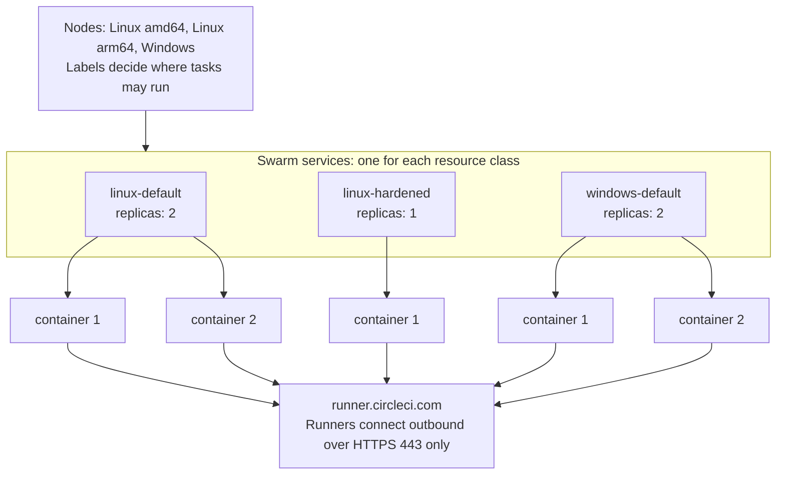
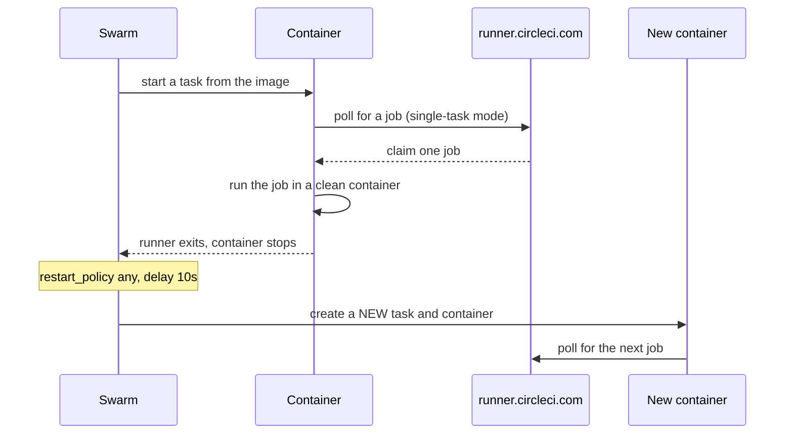

# Concepts

This page explains the model behind the stack files in this repository. Read it before you change a stack file or choose between the default and the hardened class.

The stack runs CircleCI machine runner 3 as Docker Swarm services. Swarm handles replicas, restarts, secrets, and placement. This repository adds only a stack file for each operating system, a small entrypoint for Linux, and optional setup helpers.

## Services are resource classes

Each Swarm service is one CircleCI resource class. The service name is the short name of the class, so the service `linux-default` serves the resource class `<namespace>/linux-default`. A job selects the class in its config:

```yaml
jobs:
  build:
    machine: true
    resource_class: <namespace>/linux-default
```

Each service also has one Swarm secret named `<service>-token`. The secret holds the token of that class, so a runner can only claim jobs for its own class.



The runner containers poll CircleCI for work. Nothing connects to a runner, so the stack publishes no ports.

## Replicas set the concurrency

`deploy.replicas` is the number of runners in the class, and so the number of jobs the class runs at the same time. A replica that cannot fit on any node stays in the `Pending` state until capacity is free. Refer to [Resource Classes](resource-classes.md) for sizing and for choosing the count.

## Single-task and continuous mode

Machine runner 3 has two modes. The stack files set the mode with the `CIRCLECI_RUNNER_MODE` environment variable.

| Mode | Value | Behavior | Environment |
|---|---|---|---|
| Single-task | `single-task` (default in every stack file) | The runner claims one job, runs it, and exits. Swarm starts a new container for the next job. | Clean for every job |
| Continuous | `continuous` (persistent classes only) | The runner stays up and claims job after job in the same container. | Shared by all jobs on that runner |

Use continuous mode only for trusted projects that need warm caches. The optional persistent classes are the only services that use it. Refer to [Persistent mode](resource-classes.md#persistent-mode).

## Job lifecycle

Swarm never reuses a container. Every exit, whether a finished job, an idle timeout, or a crash, leads to a new task and a new container because the restart policy is `condition: any`.



The steps in order:

1. Swarm starts a container from the service image. On Linux the entrypoint sets up the users and starts the runner. On Windows the runner is the main process.
2. The runner downloads its task agent, polls CircleCI, and claims one job.
3. The runner steps the job down to the job user on Linux, runs it, and exits when the job ends.
4. Swarm sees the exit, waits for the restart delay of 10 seconds, and starts a new container.

Three timing facts follow from this design:

- A replica needs about 10 seconds plus container start-up before it can claim the next job. The other replicas of the class keep claiming jobs in the meantime.
- Every new container downloads the task agent from `circleci-binary-releases.s3.amazonaws.com`. Allow this host in your egress rules.
- A single-task runner that finds no job exits after `CIRCLECI_RUNNER_IDLE_TIMEOUT`, which is `1h` in the stack files. Swarm replaces it, so idle replicas pick up a rotated secret or a new image within an hour.

Stopping a service sends SIGTERM to the runner. The runner drains, which means it accepts no new job and lets the running job finish. The stack sets `stop_grace_period: 5h5m`, which is the runner `max_run_time` of 5 hours plus 5 minutes.

On Windows, `stop_grace_period` is not enough. A stock Server Core container ends about 5 seconds after a stop, so a job that runs at that moment dies. The normal flow is not affected: a finished job ends the container by itself. Only a stop from outside, such as an update, a scale-down, or a drain, kills a busy container, so change a Windows service while its class is idle. Refer to [Windows drain](operations.md#windows-drain).

## What a clean environment covers

A clean environment means that a job starts in a container created from the image, with nothing left by an earlier job.

| Covered | Not covered |
|---|---|
| Files and installed packages anywhere in the container filesystem | Anything on a mounted volume: persistent classes keep a named volume by design |
| The home directory, `/tmp`, and the working directory | The Docker engine of the node when a class mounts its socket or named pipe: images, containers, and build cache persist |
| Processes, environment variables, and shell history | State outside the node, such as databases, registries, and shared storage |
| Users, groups, and sudo rules created by an earlier job | The kernel: all containers on a node share it |
| On Windows, the registry, the user profile, `%TEMP%`, and `C:\ProgramData` | Data of finished containers that Swarm has not yet pruned from the node disk |

The host directory with the runner (`/opt/machine-runner-swarm/current` on Linux, `C:\machine-runner-swarm\current` on Windows, each a link to the installed version) is mounted read-only, so a job cannot change what the next job runs. A new runner version is a new directory and a moved link: Docker follows the link when it creates a container, so the next job runs the new version, and a job that runs now finishes on the old one. Refer to [Upgrade the runner](operations.md#upgrade-the-runner-and-images).

The working directory needs no cleanup in a single-task class, because the container is discarded. On Linux, the runner does not clean it at all. The runner user cannot remove files that the job user owns, so the stack sets `CIRCLECI_RUNNER_CLEANUP_WORK_DIR` to `"false"`. Refer to [Working directory cleanup](security.md#working-directory-cleanup).

Containers are not a virtual machine boundary. Read [Security](security.md) before you run untrusted code.

## Users and the runner token on Linux

Inside each Linux container, two accounts exist:

- **The runner user** `circleci-runner` (uid 2000) runs `circleci-runner` and owns the token file. It has no sudo rights and cannot write to `/opt/machine-runner-swarm`.
- **The job user** runs every job step. It is `circleci` in the `cimg` images, or the account you name with `MACHINE_RUNNER_SWARM_JOB_USER`.

The runner steps each job down to the job user with `command_prefix`: `sudo -niHu <job user> --`, or `setpriv` when the image has no sudo. The token is never in the job environment, and the secret file is readable only by the runner user and root.

What happens next depends on one setting, `MACHINE_RUNNER_SWARM_JOB_SUDO`.

| Class type | Setting | Jobs have sudo | Can a job read the token |
|---|---|---|---|
| Default (`linux-default`, `linux-java`) | `MACHINE_RUNNER_SWARM_JOB_SUDO: "true"` | Yes, passwordless, as in the Docker executor | Yes, if the job uses sudo |
| Hardened (`linux-hardened`) | `MACHINE_RUNNER_SWARM_JOB_SUDO: "false"` | No | No |

**The default class.** Jobs keep the passwordless sudo that many orgs and orbs expect, for example `sudo apt-get install`. This protects the token from accidental exposure, because a job cannot read it as the job user and the token is not in the environment. It does not protect the token from a job that deliberately uses sudo. Root can read the secret file and can also become the runner user. The test `linux/tests/token.sh` measures this result.

**The hardened class.** Before the runner starts, the entrypoint removes every sudo right of the job user in that fresh container. The job user then has no way to become root or the runner user, so the token is unreadable from jobs. The container refuses to start if a sudo right survives the cleanup. The trade-off is that jobs cannot install system packages at run time, so you build the tools into the image. CircleCI also recommends pre-installing dependencies as the most secure option.

Choose the hardened class for shared or regulated work. Choose the default class for a single trusted team that needs sudo. A stolen token lets its holder run a runner on that class and claim jobs, which exposes the code and secrets of those jobs. Refer to [Security](security.md).

### What the Linux entrypoint does

The entrypoint `circleci-runner-entrypoint` starts as root, prepares the container, and then runs the runner as the runner user. It never reads the token. In order, it:

1. Checks that `/opt/machine-runner-swarm`, `/opt/machine-runner-swarm/bin`, and the runner are owned by root and not writable by the group or others.
2. Looks for the tools it needs. `sudo` or util-linux `setpriv` steps jobs down, and `setpriv` or `su` starts the runner. Without them it exits with code 80. Refer to [What an image needs](images.md#what-an-image-needs).
3. Creates the users with `useradd` or `adduser`: `circleci-runner` with uid and gid 2000, and the job user when the image has none. It does not edit `/etc/passwd` by hand, because sudo refuses a user that has no `passwd` and no `shadow` entry.
4. With `MACHINE_RUNNER_SWARM_JOB_SUDO=false`, removes the job user from the `sudo`, `wheel`, and `admin` groups, and deletes the sudoers rules whose first entry is the user, one of its groups, its numeric ID, or `ALL`. It then runs `sudo -l -U <job user>`, and the container exits with code 80 unless the answer is that the user is not allowed to run sudo. A rule that comes through an alias, or from a list where the user is not first, such as `other,circleci ALL=...`, therefore stops the container and does not stay unnoticed.
5. Sets `CIRCLECI_RUNNER_COMMAND_PREFIX`. A value in the service environment does not override it.
   - With sudo, the prefix is `["sudo","-niHu","<job user>","--"]`. The file `/etc/sudoers.d/90-circleci-runner` lets uid 2000 run commands as the job user only, keeps the `PATH` of the image, and keeps the environment variables of the image.
   - Without sudo, the prefix is a `setpriv` command that gives the job no capabilities. The runner holds `CAP_SETUID` and `CAP_SETGID` as ambient capabilities only to call it.
6. Creates the directories: the task agent directory, owned by uid 2000, and the working directory with its parent `/var/opt/circleci`, owned by the job user.
7. Adds the job user to the group of `/var/run/docker.sock` when the class mounts the socket and the group is not root. Refer to [Docker Builds](docker-builds.md).
8. Runs the runner with `exec` as uid 2000. The init process of the container (`init: true`) passes SIGTERM to it, which starts the drain.

The entrypoint does not validate the runner name, the token, the mode, or the timeouts, and it has no guard against the reuse of a container. The runner checks its own settings and exits with code 80 for a bad one, and Swarm never reuses a container.

With sudo, a job gets the environment variables of the image, such as `PATH`, `JAVA_HOME`, and `LANG`, the variables you set in the service, such as a proxy, and `CIRCLECI_RUNNER_NAME`. It gets nothing else from the runner. The runner runs a few commands of its own, such as `circleci-agent version`, without the step-down, as the runner user.

## Users and the runner token on Windows

Windows containers have no step-down. The runner and the jobs run as `ContainerAdministrator`, because the runner needs the symbolic link privilege of that account to install the task agent. A job can therefore read the secret file that holds the token. The token is not in the job environment.

Treat each Windows resource class as a trust boundary: use one token for each class, restrict who can use the class, and rotate tokens. The Linux variables `MACHINE_RUNNER_SWARM_JOB_SUDO` and `MACHINE_RUNNER_SWARM_JOB_USER` do not exist on Windows, and Windows ignores them. Refer to [Token model on each OS](security.md#token-model-on-each-os).

## Placement

Services carry constraints and nodes advertise capabilities. The built-in properties are `node.platform.os` and `node.platform.arch`. This repository adds the node labels `machine-runner-swarm.zone`, `machine-runner-swarm.docker-build`, `machine-runner-swarm.windows-build`, and `machine-runner-swarm.class.<service>`. Refer to [Multi-Node Clusters](multi-node.md).

## Why Swarm and not plain Compose

A plain `docker compose up` restarts the same container, so the environment is not clean. Swarm creates a new container for every task. The [FAQ](faq.md#why-not-plain-docker-compose) lists the trade-offs.
