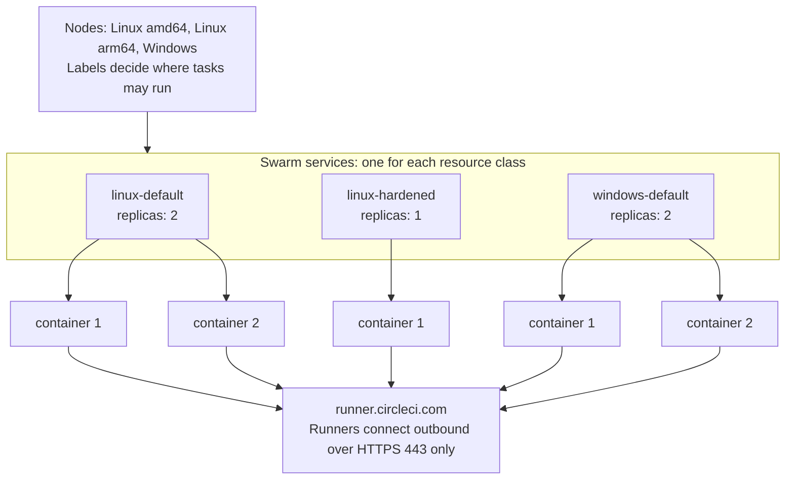
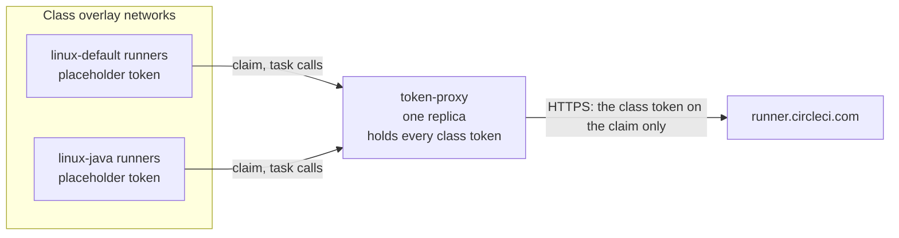
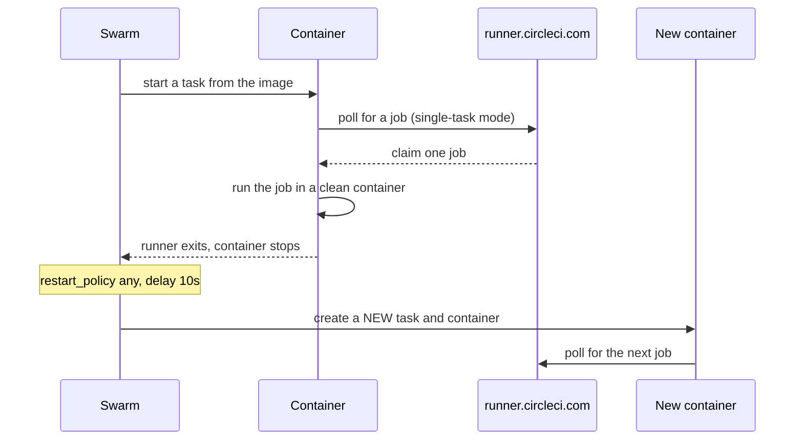

# Concepts

This page explains the model behind the stack files in this repository. Read it before you change a stack file or choose between the default and the hardened class.

The stack runs CircleCI machine runner 3 as Docker Swarm services. Swarm handles replicas, restarts, secrets, and placement. This repository adds only a stack file for each operating system, a small entrypoint and a runner distributor service for Linux, and optional setup helpers.

## Services are resource classes

Each Swarm service is one CircleCI resource class. The service name is the short name of the class, so the service `linux-default` serves the resource class `<namespace>/linux-default`. A job selects the class in its config:

```yaml
jobs:
  build:
    machine: true
    resource_class: <namespace>/linux-default
```

Each service also has one Swarm secret named `<service>-token`. The secret holds the token of that class. The single-task classes do not mount it in their runners: the [token proxy](#the-token-proxy) holds it and adds it to the claims of the runners of that class, so a runner can only claim jobs for its own class. A runner holds a made-up placeholder. A persistent class mounts its token in the runner container itself.



The runner containers poll CircleCI for work. Nothing connects to a runner, so the stack publishes no ports.

## The token proxy

The service `token-proxy` of the Linux `runners.yaml` (on Windows `token-proxy-windows` of the Windows `runners.yaml`, with the same behavior) keeps the class tokens away from the runners and their jobs. A runner sends its API calls to the proxy (`CIRCLECI_RUNNER_API_URL: http://token-proxy:8080`) and holds only a made-up placeholder token. The proxy adds the class token to one call, the task claim, and passes every other call on to CircleCI. The runner and its task agent use the task token from the claim response for the rest.



The proxy decides who may claim from the network and not from what a runner says. It allows a claim only from an address that Swarm DNS lists now for `tasks.<service>` of a class, once for each container, and gives it the token of that class. A container that is not a runner, or a runner that claims a second time, gets 403. For this the proxy is attached to the overlay network of every class, runs with `endpoint_mode: dnsrr` so that it sees the real source address, and the runners drop `NET_RAW` so that they cannot forge one. Refer to [The token proxy](security.md#the-token-proxy) for what it protects and what it does not, and to [Monitor the token proxy](operations.md#monitor-the-token-proxy) for what happens when it is down.

What this changes for you:

- **Secrets.** You create the class secrets `<service>-token` as before, and one more secret, `runner-placeholder-token`, with a made-up token. Only the proxy mounts the class secrets. Every runner mounts the placeholder.
- **Classes.** A new single-task class needs a line in the proxy: its network (Linux), its secret, and one variable. Refer to [Resource classes](resource-classes.md#define-a-class). The persistent classes do not use the proxy.
- **The image.** The proxy is a static Go binary in a published container image, `ccilabs/machine-runner-swarm-proxy` on Docker Hub, on a minimal base: no shell, uid 65534 on Linux, a read-only root file system. One tag covers Linux `amd64`, `arm64`, `ppc64le` and `s390x`, and Windows Server 2022 and 2025 (`amd64`). The service `token-proxy` pulls it by itself, so no distributor installs it. A release bundle names the image of its release by tag and digest, and a checkout names `edge`, the latest commit of the main branch. Every digest is signed. Refer to [The token proxy image](install-linux.md#the-token-proxy-image) and [Verify the token proxy image](security.md#verify-the-token-proxy-image).
- **The state.** The proxy keeps the addresses of the runners that have claimed in the small volume `proxy-state`, on the node that it runs on: a manager by default, with no label. A restart on that node refuses only the runners that claimed, and a runner that started before the proxy is never locked out. If the proxy moves to another node, the state stays behind: refer to [Where the proxy runs, and when it moves](operations.md#where-the-proxy-runs-and-when-it-moves). In a cluster with several managers, a label pins it to one.

## Add-on stack files and how they merge

Each operating system has one main stack file, `runners.yaml`, that defines the default classes and deploys on its own. The optional classes live in add-on stack files next to it: `persistent.yaml`, `docker-build.yaml`, and `ssh-rerun.yaml` on both systems, `custom-image.yaml` on Windows, and `microvm.yaml` on Linux ([MicroVM jobs](microvm.md)). An add-on stack file is not a patch of the main file. It defines services of its own, and each service needs its own resource class and its own `<service>-token` secret. The one exception on Linux is the `token-proxy` service: `docker-build.yaml`, `ssh-rerun.yaml`, and `microvm.yaml` also add their classes to it (a network, a secret, and a variable), so deploy them together with `runners.yaml`. `persistent.yaml` does not touch the proxy.

`docker stack deploy -c runners.yaml -c persistent.yaml runners` reads the files in the order given and merges them into one stack, as Docker Compose does for several `-f` files. A service, network, secret, or volume that only one file defines is added, and a key that several files set takes the value of the later file. The shipped add-on stack files only add services. YAML anchors work inside one file only, so each add-on stack file repeats the common service settings, and a change to one of them goes into every file that you use.

Pass the same list of files, in the same order, on every deploy. Swarm updates the services of the files you name. The services of a file you leave out stay as they are and stop following your edits, and `--prune` removes them. Check a merge without a Swarm with `docker stack config -c runners.yaml -c persistent.yaml`.

## Replicas set the concurrency

`deploy.replicas` is the number of runners in the class, and so the number of jobs the class runs at the same time. A replica that cannot fit on any node stays in the `Pending` state until capacity is free. Refer to [Resource Classes](resource-classes.md) for sizing and for choosing the count.

## Single-task and continuous mode

Machine runner 3 has two modes. The stack files set the mode with the `CIRCLECI_RUNNER_MODE` environment variable.

| Mode | Value | Behavior | Environment |
|---|---|---|---|
| Single-task | `single-task` (default in every stack file) | The runner claims one job, runs it, and exits. Swarm starts a new container for the next job. | Clean for every job |
| Continuous | `continuous` (persistent classes only) | The runner stays up and claims job after job in the same container. | Shared by all jobs on that runner |

Use continuous mode only for trusted projects that need warm caches. The optional persistent classes are the only services that use it. Refer to [Persistent mode](resource-classes.md#persistent-mode).

## Job lifecycle

Swarm never reuses a container. Every exit, whether a finished job, an idle timeout, or a crash, leads to a new task and a new container because the restart policy is `condition: any`.



The steps in order:

1. Swarm starts a container from the service image. On Linux the entrypoint checks the runner, sets up the users, and starts the runner. On Windows the runner is the main process.
2. The runner downloads its task agent, polls CircleCI, and claims one job.
3. The runner steps the job down to the job user on Linux, runs it, and exits when the job ends.
4. Swarm sees the exit, waits for the restart delay of 10 seconds, and starts a new container.

Three timing facts follow from this design:

- A replica needs about 10 seconds plus container start-up before it can claim the next job. The other replicas of the class keep claiming jobs in the meantime.
- Every new container downloads the task agent from `circleci-binary-releases.s3.amazonaws.com`. Allow this host in your egress rules.
- A single-task runner that finds no job exits after `CIRCLECI_RUNNER_IDLE_TIMEOUT`, which is `1h` in the stack files. Swarm replaces it, so idle replicas pick up a rotated secret or a new image within an hour.

Stopping a service sends SIGTERM to the runner. The runner drains (a runner drain), which means it accepts no new job and lets the running job finish. The stack sets `stop_grace_period: 5h5m`, which is the runner `max_run_time` of 5 hours plus 5 minutes.

On Windows, `stop_grace_period` does not hold a busy container: a stop from outside kills its job after about 5 seconds. A finished job ends its container by itself, so only an update, a scale-down, or a node drain is affected. Change a Windows service while its class is idle. Refer to [Stop a busy Windows container](operations.md#stop-a-busy-windows-container).

## What a clean environment covers

A clean environment means that a job starts in a container created from the image, with nothing left by an earlier job.

| Covered | Not covered |
|---|---|
| Files and installed packages anywhere in the container filesystem | Anything on a mounted volume: persistent classes keep a named volume by design |
| The home directory, `/tmp`, and the working directory | The Docker engine of the node when a class mounts its socket or named pipe: images, containers, and build cache persist |
| Processes, environment variables, and shell history | State outside the node, such as databases, registries, and shared storage |
| Users, groups, and sudo rules created by an earlier job | The kernel: all containers on a node share it |
| On Windows, the registry, the user profile, `%TEMP%`, and `C:\ProgramData` | Data of finished containers that Swarm has not yet pruned from the node disk |

The runner is mounted read-only, so a job cannot change what the next job runs. On Linux it comes from the per-node volume `runner-bin`, which a service of the stack fills. Refer to [The runner distributor on Linux](#the-runner-distributor-on-linux). On Windows it comes from the same volume, filled by the service `runner-distributor-windows`, through two links that Docker resolves when it creates a container. Refer to [The runner distributor on Windows](#the-runner-distributor-on-windows). A new runner version is a new directory and a moved link, so the next job runs the new version, and a job that runs now finishes on the old one. Refer to [Upgrade the runner](operations.md#upgrade-the-runner-and-images).

The working directory needs no cleanup in a single-task class, because the container is discarded. On Linux, the runner does not clean it at all. The runner user cannot remove files that the job user owns, so the stack sets `CIRCLECI_RUNNER_CLEANUP_WORK_DIR` to `"false"`. Refer to [Working directory cleanup](security.md#working-directory-cleanup).

Containers are not a virtual machine boundary. Read [Security](security.md) before you run untrusted code.

## The runner distributor on Linux

The Linux services use stock images such as `cimg/base`, and the image holds none of the runner. The service `runner-distributor` puts the runner on every Linux node, so nothing is installed on a node by hand. `docker stack deploy` is the whole install, and it is the only upgrade path.

- **The service.** `runner-distributor` is a `global` service, so it runs on every Linux node, on a Docker-build node too, and on a node that joins later. It runs the stock `alpine:3` image, pinned by digest. Its script, `linux/stack/runner-distributor.sh`, is a Swarm config.
- **The volume.** The distributor writes to `runner-bin`, a named volume that exists once on every node. Each version has a directory `versions/<version>` with `bin/circleci-runner`, `SHA256`, `VERSION`, and `TARBALL`. The link `current` points to the active version and moves with one atomic rename. The file `history` lists the versions in the order they were active.
- **The runner services.** Every class mounts `runner-bin` read-only at `/opt/machine-runner-swarm`. The entrypoint is another Swarm config, mounted at `/circleci-runner-entrypoint` with the mode `0555`, and it starts as root. A job cannot change either of them.
- **Not the token proxy.** The distributor installs the runner only. The token proxy is an image that Swarm pulls: refer to [The token proxy](#the-token-proxy).
- **The wait.** The entrypoint waits up to `MACHINE_RUNNER_SWARM_RUNNER_WAIT` seconds (default 120) until `current` exists, so a first deploy and a new node need no order. Then it resolves `current` once, when the container starts, and checks the binary against its record. Without a runner, or with a binary that differs, it exits with code 80, and Swarm tries again after the restart delay.

Because a container resolves `current` once, a running job and its container keep their version. The next container, which is the next job, gets the new one. A persistent class runs one container for all jobs, so it picks up a new version when its container restarts. Refer to [Recycle a class](operations.md#recycle-a-class).

The runner services carry no version and no hash. Which version the nodes run is a setting of the distributor service only, so an upgrade, a pin, and a rollback change that one service, and the runner services never restart. An idle replica keeps the old binary until it recycles, which takes at most the idle timeout of 1 hour.

| Setting | Behavior |
|---|---|
| `MACHINE_RUNNER_SWARM_RUNNER_VERSION=3.1.13` (an exact version, the default: the newest that CI tests) | The distributor pins that version. It never changes by itself, it makes no request once the version is installed, and it switches to an installed version without any network, so a rollback needs no download. A release of this repository bumps the default |
| `MACHINE_RUNNER_SWARM_RUNNER_VERSION=3.1` or `3` | A floating line: the newest `3.1.x`, or the newest `3.x.y`, of CircleCI's manifest. The distributor looks again every 24 hours |
| `MACHINE_RUNNER_SWARM_RUNNER_VERSION=current` | A floating value: CircleCI's current release, within major version 3. It looks again every 24 hours |

Like machine runner 3 and container runner, the runner version is chosen by the operator: an exact pin by default, a floating value on request. Refer to [The version policy](operations.md#the-version-policy) for the rules, and to [how this compares with machine runner 3, container runner and the orchestrator](operations.md#how-this-compares-with-machine-runner-3-container-runner-and-the-orchestrator).

The distributor verifies every download against a SHA-256 and records the SHA-256 of the binary next to it. Refer to [Upgrade the runner on Linux](operations.md#upgrade-the-runner-on-linux) for the settings and to [Runner binary integrity on Linux](security.md#runner-binary-integrity-on-linux) for the checks.

## The runner distributor on Windows

The Windows services use the stock Server Core image, and the image holds none of the runner and none of Git. The service `runner-distributor-windows` does what the Linux distributor does, with the same settings, the same version policy and the same rule that a runner service carries no version: `docker stack deploy` is the whole install, and the only upgrade path.

- **The service.** A `global` service on the nodes with the label `machine-runner-swarm.windows-ltsc2022`, from the stock `servercore:ltsc2022` image with process isolation. Its PowerShell script, `windows\stack\runner-distributor.ps1`, is a Swarm config.
- **The volume and the links.** It writes to `runner-bin`: `versions\<version>` for the runner (with `SHA256`, `TARBALL` and `VERSION`), `git\<git version>` for portable Git, and two relative directory symbolic links, `current` and `git\current`. Every class mounts the volume read-only twice, with `volume.subpath`: `current` at `C:\machine-runner-swarm`, and `git\current` at `C:\Program Files\Git`, where the task agent expects `tar.exe`.
- **No entrypoint.** `circleci-runner.exe` is the main process. A runner task that starts before the first flip fails and starts again after the restart delay, so a new node needs no order, and nothing checks the binary when a container starts. Refer to [Runner binary integrity on Windows](security.md#runner-binary-integrity-on-windows).
- **Not the token proxy.** It installs the runner and Git only. The service `token-proxy-windows` runs the Windows image of the token proxy, which Swarm pulls: refer to [The token proxy](#the-token-proxy).
- **Locked files.** Windows cannot replace or delete files that a running container uses. The distributor installs a version next to the others, flips the link, and removes an old version only when no container uses it. A running job keeps its version, and the runner services never restart, so no busy job is killed by an upgrade.

Refer to [Upgrade the runner on Windows](operations.md#upgrade-the-runner-on-windows) for the settings.

## Users and the runner token on Linux

Inside each Linux container, two accounts exist:

- **The runner user** `circleci-runner` (uid 2000) runs `circleci-runner` and owns the token file. It has no sudo rights and cannot write to `/opt/machine-runner-swarm`.
- **The job user** runs every job step. It is `circleci` in the `cimg` images, or the account you name with `MACHINE_RUNNER_SWARM_JOB_USER`.

The runner steps each job down to the job user with `command_prefix`: `sudo -niHu <job user> --` in the default class, or `setpriv` when the image has no sudo, and always `setpriv --no-new-privs` in the hardened class. The token is never in the job environment, and the config file that the runner reads is readable only by the runner user and root. In the single-task classes, that file holds the placeholder: the class token is in the [token proxy](#the-token-proxy), not in the container.

What happens next depends on one setting, `MACHINE_RUNNER_SWARM_JOB_SUDO`.

| Class type | Setting | Jobs have sudo | Can a job read the class token |
|---|---|---|---|
| Default (`linux-default`, `linux-java`) | `MACHINE_RUNNER_SWARM_JOB_SUDO: "true"` | Yes, passwordless, as in the Docker executor | No, the container holds a placeholder. Only a job that escapes the container onto the node of the proxy can |
| Hardened (`linux-hardened`) | `MACHINE_RUNNER_SWARM_JOB_SUDO: "false"` | No | No, for the same reason |
| Persistent (`linux-persistent`, no proxy) | `MACHINE_RUNNER_SWARM_JOB_SUDO: "true"` | Yes | Yes, if the job uses sudo. Refer to [The persistent class](security.md#the-persistent-class) |

**The default class.** Jobs keep the passwordless sudo that many orgs and orbs expect, for example `sudo apt-get install`. A job that uses sudo is root in its container: it can read the placeholder and the files of the runner, and become the runner user. It finds no class token. The test `linux/tests/token.sh` measures what the user of a job can read in the runner's config file, and `linux/tests/proxy.sh` scans the containers as root and finds no class token.

**The hardened class.** Before the runner starts, the entrypoint removes every sudo right of the job user in that fresh container, and it steps every job down with util-linux `setpriv --no-new-privs`, even when the image has sudo. Swarm ignores `no-new-privileges`, so setuid binaries such as `sudo` and `su` stay in the image, and the class keeps `SETUID` and `SETGID` for the step-down. The kernel flag that `setpriv` sets makes the job and everything it starts ignore the setuid bit, so such a binary cannot lift a job to root, even through a local-root bug. The job user then has no way to become root or the runner user, so the files and processes of the runner are out of reach of jobs. The container refuses to start if a sudo right survives the cleanup, or if the image has no util-linux `setpriv` (exit code 80). The trade-off is that jobs cannot install system packages at run time, and that nothing in a job can gain privileges through setuid or file capabilities, for example `ping` or `mount`, so you build the tools into the image. CircleCI also recommends pre-installing dependencies as the most secure option. A kernel or container-runtime bug can still lift a job to root, because the containers share the host kernel.

Choose the hardened class for shared or regulated work. Choose the default class for a single trusted team that needs sudo. A stolen token lets its holder run a runner on that class and claim jobs, which exposes the code and secrets of those jobs, so the proxy matters more than the sudo setting. Refer to [Security](security.md).

### What the Linux entrypoint does

The entrypoint `circleci-runner-entrypoint` starts as root, prepares the container, and then runs the runner as the runner user. It never reads the token or the placeholder. In order, it:

1. Waits for the runner distributor of the node, resolves the link `current` once, and checks the runner binary against its SHA-256 record. Then it checks that the runner and every directory above it, up to `/opt/machine-runner-swarm`, are owned by root and not writable by the group or others. Refer to [The runner distributor on Linux](#the-runner-distributor-on-linux).
2. Looks for the tools it needs. `sudo` or util-linux `setpriv` steps jobs down, and `setpriv` or `su` starts the runner. With `MACHINE_RUNNER_SWARM_JOB_SUDO=false`, util-linux `setpriv` with `--no-new-privs` is required, whether or not the image has sudo. Without the tools it exits with code 80. Refer to [What an image needs](images.md#what-an-image-needs).
3. Creates the users with `useradd` or `adduser`: `circleci-runner` with uid and gid 2000, and the job user when the image has none. It does not edit `/etc/passwd` by hand, because sudo refuses a user that has no `passwd` and no `shadow` entry.
4. With `MACHINE_RUNNER_SWARM_JOB_SUDO=false`, removes the job user from the `sudo`, `wheel`, and `admin` groups, and deletes the sudoers rules whose first entry is the user, one of its groups, its numeric ID, or `ALL`. It then runs `sudo -l -U <job user>`, and the container exits with code 80 unless the answer is that the user is not allowed to run sudo. A rule that comes through an alias, or from a list where the user is not first, such as `other,circleci ALL=...`, therefore stops the container and does not stay unnoticed.
5. Sets `CIRCLECI_RUNNER_COMMAND_PREFIX`. A value in the service environment does not override it.
   - With sudo, the prefix is `["sudo","-niHu","<job user>","--"]`. The file `/etc/sudoers.d/90-circleci-runner` lets uid 2000 run commands as the job user only, keeps the `PATH` of the image, and keeps the environment variables of the image.
   - Without sudo, or with `MACHINE_RUNNER_SWARM_JOB_SUDO=false`, the prefix is a `setpriv` command that gives the job no capabilities. In the hardened class it also carries `--no-new-privs`. The runner holds `CAP_SETUID` and `CAP_SETGID` as ambient capabilities only to call it.
6. Creates the directories: the task agent directory, owned by uid 2000, and the working directory with its parent `/var/opt/circleci`, owned by the job user.
7. Adds the job user to the group of `/var/run/docker.sock` when the class mounts the socket and the group is not root. Refer to [Docker Builds](docker-builds.md).
8. Runs the runner with `exec` as uid 2000. The init process of the container (`init: true`) passes SIGTERM to it, which starts the runner drain.

The entrypoint does not validate the runner name, the token, the mode, or the timeouts, and it has no guard against the reuse of a container. The runner checks its own settings and exits with code 80 for a bad one, and Swarm never reuses a container.

With sudo, a job gets the environment variables of the image, such as `PATH`, `JAVA_HOME`, and `LANG`, the variables you set in the service, such as a proxy, and `CIRCLECI_RUNNER_NAME`. It gets nothing else from the runner. The runner runs a few commands of its own, such as `circleci-agent version`, without the step-down, as the runner user.

## Users and the runner token on Windows

Windows containers have no step-down. The runner and the jobs run as `ContainerAdministrator`, because the runner needs the symbolic link privilege of that account to install the task agent. A job can therefore read the secret file that holds the token. The token is not in the job environment.

Treat each Windows resource class as a trust boundary: use one token for each class, restrict who can use the class, and rotate tokens. The Linux variables `MACHINE_RUNNER_SWARM_JOB_SUDO` and `MACHINE_RUNNER_SWARM_JOB_USER` do not exist on Windows, and Windows ignores them. Refer to [Token model on each OS](security.md#token-model-on-each-os).

## Placement

Services carry constraints and nodes advertise capabilities. The built-in properties are `node.platform.os` and `node.platform.arch`. This repository adds the node labels `machine-runner-swarm.zone`, `machine-runner-swarm.docker-build`, `machine-runner-swarm.microvm`, `machine-runner-swarm.windows-ltsc2022`, `machine-runner-swarm.windows-ltsc2025`, and `machine-runner-swarm.class.<service>`. Refer to [Multi-Node Clusters](multi-node.md).

## Why Swarm and not plain Compose

A plain `docker compose up` restarts the same container, so the environment is not clean. Swarm creates a new container for every task. The [FAQ](faq.md#why-not-plain-docker-compose) lists the trade-offs.

## Glossary

| Term | Meaning |
|---|---|
| Stack file | A Compose-format YAML file that `docker stack deploy` reads. Each OS has a main stack file (`runners.yaml`) and optional add-on stack files. This documentation never calls an add-on stack file an overlay, because an overlay network is a different thing |
| Stack | The services that one `docker stack deploy` creates. The documentation names it `runners`, so the service `linux-default` is `runners_linux-default` in Swarm commands |
| Resource class, service | A resource class is the CircleCI name, `<namespace>/<name>`, that a job selects with `resource_class`. A service is the Swarm object that runs it. One service serves one class, and the service name is the class name without the namespace |
| Replica, container | A replica is one runner of a service, and `deploy.replicas` says how many. Swarm runs each replica as a task, which is one container at a time. When a job ends, the container ends, and Swarm creates a new task and container for the same slot |
| Node | A host in the Swarm, a manager or a worker. Node labels and service constraints decide where a replica may run |
| Single-task mode, continuous mode | The two modes of machine runner 3. Single-task runs one job and exits, which gives a clean environment. Continuous keeps the runner up for many jobs. Refer to [Single-task and continuous mode](#single-task-and-continuous-mode) |
| Persistent class | A class that runs in continuous mode with a named volume, so jobs share state. It gives up the clean environment |
| Default class, hardened class | The Linux default classes (`linux-default`, `linux-java`) keep passwordless sudo for jobs. The hardened class (`linux-hardened`) removes sudo and steps every job down with `setpriv --no-new-privs`. Refer to [Users and the runner token on Linux](#users-and-the-runner-token-on-linux) |
| Token secret | The Swarm secret `<service>-token`. It is a runner config file that holds the token of the resource class. The token proxy mounts it, or, in a persistent class, the runner does |
| Token proxy | The service `token-proxy` of `runners.yaml`: it holds the class tokens of the Linux single-task classes and adds the token of a class to the claims of that class's runners. Refer to [The token proxy](#the-token-proxy) |
| Placeholder secret | The Swarm secret `runner-placeholder-token`: a runner config with a made-up token, which every proxied runner reads instead of a real token |
| Entrypoint | On Linux, the script `circleci-runner-entrypoint`, which a Swarm config delivers. It checks the runner, prepares the users, and then starts the runner. On Windows there is none: the runner is the main process |
| Runner distributor | On Linux, the `global` service `runner-distributor`; on Windows, `runner-distributor-windows` (it installs portable Git too). On every node it downloads, verifies, and installs the runner into `runner-bin`, moves `current`, and looks again every `MACHINE_RUNNER_SWARM_CHECK_INTERVAL`. Refer to [The runner distributor on Linux](#the-runner-distributor-on-linux) |
| `runner-bin` | The named volume, one on every Linux node, that holds the runner versions. The distributor writes it, and the runner services mount it read-only at `/opt/machine-runner-swarm` |
| `current` | The link in `runner-bin` that points to the active `versions/<version>`. A container resolves it once, when it starts. As a value of `MACHINE_RUNNER_SWARM_RUNNER_VERSION`, `current` is one of the floating values (with `3.1` and `3`): it makes the distributor follow CircleCI's current release |
| Record | The file `versions/<version>/SHA256`, which holds the SHA-256 of the binary in the format of `sha256sum -c`. The distributor writes it when it installs a version, and the entrypoint checks the binary against it at every container start |
| Setup helper | The optional scripts `linux/setup.sh` and `windows\Setup.ps1`, which run steps of the install pages with checks. On Linux the helper checks the node, starts Swarm, creates secrets, and deploys. It installs nothing, because the distributor installs the runner |
| Stock image, custom image | A stock image is a publisher's image as it is, for example `cimg/base` or Windows Server Core. The stack mounts the runner into it, on Linux from the volume `runner-bin` and on Windows from the host. A custom image is one you derive from it, for example to add tools. Refer to [Images](images.md) |
| Drain | The word has two meanings. A **runner drain** happens when the runner gets SIGTERM: it takes no new job and finishes the running one. A **node drain** is `docker node update --availability drain`: Swarm stops the tasks of that node, which starts a runner drain in each, and starts replacements on other nodes. This documentation always says which one |
