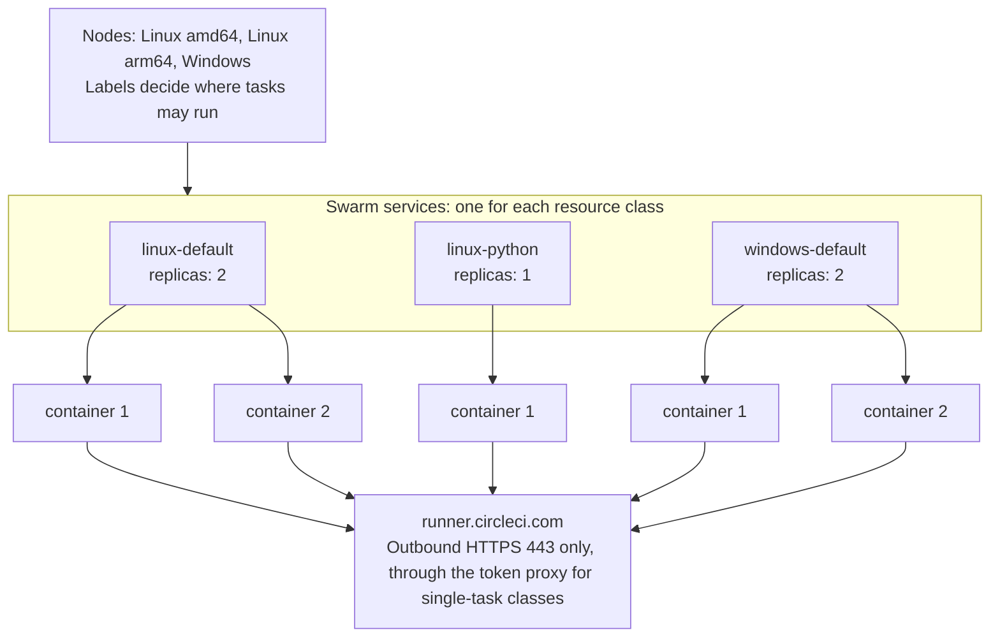
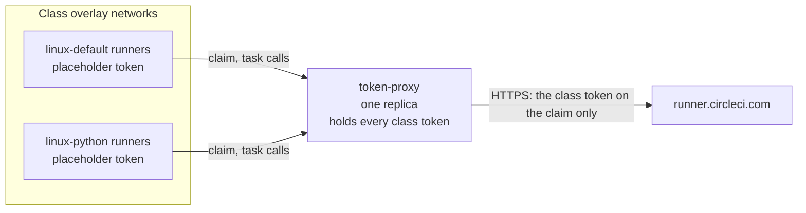
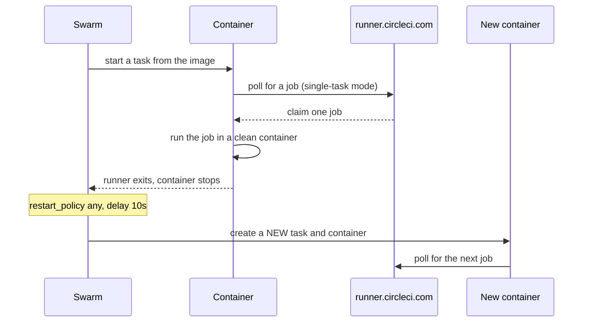

# Concepts

Machine runner swarm runs CircleCI machine runner 3 as Docker Swarm services. Swarm handles replicas, restarts, secrets, and placement. Read this page before you change a stack file or choose between the default and the hardened class.

## Services are resource classes

Each Swarm service is one CircleCI resource class. The service name is the short name of the class, so the service `linux-default` serves the resource class `<NAMESPACE>/linux-default`. A job selects the class in its config:

```yaml
jobs:
  build:
    machine: true
    resource_class: <NAMESPACE>/linux-default
```

Each service also has one Swarm secret, `<SERVICE>-token`, which holds the token of that class. In the single-task classes the [token proxy](#the-token-proxy) holds it, and the runners hold a placeholder. A persistent class mounts its token in the runner container itself.



The runner containers poll CircleCI for work, through the token proxy in the single-task classes. Nothing connects to a runner, so the main stack files publish no ports.

`deploy.replicas` is the number of runners in the class, and so the number of jobs it runs at the same time. A replica that fits on no node stays `Pending` until capacity is free. [Resource classes](resource-classes.md) covers sizing.

## The token proxy

The service `token-proxy` of `runners.yaml` (on Windows `token-proxy-windows`, which works the same way, with the differences in [Windows](security.md#windows)) keeps the class tokens away from the runners and their jobs. A runner sends its API calls to the proxy (`CIRCLECI_RUNNER_API_URL: http://token-proxy:8080`) and holds only a placeholder token. The proxy adds the class token to one call, the task claim, and passes every other call on to CircleCI. The runner and its task agent use the task token from the claim response for the rest.



The network decides who may claim, not what a runner says. The proxy allows a claim only from an address that Swarm DNS lists now for `tasks.<SERVICE>` of a class, once for each container. A container that is not a runner, or a runner that claims a second time, gets 403. A claim whose outcome is unknown counts as a claim, so the proxy fails closed. [The token proxy](security.md#the-token-proxy) lists what it protects and what it does not, and [Monitor the token proxy](operations.md#monitor-the-token-proxy) covers what happens when it is down.

What the proxy changes for you:

- **Secrets.** You create the class secrets `<SERVICE>-token`, and one more, `runner-placeholder-token`, with a dummy token. Only the proxy mounts the class secrets. Every runner mounts the placeholder.
- **Classes.** A new single-task class needs two lines in the proxy: its network (Linux) and its secret `<SERVICE>-token`. See [Resource classes](resource-classes.md#define-a-class). The persistent classes do not use the proxy.
- **The image.** `ccilabs/machine-runner-swarm-proxy` on Docker Hub (the signature is the trust root, not the name): a static Go binary on a minimal base, with no shell. One tag covers Linux `amd64`, `arm64`, `ppc64le` and `s390x`, and Windows Server 2022 and 2025 (`amd64`). Swarm pulls it, and every digest is signed: [The token proxy image](install-linux.md#the-token-proxy-image), [Verify the token proxy image](security.md#verify-the-token-proxy-image).
- **The state.** The proxy keeps the addresses of the runners that have claimed in the volume `proxy-state`, on the node that it runs on (a manager by default). If it moves, the state stays behind: [Where the proxy runs, and when it moves](operations.md#where-the-proxy-runs-and-when-it-moves). In a cluster, label the node `machine-runner-swarm.proxy=true`: runner services never run on a node with that label, so jobs do not share a node with the proxy. On a single node, set no label.

## Add-on stack files and how they merge

Each operating system has one main stack file, `runners.yaml`, that defines the default classes and deploys on its own. Optional classes live in add-on stack files next to it:

| File | System | Adds |
|---|---|---|
| `classes-extra.yaml` | Linux | `linux-java` and the hardened `linux-hardened` |
| `persistent.yaml`, `docker-build.yaml`, `ssh-rerun.yaml` | Linux and Windows | Persistent, Docker-build and SSH-rerun classes |
| `custom-image.yaml` | Windows | A class with your own image |
| `microvm.yaml` | Linux | MicroVM classes ([MicroVM jobs](microvm.md)) |
| `container-mode.yaml` | Linux | The prototype container agent for Docker-executor jobs ([Container mode](container-mode.md)) |

An add-on stack file is not a patch of the main file. It defines services of its own, and each service needs its own resource class and `<SERVICE>-token` secret. On Linux, `classes-extra.yaml`, `docker-build.yaml`, `ssh-rerun.yaml`, and `microvm.yaml` also add their classes to the `token-proxy` service, so deploy them together with `runners.yaml`. `persistent.yaml` and `container-mode.yaml` keep their own tokens and do not touch the proxy.

`docker stack deploy -c runners.yaml -c persistent.yaml runners` merges the files in the order given, as Docker Compose does for several `-f` files. A service, network, secret, or volume that only one file defines is added, and a key that several files set takes the value of the later file. YAML anchors work inside one file only, so each add-on stack file repeats the common service settings.

Pass the same files, in the same order, on every deploy: the services of a file you leave out stay as they are and stop following your edits, and `--prune` removes them. Check a merge without a Swarm with `docker stack config -c runners.yaml -c persistent.yaml`.

## Single-task or continuous mode

The stack files set the runner mode with `CIRCLECI_RUNNER_MODE`.

| Mode | Value | Behavior | Environment |
|---|---|---|---|
| Single-task | `single-task` (default in every stack file) | The runner claims one job, runs it, and exits. Swarm starts a new container for the next job | Clean for every job |
| Continuous | `continuous` (persistent classes only) | The runner stays up and claims job after job in the same container | Shared by all jobs on that runner |

Use continuous mode only for trusted projects that need warm caches: [Persistent mode](resource-classes.md#persistent-mode).

## Job lifecycle

Swarm never reuses a container. Every exit (a finished job, an idle timeout, a crash) leads to a new task and a new container, because the restart policy is `condition: any`.



On Linux the entrypoint checks the runner, sets up the users, and starts it, and the runner steps the job down to the job user. On Windows the runner is the main process. Timing:

- A replica needs about 10 seconds (the restart delay) plus container start-up before it can claim the next job. The other replicas keep claiming in the meantime.
- Every new container downloads the task agent from `circleci-binary-releases.s3.amazonaws.com`. Allow this host in your egress rules.
- A single-task runner that finds no job exits after `CIRCLECI_RUNNER_IDLE_TIMEOUT` (`1h` in the stack files), so idle replicas pick up a rotated secret or a new image within an hour.

Stopping a service sends SIGTERM to the runner. The runner drains: it accepts no new job and lets the running job finish. The stack sets `stop_grace_period: 5h5m`, the runner `max_run_time` of 5 hours plus 5 minutes.

On Windows, change a class only while it is idle ([why](operations.md#stop-a-busy-windows-container)).

## What a clean environment covers

A clean environment means that a job starts in a container created from the image, with nothing left by an earlier job.

| Covered | Not covered |
|---|---|
| Files and installed packages anywhere in the container filesystem | Anything on a mounted volume: persistent classes keep a named volume by design |
| The home directory, `/tmp`, and the working directory | The Docker engine of the node when a class mounts its socket or named pipe: images, containers, and build cache persist |
| Processes, environment variables, and shell history | State outside the node, such as databases, registries, and shared storage |
| Users, groups, and sudo rules created by an earlier job | The kernel: all containers on a node share it |
| On Windows, the registry, the user profile, `%TEMP%`, and `C:\ProgramData` | Data of finished containers that Swarm has not yet pruned from the node disk |

The runner is mounted read-only, so a job cannot change what the next job runs ([The runner distributor on Linux](#the-runner-distributor-on-linux), [The runner distributor on Windows](#the-runner-distributor-on-windows)). A single-task class needs no working directory cleanup, because the container is discarded. On Linux the runner does not clean it, because the runner user cannot remove files that the job user owns: the stack sets `CIRCLECI_RUNNER_CLEANUP_WORK_DIR` to `"false"` ([Working directory cleanup](security.md#working-directory-cleanup)).

Containers are not a virtual machine boundary. Read [Security](security.md) before you run untrusted code.

## The runner distributor on Linux

The Linux services use stock images such as `cimg/base`, and the image holds none of the runner. The service `runner-distributor` puts the runner on every Linux node that runs the classes of `runners.yaml`. `docker stack deploy` is the only upgrade path.

- **The service.** `runner-distributor` is a `global` service from the stock `alpine:3` image (pinned by digest), so it runs on every Linux node, also a Docker-build node and a node that joins later. A microVM node (`machine-runner-swarm.microvm=true`) is the exception: the microVM classes download their own runner into each VM ([MicroVM jobs](microvm.md#the-runner-in-a-vm)). Its script, `linux/stack/runner-distributor.sh`, is a Swarm config.
- **The volume.** It writes to `runner-bin`, one named volume on every node. Each version has a directory `versions/<VERSION>` with `bin/circleci-runner`, `SHA256`, `VERSION`, and `TARBALL`. The link `current` points to the active version and moves with one atomic rename. The file `history` lists the versions in the order they were active.
- **The runner services.** Every class mounts `runner-bin` read-only at `/opt/machine-runner-swarm`. The entrypoint is another Swarm config, mounted at `/circleci-runner-entrypoint` with the mode `0555`. A job cannot change either.
- **The wait.** The entrypoint waits up to `MACHINE_RUNNER_SWARM_RUNNER_WAIT` seconds (default 120) until `current` exists, so a first deploy and a new node need no order. Without a runner, or with a binary that differs from its record, it exits with code 80, and Swarm retries after the restart delay.

A container resolves `current` once, so a running job keeps its version and the next container gets the new one. A persistent class runs one container for all jobs, so it picks up a new version when its container restarts ([Recycle a class](operations.md#recycle-a-class)). The runner services carry no version and no hash: the version is a setting of the distributor service only, so an upgrade, a pin, and a rollback change that one service, and the runner services never restart. An idle replica keeps the old binary until it recycles, within the idle timeout of 1 hour.

| `MACHINE_RUNNER_SWARM_RUNNER_VERSION` | Behavior |
|---|---|
| `3.1.13` (an exact version, the default: the newest that CI tests) | A pin. The tarball is checked against the SHA-256 values that the stack file carries for it, not the manifest. It never changes by itself, makes no request once installed, and switches to an installed version without network, so a rollback needs no download. A release bumps the version and its SHA-256 values together |
| `3.1` or `3` | A floating line: the newest `3.1.x`, or the newest `3.x.y`, of CircleCI's manifest. Checked again every 24 hours. It ignores the default SHA-256 list and trusts the hash of the manifest, which is weaker |
| `current` | CircleCI's current release, within major version 3. Checked again every 24 hours, and trusts the manifest hash like the floating lines |

See [The version policy](operations.md#the-version-policy) for the rules, [Upgrade the runner on Linux](operations.md#upgrade-the-runner-on-linux) for the settings, and [Runner binary integrity on Linux](security.md#runner-binary-integrity-on-linux) for the checks.

## The runner distributor on Windows

The Windows services use the stock Server Core image, with none of the runner and none of Git. The service `runner-distributor-windows` does what the Linux distributor does, with the same settings and version policy.

- **The service.** A `global` service on the nodes with the label `machine-runner-swarm.windows-ltsc2022`, from the stock `servercore:ltsc2022` image with process isolation. Its script, `windows\stack\runner-distributor.ps1`, is a Swarm config.
- **The volume and the links.** It writes to `runner-bin`: `versions\<VERSION>` for the runner (with `SHA256`, `TARBALL` and `VERSION`), `git\<GIT_VERSION>` for portable Git, and two relative directory symbolic links, `current` and `git\current`. Every class mounts the volume read-only twice, with `volume.subpath`: `current` at `C:\machine-runner-swarm`, and `git\current` at `C:\Program Files\Git`, where the task agent expects `tar.exe`.
- **No entrypoint.** `circleci-runner.exe` is the main process. A runner task that starts before the first flip fails and starts again after the restart delay, so a new node needs no order. Nothing checks the binary when a container starts: [Runner binary integrity on Windows](security.md#runner-binary-integrity-on-windows).
- **Locked files.** Windows cannot replace or delete files that a running container uses. The distributor installs a version next to the others, flips the link, and removes an old version only when no container uses it. No busy job is killed by an upgrade.

See [Upgrade the runner on Windows](operations.md#upgrade-the-runner-on-windows) for the settings.

## Users and the runner token on Linux

Inside each Linux container, two accounts exist:

- **The runner user** `circleci-runner` (uid 2000) runs `circleci-runner` and owns the token file. It has no sudo rights and cannot write to `/opt/machine-runner-swarm`.
- **The job user** runs every job step. It is `circleci` in the `cimg` images, or the account you name with `MACHINE_RUNNER_SWARM_JOB_USER`.

The runner steps each job down to the job user with `command_prefix`: `sudo -niHu <JOB_USER> --` in the default class, `setpriv` when the image has no sudo, and always `setpriv --no-new-privs` in the hardened class. The token is never in the job environment, and the config file that the runner reads is readable only by the runner user and root. In the single-task classes that file holds the placeholder.

`MACHINE_RUNNER_SWARM_JOB_SUDO` decides the rest:

| Class type | Setting | Jobs have sudo | Can a job read the class token |
|---|---|---|---|
| Default (`linux-default`, and `linux-java` of `classes-extra.yaml`) | `"true"` | Yes, passwordless, as in the Docker executor | No, the container holds a placeholder. Only a job that escapes onto the node of the proxy can |
| Hardened (`linux-hardened` of `classes-extra.yaml`) | `"false"` | No | No, for the same reason |
| Persistent (`linux-persistent`, no proxy) | `"false"` (the shipped file; `"true"` is the opt-in) | No (with `"true"`: yes) | No, as in the hardened class. With `"true"`, yes if the job uses sudo ([The persistent class](security.md#the-persistent-class)) |

**The default class.** Jobs keep the passwordless sudo that many orgs and orbs expect, for example `sudo apt-get install`. A job that uses sudo is root in its container: it can read the placeholder and the files of the runner, and become the runner user, but it finds no class token (`linux/tests/proxy.sh` scans the containers as root to show it).

**The hardened class.** The entrypoint steps every job down with util-linux `setpriv --no-new-privs`, even when the image has sudo, and edits no file of the image. Swarm ignores `no-new-privileges`, so setuid binaries such as `sudo` and `su` stay in the image. The kernel flag that `setpriv` sets is inherited by the job and everything it starts, and cannot be cleared, so no setuid binary can lift a job to root, even through a local-root bug.

- The container exits with code 80 if the image has no util-linux `setpriv`.
- Jobs cannot install system packages at run time, and nothing in a job gains privileges through setuid or file capabilities (for example `ping` or `mount`). Build the tools into the image. CircleCI also recommends pre-installing dependencies as the most secure option.
- A kernel or container-runtime bug can still lift a job to root, because the containers share the host kernel.

Choose the hardened class for shared or regulated work, and the default class for a single trusted team that needs sudo. See [Security](security.md).

### What the Linux entrypoint does

`circleci-runner-entrypoint` starts as root, prepares the container, and runs the runner as the runner user. It never reads the token or the placeholder. In order, it:

1. Waits for the runner distributor, resolves `current` once, and checks the binary against its SHA-256 record. It also checks that the runner and every directory above it, up to `/opt/machine-runner-swarm`, are owned by root and not writable by the group or others.
2. Looks for the tools it needs: `sudo` or util-linux `setpriv` to step jobs down, and `setpriv` or `su` to start the runner. With `MACHINE_RUNNER_SWARM_JOB_SUDO=false`, util-linux `setpriv` with `--no-new-privs` is required. Without the tools it exits with code 80 ([What an image needs](images.md#what-an-image-needs)).
3. Creates the users with `useradd` or `adduser` (sudo refuses a user that has no `passwd` and no `shadow` entry): `circleci-runner` with uid and gid 2000, and the job user when the image has none.
4. Sets `CIRCLECI_RUNNER_COMMAND_PREFIX`. A value in the service environment does not override it.
   - With sudo, the prefix is `["sudo","-niHu","<JOB_USER>","--"]`. The file `/etc/sudoers.d/90-circleci-runner` lets uid 2000 run commands as the job user only, and keeps the `PATH` and environment variables of the image.
   - Without sudo, or with `MACHINE_RUNNER_SWARM_JOB_SUDO=false`, it is a `setpriv` command that gives the job no capabilities (in the hardened class also `--no-new-privs`), run through `env -u` for every `CIRCLECI_RUNNER_*` and `MACHINE_RUNNER_SWARM_*` variable of the container (the runner name stays). The runner holds `CAP_SETUID` and `CAP_SETGID` as ambient capabilities only to call it.
5. Creates the task agent and working directories, adds the job user to the group of `/var/run/docker.sock` when the class mounts the socket ([Docker builds](docker-builds.md)), and runs the runner with `exec` as uid 2000. The init process (`init: true`) passes SIGTERM to it, which starts the runner drain.

It does not validate the runner name, the token, the mode, or the timeouts: the runner checks its own settings and exits with code 80 for a bad one. With sudo, a job gets the environment variables of the image (`PATH`, `JAVA_HOME`, `LANG`), the variables you set in the service (such as a proxy), and `CIRCLECI_RUNNER_NAME`, and nothing else from the runner.

## Users and the runner token on Windows

Windows containers have no step-down: the runner and the jobs run as `ContainerAdministrator`, because the runner needs its symbolic link privilege to install the task agent. A job can read the config file of its runner. In a single-task class it holds only the placeholder (the class token is in `token-proxy-windows`), in the persistent class the real token. The token is not in the job environment. A hostile job on the same host as the proxy can still reach it, because process isolation is not a security boundary ([Windows](security.md#windows)).

Treat each Windows resource class as a trust boundary: one token for each class, restricted users, rotated tokens. `MACHINE_RUNNER_SWARM_JOB_SUDO` and `MACHINE_RUNNER_SWARM_JOB_USER` do not exist on Windows. See [Token model on each OS](security.md#token-model-on-each-os).

## Placement labels

Services carry constraints and nodes advertise capabilities. The built-in properties are `node.platform.os` and `node.platform.arch`. Machine runner swarm adds the node labels `machine-runner-swarm.zone`, `machine-runner-swarm.proxy`, `machine-runner-swarm.docker-build`, `machine-runner-swarm.container-mode`, `machine-runner-swarm.microvm`, `machine-runner-swarm.windows-ltsc2022`, `machine-runner-swarm.windows-ltsc2025`, and `machine-runner-swarm.class.<SERVICE>`. See [Multi-node clusters](multi-node.md).

## Why Swarm and not plain Compose

A plain `docker compose up` restarts the same container, so the environment is not clean. Swarm creates a new container for every task. The [FAQ](faq.md#why-not-plain-docker-compose) lists the trade-offs.

## Glossary

| Term | Meaning |
|---|---|
| Stack file | A Compose-format YAML file that `docker stack deploy` reads: a main file (`runners.yaml`) for each OS and optional add-on stack files. An add-on stack file is not a Docker overlay network |
| Stack | The services that one `docker stack deploy` creates, named `runners` here, so the service `linux-default` is `runners_linux-default` in Swarm commands |
| Resource class, service | A resource class is the CircleCI name, `<NAMESPACE>/<NAME>`, that a job selects with `resource_class`. A service is the Swarm object that runs it, named like the class without the namespace |
| `runner-bin`, `current`, record | `runner-bin` is the named volume, one on every node, that holds the runner versions under `versions/<VERSION>`. `current` is the link to the active version, which a container resolves once at start. The record is `versions/<VERSION>/SHA256`, the SHA-256 of the binary in `sha256sum -c` format, which the entrypoint checks at every container start |
| Runner distributor | The `global` service `runner-distributor` (Linux) or `runner-distributor-windows` (it installs portable Git too) that downloads, verifies, and installs the runner into `runner-bin`, moves `current`, and looks again every `MACHINE_RUNNER_SWARM_CHECK_INTERVAL` |
| Drain | A **runner drain** happens when the runner gets SIGTERM: it takes no new job and finishes the running one. A **node drain** is `docker node update --availability drain`: Swarm stops the tasks of that node, which starts a runner drain in each, and starts replacements on other nodes. |
