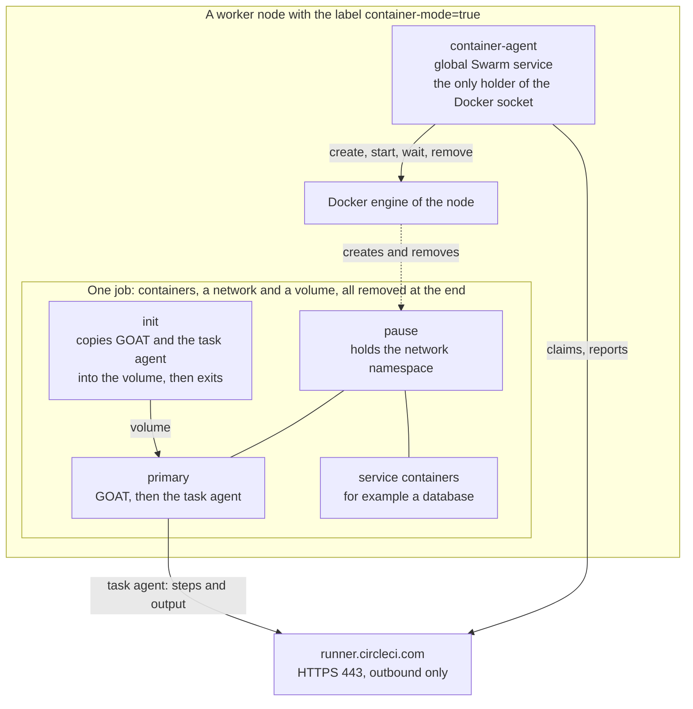

# Container mode (prototype)

Container mode runs jobs that use the Docker executor, `docker: [{image: ...}, {image: ...}]`, on the nodes of a Swarm, with no Kubernetes. With the machine classes of machine runner swarm, one Swarm serves both kinds of jobs.

> [!WARNING]
> This is a prototype, and CircleCI does not support it. The unit tests and a Swarm test against a fake runner API and a fake init image pass. A run against the real CircleCI API is still to be done. Do not use it for production jobs yet. Refer to [Status](#status).

## What it is

A job with a `docker:` list belongs to [container runner](https://circleci.com/docs/guides/execution-runner/container-runner-installation/), which starts one pod for each job. Container mode copies that design onto the Docker engine of a Swarm node:

| Container runner on Kubernetes | Container mode on Swarm |
|---|---|
| The container agent, with Kubernetes RBAC to create pods | The swarm container agent, with the Docker socket of its node |
| One pod for each job | One group of containers for each job: pause, init, primary, and one for each service |
| Containers reach each other on `localhost` | The same, through the network namespace of the pause container |
| An init container copies the orchestrator (GOAT) and the task agent into an `emptyDir` | The same init image copies them into a volume of the task |
| A Kubernetes secret holds the task token | The environment of the primary container holds it |
| Pod `resources` limits | `--cpus` and `--memory` on every container |
| Kubernetes places pods on nodes with free resources | A global agent on each opted-in node, and a cap on its jobs |

A class serves one mode. A class that a machine runner and a container agent both claim from sends jobs to the wrong one, and they fail at once. Use separate classes and tokens for each mode.

## Architecture



The agent is a global Swarm service. It starts on every worker with the label `machine-runner-swarm.container-mode=true`, and on no manager, no microVM node (`machine-runner-swarm.microvm=true`), no Docker-build node (`machine-runner-swarm.docker-build=true`), and no node with the token proxy label (`machine-runner-swarm.proxy=true`). The token proxy keeps off container-mode nodes in turn.

The agent is the only container that mounts `/var/run/docker.sock` and its class tokens (Swarm secrets). It does not use the [token proxy](concepts.md#the-token-proxy): whoever holds the socket, which is root-equivalent on its node, can read the secrets of the node, so a proxy would protect nothing.

Nothing is built or published. The service runs a stock Go image, pinned by digest, and compiles the Go sources in [`linux/stack/container-agent`](../linux/stack/container-agent) (Swarm configs named after their content) at start-up. A changed source updates the service, so `docker stack deploy` is the whole upgrade.

The code has two sides, so that the part that runs a job on an engine can later be offered upstream as a driver: the Docker driver (`driver_docker.go`, `docker.go`, behind the interface in `driver.go`) knows nothing of the runner API or class tokens, and the wrapper (`main.go`, `wrapper.go`, `api.go`: claim loop, slots, runner API) knows nothing of containers. A driver gets the task token of one task and no class token.

## The life of a job

1. The agent polls CircleCI with the token of each class, only while it has a free slot, because a claim assigns the job to it. The claim returns a task token, which fetches the job configuration. A job without a `docker:` list is a machine job, and the agent reports a failure.
2. It pulls the init, pause and job images. Registry credentials from the job go to the engine for the pull and are never stored. Variables such as `$DOCKERHUB_PASSWORD` are expanded from the environment of the job.
3. It creates a network and a volume, and starts the **init** container (no network), which copies `orchestrator` (GOAT) and `circleci-agent` into the volume at `/opt/circleci/bin` and exits.
4. It starts the **pause** container, then each **service** container with the image, entrypoint, command, user and environment from the job, and the service limits of the class. All use `--network container:<PAUSE>`, so a service listens on `localhost` for the primary container.
5. It starts the **primary** container with the entrypoint `/opt/circleci/bin/orchestrator run-task` and the GOAT settings, including the task token, in one environment variable. GOAT starts the task agent with the token on its standard input and removes the settings from the environment before any step starts. The task agent reports steps and output to CircleCI itself.
6. When the primary container stops, the agent removes the containers, network, and volume, and tells CircleCI that the job is cleaned up (after reporting a failure, if the primary container failed). If a container could not start, for example after a failed image pull, it returns the job to the queue, and reports a failure only when CircleCI has no retries left.

On SIGTERM, the agent stops claiming and lets running jobs finish (`stop_grace_period: 5h5m`, as for the machine classes). At start-up it removes every container, network, and volume with its Docker label `machine-runner-swarm.container-mode=1`, the leftovers of a crash. Swarm updates the service stop-first, so two agents never run on one node.

## Deploy

You need a Swarm set up as in the [Linux quickstart](quickstart-linux.md), Docker Engine 24 or later, and a resource class and token for container mode. The nodes need access to Docker Hub and `registry.k8s.io` for the Go, init, and pause images.

1. Create the resource class and a token with the [circleci CLI](https://circleci.com/docs/guides/toolkit/circleci-cli/), and store the token in a secret. Do not reuse the token of a machine class.

   ```bash
   printf '%s' "$TOKEN" | docker secret create docker-default-token -
   ```

2. Label the workers that may run jobs. Never label a manager.

   ```bash
   docker node update --label-add machine-runner-swarm.container-mode=true worker-1
   ```

3. Edit `MACHINE_RUNNER_SWARM_CONTAINER_CLASSES` in [`linux/stack/container-mode.yaml`](../linux/stack/container-mode.yaml): replace `CHANGE-ME` with your namespace, and set the limits. Then deploy:

   ```bash
   docker stack deploy -c linux/stack/runners.yaml -c linux/stack/container-mode.yaml runners
   ```

4. Run a job. The example [`examples/container-mode.yml`](../examples/container-mode.yml) has a primary container and a PostgreSQL service on `localhost:5432`. Read the agent log with:

   ```bash
   docker service logs runners_container-agent
   ```

### Settings

Set these in the `environment` of the service in the stack file.

| Variable | Default | Meaning |
|---|---|---|
| `MACHINE_RUNNER_SWARM_CONTAINER_CLASSES` | none, required | A JSON array of classes. Each entry has `name` (`<NAMESPACE>/<CLASS>`), `token_file` (a Swarm secret: the bare token, or a runner config with an `auth_token` line), and the limits `primary` and `service`, each with `cpus`, `memory_mb`, and `pids` (default 4096) |
| `MACHINE_RUNNER_SWARM_CONTAINER_MAX_TASKS` | `2` | Jobs at the same time on this node |
| `MACHINE_RUNNER_SWARM_CONTAINER_MAX_RUN_TIME` | `5h` | The longest a job may run. After it, the agent reports a failure and removes the job |
| `MACHINE_RUNNER_SWARM_CONTAINER_INIT_IMAGE` | `circleci/runner-init:<CLAIM_TAG>` | The init image. The stack file pins a digest |
| `MACHINE_RUNNER_SWARM_CONTAINER_PAUSE_IMAGE` | `registry.k8s.io/pause:3.10` | The image that holds the network namespace. The stack file pins a digest |
| `MACHINE_RUNNER_SWARM_CONTAINER_PULL` | `always` | `always` pulls a tag before each job. `missing` pulls only an image that the node lacks. An image pinned by digest is pulled once |
| `MACHINE_RUNNER_SWARM_CONTAINER_RUNNER_API` | `https://runner.circleci.com` | The runner API. Set the URL of your CircleCI server for a server installation |
| `MACHINE_RUNNER_SWARM_CONTAINER_POLL_INTERVAL` | `3s` | The wait between claims when no job is queued |
| `MACHINE_RUNNER_SWARM_CONTAINER_NAME` | the hostname | The name that the agent gives CircleCI |
| `MACHINE_RUNNER_SWARM_CONTAINER_DOCKER_SOCKET` | `/var/run/docker.sock` | The Docker socket of the node, as seen inside the agent container |
| `MACHINE_RUNNER_SWARM_CONTAINER_KEEP_FAILED` | unset | `true` leaves the containers, network, and volume of a failed job for `docker logs`. The next start of the agent removes them. Only for debugging: a kept primary container holds the task token |

## Security model

The agent is a trusted component, like the Kubernetes service account of container runner.

| Question | Answer |
|---|---|
| What holds the Docker socket? | Only the agent, as root with a read-only root filesystem and no capabilities. The socket is root-equivalent on its node. `linux/tests/container-mode.sh` checks that no job container mounts it. The agent container also holds the Go compiler. For a smaller container, compile the sources into an image of your own (`CGO_ENABLED=0 go build`) and set `image` and `entrypoint` in the stack file |
| Where are the class tokens? | In Swarm secrets that only the agent mounts, and in its memory. No job container has a class token or a way to claim a job. The agent never runs on the node of the token proxy |
| Where is the task token? | In one environment variable of the primary container, which GOAT removes before the task agent starts. It is scoped to one job, but `docker inspect` on the node can read it, so the node must not hand the socket to jobs ([Docker builds](docker-builds.md)) |
| Can one job reach another? | Each job has its own bridge network, and Docker does not route between them. A job can reach the internet and the node through the gateway, as a machine class can |
| What stops a runaway job? | `--cpus`, `--memory` (without swap) and a process limit on every container, and a maximum run time |
| What does a job container keep? | Default capabilities without `NET_RAW` and `MKNOD`, no privileged mode, no devices, no host paths. It runs as the user of its image, or the `user` of the job |
| Is it a virtual machine boundary? | No. All containers of a node share its kernel. Use the machine runner orchestrator for untrusted code ([Security](security.md)) |
| Which images does the agent trust? | Those that the job names, as in the Docker executor |

Anyone who can change the job configuration of a project chooses the images that run on your nodes, as with any runner. Restrict who can use the class with the same controls as for a machine class.

## Sizing

Swarm sees only the agent service, so it cannot place jobs by free memory or CPU:

- `MACHINE_RUNNER_SWARM_CONTAINER_MAX_TASKS` caps the jobs of a node. Choose it so that the cap times (the primary limit plus the service limits of a job) fits in the node. The default classes allow 4 GiB for the primary container and 2 GiB for each service, so a job with one service needs up to 6 GiB.
- A job with no free slot stays in the CircleCI queue and runs on another node. To scale out, label another worker.
- The agent needs up to 1 GiB while it compiles at start-up.

## Limits

| Limit | Detail |
|---|---|
| Prototype | Not run against the real CircleCI API yet. Not supported by CircleCI ([Status](#status)) |
| Linux only | Linux workers on amd64 and arm64 in principle. Only amd64 is tested ([Windows](#windows)) |
| No Rerun job with SSH | The agent publishes no port and passes no SSH settings to GOAT |
| No Docker layer caching, no `setup_remote_docker` | The job has no engine. Use the [docker-build class](docker-builds.md) from a machine class, or a daemonless builder |
| No ECR authentication | A job that uses `aws_auth` fails. Registry credentials with a user name and password work |
| No service logs or lifecycle output in the CircleCI UI | Read them on the node with `docker logs` while a job runs, or in the agent log |
| No wait for service readiness | Use `dockerize -wait` or a retry in the job, as with the Docker executor |
| The job user | A `user:` becomes the user of the Docker container. Container runner instead passes the name to GOAT, which needs a container that starts as root |
| One limit pair for all services | Container runner sets limits for each service image |
| Orphans after a crash | CircleCI keeps the job of a crashed agent until its own timeout |
| The init image pin | The pinned digest may give a task agent older than CircleCI expects. Watch for new tags, or unset `MACHINE_RUNNER_SWARM_CONTAINER_INIT_IMAGE` |

## Windows

Windows is not supported. It needs:

- A way to share one network namespace between containers, for the `localhost` behavior. Check whether the engine accepts `--network container:<ID>` for Windows containers.
- Windows images for the init step, GOAT, and the pause container, and the Windows build of the task agent.
- The named pipe `\\.\pipe\docker_engine` in place of the socket, an isolation mode with matching limits, Windows paths for the volume, and a different user model.

## Status

| Piece | State |
|---|---|
| Unit tests (`linux/stack/container-agent`, `go test`, run in CI) | Pass: the container layout, limits, environment, GOAT settings, failure and retry paths, cleanup, the start-up sweep, the cap, and that no token reaches a log. The wrapper runs against a fake driver, and the Docker driver against a fake engine |
| Swarm test (`linux/tests/container-mode.sh`, in Docker-in-Docker, with a fake runner API and a fake init image) | Passes: no agent on a node with the proxy or microVM label, one job with a service on `localhost`, one failing job, the limits, no socket in the job, the cap, the cleanup, and the orphans |
| Init image and GOAT | The public `circleci/runner-init` image fills a volume in plain Docker, and its `orchestrator run-task` starts a task agent with the settings that the agent writes. Not part of the CI |
| Real CircleCI job | Not yet. A first run on a test class is the next step |

See also [Concepts](concepts.md), [Security](security.md), and [FAQ: Can it run Docker executor jobs?](faq.md#can-it-run-docker-executor-jobs).
