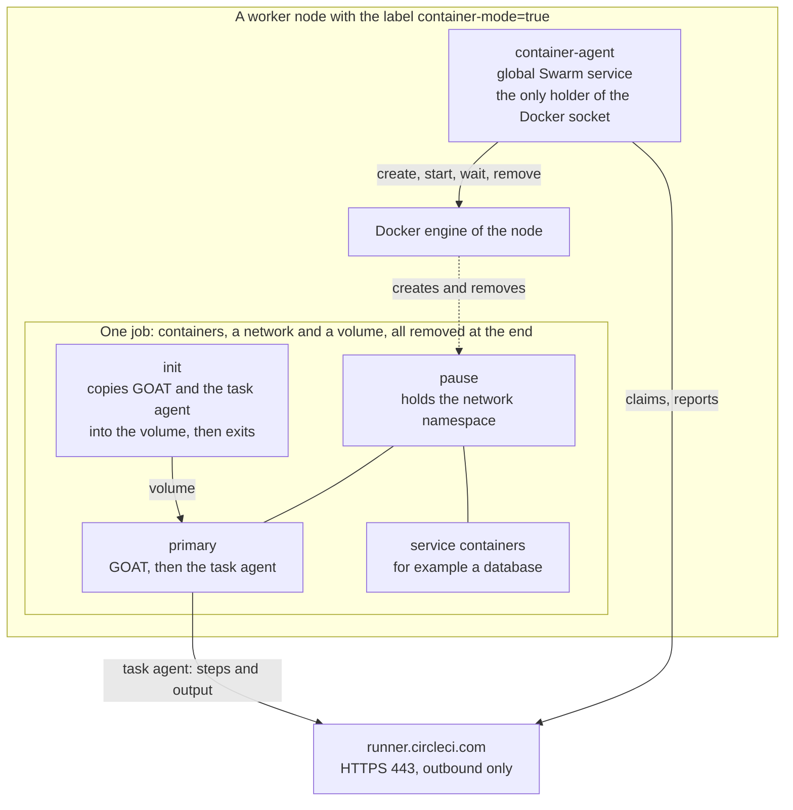

# Container mode (prototype)

Container mode runs jobs that use the Docker executor, `docker: [{image: ...}, {image: ...}]`, on the nodes of a Swarm. It needs no Kubernetes. Together with the machine classes of the rest of this repository, one Swarm then serves both kinds of jobs.

> [!WARNING]
> This is a prototype, and CircleCI does not support it. The unit tests, a Swarm test against a fake runner API, and the init step with GOAT of the public `circleci/runner-init` image pass. A run against the real CircleCI API is still to be done. Do not use it for production jobs yet. Refer to [Status](#status).

## What it is

Machine runner 3 runs a job that has `machine: true`. A job with a `docker:` list belongs to a different kind of runner, [container runner](https://circleci.com/docs/guides/execution-runner/container-runner-installation/), which starts one pod for each job. Container mode copies that design onto the Docker engine of a Swarm node:

| Container runner on Kubernetes | Container mode on Swarm |
|---|---|
| The container agent, with Kubernetes RBAC to create pods and secrets | The swarm container agent, with the Docker socket of its node |
| One pod for each job | One group of containers for each job: a pause container, an init container, the primary container, and one container for each service |
| The pod network: containers reach each other on `localhost` | The same: the containers join the network namespace of the pause container |
| An init container copies the orchestrator (GOAT) and the task agent into an `emptyDir` | The same init image copies them into a volume of the task |
| A Kubernetes secret holds the task token and the settings of GOAT | The environment of the primary container holds them. Nothing else gets them |
| Pod `resources` limits | `--cpus` and `--memory` on every container, from the class settings |
| Kubernetes places pods on nodes with free resources | A global agent on each opted-in node, and a cap on the jobs of the node |

A class serves one mode. A resource class that a machine runner and a container agent both claim from would send jobs to the wrong one, which fails them at once. Use separate classes and separate tokens for machine mode and for container mode.

## Architecture



The agent runs as a global Swarm service. It starts on every worker that carries the node label `machine-runner-swarm.container-mode=true`, and on no manager, no microVM node (`machine-runner-swarm.microvm=true`), no Docker-build node (`machine-runner-swarm.docker-build=true`), and no node that carries the token proxy label (`machine-runner-swarm.proxy=true`). The token proxy keeps off container-mode nodes in turn, so the two never share a node, whatever placement you give the proxy. The agent is the only container that mounts `/var/run/docker.sock`. It reads its class tokens from Swarm secrets that no other container mounts, and it does not use the [token proxy](concepts.md#the-token-proxy): the proxy keeps class tokens out of the runner containers that run jobs, and here no job container ever holds one. The agent that holds the tokens also holds the socket, which is root-equivalent on its node, so a proxy would add a service and protect nothing.

Nothing is built or published. The service runs a stock Go image, pinned by digest. The Go sources of the agent, in [`linux/stack/container-agent`](../linux/stack/container-agent), are Swarm configs that are named after their content, as for the entrypoint of the runner classes. The entrypoint of the service compiles them into a volume of the container, which takes a few seconds, and runs the result. A changed source file gets a new config name, which updates the service, so `docker stack deploy` is the whole upgrade.

## The life of a job

1. The agent polls CircleCI with the token of each class that it serves, but only while it has a free slot (`MACHINE_RUNNER_SWARM_CONTAINER_MAX_TASKS`), because a claim assigns the job to it.
2. The claim returns a task token. The agent uses the task token to fetch the job configuration. A job without a `docker:` list is a machine job: the agent reports a failure, because this class is a container class.
3. It pulls the images: the init image, the pause image, and the images of the job. Registry credentials from the job go to the engine for the pull and are never stored. Variables such as `$DOCKERHUB_PASSWORD` in an image name or in the credentials are expanded from the environment of the job.
4. It creates a network and a volume for this job, and starts the **init** container with the volume at `/opt/circleci/bin`. The image `circleci/runner-init` copies `orchestrator` (GOAT) and `circleci-agent` there and exits. The init container has no network.
5. It starts the **pause** container on the job network. The other containers use `--network container:<pause>`, so every container of the job shares one network namespace, and a service listens on `localhost` for the primary container, as in the Docker executor.
6. It starts each **service** container with its image, entrypoint, command, user, and environment from the job, and the service limits of the class.
7. It starts the **primary** container with the volume, the entrypoint `/opt/circleci/bin/orchestrator run-task`, the environment of the job, and the GOAT settings, which include the task token, in one environment variable. GOAT runs the entrypoint of the job in the background, starts the task agent with the token on its standard input, and removes the settings from the environment before any job step starts.
8. The task agent in the primary container reports steps and output to CircleCI itself. The agent waits for the primary container to stop.
9. It removes the containers, the network, and the volume of the job, and then tells CircleCI that the job is cleaned up. If the primary container stopped with an error, it reports the failure first. If a container could not even start, for example after a failed image pull, it returns the job to the queue, and reports a failure only when CircleCI has no retries left.

When the agent receives SIGTERM, it stops claiming and lets the running jobs finish. The stack sets `stop_grace_period: 5h5m`, as for the machine classes.

When the agent starts, it removes every container, network, and volume that carries its Docker label `machine-runner-swarm.container-mode=1`. These are the leftovers of a crash. Swarm updates the service stop-first, so two agents never run on one node, and the start-up cleanup cannot remove the job of a running agent.

## Deploy

You need a Swarm that is set up as in the [Linux quickstart](quickstart-linux.md), Docker Engine 24 or later on the nodes, a resource class for container mode, and its token. The nodes pull the Go image, the init image, and the pause image, so they need access to Docker Hub and to `registry.k8s.io`.

1. Create the resource class and a token for container mode with the [circleci CLI](https://circleci.com/docs/guides/toolkit/circleci-cli/), as for a machine class, and store the token in a secret. A class serves one mode, so do not reuse the token of a machine class.

   ```bash
   printf '%s' "$TOKEN" | docker secret create docker-default-token -
   ```

2. Label the workers that may run jobs. Never label a manager.

   ```bash
   docker node update --label-add machine-runner-swarm.container-mode=true worker-1
   ```

3. Edit `MACHINE_RUNNER_SWARM_CONTAINER_CLASSES` in [`linux/stack/container-mode.yaml`](../linux/stack/container-mode.yaml): replace `CHANGE-ME` with your namespace, and set the limits. Then deploy it with the main stack file or alone:

   ```bash
   docker stack deploy -c linux/stack/runners.yaml -c linux/stack/container-mode.yaml runners
   ```

4. Run a job. The example [`examples/container-mode.yml`](../examples/container-mode.yml) has a primary container and a PostgreSQL service on `localhost:5432`.

   ```bash
   docker service logs runners_container-agent
   ```

### Settings

The agent reads the environment variables below. The stack file sets them in the `environment` of the service.

| Variable | Default | Meaning |
|---|---|---|
| `MACHINE_RUNNER_SWARM_CONTAINER_CLASSES` | none, required | A JSON array of the classes of this agent. Each entry has `name` (`<namespace>/<class>`), `token_file` (a Swarm secret: the bare token, or a runner config with an `auth_token` line), and the limits `primary` and `service`, each with `cpus`, `memory_mb`, and `pids` (default 4096) |
| `MACHINE_RUNNER_SWARM_CONTAINER_MAX_TASKS` | `2` | Jobs at the same time on this node. The agent claims only while it has a free slot |
| `MACHINE_RUNNER_SWARM_CONTAINER_MAX_RUN_TIME` | `5h` | The longest a job may run. After it, the agent reports a failure and removes the job |
| `MACHINE_RUNNER_SWARM_CONTAINER_INIT_IMAGE` | `circleci/runner-init:<tag of the claim>` | The init image. The stack file pins a digest. Unset it to follow the tag of the claim, as container runner does |
| `MACHINE_RUNNER_SWARM_CONTAINER_PAUSE_IMAGE` | `registry.k8s.io/pause:3.10` | The image that holds the network namespace. The stack file pins a digest |
| `MACHINE_RUNNER_SWARM_CONTAINER_PULL` | `always` | `always` pulls a tag before each job, as container runner does. `missing` pulls only an image that the node lacks. An image pinned by digest is always pulled once |
| `MACHINE_RUNNER_SWARM_CONTAINER_RUNNER_API` | `https://runner.circleci.com` | The runner API. Set the URL of your CircleCI server for a server installation |
| `MACHINE_RUNNER_SWARM_CONTAINER_POLL_INTERVAL` | `3s` | The wait between claims when no job is queued |
| `MACHINE_RUNNER_SWARM_CONTAINER_NAME` | the hostname | The name that the agent gives CircleCI |
| `MACHINE_RUNNER_SWARM_CONTAINER_DOCKER_SOCKET` | `/var/run/docker.sock` | The Docker socket of the node, as seen inside the agent container |
| `MACHINE_RUNNER_SWARM_CONTAINER_KEEP_FAILED` | unset | `true` leaves the containers, network, and volume of a failed job on the node, so that you can read `docker logs`. The next start of the agent removes them. Only for debugging: a kept primary container holds the task token |

## Security model

The agent is a trusted component, like the Kubernetes service account of container runner.

| Question | Answer |
|---|---|
| What holds the Docker socket? | Only the agent. It runs as root with a read-only root filesystem and no capabilities, and the socket is root-equivalent on its node. The test `linux/tests/container-mode.sh` checks that no job container mounts it. The Go compiler is in this container too, because it builds the agent at start-up. It gives an attacker nothing that the socket does not give, but you can compile the sources into an image of your own (`CGO_ENABLED=0 go build`) and set `image` and `entrypoint` in the stack file for a smaller container |
| Where are the class tokens? | In Swarm secrets that only the agent mounts, and in the memory of the agent. The agent keeps its own tokens and does not go through the token proxy of the machine classes: whoever holds the socket can read the secrets of its node, so the proxy would protect nothing here. No job container has a class token, a secret directory, or a way to claim a job. The agent never runs on the node of the token proxy, so the tokens of the machine classes are not next to the socket |
| Where is the task token? | In the environment of the primary container, in one variable that GOAT removes before it starts the task agent, which reads the token from its standard input. The token is scoped to this one job. Anyone who can use the Docker API of the node can still read it with `docker inspect`, so the node must not hand the socket to jobs. Refer to [Docker builds](docker-builds.md) |
| Can one job reach another? | Each job has its own bridge network, and Docker does not route between them. A job can reach the internet and the node through the gateway, as a machine class can. Services of one job listen on `localhost`, not on a shared network |
| What stops a runaway job? | `--cpus` and `--memory` (without swap) and a process limit on every container, and a maximum run time. They are enforced by the kernel of the node |
| What does a job container keep? | Default capabilities without `NET_RAW` and `MKNOD`, no privileged mode, no devices, no host paths. It runs as the user of its image, or the `user` of the job. `cimg` images give the job `sudo`, as in the Docker executor |
| Is it a virtual machine boundary? | No. All containers of a node share its kernel. Use the machine runner orchestrator for untrusted code. Refer to [Security](security.md) |
| Which images does the agent trust? | Those that the job names, as in the Docker executor. The Go, init, and pause images are pinned by digest in the stack file. Update the init pin with the task agent, or follow the tag of the claim |
| Where is the audit trail? | `docker service logs runners_container-agent` shows each job, its containers, and what failed. Tokens are never logged |

An attacker who can change the job configuration of a project can choose the images that run on your nodes, as with any runner. Restrict who can use the class with the same controls as for a machine class.

## Sizing

Swarm sees only the agent service, so it cannot place jobs by free memory or CPU. The agent protects the node by other means:

- `MACHINE_RUNNER_SWARM_CONTAINER_MAX_TASKS` caps the jobs of a node. Choose it so that `MACHINE_RUNNER_SWARM_CONTAINER_MAX_TASKS` times the primary limit plus the service limits of a job fits in the node. The default classes in the stack file allow 4 GiB for the primary container and 2 GiB for each service, so a job with one service needs up to 6 GiB.
- Swarm spreads nothing. Each node serves its own jobs until its cap is reached, and a job that finds no free slot stays in the CircleCI queue and runs on another node.
- A global service runs on every labelled node, so scaling out means labelling another worker. The agent needs up to 1 GiB while it compiles at start-up, and little afterwards.

## Limits

| Limit | Detail |
|---|---|
| Prototype | Not run against the real CircleCI API yet. Not supported by CircleCI. Refer to [Status](#status) |
| Linux only | Linux workers on amd64 and arm64 in principle. Only amd64 is tested. Refer to [Windows](#windows) |
| No Rerun job with SSH | The agent publishes no port and passes no SSH settings to GOAT |
| No Docker layer caching, no `setup_remote_docker` | The job has no engine. Use the [docker-build class](docker-builds.md) from a machine class, or a daemonless builder |
| No ECR authentication | A job that uses `aws_auth` fails. Registry credentials with a user name and password work |
| No service logs or lifecycle output in the CircleCI UI | Container runner adds a logging container that streams the logs of service containers and the spin-up step. The prototype has none. Read the logs on the node with `docker logs` while a job runs, or in the agent log |
| No wait for service readiness | Services start before the primary container, and nothing waits until they listen. Use `dockerize -wait` or a retry in the job, as with the Docker executor |
| The job user | A `user:` of a container becomes the user of the Docker container, and Docker resolves a name from the image. Container runner instead passes a name to GOAT, which switches to that user and so needs a container that starts as root. The prototype avoids that need |
| One limit pair for all services | Container runner can set limits for each service image. The prototype sets one pair for every service of a class |
| Orphans after a crash | The agent removes leftover containers when it starts. CircleCI keeps the job of a crashed agent until its own timeout, because the agent has no record of the task token |
| The `agent` tag of the init image changes | The stack file pins a digest, so the task agent of a job may be older than what CircleCI expects. Watch for new tags, or unset `MACHINE_RUNNER_SWARM_CONTAINER_INIT_IMAGE` |

## Windows

Windows is not supported. A Windows version needs several things that Docker on Windows does not provide in the same form:

- A way to share one network namespace between containers, which the `localhost` behavior depends on. Check whether the engine accepts `--network container:<id>` for Windows containers. If it does not, services would need their own addresses on a per-job network, or the agent would have to create the network endpoint itself, as Kubernetes does with its network plugin.
- Windows images for the init step, GOAT, and the pause container, and the Windows build of the task agent, which CircleCI offers as a preview in container runner.
- The named pipe `\\.\pipe\docker_engine` in place of the socket, process or Hyper-V isolation, and memory and CPU limits that match the isolation mode.
- Paths such as `C:\opt\circleci\bin` for the volume, and a different user model for jobs.

## Status

| Piece | State |
|---|---|
| Unit tests (`linux/stack/container-agent`, `go test`) | Pass: the container layout, limits, environment, GOAT settings, failure and retry paths, cleanup, the start-up sweep, the cap, and that no token reaches a log |
| Swarm test (`linux/tests/container-mode.sh`) | Passes in a Swarm in Docker-in-Docker: no agent on a node with the proxy or microVM label, one job with a service on `localhost`, one failing job, the limits, no socket in the job, the cap, the cleanup, and the orphans |
| Init image and GOAT | The public `circleci/runner-init` image fills a volume in plain Docker, and its `orchestrator run-task` starts a task agent with the settings that the agent writes |
| Real CircleCI job | Not yet. A first run on a test class is the next step |

## Related pages

- [Concepts](concepts.md) explains classes, add-on stack files, and the model of the machine classes.
- [Security](security.md) explains the token model and what a job can reach.
- [FAQ: Can it run Docker executor jobs?](faq.md#can-it-run-docker-executor-jobs)
