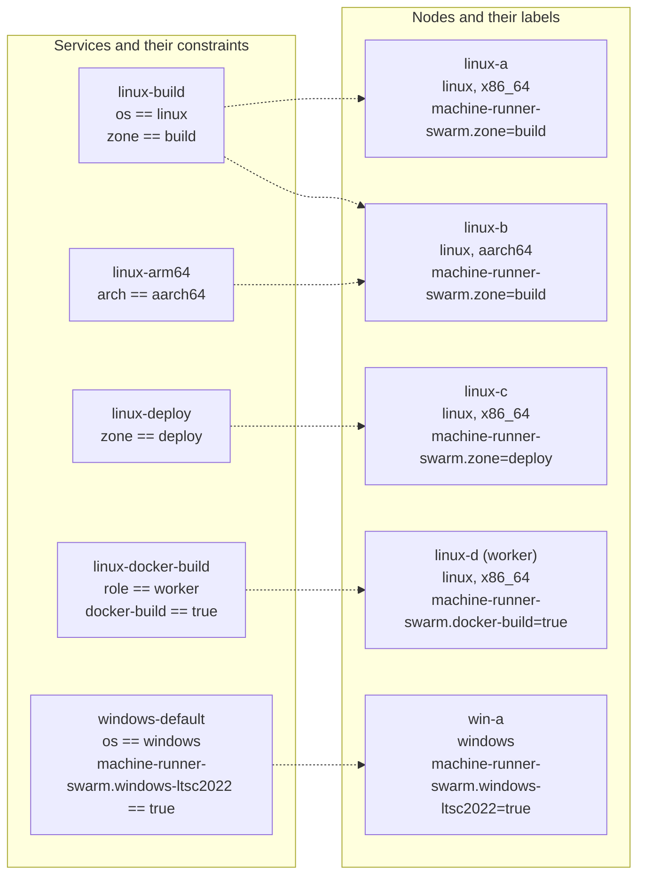

# Multi-node clusters

This page runs the stack on a cluster of Linux amd64, Linux arm64 and Windows nodes. One Swarm schedules every replica, and labels decide which node may run which resource class.

A one-node install that follows the quickstart cannot grow: its swarm listens on the loopback address. Start a cluster here, with a routable address, and use the install pages ([Linux](install-linux.md), [Windows Server](install-windows.md)) for the per-node steps.

| Layout | Hosts | Use it for |
|---|---|---|
| One node | 1 | A trial. Jobs and the token proxy share the host |
| Small | 2: a manager with the proxy label, one worker | Jobs on the worker. No manager failover |
| Production | 4 or more: three managers (one with the proxy label, the others drained), and workers | Quorum survives the loss of one manager. The proxy runs on one node: if it is lost, label another ([The node of the proxy](operations.md#the-node-of-the-proxy)) |



A dotted line means that the node satisfies every constraint of the service, so Swarm may place a replica there. A service stays pending when no node matches.

## Plan the cluster

| Node type | Role | Needs |
|---|---|---|
| Manager | Holds the cluster state and every secret. Schedules tasks | Docker Engine. Linux managers can manage Windows workers |
| Linux worker | Runs Linux services | Docker Engine. The `runner-distributor` service installs the runner for the architecture of the node |
| Windows worker | Runs Windows services | Docker Engine in Windows-container mode, the `ltsc2022` base image, the `machine-runner-swarm.windows-ltsc*` labels. Nothing else: the distributor installs the runner and Git |

### Managers and quorum

Managers keep the cluster state, including every Swarm secret, in an encrypted Raft log. Each manager holds a copy.

- Use one manager for a small installation without availability needs, three to survive the loss of one, or five to survive the loss of two. Use an odd number: quorum is a majority.
- Keep the managers on reliable, low-latency links.

Quorum matters more here than in a typical Swarm. Every job ends with a runner exit, and only a manager with quorum can create the replacement task. Without quorum, running jobs finish but the runners are not replaced, so the capacity drops to zero.

Keep jobs off managers when you can: a container breakout on a manager exposes the tokens of every class. In a cluster, label the node that runs the token proxy (a manager) and tell the deploy about it. Runner services never run on a node with that label, so no job shares a node with the class tokens.

```bash
docker node update --label-add machine-runner-swarm.proxy=true <MANAGER_NAME>
sudo env MACHINE_RUNNER_SWARM_PROXY_PLACEMENT='node.labels.machine-runner-swarm.proxy == true' docker stack deploy -c deploy/runners.yaml runners
```

Keep the variable with your other deploy variables ([Keep the deploy variables in version control](operations.md#keep-the-deploy-variables-in-version-control)): a deploy without it puts the proxy back on any manager. Drain the other managers so that they run no tasks.

```bash
docker node update --availability drain <OTHER_MANAGER_NAME>
```

> [!WARNING]
> **The token proxy needs a node that is not drained.** `token-proxy` runs on a manager by default (`node.role == manager`), or on the labeled node. If you drain every manager, or the labeled node, the proxy stays `Pending` (`no suitable node`) and no runner can claim a job, with no other error: the runners only log 502 or a refused connection to `token-proxy`. The same happens when the managers are Linux hosts and the proxy is the Windows one (`token-proxy-windows` also defaults to a manager, and a Windows task cannot run on a Linux manager), and when a Windows-only swarm has no Windows manager. Label a Windows node for it (a worker works), and in a mixed cluster label one Linux and one Windows node, because each proxy keeps to its own operating system. Never drain the labeled node without the steps in [The node of the proxy](operations.md#the-node-of-the-proxy). A proxy on a worker still holds every class token, so choose a node that runs no jobs.

On a single-node Swarm the only node is a manager and runs the replicas and the proxy: set no label. Never use the Docker socket classes (pattern A) there ([Docker builds](docker-builds.md)).

## Create the swarm

Initialize Swarm on the first manager with an address that the other nodes can reach (not the loopback address of the single-node install).

```bash
docker swarm init --advertise-addr <MANAGER_IP_ADDRESS> --task-history-limit 2 --default-addr-pool <POOL_CIDR> --default-addr-pool-mask-length 24
```

Two options matter for this stack, and neither is the default:

- **`--task-history-limit 2`.** Every finished job ends a task, and Swarm keeps the last 5 tasks of each slot, with their containers and disk, unless you lower it ([Free disk space](operations.md#free-disk-space)). Change it later with `docker swarm update --task-history-limit 2`.
- **`--default-addr-pool`.** Each Linux class gets its own `/24` overlay network from the default pool of Swarm, `10.0.0.0/8`. Choose a pool that does not overlap your own networks, because an overlap makes tasks unreachable in ways that are hard to see. Choose a range that none of your networks uses, for example a free `/16` from `10.0.0.0/8`: it gives 256 networks. You can set the pool only when you create the swarm.

If you started with the loopback address, run `docker stack rm runners` and `docker swarm leave --force`, initialize again, and recreate the secrets.

Get the join command for each node type on a manager. Run the printed command (`docker swarm join --token <TOKEN> <MANAGER_IP_ADDRESS>:2377`) on the node.

```bash
docker swarm join-token worker
docker swarm join-token manager
```

A join token grants cluster membership: keep it secret, and rotate it with `docker swarm join-token --rotate worker` when it leaks. Confirm the nodes from a manager.

```bash
docker node ls
```

## Join the nodes

### Linux nodes

On each node:

1. Install Docker Engine and confirm that the clock is synchronized ([Prepare each node](install-linux.md#2-prepare-each-node)).
2. Open the ports in [Inter-node ports](#inter-node-ports).
3. Run the join command.

Nothing else is installed on the node. The `runner-distributor` service is `global`, so Swarm starts it on the new node by itself, and it installs the runner into the volume `runner-bin` (it skips a node labeled `machine-runner-swarm.microvm=true`: [the microVM classes](microvm.md#the-runner-in-a-vm) download their own runner). A runner container that starts first waits up to 120 seconds for it.

### Arm nodes

The `runner-distributor` service reads the architecture of the node and installs the `arm64` runner build on an Arm node. Swarm reports Arm nodes as `aarch64` and Intel and AMD nodes as `x86_64`.

- Give each architecture its own resource class, for example `linux-arm64`, constrained with `node.platform.arch == aarch64`: a job cannot pick an architecture inside a class that spans both.
- Use an image that publishes an `arm64` variant (check with `docker buildx imagetools inspect <IMAGE>`).

### Mixed architectures

One cluster can have `x86_64` and `aarch64` nodes. Nothing else is needed on the nodes.

- **Which build a node gets.** Each `runner-distributor` task downloads `circleci-runner_linux_<ARCH>.tar.gz` for its own node and checks its SHA-256 against the entry of that architecture in the manifest. If you set `MACHINE_RUNNER_SWARM_RUNNER_SHA256`, list the hash of every architecture in the cluster. A tarball that does not match installs nothing on that node, and the other nodes still install.
- **Placement.** A class without an architecture constraint can run on both kinds of node. Add `node.platform.arch == aarch64` or `x86_64` to the constraints of the classes that need one. When the nodes of that architecture are drained or gone, the class stays `Pending` with `no suitable node`: it never moves to the other architecture.
- **What is tested.** [`linux/tests/mixed-arch.sh`](../linux/tests/mixed-arch.sh) (the optional CI job `linux-mixed-arch`, see [CI](ci.md)) deploys the shipped stack file on an amd64 manager and an arm64 worker. It checks that each node installs the runner of its own architecture, that a tarball that does not match its manifest entry installs nothing on that node only, and that classes constrained by `node.platform.arch` run only on their architecture, also when the other node is drained.
- **Emulated, not real.** That arm64 worker is a `docker:dind` container under QEMU emulation on an x86_64 host. The test proves the install, the verification and the placement logic, not the speed or system call behavior of an Arm node. IPsec on overlays does not work under emulation, so it deploys the plain-overlay copy of the stack files (the opt-out of [Encrypted class networks](#encrypted-class-networks)), and `placement.sh` tests the encrypted files on two nodes. Real arm64 nodes are tested by the single-node jobs `linux-arm64` and `e2e-linux-arm64` (a real runner on an Arm VM).

### Windows nodes

On each node:

1. Install Docker Engine in Windows-container mode and the Windows Containers feature.
2. Pull the images before the join ([Prepare each host](install-windows.md#2-prepare-each-host)). The runner and Git are not staged: the service `runner-distributor-windows` installs them after the join.
3. Open the ports in [Inter-node ports](#inter-node-ports).
4. Run the join command.
5. From a manager, label the node with the image tags it can run. A Server 2025 node also gets `windows-ltsc2025`, because it runs `ltsc2022` images too.

   ```bash
   docker node update --label-add machine-runner-swarm.windows-ltsc2022=true <NODE_NAME>
   docker node update --label-add machine-runner-swarm.windows-ltsc2025=true <NODE_NAME>
   ```

The labels are required, because the image build must be the host build or an older one ([Image tags and host builds](install-windows.md#image-tags-and-host-builds)).

Deploy the Linux and Windows files into the same stack name. The service names differ, so they do not collide. Do not use `docker stack deploy --prune` there: it removes the services of the other file.

**Mixed Linux and Windows clusters are tested by hand, not in CI.** The constraints on `node.platform.os` keep each service on its own operating system. A cluster of a Linux manager and a Windows Server 2022 worker ran real CircleCI jobs on both operating systems, with both runner distributors and an overlay network between them. CI tests each operating system on its own Swarm, because the Linux and Windows VMs of CI cannot reach each other. A mixed cluster needs the ports 2377, 7946 and 4789 open between its nodes ([Inter-node ports](#inter-node-ports)), and a Linux manager that both stack files are deployed from.

## Labels and constraints

A service constraint says where Swarm may place a replica, and all constraints of a service must hold. Add them under `deploy.placement.constraints`. The `spread: node.id` preference, which the shipped stack files set, spreads the replicas evenly over the matching nodes.

```yaml
deploy:
  placement:
    constraints:
      - node.platform.os == linux
      - node.platform.arch == aarch64
      - node.labels.machine-runner-swarm.zone == build
    preferences:
      - spread: node.id
```

### Built-in node properties

| Property | Values |
|---|---|
| `node.platform.os` | `linux`, `windows` |
| `node.platform.arch` | `x86_64`, `aarch64` |
| `node.hostname` | The hostname of the node |
| `node.role` | `manager`, `worker` |

### Labels used by the stack

Set a label with `docker node update --label-add <KEY>=<VALUE> <NODE_NAME>`, and remove it with `--label-rm <KEY>`. Constraints on labels have the form `node.labels.<KEY> == <VALUE>`.

| Label | Value | Used by |
|---|---|---|
| `machine-runner-swarm.windows-ltsc2022` | `true` | Every shipped Windows service, which uses `ltsc2022` images. Set on Server 2022 and 2025 nodes |
| `machine-runner-swarm.windows-ltsc2025` | `true` | Services on an `ltsc2025` image. Set on Server 2025 nodes only |
| `machine-runner-swarm.zone` | A network zone name | Services that must run in one zone. A commented example sits in the Linux placement block |
| `machine-runner-swarm.docker-build` | `true` | The docker-build services (pattern A) ([Docker builds](docker-builds.md)) |
| `machine-runner-swarm.container-mode` | `true` | The container agent of [container mode](container-mode.md) (experimental), on workers only. The token proxy stays off container-mode nodes |
| `machine-runner-swarm.proxy` | `true` | The node that runs the token proxy, in a cluster. With `MACHINE_RUNNER_SWARM_PROXY_PLACEMENT='node.labels.machine-runner-swarm.proxy == true'` the proxy runs only there, and no runner service runs on a node with this label. On a single node, set no label ([Where the proxy runs, and when it moves](operations.md#where-the-proxy-runs-and-when-it-moves)) |
| `machine-runner-swarm.microvm` | `true` | The microVM services, on nodes whose Docker daemon runs every container in a Kata microVM. Every other service stays off these nodes ([MicroVM jobs](microvm.md)) |
| `machine-runner-swarm.class.<SERVICE>` | `true` | Pins a service to the labeled nodes. `windows-persistent` uses `machine-runner-swarm.class.windows-persistent`. `linux-persistent` pins itself with `node.hostname` instead |

### Keep the docker-build node to itself

A job on a docker-build class controls the whole Docker engine of its node, so it can enter every other container there and read the tokens of any class that runs on that node. The stack files keep the other classes off that node: every runner service except the docker-build ones carries the constraint `node.labels.machine-runner-swarm.docker-build != true` (a node without the label matches it, because Swarm treats a missing label as "not equal"). `runner-distributor` has no such constraint, because the docker-build class needs the runner on its node too. A node that gets the label stops running those services: Swarm starts replacements on other nodes, or leaves them pending. Add the same constraint to every service you write yourself.

## Network zones

Use the label `machine-runner-swarm.zone` when your nodes sit in different network zones, for example a build network and a deploy network with different firewall rules or egress addresses.

1. Label each node with its zone.

   ```bash
   docker node update --label-add machine-runner-swarm.zone=build linux-a
   docker node update --label-add machine-runner-swarm.zone=deploy linux-c
   ```

2. Copy a service for each zone, give each copy its own resource class, secret and name, and add the constraint.

   ```yaml
   linux-deploy:
     # ...
     deploy:
       placement:
         constraints:
           - node.platform.os == linux
           - node.labels.machine-runner-swarm.zone == deploy
   ```

A job picks the zone by picking the resource class. Do not use zones to balance capacity: use `replicas` and `spread`.

## Registry needs

Swarm does not share images between nodes: each node pulls the image of a task from a registry the first time the task lands there.

- Every node must reach the registry of every image that a service on that node uses ([Egress hosts](security.md#egress-hosts)). Your own image must be in a registry that all nodes of its OS can reach ([Images](images.md)).
- For a private registry, run `docker login` on the manager and deploy with `docker stack deploy --with-registry-auth`.
- Pin images by digest, for example `cimg/base:2026.10@sha256:<DIGEST>`, so every node runs the same content. Tags such as `21.0` move.
- Pull large images ahead of time (a Windows `servercore` image is about 2.2 GB compressed). Public registries apply pull rate limits: a mirror or an authenticated pull avoids failed pulls.
- `runner-distributor` runs the stock `alpine:3` image on every Linux node. If the nodes cannot reach Docker Hub, mirror it and change `image` in your copy of the stack file. Copy it with its digest (`docker buildx imagetools create` keeps it), so the pin holds.
- The token proxy runs from `ccilabs/machine-runner-swarm-proxy`. Mirror it with its signature (`cosign copy`), pin the digest in `MACHINE_RUNNER_SWARM_PROXY_IMAGE`, and keep that in your deploy file ([Upgrade the token proxy](operations.md#upgrade-the-token-proxy)).
- A manager that cannot reach the registry cannot resolve a tag to a digest on deploy. Use `docker stack deploy --resolve-image never`, or images that you pinned by digest and mirrored.
- A site with no route to the internet also needs the runner download and the task agent ([CircleCI server, proxies, and hosts without internet](operations.md#circleci-server-proxies-and-hosts-without-internet)).

## Inter-node ports

Swarm needs these ports between all nodes of the cluster. Open them only for the addresses of cluster nodes.

| Port | Protocol | Purpose | Nodes |
|---|---|---|---|
| 2377 | TCP | Cluster management | Managers only receive it |
| 7946 | TCP and UDP | Node discovery | All nodes |
| 4789 | UDP | Overlay network (VXLAN) | All nodes |
| IP protocol 50 (ESP) | IPsec | Encrypted overlay networks (the Linux class networks). It is a protocol, not a port | All nodes with Linux services |

The runner containers need no inbound ports, and the stack publishes none. Outbound HTTPS from each node is the only other requirement ([Egress hosts](security.md#egress-hosts)).

Ubuntu with `ufw`:

```bash
sudo ufw allow from <CLUSTER_SUBNET> to any port 2377 proto tcp
sudo ufw allow from <CLUSTER_SUBNET> to any port 7946
sudo ufw allow from <CLUSTER_SUBNET> to any port 4789 proto udp
sudo ufw allow from <CLUSTER_SUBNET> proto esp
```

RHEL with `firewalld`:

```bash
sudo firewall-cmd --permanent --new-zone=swarm
sudo firewall-cmd --permanent --zone=swarm --add-source=<CLUSTER_SUBNET>
sudo firewall-cmd --permanent --zone=swarm --add-port=2377/tcp --add-port=7946/tcp --add-port=7946/udp --add-port=4789/udp
sudo firewall-cmd --permanent --zone=swarm --add-protocol=esp
sudo firewall-cmd --reload
```

In a cloud, add a security group rule for protocol number 50 (ESP) with the security group of the nodes as the source. Most consoles list it as "Custom protocol 50" or "ESP".

Windows Server:

```powershell
New-NetFirewallRule -DisplayName 'Swarm TCP' -Direction Inbound -Action Allow -Protocol TCP -LocalPort 2377,7946 -RemoteAddress <CLUSTER_SUBNET>
New-NetFirewallRule -DisplayName 'Swarm UDP' -Direction Inbound -Action Allow -Protocol UDP -LocalPort 7946,4789 -RemoteAddress <CLUSTER_SUBNET>
```

On a Windows host with a single network adapter, an existing `transparent` network can block the creation of the overlay networks: see the Microsoft documentation on Windows container networking if overlay creation fails.

### Encrypted class networks

The Linux stack files create the class networks as encrypted overlays: `driver: overlay` with `driver_opts: {encrypted: "true"}`. The runners reach the token proxy over `http://token-proxy:8080`, and that traffic carries task tokens, the job configuration with the secrets of its contexts, and step output. In clear text, anyone on the network could read it or inject packets into the overlay, which the source-address guarantee of the proxy depends on. Swarm encrypts the VXLAN traffic between nodes with IPsec instead. A node that cannot reach another over ESP drops that traffic, which looks like a runner that cannot find `token-proxy`: if a runner cannot reach the proxy from another node, check ESP first.

- **Cost.** IPsec costs CPU on every node and some throughput. A single-node Swarm needs nothing open.
- **Opt out.** If the network between your nodes is yours (a private network, or a link that you encrypt another way), delete `driver_opts: {encrypted: "true"}` from every class network of your copy of the Linux stack files (`runners.yaml` and the add-on files you use). A Swarm network cannot change after it exists: run `docker stack rm runners`, wait until the networks are gone (`docker network ls`), and deploy again. Without the option, ESP is not needed.
- **Windows.** Docker does not support encrypted overlay networks for Windows containers, so the Windows stack files set no `driver_opts`, and their overlay carries the traffic of the Windows classes and `token-proxy-windows` in clear text between nodes. Keep the Windows nodes on a network that you trust, or encrypt the link at the host (for example with Windows Firewall connection security rules for IPsec). All Windows classes share the default overlay of the stack.

## Verify the placement

```bash
docker node ls
docker node inspect --format '{{ .Spec.Labels }}' <NODE_NAME>
docker service ps runners_linux-default
```

The `NODE` column of `docker service ps` shows where each replica runs. A task that stays `Pending` shows the reason in the `ERROR` column, for example `no suitable node (scheduling constraints not satisfied on 2 nodes)` ([A task stays pending](troubleshooting.md#a-task-stays-pending)).

## Next

- [Resource classes](resource-classes.md)
- [Operations](operations.md), including how to drain a node for patching
- [Security](security.md)
