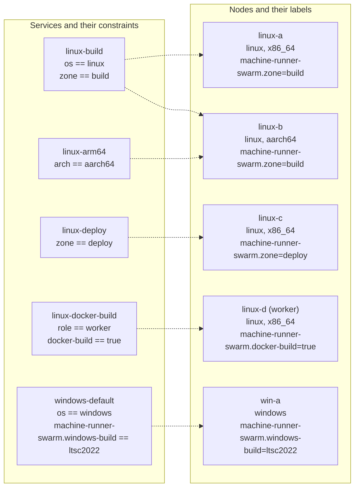

# Multi-node clusters

This page describes how to run the stack on a cluster of nodes: Linux amd64, Linux arm64, and Windows. One Swarm schedules every replica, and labels decide which node may run which resource class.

Start with the single-node steps on [Install on Linux with Docker Swarm](install-linux.md) or [Install on Windows Server with Docker Swarm](install-windows.md), then use this page to add nodes.



A dotted line means that the node satisfies every constraint of the service, so Swarm may place a replica of it there. A service stays pending when no node matches.

## Plan the cluster

| Node type | Role | Needs |
|---|---|---|
| Manager | Holds the cluster state and every secret. Schedules tasks | Docker Engine. Linux managers can manage Windows workers |
| Linux worker | Runs Linux services | Docker Engine, `/opt/machine-runner-swarm` with the build for its architecture |
| Windows worker | Runs Windows services | Docker Engine in Windows-container mode, `C:\machine-runner-swarm`, the `machine-runner-swarm.windows-build` label |

### Managers and quorum

Managers keep the cluster state in a Raft log, including every Swarm secret. Swarm encrypts the log at rest and in transit, and each manager holds a copy.

- Use one manager for a small installation without availability needs.
- Use three managers to survive the loss of one, or five to survive the loss of two. Use an odd number, because quorum is a majority and an even number adds no tolerance.
- Keep the managers on reliable, low-latency links.

Quorum matters more for this stack than for a typical Swarm. Every job ends with a runner exit, and only a manager with quorum can create the replacement task. Without quorum, running jobs finish, but the runners are not replaced, so the capacity drops to zero.

Keep jobs off managers when you can. A container breakout on a manager exposes the tokens of every class. Drain each manager so that it runs no tasks:

```console
$ docker node update --availability drain <manager name>
```

On a single-node Swarm the only node is a manager and runs the replicas. Never use the Docker socket classes (pattern A) there. Refer to [Docker Builds](docker-builds.md).

## Create the swarm

Initialize Swarm on the first manager with an address that the other nodes can reach. The loopback address that the single-node install uses cannot accept other nodes.

```console
$ docker swarm init --advertise-addr <manager IP address>
```

If you started with the loopback address, remove the stack with `docker stack rm runners`, run `docker swarm leave --force`, initialize again, and recreate the secrets.

Get the join command for each node type on a manager:

```console
$ docker swarm join-token worker
$ docker swarm join-token manager
```

Run the printed command on the node. It has the form `docker swarm join --token <token> <manager IP address>:2377`. A join token grants cluster membership, so keep it secret. Rotate it with `docker swarm join-token --rotate worker` when it leaks.

Confirm the nodes from a manager:

```console
$ docker node ls
```

## Join the nodes

### Linux nodes

On each node:

1. Install Docker Engine and confirm that the clock is synchronized. Refer to [Prepare each node](install-linux.md#2-prepare-each-node).
2. Install the runner and entrypoint into `/opt/machine-runner-swarm`. Refer to [Install the runner and the entrypoint](install-linux.md#3-install-the-runner-and-the-entrypoint). The directory must exist on every node that can run a service.
3. Open the ports in [Inter-node ports](#inter-node-ports).
4. Run the join command.

### Arm nodes

The installation steps on [Install on Linux with Docker Swarm](install-linux.md) pick the `arm64` runner build on an Arm node. Swarm reports the architecture of Arm nodes as `aarch64` and that of Intel and AMD nodes as `x86_64`.

- Give each architecture its own resource class, for example `linux-arm64`, and constrain it with `node.platform.arch == aarch64`. A class that spans both architectures places replicas unpredictably, and a job cannot pick one.
- Use an image that publishes an `arm64` variant. For example, check with `docker buildx imagetools inspect <image>`.

### Windows nodes

On each node:

1. Install Docker Engine in Windows-container mode and the Windows Containers feature.
2. Stage `C:\machine-runner-swarm` and pull the images, including your stop-timeout image. Refer to [Stage the runner and Git](install-windows.md#3-stage-the-runner-and-git) and [Build the stop-timeout image](install-windows.md#4-build-the-stop-timeout-image). Do this before the join.
3. Open the ports in [Inter-node ports](#inter-node-ports).
4. Run the join command.
5. Label the node from a manager with its build: `docker node update --label-add machine-runner-swarm.windows-build=ltsc2022 <node name>`. Use `ltsc2025` on Server 2025.

The labels are required, because the image build must match the host build. Refer to [Image tags and host builds](install-windows.md#image-tags-and-host-builds).

Deploy the Linux and Windows files into the same stack name. The service names differ, so they do not collide. Do not use `docker stack deploy --prune` there, because it removes the services of the other file.

## Labels and constraints

A service constraint says where Swarm may place a replica. All constraints of a service must hold. Add them under `deploy.placement.constraints` in the stack file.

```yaml
deploy:
  placement:
    constraints:
      - node.platform.os == linux
      - node.platform.arch == aarch64
      - node.labels.machine-runner-swarm.zone == build
    preferences:
      - spread: node.id
```

The `spread: node.id` preference spreads the replicas of a service evenly over the matching nodes. The shipped stack files set it.

### Built-in node properties

| Property | Values |
|---|---|
| `node.platform.os` | `linux`, `windows` |
| `node.platform.arch` | `x86_64`, `aarch64` |
| `node.hostname` | The hostname of the node |
| `node.role` | `manager`, `worker` |

### Labels used by this repository

Set a label with `docker node update --label-add <key>=<value> <node name>`. Remove it with `--label-rm <key>`.

| Label | Value | Used by |
|---|---|---|
| `machine-runner-swarm.windows-build` | `ltsc2022` or `ltsc2025` | Every Windows service. Matches the image to the host build |
| `machine-runner-swarm.zone` | The name of a network zone | Services that must run in one zone. A commented example sits in the Linux placement block |
| `machine-runner-swarm.docker-build` | `true` | The docker-build services (pattern A). Refer to [Docker Builds](docker-builds.md) |
| `machine-runner-swarm.class.<service>` | `true` | Pins a service to the labeled nodes. `windows-persistent` uses `machine-runner-swarm.class.windows-persistent`. `linux-persistent` pins itself with `node.hostname` instead |

Constraints on labels use the form `node.labels.<key> == <value>`. For example, `node.labels.machine-runner-swarm.docker-build == true`.

### Keep the docker-build node to itself

A job on a docker-build class controls the whole Docker engine of its node, so it can inspect and enter every other container there. Keep other classes off that node by adding `node.labels.machine-runner-swarm.docker-build != true` to their constraints.

## Network zones

Use the label `machine-runner-swarm.zone` when your nodes sit in different network zones, for example a build network and a deploy network with different firewall rules or egress addresses.

1. Label each node with its zone:

   ```console
   $ docker node update --label-add machine-runner-swarm.zone=build linux-a
   $ docker node update --label-add machine-runner-swarm.zone=deploy linux-c
   ```

2. Copy a service for each zone, give each copy its own resource class, secret, and name, and add the constraint:

   ```yaml
   linux-deploy:
     # ...
     deploy:
       placement:
         constraints:
           - node.platform.os == linux
           - node.labels.machine-runner-swarm.zone == deploy
   ```

A job picks the zone by picking the resource class. Do not use zones to balance capacity. Use `replicas` and `spread` for that.

## Registry needs

Swarm does not share images between nodes. Each node pulls the image of a task from a registry the first time the task lands there.

- Every node must reach the registry of every image that a service on that node uses. Refer to [Egress hosts](security.md#egress-hosts).
- For a private registry, run `docker login` on the manager and deploy with `docker stack deploy --with-registry-auth`. Swarm then passes the credentials to the nodes that run the tasks.
- Pin images by digest, for example `cimg/base:2026.10@sha256:<digest>`, so that every node runs the same content. Tags such as `21.0` move.
- Pull large images ahead of time. A Windows `servercore` image is about 2.2 GB compressed.
- Public registries apply pull rate limits. A mirror or an authenticated pull avoids failed pulls on a busy cluster.
- A baked image, your own image, and the Windows stop-timeout image must be in a registry that all nodes of their OS can reach. Refer to [Images](images.md).

## Inter-node ports

Swarm needs these ports between all nodes of the cluster. Open them only for the addresses of cluster nodes.

| Port | Protocol | Purpose | Nodes |
|---|---|---|---|
| 2377 | TCP | Cluster management | Managers only receive it |
| 7946 | TCP and UDP | Node discovery | All nodes |
| 4789 | UDP | Overlay network (VXLAN) | All nodes |

The runner containers need no inbound ports, and the stack publishes none. Outbound HTTPS from each node is the only other requirement.

Ubuntu with `ufw`:

```console
$ sudo ufw allow from <cluster subnet> to any port 2377 proto tcp
$ sudo ufw allow from <cluster subnet> to any port 7946
$ sudo ufw allow from <cluster subnet> to any port 4789 proto udp
```

RHEL with `firewalld`:

```console
$ sudo firewall-cmd --permanent --new-zone=swarm
$ sudo firewall-cmd --permanent --zone=swarm --add-source=<cluster subnet>
$ sudo firewall-cmd --permanent --zone=swarm --add-port=2377/tcp --add-port=7946/tcp --add-port=7946/udp --add-port=4789/udp
$ sudo firewall-cmd --reload
```

Windows Server:

```powershell
New-NetFirewallRule -DisplayName 'Swarm TCP' -Direction Inbound -Action Allow -Protocol TCP -LocalPort 2377,7946 -RemoteAddress <cluster subnet>
New-NetFirewallRule -DisplayName 'Swarm UDP' -Direction Inbound -Action Allow -Protocol UDP -LocalPort 7946,4789 -RemoteAddress <cluster subnet>
```

On a Windows host with a single network adapter, an existing `transparent` network can block the creation of the overlay networks. Refer to the Microsoft documentation on Windows container networking if overlay creation fails.

## Verify the placement

```console
$ docker node ls
$ docker node inspect --format '{{ .Spec.Labels }}' <node name>
$ docker service ps runners_linux-default
```

The `NODE` column of `docker service ps` shows where each replica runs. A task that stays in `Pending` shows the reason in the `ERROR` column, for example `no suitable node (scheduling constraints not satisfied on 2 nodes)`. Refer to [Troubleshooting](troubleshooting.md#a-task-stays-pending).

## Additional resources

- [Resource Classes](resource-classes.md)
- [Operations](operations.md), including how to drain a node for patching
- [Security](security.md)
