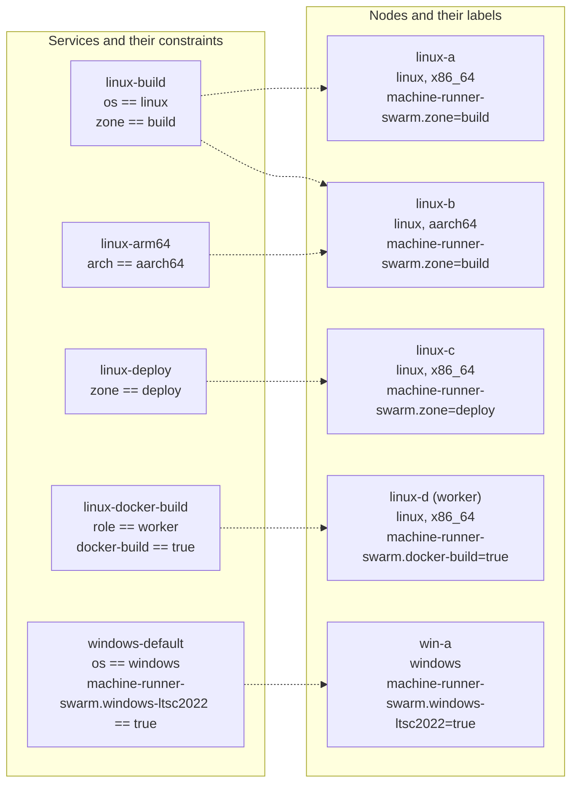

# Multi-node clusters

This page describes how to run the stack on a cluster of nodes: Linux amd64, Linux arm64, and Windows. One Swarm schedules every replica, and labels decide which node may run which resource class.

Start with the single-node steps on [Install on Linux with Docker Swarm](install-linux.md) or [Install on Windows Server with Docker Swarm](install-windows.md), then use this page to add nodes.



A dotted line means that the node satisfies every constraint of the service, so Swarm may place a replica of it there. A service stays pending when no node matches.

## Plan the cluster

| Node type | Role | Needs |
|---|---|---|
| Manager | Holds the cluster state and every secret. Schedules tasks | Docker Engine. Linux managers can manage Windows workers |
| Linux worker | Runs Linux services | Docker Engine. The `runner-distributor` service installs the runner for the architecture of the node |
| Windows worker | Runs Windows services | Docker Engine in Windows-container mode, the `ltsc2022` base image, the `machine-runner-swarm.windows-ltsc*` labels. Nothing else: the distributor installs the runner and Git |

### Managers and quorum

Managers keep the cluster state in a Raft log, including every Swarm secret. Swarm encrypts the log at rest and in transit, and each manager holds a copy.

- Use one manager for a small installation without availability needs.
- Use three managers to survive the loss of one, or five to survive the loss of two. Use an odd number, because quorum is a majority and an even number adds no tolerance.
- Keep the managers on reliable, low-latency links.

Quorum matters more for this stack than for a typical Swarm. Every job ends with a runner exit, and only a manager with quorum can create the replacement task. Without quorum, running jobs finish, but the runners are not replaced, so the capacity drops to zero.

Keep jobs off managers when you can. A container breakout on a manager exposes the tokens of every class. In a cluster, label the node that runs the token proxy (a manager), and tell the deploy about it. The runner services never run on a node with that label, so no job shares a node with the class tokens, and that node needs no drain:

```console
$ docker node update --label-add machine-runner-swarm.proxy=true <manager name>
$ sudo env MACHINE_RUNNER_SWARM_PROXY_PLACEMENT='node.labels.machine-runner-swarm.proxy == true' docker stack deploy -c deploy/runners.yaml runners
```

Keep the variable with your other deploy variables ([Keep the deploy variables in version control](operations.md#keep-the-deploy-variables-in-version-control)), because a deploy without it puts the proxy back on any manager. Drain the other managers (a node drain) so that they run no tasks:

```console
$ docker node update --availability drain <other manager name>
```

> [!WARNING]
> **The token proxy needs a node that is not drained.** `token-proxy` runs on a manager by default (`node.role == manager`), and with the label above it runs on the labelled node. A drained node takes no task. If you drain every manager, or the labelled node, the proxy stays `Pending` (`no suitable node`) and no runner can claim a job, with no other error: the runners only log 502 or a refused connection to `token-proxy`. The same happens when the managers are Linux hosts and the proxy is the Windows one (`token-proxy-windows` also defaults to a manager, and a Windows task cannot run on a Linux manager), and when a Windows-only swarm has no Windows manager. Label a Windows node for it, a worker included, and in a mixed cluster label one Linux and one Windows node, because each proxy also keeps to its own operating system. Never drain the labelled node without the steps in [The node of the proxy](operations.md#the-node-of-the-proxy). A proxy on a worker still holds every class token, so choose a node that runs no jobs: the label keeps the runner services away from it.

On a single-node Swarm the only node is a manager and runs the replicas, and with it the proxy: there is no label, and nothing changes. Never use the Docker socket classes (pattern A) there. Refer to [Docker Builds](docker-builds.md).

## Create the swarm

Initialize Swarm on the first manager with an address that the other nodes can reach. The loopback address that the single-node install uses cannot accept other nodes.

```console
$ docker swarm init --advertise-addr <manager IP address> \
    --task-history-limit 2 \
    --default-addr-pool 10.20.0.0/16 --default-addr-pool-mask-length 24
```

Two options matter for this stack, and neither is the default:

- **`--task-history-limit 2`.** Every finished job ends a task, and Swarm keeps the last 5 tasks of each slot, with their containers and their disk, unless you lower it. The single-node install sets 2, and a swarm that you create here does not. Refer to [Free disk space](operations.md#free-disk-space). Change it later with `docker swarm update --task-history-limit 2`.
- **`--default-addr-pool`.** Each Linux class gets its own overlay network, a `/24` from the default pool of Swarm, which is `10.0.0.0/8`. Choose a pool that does not overlap your own networks, because an overlap makes tasks unreachable in ways that are hard to see. A `/16` split into `/24` networks gives 256 of them, which is enough for the classes of one stack and for the networks of your own services. You can set the pool only when you create the swarm.

If you started with the loopback address, remove the stack with `docker stack rm runners`, run `docker swarm leave --force`, initialize again, and recreate the secrets.

Get the join command for each node type on a manager:

```console
$ docker swarm join-token worker
$ docker swarm join-token manager
```

Run the printed command on the node. It has the form `docker swarm join --token <token> <manager IP address>:2377`. A join token grants cluster membership, so keep it secret. Rotate it with `docker swarm join-token --rotate worker` when it leaks.

Confirm the nodes from a manager:

```console
$ docker node ls
```

## Join the nodes

### Linux nodes

On each node:

1. Install Docker Engine and confirm that the clock is synchronized. Refer to [Prepare each node](install-linux.md#2-prepare-each-node).
2. Open the ports in [Inter-node ports](#inter-node-ports).
3. Run the join command.

Nothing else is installed on the node. The `runner-distributor` service is `global`, so Swarm starts it on the new node by itself, and it installs the runner into the volume `runner-bin` of that node (it skips a node with the label `machine-runner-swarm.microvm=true`: the microVM classes download their own runner, [MicroVM jobs](microvm.md#the-runner-in-a-vm)). A runner container that Swarm starts there first waits up to 120 seconds for it.

### Arm nodes

The `runner-distributor` service reads the architecture of the node and installs the `arm64` runner build on an Arm node. Swarm reports the architecture of Arm nodes as `aarch64` and that of Intel and AMD nodes as `x86_64`.

- Give each architecture its own resource class, for example `linux-arm64`, and constrain it with `node.platform.arch == aarch64`. A class that spans both architectures places replicas unpredictably, and a job cannot pick one.
- Use an image that publishes an `arm64` variant. For example, check with `docker buildx imagetools inspect <image>`.

### Mixed architectures

One cluster can have `x86_64` and `aarch64` nodes. Nothing else is needed on the nodes.

- **Which build a node gets.** Each `runner-distributor` task reads the architecture of its own node (`x86_64` is `amd64`, `aarch64` is `arm64`), downloads `circleci-runner_linux_<arch>.tar.gz` of that architecture, and checks its SHA-256 against the entry of that architecture in the manifest. If you set `MACHINE_RUNNER_SWARM_RUNNER_SHA256`, list the hash of every architecture in the cluster. One pinned version, or `current`, gives each node the build for its own architecture. A tarball that does not match its entry installs nothing on that node, and the other nodes still install.
- **Placement.** A class without an architecture constraint can run on both kinds of node. Add `node.platform.arch == aarch64` or `node.platform.arch == x86_64` to the `deploy.placement.constraints` of the classes that need one. The constraint is added to the shared ones of `runners.yaml`. When the nodes of that architecture are drained or gone, the class stays `Pending` with `no suitable node`. It never moves to the other architecture.
- **What is tested.** [`linux/tests/mixed-arch.sh`](../linux/tests/mixed-arch.sh) (the optional CI job `linux-mixed-arch`, see [CI](ci.md)) runs the shipped stack file on a Swarm of an amd64 manager and an arm64 worker. It checks that each node installs the runner of its own architecture (the ELF header of the binary, and the tarball SHA-256 of that architecture), that a release whose arm64 tarball does not match its manifest entry installs on the amd64 node and not on the arm64 node, that the real arm64 runner prints its version in a stock `cimg/base`, and that classes constrained by `node.platform.arch` run only on their architecture, also when the other node is drained.
- **What is emulated, and what is real.** The arm64 worker of that test is a `docker:dind` container under QEMU user-mode emulation on an x86_64 host, not Arm hardware. QEMU cannot run `runc` or program `iptables` itself, so the emulated engine uses native copies of those helpers, and IPVS (the virtual IP of a service) and IPsec on overlays do not work there. The test therefore proves the install, the verification and the placement logic, and not the speed or the system call behavior of an Arm node. It deploys the plain-overlay copy of the stack files, the opt-out of [Encrypted class networks](#encrypted-class-networks), because IPsec cannot run under emulation. The test `placement.sh` runs the shipped, encrypted files on two nodes and checks that a replica reaches its peer on the other node. A real arm64 node is tested by the single-node jobs `linux-arm64` (the distributor and the shipped stack) and `e2e-linux-arm64` (a real runner on an Arm VM).

### Windows nodes

On each node:

1. Install Docker Engine in Windows-container mode and the Windows Containers feature.
2. Pull the images. Refer to [Prepare each host](install-windows.md#2-prepare-each-host). Do this before the join. The runner and Git are not staged: the service `runner-distributor-windows` installs them on the node after the join.
3. Open the ports in [Inter-node ports](#inter-node-ports).
4. Run the join command.
5. Label the node from a manager with the image tags it can run: `docker node update --label-add machine-runner-swarm.windows-ltsc2022=true <node name>`. On Server 2025, add `machine-runner-swarm.windows-ltsc2025=true` as well, because a 2025 node runs `ltsc2022` images too.

The labels are required, because the image build must be the host build or an older one. Refer to [Image tags and host builds](install-windows.md#image-tags-and-host-builds).

Deploy the Linux and Windows files into the same stack name. The service names differ, so they do not collide. Do not use `docker stack deploy --prune` there, because it removes the services of the other file.

**Mixed Linux and Windows clusters are tested by hand, not in CI.** The Linux and the Windows stack files are made to be deployed into one Swarm: the constraints on `node.platform.os` keep each service on its own operating system, and the service names differ. A mixed cluster of a Linux manager and a Windows Server 2022 worker ran real CircleCI jobs on both operating systems, with both runner distributors and an overlay network between Linux and Windows containers. CI tests each operating system on its own Swarm, because the Linux and the Windows VMs of CI cannot reach each other. A mixed cluster needs the ports 2377, 7946 and 4789 open between its nodes (refer to [Inter-node ports](#inter-node-ports)), and a Linux manager that both stack files are deployed from.

## Labels and constraints

A service constraint says where Swarm may place a replica. All constraints of a service must hold. Add them under `deploy.placement.constraints` in the stack file.

```yaml
deploy:
  placement:
    constraints:
      - node.platform.os == linux
      - node.platform.arch == aarch64
      - node.labels.machine-runner-swarm.zone == build
    preferences:
      - spread: node.id
```

The `spread: node.id` preference spreads the replicas of a service evenly over the matching nodes. The shipped stack files set it.

### Built-in node properties

| Property | Values |
|---|---|
| `node.platform.os` | `linux`, `windows` |
| `node.platform.arch` | `x86_64`, `aarch64` |
| `node.hostname` | The hostname of the node |
| `node.role` | `manager`, `worker` |

### Labels used by this repository

Set a label with `docker node update --label-add <key>=<value> <node name>`. Remove it with `--label-rm <key>`.

| Label | Value | Used by |
|---|---|---|
| `machine-runner-swarm.windows-ltsc2022` | `true` | Every shipped Windows service, which uses `ltsc2022` images. Set on Server 2022 and on Server 2025 nodes |
| `machine-runner-swarm.windows-ltsc2025` | `true` | Services on an `ltsc2025` image. Set on Server 2025 nodes only |
| `machine-runner-swarm.zone` | The name of a network zone | Services that must run in one zone. A commented example sits in the Linux placement block |
| `machine-runner-swarm.docker-build` | `true` | The docker-build services (pattern A). Refer to [Docker Builds](docker-builds.md) |
| `machine-runner-swarm.container-mode` | `true` | The container agent of [container mode](container-mode.md) (experimental), on workers only. It stays off microVM, Docker-build and proxy nodes, and the token proxy stays off container-mode nodes |
| `machine-runner-swarm.proxy` | `true` | The node that runs the token proxy, in a cluster. Label it, and deploy with `MACHINE_RUNNER_SWARM_PROXY_PLACEMENT='node.labels.machine-runner-swarm.proxy == true'`: the proxy then runs only there, and **no runner service ever runs on a node with this label**, so jobs never share a node with the class tokens and the proxy state `proxy-state`. On a single node, with no label, nothing changes. Refer to [Where the proxy runs, and when it moves](operations.md#where-the-proxy-runs-and-when-it-moves) |
| `machine-runner-swarm.microvm` | `true` | The microVM services, on nodes whose Docker daemon runs every container in a Kata microVM. Every other service stays off these nodes. Refer to [MicroVM jobs](microvm.md) |
| `machine-runner-swarm.class.<service>` | `true` | Pins a service to the labeled nodes. `windows-persistent` uses `machine-runner-swarm.class.windows-persistent`. `linux-persistent` pins itself with `node.hostname` instead |

Constraints on labels use the form `node.labels.<key> == <value>`. For example, `node.labels.machine-runner-swarm.docker-build == true`.

### Keep the docker-build node to itself

A job on a docker-build class controls the whole Docker engine of its node, so it can inspect and enter every other container there, and read the tokens of any class that runs on that node. The stack files keep the other classes off that node: every runner service except the docker-build ones carries the constraint `node.labels.machine-runner-swarm.docker-build != true`. The service `runner-distributor` has no such constraint, because the docker-build class needs the runner on its node too. A node without the label matches it, because Swarm treats a missing label as "not equal". A node that gets the label stops running those services: Swarm shuts their tasks down and starts replacements on other nodes, or leaves them pending when no other node matches. Add the same constraint to every service you write yourself.

## Network zones

Use the label `machine-runner-swarm.zone` when your nodes sit in different network zones, for example a build network and a deploy network with different firewall rules or egress addresses.

1. Label each node with its zone:

   ```console
   $ docker node update --label-add machine-runner-swarm.zone=build linux-a
   $ docker node update --label-add machine-runner-swarm.zone=deploy linux-c
   ```

2. Copy a service for each zone, give each copy its own resource class, secret, and name, and add the constraint:

   ```yaml
   linux-deploy:
     # ...
     deploy:
       placement:
         constraints:
           - node.platform.os == linux
           - node.labels.machine-runner-swarm.zone == deploy
   ```

A job picks the zone by picking the resource class. Do not use zones to balance capacity. Use `replicas` and `spread` for that.

## Registry needs

Swarm does not share images between nodes. Each node pulls the image of a task from a registry the first time the task lands there.

- Every node must reach the registry of every image that a service on that node uses. Refer to [Egress hosts](security.md#egress-hosts).
- For a private registry, run `docker login` on the manager and deploy with `docker stack deploy --with-registry-auth`. Swarm then passes the credentials to the nodes that run the tasks.
- Pin images by digest, for example `cimg/base:2026.10@sha256:<digest>`, so that every node runs the same content. Tags such as `21.0` move.
- Pull large images ahead of time. A Windows `servercore` image is about 2.2 GB compressed.
- Public registries apply pull rate limits. A mirror or an authenticated pull avoids failed pulls on a busy cluster.
- The service `runner-distributor` runs the stock `alpine:3` image on every Linux node, so every Linux node must be able to pull it. Mirror it in your registry and change `image` in your copy of the stack file, if the nodes cannot reach Docker Hub. Copy it with its digest (`docker buildx imagetools create` keeps it), so that the pin still holds.
- The token proxy runs from `ccilabs/machine-runner-swarm-proxy`. Mirror it with its signature (`cosign copy`), pin the digest in `MACHINE_RUNNER_SWARM_PROXY_IMAGE`, and keep that in your deploy file ([Upgrade the token proxy](operations.md#upgrade-the-token-proxy)).
- A manager that cannot reach the registry cannot resolve a tag to a digest when you deploy. Deploy with `docker stack deploy --resolve-image never`, or use images that you pinned by digest and mirrored.
- Images are not the whole list. A site with no route to the internet also needs the runner download and the task agent: refer to [CircleCI server, proxies, and hosts without internet](operations.md#circleci-server-proxies-and-hosts-without-internet).
- Your own image must be in a registry that all nodes of its OS can reach. Refer to [Images](images.md).

## Inter-node ports

Swarm needs these ports between all nodes of the cluster. Open them only for the addresses of cluster nodes.

| Port | Protocol | Purpose | Nodes |
|---|---|---|---|
| 2377 | TCP | Cluster management | Managers only receive it |
| 7946 | TCP and UDP | Node discovery | All nodes |
| 4789 | UDP | Overlay network (VXLAN) | All nodes |
| IP protocol 50 (ESP) | IPsec | Encrypted overlay networks (the Linux class networks). It is a protocol, not a port | All nodes with Linux services |

The runner containers need no inbound ports, and the stack publishes none. Outbound HTTPS from each node is the only other requirement. A Linux node reaches the release bucket of CircleCI for the runner download of the distributor, or your mirror. Refer to [Egress hosts](security.md#egress-hosts).

Ubuntu with `ufw`:

```console
$ sudo ufw allow from <cluster subnet> to any port 2377 proto tcp
$ sudo ufw allow from <cluster subnet> to any port 7946
$ sudo ufw allow from <cluster subnet> to any port 4789 proto udp
$ sudo ufw allow from <cluster subnet> proto esp
```

RHEL with `firewalld`:

```console
$ sudo firewall-cmd --permanent --new-zone=swarm
$ sudo firewall-cmd --permanent --zone=swarm --add-source=<cluster subnet>
$ sudo firewall-cmd --permanent --zone=swarm --add-port=2377/tcp --add-port=7946/tcp --add-port=7946/udp --add-port=4789/udp
$ sudo firewall-cmd --permanent --zone=swarm --add-protocol=esp
$ sudo firewall-cmd --reload
```

In a cloud, add the protocol to the security group of the nodes: a rule for the protocol number 50 (ESP), with the security group of the nodes as the source. Most consoles list it as "Custom protocol 50" or "ESP".

### Encrypted class networks

The Linux stack files create the class networks as encrypted overlays: `driver: overlay` with `driver_opts: {encrypted: "true"}`. The runners reach the token proxy over `http://token-proxy:8080`, and that traffic carries task tokens, the job configuration with the secrets of its contexts, and step output. Between nodes it would cross the network in clear text, and anyone on that network could also inject packets into the overlay, which the source-address guarantee of the proxy depends on. Swarm encrypts the VXLAN traffic between the nodes with IPsec instead, and a node that cannot reach another over ESP drops that traffic: tasks on different nodes then cannot reach each other, which looks like a runner that cannot find `token-proxy`. If a runner cannot reach the proxy from another node, check ESP first, with the ports above.

- **What you pay.** IPsec costs CPU on every node and some throughput, which a class of long jobs with little network traffic never notices. A single-node Swarm sends nothing between nodes, so it needs nothing open.
- **Opt out.** If the network between your nodes is yours (a private network, or a link that you encrypt another way), delete the line `driver_opts: {encrypted: "true"}` from every class network of your copy of the Linux stack files (`runners.yaml` and the add-on files you use), remove the stack, and deploy again. A Swarm network cannot change after it exists, so a plain `docker stack deploy` leaves an existing network as it is: run `docker stack rm runners`, wait until the networks are gone (`docker network ls`), and deploy again. Without the option, ESP is not needed.
- **Windows.** Docker does not support encrypted overlay networks for Windows containers, so the Windows stack files set no `driver_opts`, and their overlay carries the traffic of the Windows classes and `token-proxy-windows` in clear text between nodes. Keep the Windows nodes on a network that you trust, or encrypt the link between them at the host (for example with Windows Firewall connection security rules for IPsec). The Windows stack files also create no network of their own for each class, so all of their classes share the default overlay of the stack.

Windows Server:

```powershell
New-NetFirewallRule -DisplayName 'Swarm TCP' -Direction Inbound -Action Allow -Protocol TCP -LocalPort 2377,7946 -RemoteAddress <cluster subnet>
New-NetFirewallRule -DisplayName 'Swarm UDP' -Direction Inbound -Action Allow -Protocol UDP -LocalPort 7946,4789 -RemoteAddress <cluster subnet>
```

On a Windows host with a single network adapter, an existing `transparent` network can block the creation of the overlay networks. Refer to the Microsoft documentation on Windows container networking if overlay creation fails.

## Verify the placement

```console
$ docker node ls
$ docker node inspect --format '{{ .Spec.Labels }}' <node name>
$ docker service ps runners_linux-default
```

The `NODE` column of `docker service ps` shows where each replica runs. A task that stays in `Pending` shows the reason in the `ERROR` column, for example `no suitable node (scheduling constraints not satisfied on 2 nodes)`. Refer to [Troubleshooting](troubleshooting.md#a-task-stays-pending).

## Additional resources

- [Resource Classes](resource-classes.md)
- [Operations](operations.md), including how to drain a node for patching
- [Security](security.md)
