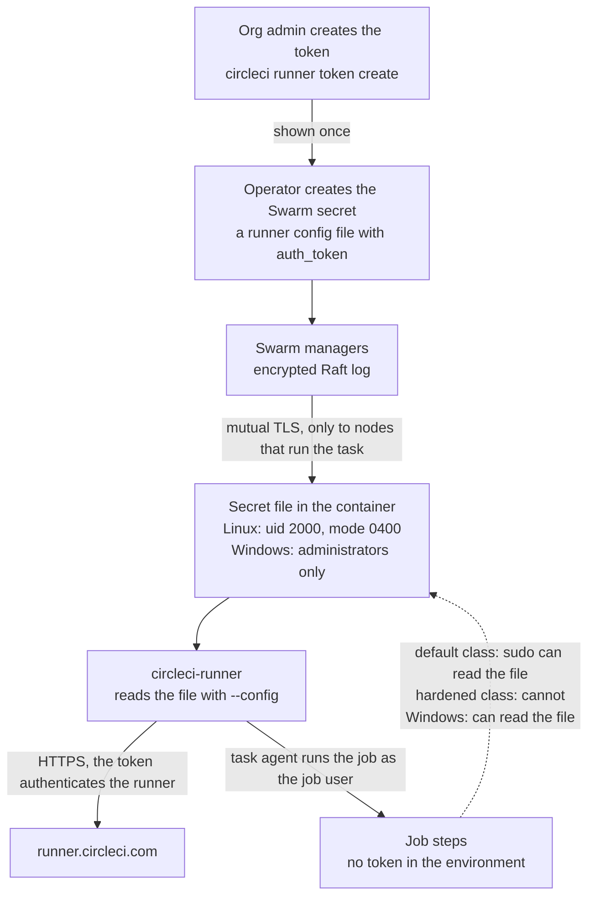

# Security

This page describes what the stack protects, what it does not protect, and which controls you must apply on the CircleCI side. Read it before you give a class to a team.

> [!IMPORTANT]
> Untrusted jobs on a self-hosted runner pose significant risks to your machines and your network. Never use self-hosted runners for public projects that build forked pull requests.

## Threat model

### What the stack protects

| Asset | Where it lives |
|---|---|
| The runner token of a class | A Swarm secret, then a file in each runner container |
| Job secrets, such as contexts and project variables | The job environment while a job runs |
| Source code | The working directory of a job |
| The node and its network | The host, reachable from the containers by default egress |

### Who can attack

- A job author whose code runs in your container, which is the normal case. The job can do anything its user can do.
- A dependency or script that a job downloads and runs.
- A forked pull request, when you allow fork builds on a public project. Do not allow it.
- Another job that ran earlier on the same node, or that runs next to it.

### What the stack does about it

| Threat | Control | What remains |
|---|---|---|
| A job leaves state for the next job | Single-task mode and a new container for every job | Anything on mounted volumes or on a mounted Docker engine. Refer to [What a clean environment covers](concepts.md#what-a-clean-environment-covers) |
| A job reads the runner token | The token is a file that only the runner user and root can read, and is not in the environment. Hardened classes remove sudo | In the default Linux class, a job that uses sudo reads it. On Windows, a job reads it |
| A job replaces the runner or entrypoint | The directory with the runner is mounted read-only and is root-owned. The entrypoint refuses to start otherwise | None known |
| A job reaches other tenants through the network | One overlay network for each Linux class | Replicas of one class reach each other. Refer to [Isolation between runners](#isolation-between-runners) |
| A job breaks out of the container | Default seccomp and AppArmor profiles, dropped capabilities, no privileged mode | Containers share the host kernel. A kernel or runtime vulnerability bypasses every control on this page |
| A job takes over the node through Docker | The Docker engine is not mounted by default | The opt-in docker-build classes are root-equivalent, and administrator-equivalent on Windows. Refer to [Docker Builds](docker-builds.md) |

The stack does not harden the host operating system, the Docker daemon, or your network. It does not defend against a kernel exploit.

## Token model on each OS

A resource class token only authorizes a runner to claim tasks for that class. A holder of the token can still run a runner of their own on that class, and claim jobs that were meant for yours. That gives them the code and secrets of those jobs, so treat the token as a secret and rotate it.



### Linux

- **Storage.** The secret is a minimal runner config file that holds only `api.auth_token`. Swarm mounts it as a read-only file in memory at `/run/secrets/circleci_runner_config.yaml`, owned by the runner user `circleci-runner` (uid 2000) with mode `0400`. The runner reads it with `--config`. The token is in no environment variable, no command line, and no stack file, and `docker inspect` does not show it.
- **Users.** The runner runs as `circleci-runner`, which has no sudo rights and cannot write to `/opt/machine-runner-swarm`. Jobs run as the job user, stepped down with `command_prefix`.
- **Default class.** The job user keeps passwordless sudo. A job that does not use sudo cannot read the token. A job that uses sudo can read the secret file, because root can read any file, and it can become the runner user. No in-container control stops this. The secret is a read-only mount of one file, so root cannot truncate, delete, or unmount it without `CAP_SYS_ADMIN`, but root can read it. Scrubbing the file, making the runner process non-dumpable, and dropping capabilities do not help while sudo works. The protection is against accidental exposure, such as a script that prints files or environment.
- **Hardened class.** `MACHINE_RUNNER_SWARM_JOB_SUDO: "false"` removes every sudo right of the job user before the runner starts, and the container does not start when a right survives. It also steps every job down with `setpriv --no-new-privs`, even when the image has sudo, and the container does not start when the image has no util-linux `setpriv`. Swarm ignores `no-new-privileges`, so this per-job flag is what stops a setuid binary (`sudo`, `su`, or one with a local-root bug) from lifting a job to root. The job user cannot read the file or the process of the runner, and cannot become another user. A kernel or container-runtime bug can still lift a job to root, because the containers share the host kernel. Tools must be in the image. Use this for shared or regulated classes.

The test `linux/tests/token.sh` measures these results against the real runner binary.

| Probe, run as the job user | Default class | Hardened class |
|---|---|---|
| Read the secret file | Denied | Denied |
| Read `/proc/<runner pid>/environ` | Denied, and it holds no token | Denied |
| Token in the job environment | Absent | Absent |
| `sudo -n true` | Works | Fails, because `sudo -l -U <job user>` reports that the user is not allowed to run sudo |
| Run a setuid-root binary through the step-down of the runner | Becomes root (sudo is the way) | Stays the job user: `NoNewPrivs` is `1`, and the binary cannot reach the token. Without the flag the same binary reads it |
| Read the secret file with sudo | Readable | Not possible |
| Read the `/proc` of the runner as root without `CAP_SYS_PTRACE` | Denied | Not possible |
| Write to `/opt/machine-runner-swarm` | No | No |

### Windows

- **Storage.** The secret is the same minimal runner config file. Swarm places it at `C:\ProgramData\Docker\secrets\circleci_runner_config.yaml`. Windows does not support `uid`, `gid`, or `mode` for secrets, and only administrators and `SYSTEM` can read the file.
- **No step-down.** The runner and the jobs run as `ContainerAdministrator`, because the runner needs its symbolic link privilege. A job can read the token file. The token is not in the job environment.
- **Clear text on disk.** The token is stored as plain text on the disk of the container. Swarm writes the secret to the root disk of the container, and keeps it there until the container stops. This is a limitation of Swarm on Windows. On Linux, the secret is a mount in memory (tmpfs) and never reaches the disk of the container. Anyone who can read the Docker root directory of the host can read a Windows token, so enable BitLocker on the volume that holds it. Refer to [BitLocker on Windows hosts](#bitlocker-on-windows-hosts).
- **Process isolation.** Microsoft does not treat process isolation as a security boundary. Use one trust group of classes for each host. Hyper-V isolation adds a kernel boundary, needs nested virtualization on a virtual machine, and is not tested here.

Treat each Windows resource class as a trust boundary. Use one token for each class and host, restrict who can use the class, and rotate tokens.

### Swarm

- Swarm stores secrets encrypted in the Raft log of the managers, and sends a secret only to nodes that run a task that uses it.
- Optionally lock the managers with `docker swarm update --autolock=true`. It protects the secrets at rest, but each manager then needs `docker swarm unlock` after every Docker daemon restart.
- Keep join tokens private, and rotate them with `docker swarm join-token --rotate`.
- A user in the `docker` group on a manager can read every token. Limit administrator access to the managers.

## Compared with the official runner installs

This table puts the Linux classes of this repository next to the installs that CircleCI documents. The first three columns come from the public CircleCI documentation only, and the last two from the tests of this repository. Where the public documentation says nothing, the cell says so.

| | Machine runner 3 package | Container runner | Machine runner orchestrator | This repository, default class | This repository, hardened class |
|---|---|---|---|---|---|
| Can a job read the resource class token? | Yes in effect. The job gains the privileges of the task agent, and the runner runs as the same user (`circleci`) | Not stated in the public documentation. The agent holds the tokens in a Kubernetes secret | No. A sidecar keeps the token out of the VM, and `grantSudo` is refused without it | Only a job that uses sudo | No, unless a kernel or container-runtime bug gives the job root |
| Can jobs use sudo? | Whatever you grant the `circleci` user | Set by the job image and the pod `securityContext` that you configure | No by default (`grantSudo: false`), and jobs run as the unprivileged `circleci` user. Optional with `grantSudo: true` | Yes, passwordless, as in the Docker executor | No. A setuid binary cannot lift a job to root, because the step-down uses `setpriv --no-new-privs` |
| The boundary between jobs | None: each job runs on the machine where the runner is installed | An ephemeral pod, which Kubernetes tears down after the job. Pods share the node kernel | A virtual machine for each job, provisioned on demand and shut down after the job | A new container for each job, on a kernel that all containers on the node share | The same: a new container for each job, with a shared kernel |

Sources: [Self-hosted runner concepts](https://circleci.com/docs/guides/execution-runner/runner-concepts/), [Self-hosted runner overview](https://circleci.com/docs/guides/execution-runner/runner-overview/#choosing-a-runner-execution-environment), [Container runner reference](https://circleci.com/docs/guides/execution-runner/container-runner/), and the [Machine runner orchestrator](https://circleci.com/docs/guides/execution-runner/machine-runner-orchestrator/) reference, including [its sidecar](https://circleci.com/docs/guides/execution-runner/machine-runner-orchestrator/#sidecar) and [`grantSudo`](https://circleci.com/docs/guides/execution-runner/machine-runner-orchestrator/#granting-sudo).

Read the table this way:

- **A clean container is not a virtual machine.** The orchestrator is the only column with a hardware-level boundary between jobs. If jobs must not share a kernel, use the orchestrator, or dedicate nodes to one trust group. Refer to [Why Swarm and not container runner or another runner?](faq.md#why-swarm-and-not-container-runner-or-another-runner)
- **The token.** In the orchestrator the token never reaches the VM, so even a root job cannot read it. In the hardened class the token is a file in the container, and the protection is that the job user cannot become root. In the default class a job that uses sudo reads it.
- **Windows is at parity with the official Windows runner.** The job runs as an administrator, the same account as the runner, and can read the token. The Windows class has no hardened variant. Treat each Windows class as a trust boundary, and refer to [Windows](#windows).

## Hardening defaults

### Linux defaults

| Control | Setting in `linux/stack/runners.yaml` |
|---|---|
| Secret file | Owned by uid and gid 2000, mode `0400` |
| Runner and entrypoint | Root-owned, read-only mount, not writable by the job user |
| Separate users | The runner user has no sudo. The job user is stepped down |
| Working directory | `CIRCLECI_RUNNER_CLEANUP_WORK_DIR: "false"`. Refer to [Working directory cleanup](#working-directory-cleanup) |
| Temporary files | The root filesystem is writable, and `/tmp` is writable and executable |
| Logs | Text format. The `local` log driver, 20 MB for each of 3 files |
| Shutdown | `init: true`, and `stop_grace_period: 5h5m` so that a running job finishes |
| Capabilities | Default classes drop `NET_RAW` and `MKNOD`. The hardened class drops all and adds back `CHOWN` and `FOWNER` (the entrypoint sets the owner of directories), `SETUID` and `SETGID` (the step-down), `KILL` (the init process signals the runner, which has another uid), and `AUDIT_WRITE` (sudo audit messages) |
| Limits | `pids: 4096`, `nofile` 65536, no core dumps, and reservations that equal the limits |
| Network | One overlay network for each class, and no published ports, so SSH rerun is off unless you deploy the SSH add-on stack file |
| Runner version | 3.1.12 or later |

Swarm ignores `security_opt`, `privileged`, `userns_mode`, and the short `tmpfs` form, and its tmpfs mounts are not executable. The stack therefore sets no `no-new-privileges` and no `read_only` filesystem. The default seccomp and AppArmor profiles of Docker apply.

Keep the host clock on NTP. TLS fails silently when the clock drifts. Keep SELinux or AppArmor enforcing on the node. Disable swap, or size memory knowing that Swarm cannot set a swap limit.

### Working directory cleanup

The runner can remove its working directory before it starts a task and again after the task. On Linux, the stack files and the entrypoint turn this off with `CIRCLECI_RUNNER_CLEANUP_WORK_DIR: "false"`.

The reason is file ownership. The runner runs as the runner user (uid 2000), and the working directory and the files in it belong to the job user. The runner cannot remove them, so with cleanup on every task fails before it starts. The log shows `failed to remove working directory before starting task` with `permission denied`, even for the first task, because the parent directory belongs to the job user too. Giving the runner user the ownership does not help, because the job user must then be able to create the directory again. Running jobs as the runner user would give every job the runner token and remove the step-down, so the stack does not do that.

What this means for each class:

- **Single-task classes.** Nothing is lost. Swarm discards the container after the job, so no file survives.
- **Persistent classes.** Nothing removes what a job leaves in the working directory, and the next job can read it. Start every job with a step that removes what an earlier job left. Recycle the class on a schedule. Refer to [Persistent mode](resource-classes.md#persistent-mode).

Do not set the variable to `true` on Linux. Refer to [Error: failed to remove working directory](troubleshooting.md#error-failed-to-remove-working-directory-permission-denied). Windows jobs and the runner use the same account, so the Windows files keep cleanup on.

### Windows defaults

| Control | Setting in `windows\stack\runners.yaml` |
|---|---|
| Runner and Git | Read-only mounts of `C:\machine-runner-swarm`. Authenticated Users have read and execute access, and a job cannot write |
| Secret | Administrators and `SYSTEM` only. Refer to [Token model on each OS](#token-model-on-each-os) |
| Working directory | `CIRCLECI_RUNNER_CLEANUP_WORK_DIR: "true"` |
| Logs | Text format. The `json-file` log driver with rotation |
| Shutdown | `stop_grace_period: 5h5m`. A stop from outside kills a busy container after about 5 seconds, so change a service while its class is idle. Refer to [Stop a busy Windows container](operations.md#stop-a-busy-windows-container) |
| Limits | CPU and memory limits. The Windows engine rejects `pids` and `ulimits` |
| Network | No published ports, so SSH rerun is off unless you deploy the SSH add-on stack file |

`init`, `cap_drop`, `read_only`, and `tmpfs` have no effect on Windows.

## Isolation between runners

Replicas of one class share an overlay network and can reach each other. Swarm cannot prevent this: `enable_icc=false` is ignored on swarm-scoped networks, overlay networks have no such option, and a stack cannot use a node-local bridge network. On Windows, the overlay is the only network option for services, and Windows has no equivalent control for it.

On Linux, each class gets its own overlay network, so classes cannot reach each other. Containers can still reach the host network and the internet through default egress. To reduce the exposure:

- Run sensitive classes on dedicated nodes. Refer to [Multi-Node Clusters](multi-node.md).
- Filter egress on the host, for example in the `DOCKER-USER` chain on Linux.
- Rely on single-use containers. A compromised replica disappears with its job.

## CircleCI-side controls

The stack cannot decide which projects may use a class. Apply these controls in your organization.

1. **One class and one token for each service.** Give each token a nickname that names its host or purpose, so you can revoke it alone. Only organization admins create and delete resource classes. Delete the tokens of a class before you delete the class.
2. **Config policies.** Restrict each class to named projects with the `resource_class_by_project` helper. Config policies need the Scale plan on cloud, or server version 4.2 or later. A class that is not in the mapping stays available to every project.

   ```rego
   package org
   import data.circleci.config

   policy_name["runner_policies"]

   enable_hard["resource_class_check"]

   resource_class_check = config.resource_class_by_project({
     "<namespace>/linux-hardened": {"<project ID>"},
     "<namespace>/linux-docker-build": {"<project ID>", "<project ID>"}
   })
   ```

   Enable evaluation and push the policy. Refer to [Config policies for self-hosted runner](https://circleci.com/docs/guides/config-policies/config-policies-for-self-hosted-runner/).

   ```console
   $ circleci policy settings set --org <org> --enabled
   $ circleci policy push ./config-policies --org <org>
   ```

3. **Context restrictions.** Project restrictions, security groups, and expression restrictions combine with logical AND. Restrict every context that jobs on a runner class use. For deploy contexts, add an expression such as `pipeline.git.branch == "main" and not job.ssh.enabled`.
4. **No fork builds on public projects.** CircleCI does not make self-hosted runners available to public projects that have **Build forked pull requests** enabled.
5. **SSH rerun stays off unless a class needs it.** The shipped classes leave `CIRCLECI_RUNNER_SSH_ADVERTISE_ADDR` unset and publish no ports, so they cannot serve SSH. If you deploy the SSH add-on stack file, keep its class for named projects and restrict inbound port 54782. Refer to [Rerun job with SSH](resource-classes.md#rerun-job-with-ssh).
6. **Monitoring.** Watch the runner inventory for names you do not know, and the logs for `401` and for exit code 80.

Runner classes are usable only by jobs of the organization that owns them.

## Egress hosts

Runners need outbound HTTPS only, and no inbound access. Allow these hosts by name, because their addresses change.

| Host | Port | Used for |
|---|---|---|
| `runner.circleci.com` | 443 | The runner API: claiming tasks |
| `circleci-binary-releases.s3.amazonaws.com` | 443 | The task agent, which every new container downloads, and the runner download during setup |
| `circleci-tasks-prod.s3.us-east-1.amazonaws.com` | 443 | Caches, workspaces, artifacts, and test results |
| `internal.circleci.com` | 443 | CircleCI endpoint used during checkout |
| Your VCS host, for example `github.com` | 443, and 22 for SSH checkouts | Checkout |
| Your image registries, for example Docker Hub and `mcr.microsoft.com` | 443 | Pulling the service images |
| `github.com` and `release-assets.githubusercontent.com` | 443 | Windows setup only: Git for Windows and 7-Zip. The first host redirects the downloads to the second |

If your VCS organization uses an IP allow list, add the egress addresses of your nodes. The list applies to every checkout method. If you use an explicit proxy, test a checkout through it before you roll out a class. Jobs inherit `HTTPS_PROXY` and `NO_PROXY` from the service environment in the stack file.

## BitLocker on Windows hosts

Docker keeps a Swarm secret in clear text on the container root disk until the container stops. Encrypt the volume that holds the Docker root directory, which is `C:\ProgramData\docker` by default, with BitLocker. Confirm the protection status:

```powershell
Get-BitLockerVolume
```

The status of the volume must show that protection is on. BitLocker protects the token when someone steals the disk, or a snapshot or backup of it. It does not protect against a job, or an administrator who is logged in to the live host, because both read the decrypted file. Limit the local administrators of the host, use one token for each class and host, and rotate tokens. Refer to the Microsoft documentation for BitLocker on Windows Server for the setup steps, including the recovery key.
