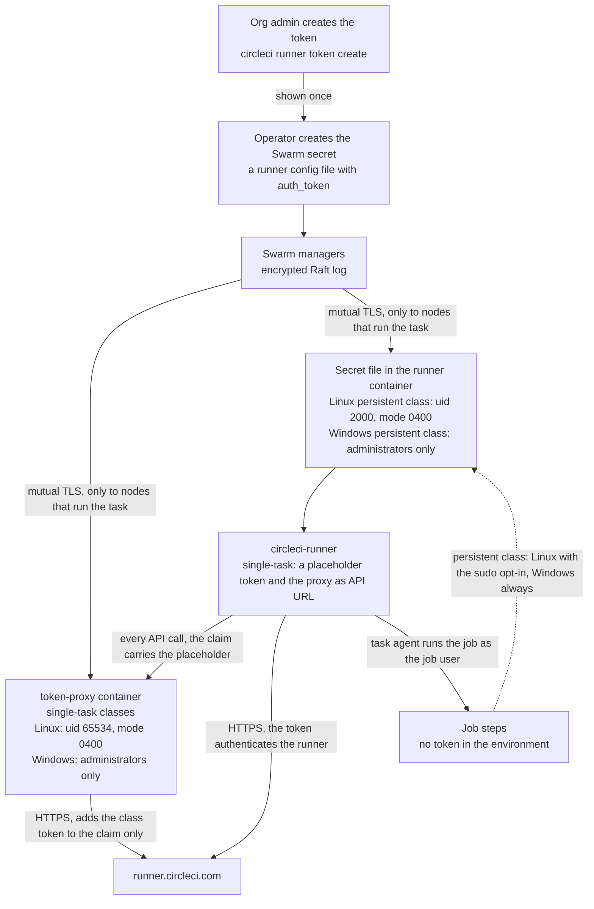

# Security

This page lists what the stack protects, what it does not, and which controls you must apply on the CircleCI side. Read it before you give a class to a team.

> [!IMPORTANT]
> Untrusted jobs on a self-hosted runner pose significant risks to your machines and your network. Never use self-hosted runners for public projects that build forked pull requests.

**Status.** This is a CircleCI Labs project at version `0.x`. It has not been independently reviewed or penetration-tested. The documentation site follows the `main` branch, so it can describe a control that your release does not have: the copy of this page in your release bundle is the one for that release. [What is tested](../README.md#what-is-tested) says how each claim is checked, and which claims are not.

## Threat model

### What the stack protects

- **The runner token of a class.** A Swarm secret. The [token proxy](#the-token-proxy) holds it for the single-task classes, so no runner container has it. A persistent class puts it in a file in each runner container.
- **Job secrets** (contexts, project variables) in the job environment, **source code** in the working directory, and **the node and its network**, which the containers reach by default egress.

### Who can attack

- A job author whose code runs in your container (the normal case), or a dependency or script that a job downloads and runs. The job can do anything its user can do.
- A forked pull request, when you allow fork builds on a public project. Do not allow it.
- Another job that ran earlier on the same node, or runs next to it.

### What the stack does about it

| Threat | Control | What remains |
|---|---|---|
| A job leaves state for the next job | Single-task mode, a new container for every job | Mounted volumes and a mounted Docker engine ([What a clean environment covers](concepts.md#what-a-clean-environment-covers)) |
| A job reads the runner token | Single-task classes: only the token proxy holds it, and runners hold a placeholder. Linux persistent class: a file that only the runner user and root can read. Windows persistent class: a file that every job can read | Linux persistent class: a job that uses sudo reads it (the opt-in `MACHINE_RUNNER_SWARM_JOB_SUDO: "true"`). Windows: any persistent-class job reads it, and for single-task classes no test asserts that a job cannot ([Windows](#windows)). Any class: a job that escapes onto the node of the proxy. See [The token proxy](#the-token-proxy) and [The persistent class](#the-persistent-class) |
| A job replaces the runner or entrypoint | The runner volume is read-only and owned by root. Linux: the entrypoint is a Swarm config and checks the runner against its SHA-256 record at every container start. Windows: the distributor checks the record at every check | Linux: a privileged sibling container can still change the volume ([Runner binary integrity on Linux](#runner-binary-integrity-on-linux)) |
| A job reaches other tenants through the network | One overlay network for each Linux class | Replicas of one class reach each other ([Isolation between runners](#isolation-between-runners)) |
| A job breaks out of the container | Default seccomp and AppArmor profiles, dropped capabilities, no privileged mode | Containers share the host kernel, so a kernel or runtime vulnerability bypasses every control on this page. The opt-in [microVM classes](microvm.md) give each job its own kernel |
| A job reaches the instance-metadata service of a cloud node | Nothing, by default | The credentials of the node role, and on some clouds the user data ([Cloud nodes: block the metadata address](#cloud-nodes-block-the-metadata-address)) |
| A job takes over the node through Docker | The Docker engine is not mounted by default | The opt-in docker-build classes are root-equivalent (administrator-equivalent on Windows): [Docker builds](docker-builds.md) |

The stack does not harden the host operating system, the Docker daemon, or your network.

## Token model on each OS

A resource class token only authorizes a runner to claim tasks for that class. A holder can still run a runner of their own on that class and claim jobs meant for yours, which gives them the code and secrets of those jobs. Treat the token as a secret and rotate it.



A single-task class (Linux and Windows) takes the path through the proxy: only the proxy holds the class token. A persistent class takes the direct path: the runner holds the token itself.

### Linux

- **Single-task classes.** The class secret `<SERVICE>-token` is mounted into the `token-proxy` service and nowhere else. Runners read a placeholder config, so the sudo setting does not decide whether a job reaches the class token.
- **Storage.** A class secret is a minimal runner config file with only `api.auth_token`. Swarm mounts it as a read-only file in memory: in the proxy container at `/run/secrets/<SERVICE>-token` (uid 65534, mode `0400`), or, in a persistent class, in the runner container at `/run/secrets/circleci_runner_config.yaml` (owner `circleci-runner`, uid 2000, mode `0400`). Every other runner mounts the placeholder secret `runner-placeholder-token` at the same path. The token is in no environment variable, no command line, and no stack file, and `docker inspect` does not show it.
- **Users.** The runner runs as `circleci-runner`, which has no sudo rights and cannot write to `/opt/machine-runner-swarm`. Jobs run as the job user, stepped down with `command_prefix`.
- **Default class.** The job user keeps passwordless sudo, so a job is root in its container. It can read the placeholder and the files of the runner, and become the runner user, but finds no class token. It still gets the task token of its own job.
- **Hardened class.** `MACHINE_RUNNER_SWARM_JOB_SUDO: "false"` steps every job down with `setpriv --no-new-privs`, even when the image has sudo, and the container does not start when the image has no util-linux `setpriv`. Swarm ignores `no-new-privileges`, so this per-job flag, inherited by everything the job starts, is what stops a setuid binary (`sudo`, `su`, or one with a local-root bug) from lifting a job to root. The job gets none of the `CIRCLECI_RUNNER_*` and `MACHINE_RUNNER_SWARM_*` variables, cannot read the file or the process of the runner, and cannot become another user. Tools must be in the image. A kernel or container-runtime bug can still lift a job to root. Use it for shared or regulated work. [Users and the runner token on Linux](concepts.md#users-and-the-runner-token-on-linux) compares the classes.

`linux/tests/token.sh` measures these probes against the real runner binary, with a sentinel token in the runner's config file as the persistent class has it. `linux/tests/proxy.sh` scans the files, `/proc/*/environ` and `/proc/*/cmdline` of the runners as root and finds no class token.

| Probe, run as the job user | Default class | Hardened class |
|---|---|---|
| Read the config file (the real token in the persistent class, the placeholder in the others) | Denied | Denied |
| Read `/proc/<RUNNER_PID>/environ`, or find the token in the job environment | Denied, no token in it | Denied, no token in it |
| `sudo -n true` | Works | Fails: `NoNewPrivs` stops the setuid `sudo` |
| Run a setuid-root binary through the step-down of the runner | Becomes root | Stays the job user: `NoNewPrivs` is `1`. Without the flag the same binary reads the token |
| Write to `/opt/machine-runner-swarm` | No | No |

### Windows

- **Single-task classes.** The class secret `<SERVICE>-token` is mounted into the service `token-proxy-windows` and nowhere else. Runners read a placeholder, as on Linux.
- **Storage and users.** Swarm places the secret at `C:\ProgramData\Docker\secrets\<TARGET>`. Windows has no `uid`, `gid`, or `mode` for secrets, and only administrators and `SYSTEM` can read the file. There is no step-down: the runner and the jobs run as `ContainerAdministrator`, because the runner needs its symbolic link privilege. A job can read the config file of its runner (the placeholder, or the token in a persistent class). The token is not in the job environment.
- **No `NET_RAW` drop.** The proxy uses the source address to tell the runners of a class apart, and a Windows container cannot drop `NET_RAW`, so a job can forge a source address. This gains little: the answer to a claim goes to the owner of the address, and a container that has claimed cannot claim again. Windows is not tested for this.
- **Clear text on disk.** Swarm writes the secret as plain text to the root disk of the proxy container (and of the runner container, in a persistent class) until the container stops. Linux keeps it in memory (tmpfs). Anyone who can read the Docker root directory of the host can read a Windows token, so enable [BitLocker](#bitlocker-on-windows-hosts).
- **The proxy is not a boundary against a hostile job on its host.** A job runs as an administrator, with process isolation, next to the proxy when both run on one node. Microsoft does not treat process isolation as a security boundary. It becomes a boundary only when the proxy runs on a node that runs no jobs (label that node `machine-runner-swarm.proxy=true`) and untrusted classes run with Hyper-V isolation, which needs nested virtualization on a virtual machine and is not tested here. The end-to-end jobs on Windows run real jobs through the proxy, but only record whether a job can read the token and assert nothing about it, and no test forges a source address. Treat these protections as untested, and use one trust group of classes for each host.

Treat each Windows resource class as a trust boundary. Use one token for each class and host, restrict who can use the class, and rotate tokens.

### Swarm

- Swarm stores secrets encrypted in the Raft log of the managers, and sends a secret only to nodes that run a task that uses it.
- Optionally lock the managers with `docker swarm update --autolock=true`. It protects the secrets at rest, but each manager then needs `docker swarm unlock` after every Docker daemon restart.
- Keep join tokens private, and rotate them with `docker swarm join-token --rotate`.
- A user in the `docker` group on a manager can read every token. Limit administrator access to the managers.

## The token proxy

The service `token-proxy` in `runners.yaml` keeps the class tokens of the single-task classes away from the runner containers and their jobs. One proxy serves every class of the stack, and `docker-build.yaml` and `ssh-rerun.yaml` add their classes to it. [Concepts](concepts.md#the-token-proxy) shows how the pieces fit.

### What it does

- **Only the claim gets the class token.** The proxy replaces the `Authorization` header of the task-claim call (`POST /api/v3/runner/claim`) with the class token and passes every other call on unchanged. The runner and its task agent use the task token from the claim response, which is scoped to one task.
- **The network decides the class, not the caller.** Every secret `<SERVICE>-token` in its secrets directory is the class `<SERVICE>`, whose runners are `tasks.<SERVICE>`. `runner-placeholder-token` is never a class, and no runner token is mounted into the proxy. A claim is allowed only from an IP address that Swarm DNS lists now for `tasks.<SERVICE>`, and gets the token of that class. Any other address (a container that you started on the class network, or an address that two classes list) gets 403 and nothing reaches CircleCI. The 403 says only `claim refused`: the reason is in the log of the proxy, where a job cannot read it.
- **One claim per container.** After a claim that returns a task, that address cannot claim again until DNS has not listed it for 30 seconds in a row, which means the container is gone. One missing answer, even a `no such host` for the whole class, is one poll of the 30 and never a release.
- **A job cannot forge the source address on Linux.** The proxy attaches to each class overlay with `endpoint_mode: dnsrr`, so it sees the address of the container that connects. The runner services drop `NET_RAW`, so even root in a container cannot send packets with another address. Keep `cap_drop: [NET_RAW, MKNOD]` or `ALL` on every class that uses the proxy.
  - The encrypted class networks need Docker Engine 23.0.3 or later (or 20.10.24). Earlier engines accepted unauthenticated VXLAN traffic on encrypted overlay networks ([CVE-2023-28840](https://github.com/advisories/GHSA-232p-vwff-86mp)), which lets a host on the node network inject packets into a class overlay. The setup helper requires Docker 24 or later.
  - The exception is `linux-microvm-docker`, which cannot drop `NET_RAW` (BuildKit needs it). It runs in a VM with no `NET_ADMIN`, stays at one replica, and has an overlay of its own, so no other runner of its class exists to impersonate ([MicroVM jobs](microvm.md#security)).
- **It remembers who has claimed, also after a restart.** It writes the addresses that have claimed to the volume `proxy-state` before the runner gets its task. If it cannot write them, the claim fails, and the proxy removes the state file (and keeps its marker), so the next start takes the fail-safe path below.
  - A restart with a state refuses every address in it, and only those.
  - A start with no state (an empty `proxy-state`, a lost state, a new class) does not guess. For each class the proxy asks CircleCI how many tasks run (`GET /api/v3/runner/scale`, with the token of that class). With none running, the runners present may claim. With some running, or when the call fails, it refuses every runner of that class present until Swarm replaces it.
  - The state stays on the node. If the proxy moves, it starts empty there: [Where the proxy runs, and when it moves](operations.md#where-the-proxy-runs-and-when-it-moves).
- **An unknown outcome counts as a claim.** When the request reached CircleCI but the answer was lost (a timeout, a broken connection), the proxy latches the runner as if the claim had succeeded, so that runner is refused until Swarm replaces it. This costs a runner, never a second task for one container. It waits at most 60 seconds for the response headers of the upstream.
- **It fails closed.** It does not start without a usable token file for every class, nor when it cannot write its state, and it answers 503 when DNS fails, a token file disappears or it cannot write its state. A count of running tasks that CircleCI does not give as a whole number of 0 or more (`data.attributes.running_task_count` and `unclaimed_task_count`, exactly these names), or does not give in 25 seconds for all classes together, counts as running tasks. It logs addresses, class names, and status codes, never a token.
- **It limits what a job can send it.** A claim is accepted from one address at most twice a second, with bursts of 10, and its body is at most 64 KiB. Every client address is limited to 50 requests a second, with bursts of 200, and the proxy serves at most 512 requests at once: more get a 503 with a `Retry-After` header. These limits are not proof against a hostile job: a job that sends enough requests from the containers of its class can use up the 512 shared slots and the one replica, and the claims of every class then wait. The proxy logs one summary line a minute ([Monitor the token proxy](operations.md#monitor-the-token-proxy)).
- **It is small.** One static Go binary in a distroless image (no shell), uid 65534, no capabilities, a read-only root filesystem, no published port. Its secrets are the class tokens and nothing else. The image is signed ([The token proxy image](#the-token-proxy-image)).

### What it does not do

- **It sees the runner traffic of its classes.** Claims, task configuration and step output pass through it over plain HTTP on the overlay network. The class token is never on that path, but the task token is. Between nodes, the Linux class networks are encrypted by default (IPsec, which needs IP protocol 50 (ESP) open: [Encrypted class networks](multi-node.md#encrypted-class-networks)). Docker does not support encrypted overlay networks for Windows containers, so Windows class traffic is plain between nodes: keep those nodes on a network that you trust.
- **It is one point of failure.** One replica serves all classes, because a second replica would not share the record of who has claimed. While it is down, no runner can claim, and a running job keeps its container while its calls wait ([Monitor the token proxy](operations.md#monitor-the-token-proxy)).
- **Its node holds every class token.** A job that escapes its container onto that node reads them. The proxy never runs on a Docker-build node or on a node of the [container agent](container-mode.md), which holds the Docker socket. It runs on a manager by default. In a cluster, label the node `machine-runner-swarm.proxy=true` and pin the proxy to it with `MACHINE_RUNNER_SWARM_PROXY_PLACEMENT`: runner services never run on a node with that label. On a single node there is no such label, and jobs run next to the proxy.
- **It depends on the runner API.** It knows two calls, `POST /api/v3/runner/claim` and `GET /api/v3/runner/scale`, tested against the runner version that this release pins. If CircleCI changes them, the proxy fails closed and jobs wait until a release follows the change. Pin the runner version in production. This page makes no claim about how the Runner Terms apply to a proxy between your runners and CircleCI: that is for your own review.
- **It does not cover the persistent classes** ([The persistent class](#the-persistent-class)), and **it does not replace CircleCI-side controls**: a stolen class token still lets its holder run a runner on that class ([CircleCI-side controls](#circleci-side-controls)).

Windows runs its own proxy, `token-proxy-windows` (the `windows/amd64` image of the same tag), because a Windows node does not share its network with a Linux proxy. It works as described here, with the differences in [Windows](#windows). There is no `windows/arm64` image ([Windows](install-windows.md#the-token-proxy-image)).

## The persistent class

A persistent class (`persistent.yaml`) does not use the proxy. A continuous runner claims a task after every job, and the proxy allows one claim for each container, so the runner keeps its token in a file in its own container. This class is weaker than the proxied classes:

- The shipped file sets `MACHINE_RUNNER_SWARM_JOB_SUDO: "false"`, so the token file is unreadable to the job user, and the tools that jobs need must be in the image. With the opt-in `"true"`, a job that uses sudo reads the class token and can run a runner of its own on that class.
- State from one job is visible to the next, because the container lives on.

Give the persistent class a resource class of its own, restrict it to trusted projects with a config policy, keep production contexts away from it, and rotate its token on a schedule. See [Persistent mode](resource-classes.md#persistent-mode).

## Runner binary integrity on Linux

The runner executes your jobs, so it must be the binary that CircleCI published. The `runner-distributor` service installs it and the entrypoint checks it before every start ([The runner distributor on Linux](concepts.md#the-runner-distributor-on-linux)).

### Where the runner comes from

The distributor downloads the tarball over HTTPS from the release bucket of CircleCI and compares its SHA-256 with the values that the stack file carries for the pinned version (`MACHINE_RUNNER_SWARM_RUNNER_SHA256`: `amd64`, `arm64`, `ppc64le` and `s390x`). Each release of this repository bumps the version and these values together, copied from CircleCI's manifest. This is trust on first use from the same bucket: CircleCI publishes no signature for the runner that this stack checks. A later change of the bucket cannot change what the nodes install.

- **Floating versions are weaker.** A floating value (`3.1`, `3`, `current`) has no list, because the version is not known in advance. The distributor ignores the default list and compares the SHA-256 with CircleCI's `manifest.json`. The manifest comes from the same bucket as the tarball, so whoever can change one can change the other: the check proves that the download is whole, not that CircleCI published it. It is the same trust as the runner's own download of the task agent.
- **An exact version of your own** needs its own list, from the `checksums.txt` of its release (every architecture of your nodes), or the word `manifest`. The distributor then installs only a tarball that matches.
- **A mirror** (`MACHINE_RUNNER_SWARM_DOWNLOAD_BASE_URL`) must be an `https://` URL unless a usable SHA-256 list is set for an exact pin: over plain `http` the manifest, and with it the hash, could be changed on the way. A floating value has no list, so an `http://` base is refused unless `MACHINE_RUNNER_SWARM_ALLOW_HTTP=true`. The microVM classes download the runner into every VM with the same rules.

### The checks

| When | Who | What |
|---|---|---|
| Download and install | Distributor | The SHA-256 of the tarball must equal a value of the list (or, with `manifest`, the manifest value), otherwise nothing is installed. The binary must report exactly the version that it installs (a pin of `3.1.1` does not accept `3.1.13`). The SHA-256 of the binary goes to `versions/<VERSION>/SHA256`. Files are owned by root |
| Every check interval (24 hours by default) | Distributor | It compares the active binary with its record, and installs the version again when the binary changed |
| Every container start | Entrypoint | It resolves `current` once and runs `sha256sum -c` against the record. A missing record or a different binary ends in exit code 80 and the log line `does not match its SHA-256 record` ([Error: does not match its SHA-256 record](troubleshooting.md#error-does-not-match-its-sha-256-record)). Hashing the 74 MB binary takes about 0.05 seconds |
| While a job runs | Mount | The volume is read-only in the runner containers (files owned by root, mode `0755`). The entrypoint is an immutable Swarm config |

### The token proxy image

The distributor does not install the token proxy. It is the image `ccilabs/machine-runner-swarm-proxy` of Docker Hub, which Swarm pulls, and its integrity rests on the image digest.

- A release bundle names the image by tag and digest (`ccilabs/machine-runner-swarm-proxy:<VERSION>@sha256:<DIGEST>`), so Docker pulls exactly the image that the release pipeline pushed, whatever happens to the tag later.
- A checkout names the tag `latest`, which only a release moves and which is not a digest. Pin a digest for anything that matters ([Upgrade the token proxy](operations.md#upgrade-the-token-proxy)). `linux/setup.sh --deploy` warns when `MACHINE_RUNNER_SWARM_PROXY_IMAGE` is not pinned by digest.
- `ccilabs` is the Docker Hub organization of CircleCI Labs. You trust the signature below, not the name: an image of that name that does not verify is not this project's.

Every digest that the pipeline pushes is signed, and the pipeline checks the signature again before it gives the image its release tags. The Linux index (four platforms), each Windows image (Server 2022 and 2025) and the manifest list that joins them are signed separately. The image runs as the user 65534 (Windows: `ContainerAdministrator`), and the state of the proxy is the only thing it writes.

#### Verify the token proxy image

The signature is a keyless [cosign](https://docs.sigstore.dev/cosign/system_config/installation/) signature, made with the OIDC token of the CircleCI job that pushed the image, like the signature of a release ([Verify a release](install-linux.md#verify-a-release)). It proves that a job of this CircleCI project pushed that digest. Verify the digest that you run, before you run it. You need cosign 3.1.3 or a later 3.x (CI signs and verifies with 3.1.3, and earlier versions are not tested). A digest of the manifest list covers every platform. Pass the tag, and cosign resolves it to the digest and prints it.

```bash
cosign verify ccilabs/machine-runner-swarm-proxy:<VERSION> \
  --certificate-identity "https://circleci.com/api/v2/projects/7bbdbb66-6ba8-4f6c-982e-d4fb401ec257/pipeline-definitions/8b2a66db-3f28-5c80-88e4-03f4694b5b60" \
  --certificate-oidc-issuer "https://oidc.circleci.com"
```

The command prints the verified claims as JSON when the project and the pipeline definition above signed the image. Compare the digest in its output with the one in your stack file. A tag from a commit that is not a release (`edge`, `sha-<12 characters>`) verifies the same way.

This is only the signature check. It does not look at the ref, and the identity does not name a branch, so a job of any branch can sign with it. A reader who stops here accepts an image that a job of any branch signed. The ref check is a second, separate step: the extension `1.3.6.1.4.1.57264.1.14` must be `refs/heads/main` in every signature of the digest. `cosign` has no flag for that extension, so this command reads it, with the same pattern as [Verify a release](install-linux.md#verify-a-release) (the OID, then the value `refs/heads/main`, from a byte boundary):

```bash
cosign download signature ccilabs/machine-runner-swarm-proxy:<VERSION> \
  | jq -r '.verificationMaterial | (.certificate // .x509CertificateChain.certificates[0]).rawBytes' \
  | while read -r cert; do printf '%s' "$cert" | base64 -d | od -An -v -tx1 | tr -d ' \n' \
    | grep -Eq '^([0-9a-f]{2})*2b0601040183bf30010e0411(0c|13)0f726566732f68656164732f6d61696e' \
    || { echo "NOT signed for refs/heads/main: do not use this image"; exit 1; }; done && echo "every signature is for refs/heads/main"
```

The notes of every release name the image of that release.

### What remains

- **Not verified:** the task agent, which every container downloads from the same bucket at start, with no pin and no check (it runs as the job user and holds the task token), and the source of the pinned SHA-256 values (CircleCI's manifest at the time of the bump).
- **A race at start.** The check narrows the window and does not close it: a sibling that rewrites the file between the hash and the `exec` of one container start is not detected.
- **A privileged sibling container** with `SYS_ADMIN` on the same node could mount the volume read-write and change both the binary and its record. The docker-build class mounts the Docker socket and can do the same ([Docker builds](docker-builds.md)). The microVM classes do not mount the volume: each VM downloads and verifies its own runner ([MicroVM jobs](microvm.md#the-runner-in-a-vm)).
- **Whoever can update the `runner-distributor` service** (for example a user in the `docker` group of a manager) chooses the version and the download address. A list in `MACHINE_RUNNER_SWARM_RUNNER_SHA256` limits what can be installed to the tarballs on it.

## Runner binary integrity on Windows

The trust is the one of Linux. The service `runner-distributor-windows` downloads the tarball over HTTPS from the release bucket of CircleCI, compares its SHA-256 with the two values (`amd64` and `arm64`) that the stack file carries for the pinned version, checks that the binary reports the version, and records its SHA-256 in `versions\<VERSION>\SHA256`. A floating value ignores the list and uses CircleCI's `manifest.json` (weaker), and a mirror must be `https://` unless a usable list is set for an exact pin (or `MACHINE_RUNNER_SWARM_ALLOW_HTTP=true` when there is no list). Portable Git and `7zr.exe` are pinned by SHA-256 in the script, so a new Git version is a new release of this repository.

Two things differ from Linux:

- The runner is the main process of the container and there is no entrypoint, so **nothing checks the binary when a container starts**. The distributor compares the active binary with its record at every check interval (24 hours by default) and installs it again when it changed.
- A job runs as an administrator in its own container, and the volume is mounted read-only through two links, so a job cannot change the runner or Git. A container with write access to the volume can, for example one of the docker-build class ([Docker builds](docker-builds.md)).

## Compared with the official runner installs

The first three columns are our reading of the public CircleCI documentation as of 17 October 2026. They are not statements by CircleCI, the pages change, and the sources below are the reference. The last two columns come from the tests of this repository. Where the public documentation says nothing, the cell says so.

| | Machine runner 3 package | Container runner | Machine runner orchestrator | This repository, default class | This repository, hardened class |
|---|---|---|---|---|---|
| Can a job read the class token? | A job gains the privileges of the task agent, and the runner runs as the same user (`circleci`) | Not stated. The agent holds the tokens in a Kubernetes secret | No: a sidecar keeps the token out of the VM | No, even with sudo: the token proxy holds it. A job that escapes onto the node of the proxy could read it | No, for the same reason. The persistent class is the exception ([The persistent class](#the-persistent-class)) |
| Can jobs use sudo? | Whatever you grant the `circleci` user | Set by the job image and the pod `securityContext` | No by default (`grantSudo: false`) | Yes, passwordless, as in the Docker executor | No: the step-down uses `setpriv --no-new-privs` |
| Boundary between jobs | None: each job runs on the machine where the runner is installed | An ephemeral pod, on the shared node kernel | A virtual machine for each job | A new container for each job, on a shared kernel | The same |

Sources: [Self-hosted runner concepts](https://circleci.com/docs/guides/execution-runner/runner-concepts/), [Self-hosted runner overview](https://circleci.com/docs/guides/execution-runner/runner-overview/#choosing-a-runner-execution-environment), [Container runner reference](https://circleci.com/docs/guides/execution-runner/container-runner/), and the [Machine runner orchestrator](https://circleci.com/docs/guides/execution-runner/machine-runner-orchestrator/) reference, including [its sidecar](https://circleci.com/docs/guides/execution-runner/machine-runner-orchestrator/#sidecar) and [`grantSudo`](https://circleci.com/docs/guides/execution-runner/machine-runner-orchestrator/#granting-sudo).

- **A clean container is not a virtual machine.** The orchestrator is the only column with a hardware-level boundary between jobs. If jobs must not share a kernel, use the orchestrator, or dedicate nodes to one trust group ([Why Swarm and not container runner or another runner?](faq.md#why-swarm-and-not-container-runner-or-another-runner)).
- **The token.** The single-task classes here work like the orchestrator's sidecar, except that a job that escapes onto the node of the proxy reaches the tokens. The persistent class and Windows are weaker: the token is a file in the container ([Windows](#windows)). The Windows persistent class is at parity with the official Windows runner, and the Windows classes have no hardened variant.

## Hardening defaults

### Linux defaults

Settings in `linux/stack/runners.yaml`. Tokens, the proxy and the runner volume are covered above.

| Control | Setting |
|---|---|
| Users | The runner user has no sudo. The job user is stepped down. The entrypoint is a Swarm config with mode `0555` |
| Working directory | `CIRCLECI_RUNNER_CLEANUP_WORK_DIR: "false"` ([Working directory cleanup](#working-directory-cleanup)) |
| Filesystem and logs | The root filesystem is writable, and `/tmp` is writable and executable. Text logs, the `local` driver, 20 MB for each of 3 files |
| Shutdown | `init: true`, and `stop_grace_period: 5h5m` so that a running job finishes |
| Capabilities | Default classes drop `NET_RAW` and `MKNOD`. The hardened class drops all and adds back `CHOWN` and `FOWNER` (the entrypoint sets the owner of directories), `SETUID` and `SETGID` (the step-down), `KILL` (the init process signals the runner, which has another uid), and `AUDIT_WRITE` (sudo audit messages) |
| Limits | `pids: 4096`, `nofile` 65536, no core dumps, and reservations that equal the limits |
| Network | One overlay network for each class, no published ports, so SSH rerun is off unless you deploy the SSH add-on stack file |
| Runner version | 3.1.12 or later. The default pin is the newest version that this repository's CI tests |

Swarm ignores `security_opt`, `privileged`, `userns_mode`, and the short `tmpfs` form, and its tmpfs mounts are not executable. The stack therefore sets no `no-new-privileges` and no `read_only` filesystem for the runners. The default seccomp and AppArmor profiles of Docker apply.

Keep the host clock on NTP, because TLS fails silently when the clock drifts. Keep SELinux or AppArmor enforcing on the node. Disable swap, or size memory knowing that Swarm cannot set a swap limit.

### Working directory cleanup

On Linux, the stack files and the entrypoint set `CIRCLECI_RUNNER_CLEANUP_WORK_DIR: "false"`. The runner (uid 2000) cannot remove files that the job user owns, so with cleanup on every task fails before it starts, with `failed to remove working directory before starting task` and `permission denied`. Running jobs as the runner user would give every job the runner token and remove the step-down.

- **Single-task classes.** Nothing is lost: Swarm discards the container after the job.
- **Persistent classes.** Nothing removes what a job leaves, and the next job can read it. Start every job with a step that removes what an earlier job left, and recycle the class on a schedule ([Persistent mode](resource-classes.md#persistent-mode)).

Do not set the variable to `true` on Linux ([Error: failed to remove working directory](troubleshooting.md#error-failed-to-remove-working-directory-permission-denied)). On Windows the jobs and the runner use the same account, so cleanup stays on.

### Windows defaults

Settings in `windows\stack\runners.yaml`:

- The runner and Git are read-only mounts of the volume `runner-bin` (`current` at `C:\machine-runner-swarm`, `git\current` at `C:\Program Files\Git`), and the secret is readable by administrators and `SYSTEM` only.
- `CIRCLECI_RUNNER_CLEANUP_WORK_DIR: "true"`. Logs use the `json-file` driver with rotation.
- `stop_grace_period: 5h5m`, but a stop from outside kills a busy container after about 5 seconds, so change a service while its class is idle ([Stop a busy Windows container](operations.md#stop-a-busy-windows-container)).
- CPU and memory limits. The Windows engine rejects `pids` and `ulimits`. `init`, `cap_drop`, `read_only`, and `tmpfs` have no effect.
- No published ports, so SSH rerun is off unless you deploy the SSH add-on stack file.

## Isolation between runners

Replicas of one class share an overlay network and can reach each other. Swarm cannot prevent this: `enable_icc=false` is ignored on swarm-scoped networks, and a stack cannot use a node-local bridge network.

- **Linux.** Each class has its own overlay network, so classes cannot reach each other. Containers can still reach the host network and the internet through default egress.
- **Windows.** The overlay is the only network option. All Windows classes share one overlay network, and it is not encrypted, so Windows classes can reach each other, and their traffic is in clear text between nodes ([Encrypted class networks](multi-node.md#encrypted-class-networks)).

To reduce the exposure:

- Run sensitive classes on dedicated nodes ([Multi-node clusters](multi-node.md)).
- Filter egress on the host, for example in the `DOCKER-USER` chain on Linux. Docker bypasses `ufw` and `firewalld` rules for published ports and for container traffic.
- Rely on single-use containers: a compromised replica disappears with its job.
- Any container on a class network can reach the proxy. It answers only claims from the runners of the class.

## Cloud nodes: block the metadata address

Nothing in this stack or in Docker stops a job from reaching the instance-metadata service that cloud providers serve at `169.254.169.254`. On a cloud VM, it can hand out the credentials of the role attached to the node and, on some clouds, the user data of the instance. A job that reads them acts as the node. This is true of every self-hosted runner on a cloud VM.

These recipes are the usual ones, and they are not tested in this repository's CI. Check them on your own nodes with a job that runs `curl -m 3 http://169.254.169.254/`, which must fail.

1. **Give the node role the fewest permissions that the node needs, often none.** Do not leave the Swarm join token readable in the user data or startup script of an instance: a job that reaches the metadata service reads it, and with it joins a node to your Swarm.
2. **Block the address for containers on Linux.** Add a rule to the `DOCKER-USER` chain, which Docker evaluates before its own rules for container traffic:

   ```bash
   sudo iptables -I DOCKER-USER -d 169.254.169.254 -j DROP
   ```

   Docker creates the chain when it starts, so add the rule after Docker is up, and again after a reboot. This systemd unit starts after `docker.service` and adds the rule only when it is missing:

   ```ini
   [Unit]
   Description=Block the instance metadata address for containers
   After=docker.service
   Requires=docker.service

   [Service]
   Type=oneshot
   RemainAfterExit=yes
   ExecStart=/bin/sh -c 'iptables -C DOCKER-USER -d 169.254.169.254 -j DROP 2>/dev/null || iptables -I DOCKER-USER -d 169.254.169.254 -j DROP'

   [Install]
   WantedBy=multi-user.target
   ```

   The rule does not cover a container on the host network (the docker-build class can use one) or the host itself. Check it with `sudo iptables -S DOCKER-USER` after a reboot and after a restart of Docker. If your Docker uses another firewall backend, use its equivalent.
3. **On AWS, require IMDSv2 and a hop limit of 1.** This disables IMDSv1 and stops the session-token response from reaching a container behind Docker's bridge or NAT:

   ```bash
   aws ec2 modify-instance-metadata-options --instance-id <INSTANCE_ID> --http-tokens required --http-put-response-hop-limit 1 --http-endpoint enabled
   ```

   It does not cover containers on the host network. It also breaks every job that uses the node role through the metadata service: give such jobs their credentials another way, for example through a context or OIDC.
4. **On other clouds,** allow the metadata service from the host only, and attach a role with minimal permissions. On Windows nodes these settings apply too, but have not been tried with Windows containers.

## Listening ports on a node

The stack publishes no other port, and the token proxy publishes none.

| Port | Protocol | Nodes | Used for | Who may reach it |
|---|---|---|---|---|
| 2377 | TCP | Managers | Cluster management | The nodes of the cluster only |
| 7946 | TCP and UDP | All | Node discovery | The nodes of the cluster only |
| 4789 | UDP | All | Overlay network (VXLAN) | The nodes of the cluster only, even though the Linux class networks are encrypted: an unfiltered port lets a host on the network send packets to the overlay |
| IP protocol 50 (ESP) | | All | IPsec of the encrypted Linux class networks ([Encrypted class networks](multi-node.md#encrypted-class-networks)) | The nodes of the cluster only |
| 53 | TCP and UDP | Every node, with the routing mesh | The DNS forwarder `microvm-dns` of the [microVM classes](microvm.md#dns). It is an open resolver for anyone who can reach the node | The nodes of the cluster only |
| 54782 | TCP | The node that runs a task of the SSH class | [Rerun job with SSH](resource-classes.md#rerun-job-with-ssh) | The networks where your users connect, such as a VPN |

Docker publishes the last two ports with NAT rules that run before `ufw` and `firewalld` rules, so a rule in either does not restrict them. Filter them in the `DOCKER-USER` chain or with a cloud security group. This example, not tested here, drops port 54782 from sources outside a VPN range:

```bash
sudo iptables -I DOCKER-USER ! -s <VPN_RANGE> -p tcp --dport 54782 -j DROP
```

[Inter-node ports](multi-node.md#inter-node-ports) has the rules for the cluster ports.

## CircleCI-side controls

The stack cannot decide which projects may use a class. Apply these controls in your organization.

1. **One class and one token for each service.** Give each token a nickname that names its host or purpose, so you can revoke it alone. Only organization admins create and delete resource classes. Delete the tokens of a class before the class.
2. **Config policies.** Restrict each class to named projects with the `resource_class_by_project` helper. Config policies need the Scale plan on cloud, or server version 4.2 or later. A class that is not in the mapping stays available to every project.

   ```rego
   package org
   import data.circleci.config

   policy_name["runner_policies"]

   enable_hard["resource_class_check"]

   resource_class_check = config.resource_class_by_project({
     "<NAMESPACE>/linux-hardened": {"<PROJECT_ID>"},
     "<NAMESPACE>/linux-docker-build": {"<PROJECT_ID>", "<PROJECT_ID>"}
   })
   ```

   Enable evaluation and push the policy ([Config policies for self-hosted runner](https://circleci.com/docs/guides/config-policies/config-policies-for-self-hosted-runner/)):

   ```bash
   circleci policy settings set --org <ORG> --enabled
   circleci policy push ./config-policies --org <ORG>
   ```

3. **Context restrictions.** Project restrictions, security groups, and expression restrictions combine with logical AND. Restrict every context that jobs on a runner class use. For deploy contexts, add an expression such as `pipeline.git.branch == "main" and not job.ssh.enabled`.
4. **No fork builds on public projects.** CircleCI does not make self-hosted runners available to public projects that have **Build forked pull requests** enabled.
5. **SSH rerun stays off unless a class needs it.** The shipped classes leave `CIRCLECI_RUNNER_SSH_ADVERTISE_ADDR` unset and publish no ports. If you deploy the SSH add-on stack file, keep its class for named projects and restrict inbound port 54782 with the `DOCKER-USER` chain or a cloud security group ([Rerun job with SSH](resource-classes.md#rerun-job-with-ssh)).
6. **Monitoring.** Watch the runner inventory for names you do not know, and the logs for `401` and for exit code 80. In the log of the token proxy, a `refused` claim comes from a container that is not a runner of a class, or from a runner that tries to claim twice ([Monitor the token proxy](operations.md#monitor-the-token-proxy)).

Runner classes are usable only by jobs of the organization that owns them.

## Egress hosts

Runners need outbound HTTPS only, and no inbound access. Allow these hosts by name, because their addresses change.

| Host | Port | Used for |
|---|---|---|
| `runner.circleci.com` | 443 | The runner API. With the token proxy, only the node of the proxy calls it for the single-task classes |
| `circleci-binary-releases.s3.amazonaws.com` | 443 | The task agent, which every new container downloads, and the runner download (by `runner-distributor`, `runner-distributor-windows`, or each container of a microVM class) |
| `circleci-tasks-prod.s3.us-east-1.amazonaws.com` | 443 | Caches, workspaces, artifacts, and test results |
| `internal.circleci.com` | 443 | Not on CircleCI's list of hosts for self-hosted runners (the two hosts above, the cache host, and your VCS host). Allow it only if a job log shows that a step needs it |
| Your VCS host, for example `github.com` | 443, and 22 for SSH checkouts | Checkout. For Bitbucket Cloud over SSH, CircleCI's changelog says the agent uses `ssh.bitbucket.org` from 12 November 2026 |
| Your image registries, for example Docker Hub and `mcr.microsoft.com` | 443 | Pulling the service images, on Linux also the `alpine` image of `runner-distributor`. The token proxy image comes from Docker Hub (`registry-1.docker.io`, `auth.docker.io` and its content delivery network), or from a mirror that you name with `MACHINE_RUNNER_SWARM_PROXY_IMAGE` |
| `github.com` and `release-assets.githubusercontent.com` | 443 | On Windows, Git for Windows and 7-Zip, which `runner-distributor-windows` downloads (not in an air-gapped setup with a mirror). The first host redirects the downloads to the second |

If your VCS organization uses an IP allow list, add the egress addresses of your nodes. If you use an explicit proxy, test a checkout through it before you roll out a class. Jobs inherit `HTTPS_PROXY` and `NO_PROXY` from the service environment in the stack file.

## What needs internet

The stack accepts no inbound connection. Only CircleCI cloud with internet access is tested. A host without internet access, and CircleCI server, are not tested in this release. [Egress hosts](#egress-hosts) lists the hosts. What fetches what:

| Part | Fetched by | Cloud | Server |
|---|---|---|---|
| The release bundle, `SHA256SUMS` and signature (once, on any host) | You, from `github.com`. `cosign` also downloads the Sigstore trust root on first use (`tuf-repo-cdn.sigstore.dev`). Not tested offline | Needed | Needed |
| The stack images, and Git and 7-Zip on Windows | Docker and the Windows distributor, from your registries and `github.com`. A mirror can replace each | Needed, or a mirror | Needed, or a mirror |
| The runner | The distributors, and each container of a microVM class | Needed, or a mirror | Not tested |
| The task agent | Every new container at start (CircleCI's runner downloads it) | Needed | Not tested |
| The runner API | The token proxy, for claims | Needed | Your server host: set `-upstream` of the proxy |
| Jobs | Checkout, caches, workspaces, artifacts, test results, and whatever the job fetches | Needed | The storage of your server, not tested |

Mirrors replace the downloads of this stack, and do not replace the task agent: see [Run the downloads from a mirror](operations.md#run-the-downloads-from-a-mirror) and [Upgrade the token proxy](operations.md#upgrade-the-token-proxy). CircleCI lists three hosts for machine runners in its [runner FAQ](https://circleci.com/docs/guides/execution-runner/runner-faqs/#what-connectivity-is-required): `runner.circleci.com`, `circleci-binary-releases.s3.amazonaws.com` and `circleci-tasks-prod.s3.us-east-1.amazonaws.com`. The other hosts come from this stack.

### CircleCI server

CircleCI documents machine runner 3 for server 4.4 and later, and says that an install on server sets the API URL of the runner (`CIRCLECI_RUNNER_API_URL`, or `api.url` in the config file). This repository is tested against CircleCI cloud only. Here the runners call the token proxy, so the URL of your server goes to the `-upstream` argument of the `token-proxy` service (its `command` in the stack file), and the runners keep `CIRCLECI_RUNNER_API_URL: http://token-proxy:8080`. Whether the proxy and the runner download work against your server version is not known, and no job of this project has run against one. Config policies need the Scale plan on cloud or server 4.2 or later.

## BitLocker on Windows hosts

Docker keeps a Swarm secret in clear text on the container root disk until the container stops. Encrypt the volume that holds the Docker root directory (`C:\ProgramData\docker` by default) with BitLocker, and confirm the protection status:

```powershell
Get-BitLockerVolume
```

The status of the volume must show that protection is on. BitLocker protects the token when someone steals the disk, or a snapshot or backup of it. It does not protect against a job, or an administrator who is logged in to the live host, because both read the decrypted file. Limit the local administrators of the host, use one token for each class and host, and rotate tokens. See the Microsoft documentation for BitLocker on Windows Server for the setup steps, including the recovery key.
