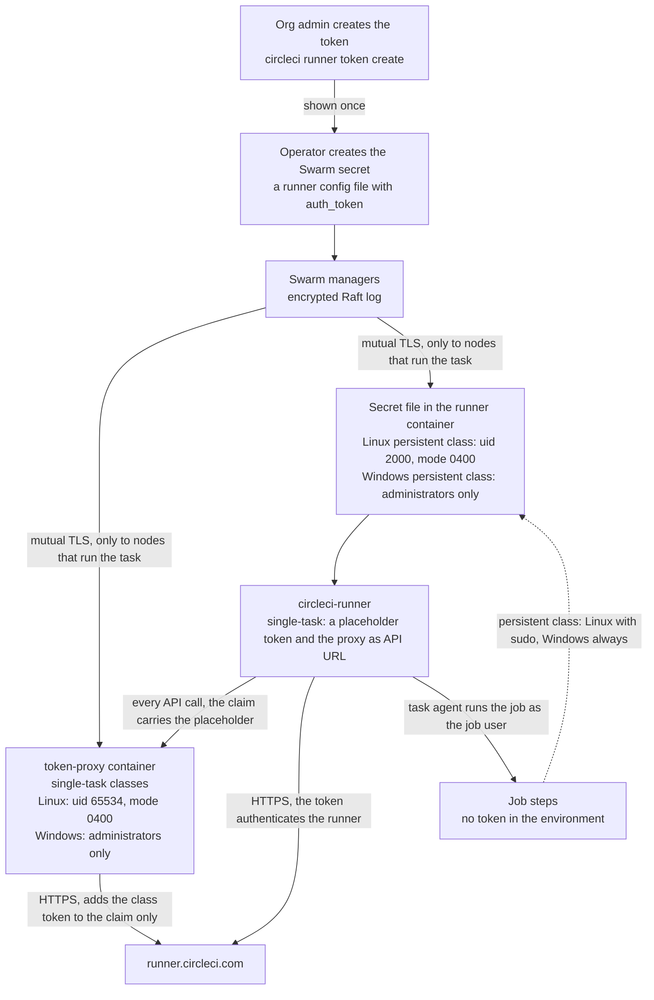

# Security

This page describes what the stack protects, what it does not protect, and which controls you must apply on the CircleCI side. Read it before you give a class to a team.

> [!IMPORTANT]
> Untrusted jobs on a self-hosted runner pose significant risks to your machines and your network. Never use self-hosted runners for public projects that build forked pull requests.

## Threat model

### What the stack protects

| Asset | Where it lives |
|---|---|
| The runner token of a class | A Swarm secret. The [token proxy](#the-token-proxy) holds it for the single-task classes, so no runner container has it. A persistent class puts it in a file in each runner container |
| Job secrets, such as contexts and project variables | The job environment while a job runs |
| Source code | The working directory of a job |
| The node and its network | The host, reachable from the containers by default egress |

### Who can attack

- A job author whose code runs in your container, which is the normal case. The job can do anything its user can do.
- A dependency or script that a job downloads and runs.
- A forked pull request, when you allow fork builds on a public project. Do not allow it.
- Another job that ran earlier on the same node, or that runs next to it.

### What the stack does about it

| Threat | Control | What remains |
|---|---|---|
| A job leaves state for the next job | Single-task mode and a new container for every job | Anything on mounted volumes or on a mounted Docker engine. Refer to [What a clean environment covers](concepts.md#what-a-clean-environment-covers) |
| A job reads the runner token | Single-task classes: only the token proxy holds the token, and runners and jobs hold a made-up placeholder. Linux persistent class: the token is a file that only the runner user and root can read, and is not in the environment. Windows persistent class: the token is a file that every job can read | Linux persistent class: a job that uses sudo reads it. Windows persistent class: a job reads it. A job that escapes its container onto the node of the proxy. Refer to [The token proxy](#the-token-proxy) and [The persistent class](#the-persistent-class) |
| A job replaces the runner or entrypoint | On Linux, the runner is in a per-node volume that the container mounts read-only and that only root owns, the entrypoint is a Swarm config, and the entrypoint checks the runner against its SHA-256 record at every container start. On Windows, the volume with the runner and Git is mounted read-only, and the distributor compares the runner with its record at every check | On Linux, a privileged sibling container can still change the volume. Refer to [Runner binary integrity on Linux](#runner-binary-integrity-on-linux) |
| A job reaches other tenants through the network | One overlay network for each Linux class | Replicas of one class reach each other. Refer to [Isolation between runners](#isolation-between-runners) |
| A job breaks out of the container | Default seccomp and AppArmor profiles, dropped capabilities, no privileged mode | Containers share the host kernel. A kernel or runtime vulnerability bypasses every control on this page. The opt-in [microVM classes](microvm.md) give each job its own kernel |
| A job takes over the node through Docker | The Docker engine is not mounted by default | The opt-in docker-build classes are root-equivalent, and administrator-equivalent on Windows. Refer to [Docker Builds](docker-builds.md) |

The stack does not harden the host operating system, the Docker daemon, or your network. It does not defend against a kernel exploit.

## Token model on each OS

A resource class token only authorizes a runner to claim tasks for that class. A holder of the token can still run a runner of their own on that class, and claim jobs that were meant for yours. That gives them the code and secrets of those jobs, so treat the token as a secret and rotate it.



The two arrows into the runner and the API show the two paths. A single-task class takes the first, on Linux and on Windows: the runner talks to the proxy, and only the proxy holds the class token. A persistent class takes the second: the runner holds the token itself.

### Linux

- **Single-task classes: the token proxy.** The class secret `<service>-token` is mounted into the `token-proxy` service and nowhere else. The runners read a made-up placeholder config, and the proxy adds the class token to their claims. A job cannot read what the container does not hold, so the sudo setting no longer decides whether a job can reach the class token. Refer to [The token proxy](#the-token-proxy).
- **Storage.** A class secret is a minimal runner config file that holds only `api.auth_token`. Swarm mounts it as a read-only file in memory, in the proxy container at `/run/secrets/<service>-token` (uid 65534, mode `0400`), or, in a persistent class, in the runner container at `/run/secrets/circleci_runner_config.yaml`, owned by the runner user `circleci-runner` (uid 2000) with mode `0400`. The runners of the other classes mount the placeholder secret `runner-placeholder-token` at the same path. The runner reads it with `--config`. The token is in no environment variable, no command line, and no stack file, and `docker inspect` does not show it.
- **Users.** The runner runs as `circleci-runner`, which has no sudo rights and cannot write to `/opt/machine-runner-swarm`. Jobs run as the job user, stepped down with `command_prefix`.
- **Default class.** The job user keeps passwordless sudo. A job that uses sudo is root in its container. It can read the placeholder, the files of the runner, and become the runner user, but the container holds no class token. What a job still gets is the task token of its own job, which the task agent already has.
- **Hardened class.** `MACHINE_RUNNER_SWARM_JOB_SUDO: "false"` removes every sudo right of the job user before the runner starts, and the container does not start when a right survives. It also steps every job down with `setpriv --no-new-privs`, even when the image has sudo, and the container does not start when the image has no util-linux `setpriv`. Swarm ignores `no-new-privileges`, so this per-job flag is what stops a setuid binary (`sudo`, `su`, or one with a local-root bug) from lifting a job to root. The job user cannot read the file or the process of the runner, and cannot become another user. A kernel or container-runtime bug can still lift a job to root, because the containers share the host kernel. Tools must be in the image. Use this for shared or regulated classes, and for the persistent class when its jobs can do without sudo.

The test `linux/tests/token.sh` measures the probes below against the real runner binary, with the sentinel token in the runner's config file as the persistent class has it. The test `linux/tests/proxy.sh` shows that, with the proxy, no class token is in a runner container: it scans the files, `/proc/*/environ`, and `/proc/*/cmdline` of the runners as root.

| Probe, run as the job user | Default class | Hardened class |
|---|---|---|
| Read the config file (the real token in the persistent class, the placeholder in the others) | Denied | Denied |
| Read `/proc/<runner pid>/environ` | Denied, and it holds no token | Denied |
| Token in the job environment | Absent | Absent |
| `sudo -n true` | Works | Fails, because `sudo -l -U <job user>` reports that the user is not allowed to run sudo |
| Run a setuid-root binary through the step-down of the runner | Becomes root (sudo is the way) | Stays the job user: `NoNewPrivs` is `1`, and the binary cannot reach the token. Without the flag the same binary reads it |
| Read the config file with sudo | Readable | Not possible |
| Read the `/proc` of the runner as root without `CAP_SYS_PTRACE` | Denied | Not possible |
| Write to `/opt/machine-runner-swarm` | No | No |

### Windows

- **Single-task classes: the token proxy.** The class secret `<service>-token` is mounted into the service `token-proxy-windows` and nowhere else. The runners read a made-up placeholder config, and the proxy adds the class token to their claims, as on Linux. Refer to [The token proxy](#the-token-proxy).
- **Storage.** A class secret is the same minimal runner config file. Swarm places it at `C:\ProgramData\Docker\secrets\<target>` (in the proxy container `<service>-token`, in the runner container of the persistent class `circleci_runner_config.yaml`). Windows does not support `uid`, `gid`, or `mode` for secrets, and only administrators and `SYSTEM` can read the file.
- **No step-down.** The runner and the jobs run as `ContainerAdministrator`, because the runner needs its symbolic link privilege. A job can read the config file of its runner, which holds the placeholder (in a persistent class: the token). The token is not in the job environment. An administrator in a container has no dropped `NET_RAW`, so the guarantee of the proxy that a job cannot forge a source address does not hold on Windows the way it does on Linux. What a forged address gets the job is limited: the answer to a claim goes to the owner of the address, not to the sender, and a container that has claimed cannot claim again. Windows is not tested for this, so treat each class as a trust boundary all the same.
- **Clear text on disk.** The token is stored as plain text on the disk of the container of the proxy (and of the runner, in a persistent class). Swarm writes the secret to the root disk of the container, and keeps it there until the container stops. This is a limitation of Swarm on Windows. On Linux, the secret is a mount in memory (tmpfs) and never reaches the disk of the container. Anyone who can read the Docker root directory of the host can read a Windows token, so enable BitLocker on the volume that holds it. Refer to [BitLocker on Windows hosts](#bitlocker-on-windows-hosts).
- **Process isolation.** Microsoft does not treat process isolation as a security boundary. Use one trust group of classes for each host. Hyper-V isolation adds a kernel boundary, needs nested virtualization on a virtual machine, and is not tested here.

Treat each Windows resource class as a trust boundary. Use one token for each class and host, restrict who can use the class, and rotate tokens.

### Swarm

- Swarm stores secrets encrypted in the Raft log of the managers, and sends a secret only to nodes that run a task that uses it.
- Optionally lock the managers with `docker swarm update --autolock=true`. It protects the secrets at rest, but each manager then needs `docker swarm unlock` after every Docker daemon restart.
- Keep join tokens private, and rotate them with `docker swarm join-token --rotate`.
- A user in the `docker` group on a manager can read every token. Limit administrator access to the managers.

### The token proxy

The service `token-proxy` in `runners.yaml` keeps the class tokens of the Linux single-task classes away from the runner containers and from the jobs that run in them. One proxy serves every class of the stack, and `docker-build.yaml` and `ssh-rerun.yaml` add their classes to it. Refer to [Concepts](concepts.md#the-token-proxy) for how the pieces fit.

What it does:

- **The claim is the only call that gets the class token.** The runners send every API call to the proxy and hold a made-up token. The proxy replaces the `Authorization` header of the task-claim call (`POST /api/v3/runner/claim`) with the class token and passes every other call on unchanged. The runner and its task agent use the task token from the claim response for the rest, and the token is scoped to one task.
- **The class is decided by the network, not by the caller.** A claim is allowed only from an IP address that Swarm DNS lists now for `tasks.<service>` of a configured class, and it gets the token of that class. Any other address, such as a container that you started on the class network, gets 403 and nothing reaches CircleCI. An address that two classes list is refused too.
- **One claim per container.** After a claim that returns a task, that address cannot claim again until it leaves the DNS answer, which means the container is gone. A job that runs in a container cannot use the proxy to claim again for itself or to start more tasks of its class.
- **The source address cannot be forged by a job.** The proxy attaches to each class overlay network with `endpoint_mode: dnsrr`, so it sees the address of the container that connects, not an address that the Swarm load balancer rewrote. The runner services drop `NET_RAW`, so even root in a container cannot send packets with another address. Keep `cap_drop: [NET_RAW, MKNOD]` or `ALL` on every class that uses the proxy.
- **It knows who has claimed, also after a restart.** The proxy writes the addresses that have claimed to the small volume `proxy-state` before the runner gets its task. A restart with that state refuses only those addresses, so a runner that started before the proxy, or waited through a restart, is never locked out. A start with an empty `proxy-state` is a first start: no runner has claimed through this proxy, so every runner present may claim. The state stays on the node, so if the proxy moves to another node, it starts empty there: refer to [Where the proxy runs, and when it moves](operations.md#where-the-proxy-runs-and-when-it-moves) for the worst case and what to do. A `proxy-state` that has its marker but no usable state has lost it, and the proxy fails safe: it refuses every runner present until Swarm replaces them. The service is pinned to the node that keeps the volume (the label `machine-runner-swarm.proxy=true`). Before you move it to another node, set `MACHINE_RUNNER_SWARM_PROXY_NO_STATE=latch`, which makes an empty volume count as lost. Refer to [Move the proxy to another node](operations.md#where-the-proxy-runs-and-when-it-moves).
- **It fails closed otherwise.** The proxy does not start without a usable token file for every class, nor when it cannot write its state. It answers 503 when DNS fails or a token file disappears. It logs addresses, class names, and status codes, never a token.
- **It is small and locked down.** One static Go binary of about 400 lines runs from the volume `runner-bin`, mounted read-only, in a stock `alpine` image, as uid 65534, with no capabilities, a read-only root filesystem, and no published port. The distributor installs it from the release of this repository and verifies it against the signed-release `SHA256SUMS`, and the entrypoint of the service checks it against its record at every start. Refer to [Runner binary integrity on Linux](#runner-binary-integrity-on-linux). Its secrets are the class tokens and nothing else.

What it does not do:

- **It sees the runner traffic of its classes.** The runner and the task agent send their API calls through it, over plain HTTP on the overlay network: claims, task configuration, and step output. The class token is never on that path, but the task token is. Overlay traffic between nodes is not encrypted unless you set the network option `encrypted`, which uses IPsec between the nodes. Consider it when the proxy and the runners run on different nodes and the network between them is not yours. Docker does not support encrypted overlay networks for Windows containers.
- **It is one point of failure.** One replica serves all classes, because a second replica would not share the record of who has claimed. While it is down, no runner can claim. A job that is running keeps its container and its calls wait for the proxy. Refer to [Monitor the token proxy](operations.md#monitor-the-token-proxy).
- **The node of the proxy holds every class token.** A job that escapes its container onto that node reads them. The proxy never runs on a Docker-build node. It runs on a manager by default; choose a manager that runs no jobs when you can, and with several managers pin the proxy to one with the label `machine-runner-swarm.proxy=true`.
- **It does not cover the persistent classes.** Refer to [The persistent class](#the-persistent-class).
- **Windows has its own proxy.** The Windows stack runs `token-proxy-windows` (the `windows/amd64` or `windows/arm64` build, from the same release) for the Windows classes, because a Windows node does not share its network with a Linux proxy. It works as described here, with the differences in [Windows](#windows). It starts from `runner-bin` without a start script, so the distributor checks the binary against its `SHA256SUMS` line before it moves the link, and nothing checks it again at the start of the container.
- **It does not replace CircleCI-side controls.** A stolen class token still lets its holder run a runner on that class. Rotate tokens and restrict classes to projects, as in [CircleCI-side controls](#circleci-side-controls).

### The persistent class

A persistent class (`persistent.yaml`) does not use the proxy. A continuous runner claims a task after every job, and the proxy allows one claim for each container, so the runner keeps its token in a file in its own container. This class is weaker than the proxied classes:

- A job that uses sudo, which the shipped file allows, reads the class token, and it can then run a runner of its own on that class.
- State from one job is visible to the next, because the container lives on.

Therefore give the persistent class a resource class of its own, restrict it to trusted projects with a config policy, keep production contexts away from it, and rotate its token on a schedule. If its jobs can do without sudo, set `MACHINE_RUNNER_SWARM_JOB_SUDO: "false"` in your copy of the file and bake the tools into the image, which makes the token unreadable to the job user as in the old hardened class. Refer to [Persistent mode](resource-classes.md#persistent-mode).

## Runner binary integrity on Linux

The runner executes the jobs of your classes, so it must be the binary that CircleCI published. The `runner-distributor` service installs it, and the entrypoint checks it before every start. Refer to [The runner distributor on Linux](concepts.md#the-runner-distributor-on-linux) for how the parts fit.

### Where the runner comes from

The distributor downloads the tarball over HTTPS from the release bucket of CircleCI, and compares its SHA-256 with the value in the `manifest.json` of CircleCI, which it also gets over HTTPS. This is the same trust as the runner's own download of the task agent, which every container fetches from the same bucket.

To take the manifest out of the chain, set `MACHINE_RUNNER_SWARM_RUNNER_SHA256` to the SHA-256 values that you accept (the tarballs of every architecture of your nodes), from the `checksums.txt` of the release, and pin the version. The distributor then installs only a tarball that has one of these values. With `current`, a new release is refused until you update the list.

### The checks

| When | Who | What |
|---|---|---|
| Download | Distributor | The SHA-256 of the tarball must equal the manifest value, or a value of your list. Otherwise it installs nothing |
| Install | Distributor | The binary must report the version that it installs. The distributor records the SHA-256 of the binary in `versions/<version>/SHA256`, and the files are owned by root and not writable by others |
| Every check interval (24 hours by default) | Distributor | It compares the active binary with its record, and installs the version again when the binary changed |
| Every container start | Entrypoint | It resolves `current` once and runs `sha256sum -c` against the record. A missing record or a different binary ends in exit code 80 and the log line `does not match its SHA-256 record`. Refer to [Error: does not match its SHA-256 record](troubleshooting.md#error-does-not-match-its-sha-256-record). Hashing the 74 MB binary takes about 0.05 seconds |
| While a job runs | Mount | The volume is read-only in the runner containers, and its files are owned by root with the mode `0755`, so a job cannot change it. The entrypoint is a Swarm config, which is immutable and read-only |

### The token proxy binary

The distributor installs the token proxy the same way, from the GitHub release of this repository: `machine-runner-swarm-proxy_linux_<arch>` and the `SHA256SUMS` of that release (`MACHINE_RUNNER_SWARM_PROXY_VERSION`, pinned by `ci/release.sh` to the release that it cuts, or `unreleased` in a checkout, which means the latest published release of this repository). Every platform of CircleCI's runner manifest has a build: Linux `amd64`, `arm64`, `ppc64le` and `s390x`, Windows `amd64` and `arm64`, and the distributor picks the one of its own architecture. It installs nothing unless the SHA-256 of the binary equals its line in `SHA256SUMS`, and, when you set `MACHINE_RUNNER_SWARM_PROXY_SHA256`, one of your values. `SHA256SUMS` comes over HTTPS from the same release as the binary, and the release signs it, so verify the signature of a release when you pin hashes by hand ([Verify a release](install-linux.md#verify-a-release)). The binary reports its version, is recorded in `proxy/versions/<version>/SHA256`, and the entrypoint of the `token-proxy` service checks it against the record at every start, which ends in exit code 1 and the log line `does not match its SHA-256 record` when the volume was changed. The distributor repairs a changed copy at its next check.

### What remains

- A privileged sibling container with `SYS_ADMIN` on the same node could mount the volume read-write and change both the binary and its record. The microVM classes do not mount the volume for this reason: each VM downloads and verifies its own runner. Refer to [MicroVM jobs](microvm.md#the-runner-in-a-vm).
- The check at the start of a container narrows the window and does not close it: a sibling that rewrites the file between the hash and the `exec` of one start is not detected.
- The docker-build class mounts the Docker socket of the host and is root-equivalent on its node, so it can change the volume too. Refer to [Docker Builds](docker-builds.md).
- Whoever can update the `runner-distributor` service, for example a user in the `docker` group of a manager, chooses the version and the download address. A list in `MACHINE_RUNNER_SWARM_RUNNER_SHA256` limits what can be installed to the tarballs on it.

## Runner binary integrity on Windows

The trust is the one of Linux: the service `runner-distributor-windows` downloads the tarball over HTTPS from the release bucket of CircleCI, compares its SHA-256 with the `manifest.json` of CircleCI (or with your `MACHINE_RUNNER_SWARM_RUNNER_SHA256` list), checks that the binary reports the version, and records the SHA-256 of the binary in `versions\<version>\SHA256`. Portable Git and `7zr.exe` are pinned by SHA-256 in the script, so a new Git version is a new script and a new release of this repository.

Two things differ. The runner is the main process of the container and there is no entrypoint, so **nothing checks the binary when a container starts**. The distributor compares the active binary with its record at every check interval (24 hours by default) and installs it again when it changed. And a job runs as an administrator, but in its own container: the volume is mounted read-only through two links, so a job cannot change the runner or Git. A container with write access to the volume, for example one of the docker-build class (it controls the engine and is root-equivalent on its node), can still change them. Refer to [Docker Builds](docker-builds.md).

## Compared with the official runner installs

This table puts the Linux classes of this repository next to the installs that CircleCI documents. The first three columns come from the public CircleCI documentation only, and the last two from the tests of this repository. Where the public documentation says nothing, the cell says so.

| | Machine runner 3 package | Container runner | Machine runner orchestrator | This repository, default class | This repository, hardened class |
|---|---|---|---|---|---|
| Can a job read the resource class token? | Yes in effect. The job gains the privileges of the task agent, and the runner runs as the same user (`circleci`) | Not stated in the public documentation. The agent holds the tokens in a Kubernetes secret | No. A sidecar keeps the token out of the VM, and `grantSudo` is refused without it | No, even with sudo: the token is in the token proxy, and the container holds a placeholder. A job on the node of the proxy could read it, after a container escape | No, for the same reason. The persistent class is the exception, refer to [The persistent class](#the-persistent-class) |
| Can jobs use sudo? | Whatever you grant the `circleci` user | Set by the job image and the pod `securityContext` that you configure | No by default (`grantSudo: false`), and jobs run as the unprivileged `circleci` user. Optional with `grantSudo: true` | Yes, passwordless, as in the Docker executor | No. A setuid binary cannot lift a job to root, because the step-down uses `setpriv --no-new-privs` |
| The boundary between jobs | None: each job runs on the machine where the runner is installed | An ephemeral pod, which Kubernetes tears down after the job. Pods share the node kernel | A virtual machine for each job, provisioned on demand and shut down after the job | A new container for each job, on a kernel that all containers on the node share | The same: a new container for each job, with a shared kernel |

Sources: [Self-hosted runner concepts](https://circleci.com/docs/guides/execution-runner/runner-concepts/), [Self-hosted runner overview](https://circleci.com/docs/guides/execution-runner/runner-overview/#choosing-a-runner-execution-environment), [Container runner reference](https://circleci.com/docs/guides/execution-runner/container-runner/), and the [Machine runner orchestrator](https://circleci.com/docs/guides/execution-runner/machine-runner-orchestrator/) reference, including [its sidecar](https://circleci.com/docs/guides/execution-runner/machine-runner-orchestrator/#sidecar) and [`grantSudo`](https://circleci.com/docs/guides/execution-runner/machine-runner-orchestrator/#granting-sudo).

Read the table this way:

- **A clean container is not a virtual machine.** The orchestrator is the only column with a hardware-level boundary between jobs. If jobs must not share a kernel, use the orchestrator, or dedicate nodes to one trust group. Refer to [Why Swarm and not container runner or another runner?](faq.md#why-swarm-and-not-container-runner-or-another-runner)
- **The token.** In the orchestrator the token never reaches the VM, so even a root job cannot read it. The single-task classes of this repository work the same way: the token proxy adds the token to the claim, as the sidecar does, and the container holds a placeholder, so even a root job cannot read it. What differs is that a job that escapes its container onto the node of the proxy reaches the tokens, where in the orchestrator the sidecar is next to a virtual machine. The persistent class and Windows are weaker: there the token is a file in the container, readable by a job that uses sudo (persistent) or by every job (Windows).
- **The runner binary.** The table does not compare how the installs verify the runner. In this repository the distributor installs it with a SHA-256 check, and the entrypoint checks it at every container start. Refer to [Runner binary integrity on Linux](#runner-binary-integrity-on-linux).
- **Windows.** A single-task class works as on Linux: the job runs as an administrator, the same account as the runner, but the container holds only the placeholder, and the proxy holds the token. The persistent class is at parity with the official Windows runner: the job can read the token. The Windows classes have no hardened variant. Treat each Windows class as a trust boundary, and refer to [Windows](#windows).

## Hardening defaults

### Linux defaults

| Control | Setting in `linux/stack/runners.yaml` |
|---|---|
| Class tokens | Secrets of the `token-proxy` service only: uid 65534, mode `0400`. The runners mount the placeholder secret `runner-placeholder-token`, owned by uid and gid 2000, mode `0400` |
| Token proxy | One replica, `endpoint_mode: dnsrr`, a read-only root filesystem, `cap_drop: [ALL]`, uid 65534, no published port, a health check, a small volume for its state, and never on a Docker-build node |
| Runner | A per-node volume, root-owned and read-only in the container, so the job user cannot write to it. The entrypoint checks it against its SHA-256 record at every start |
| Entrypoint | A Swarm config, mounted with the mode `0555` |
| Separate users | The runner user has no sudo. The job user is stepped down |
| Working directory | `CIRCLECI_RUNNER_CLEANUP_WORK_DIR: "false"`. Refer to [Working directory cleanup](#working-directory-cleanup) |
| Temporary files | The root filesystem is writable, and `/tmp` is writable and executable |
| Logs | Text format. The `local` log driver, 20 MB for each of 3 files |
| Shutdown | `init: true`, and `stop_grace_period: 5h5m` so that a running job finishes |
| Capabilities | Default classes drop `NET_RAW` and `MKNOD`. The hardened class drops all and adds back `CHOWN` and `FOWNER` (the entrypoint sets the owner of directories), `SETUID` and `SETGID` (the step-down), `KILL` (the init process signals the runner, which has another uid), and `AUDIT_WRITE` (sudo audit messages) |
| Limits | `pids: 4096`, `nofile` 65536, no core dumps, and reservations that equal the limits |
| Network | One overlay network for each class, and no published ports, so SSH rerun is off unless you deploy the SSH add-on stack file |
| Runner version | 3.1.12 or later. By default the distributor pins the newest runner version that this repository's CI tests, and `3.1`, `3` or `current` make it follow CircleCI's manifest |

Swarm ignores `security_opt`, `privileged`, `userns_mode`, and the short `tmpfs` form, and its tmpfs mounts are not executable. The stack therefore sets no `no-new-privileges` and no `read_only` filesystem. The default seccomp and AppArmor profiles of Docker apply.

Keep the host clock on NTP. TLS fails silently when the clock drifts. Keep SELinux or AppArmor enforcing on the node. Disable swap, or size memory knowing that Swarm cannot set a swap limit.

### Working directory cleanup

The runner can remove its working directory before it starts a task and again after the task. On Linux, the stack files and the entrypoint turn this off with `CIRCLECI_RUNNER_CLEANUP_WORK_DIR: "false"`.

The reason is file ownership. The runner runs as the runner user (uid 2000), and the working directory and the files in it belong to the job user. The runner cannot remove them, so with cleanup on every task fails before it starts. The log shows `failed to remove working directory before starting task` with `permission denied`, even for the first task, because the parent directory belongs to the job user too. Giving the runner user the ownership does not help, because the job user must then be able to create the directory again. Running jobs as the runner user would give every job the runner token and remove the step-down, so the stack does not do that.

What this means for each class:

- **Single-task classes.** Nothing is lost. Swarm discards the container after the job, so no file survives.
- **Persistent classes.** Nothing removes what a job leaves in the working directory, and the next job can read it. Start every job with a step that removes what an earlier job left. Recycle the class on a schedule. Refer to [Persistent mode](resource-classes.md#persistent-mode).

Do not set the variable to `true` on Linux. Refer to [Error: failed to remove working directory](troubleshooting.md#error-failed-to-remove-working-directory-permission-denied). Windows jobs and the runner use the same account, so the Windows files keep cleanup on.

### Windows defaults

| Control | Setting in `windows\stack\runners.yaml` |
|---|---|
| Runner and Git | Read-only mounts of the volume `runner-bin` (`current` at `C:\machine-runner-swarm`, `git\current` at `C:\Program Files\Git`). A job cannot write. Refer to [Runner binary integrity on Windows](#runner-binary-integrity-on-windows) |
| Secret | Administrators and `SYSTEM` only. Refer to [Token model on each OS](#token-model-on-each-os) |
| Working directory | `CIRCLECI_RUNNER_CLEANUP_WORK_DIR: "true"` |
| Logs | Text format. The `json-file` log driver with rotation |
| Shutdown | `stop_grace_period: 5h5m`. A stop from outside kills a busy container after about 5 seconds, so change a service while its class is idle. Refer to [Stop a busy Windows container](operations.md#stop-a-busy-windows-container) |
| Limits | CPU and memory limits. The Windows engine rejects `pids` and `ulimits` |
| Network | No published ports, so SSH rerun is off unless you deploy the SSH add-on stack file |

`init`, `cap_drop`, `read_only`, and `tmpfs` have no effect on Windows.

## Isolation between runners

Replicas of one class share an overlay network and can reach each other. Swarm cannot prevent this: `enable_icc=false` is ignored on swarm-scoped networks, overlay networks have no such option, and a stack cannot use a node-local bridge network. On Windows, the overlay is the only network option for services, and Windows has no equivalent control for it.

On Linux, each class gets its own overlay network, so classes cannot reach each other. Containers can still reach the host network and the internet through default egress. To reduce the exposure:

- Run sensitive classes on dedicated nodes. Refer to [Multi-Node Clusters](multi-node.md).
- Treat the proxy as part of every class network: any container on a class network can reach it, and the proxy answers only claims from the runners of the class.
- Filter egress on the host, for example in the `DOCKER-USER` chain on Linux.
- Rely on single-use containers. A compromised replica disappears with its job.

## CircleCI-side controls

The stack cannot decide which projects may use a class. Apply these controls in your organization.

1. **One class and one token for each service.** Give each token a nickname that names its host or purpose, so you can revoke it alone. Only organization admins create and delete resource classes. Delete the tokens of a class before you delete the class.
2. **Config policies.** Restrict each class to named projects with the `resource_class_by_project` helper. Config policies need the Scale plan on cloud, or server version 4.2 or later. A class that is not in the mapping stays available to every project.

   ```rego
   package org
   import data.circleci.config

   policy_name["runner_policies"]

   enable_hard["resource_class_check"]

   resource_class_check = config.resource_class_by_project({
     "<namespace>/linux-hardened": {"<project ID>"},
     "<namespace>/linux-docker-build": {"<project ID>", "<project ID>"}
   })
   ```

   Enable evaluation and push the policy. Refer to [Config policies for self-hosted runner](https://circleci.com/docs/guides/config-policies/config-policies-for-self-hosted-runner/).

   ```console
   $ circleci policy settings set --org <org> --enabled
   $ circleci policy push ./config-policies --org <org>
   ```

3. **Context restrictions.** Project restrictions, security groups, and expression restrictions combine with logical AND. Restrict every context that jobs on a runner class use. For deploy contexts, add an expression such as `pipeline.git.branch == "main" and not job.ssh.enabled`.
4. **No fork builds on public projects.** CircleCI does not make self-hosted runners available to public projects that have **Build forked pull requests** enabled.
5. **SSH rerun stays off unless a class needs it.** The shipped classes leave `CIRCLECI_RUNNER_SSH_ADVERTISE_ADDR` unset and publish no ports, so they cannot serve SSH. If you deploy the SSH add-on stack file, keep its class for named projects and restrict inbound port 54782. Refer to [Rerun job with SSH](resource-classes.md#rerun-job-with-ssh).
6. **Monitoring.** Watch the runner inventory for names you do not know, and the logs for `401` and for exit code 80. In the log of the token proxy, a claim that is `refused` comes from a container that is not a runner of a class, or from a runner that tries to claim twice. Refer to [Monitor the token proxy](operations.md#monitor-the-token-proxy).

Runner classes are usable only by jobs of the organization that owns them.

## Egress hosts

Runners need outbound HTTPS only, and no inbound access. Allow these hosts by name, because their addresses change.

| Host | Port | Used for |
|---|---|---|
| `runner.circleci.com` | 443 | The runner API: claiming tasks. With the token proxy, only the node of the proxy calls it for the single-task Linux classes, because the runners and their task agents reach the API through the proxy |
| `circleci-binary-releases.s3.amazonaws.com` | 443 | The task agent, which every new container downloads, and the runner download: on Linux by the `runner-distributor` service (the manifest and the tarball), or by each container of a microVM class, on Windows during setup |
| `circleci-tasks-prod.s3.us-east-1.amazonaws.com` | 443 | Caches, workspaces, artifacts, and test results |
| `internal.circleci.com` | 443 | CircleCI endpoint used during checkout |
| Your VCS host, for example `github.com` | 443, and 22 for SSH checkouts | Checkout |
| Your image registries, for example Docker Hub and `mcr.microsoft.com` | 443 | Pulling the service images, on Linux also the `alpine` image of the `runner-distributor` service |
| `api.github.com` | 443 | Only from a checkout (`git clone`, Download ZIP), where the proxy version `unreleased` means the latest published release: the `runner-distributor` service asks the GitHub API for its tag, once for each check interval. A release bundle names its release and does not ask |
| `github.com` and `release-assets.githubusercontent.com` | 443 | The token proxy binary and its `SHA256SUMS`, which the `runner-distributor` service downloads from the GitHub release of this repository (not in an air-gapped setup with a mirror). On Windows also Git for Windows and 7-Zip. The first host redirects the downloads to the second |

If your VCS organization uses an IP allow list, add the egress addresses of your nodes. The list applies to every checkout method. If you use an explicit proxy, test a checkout through it before you roll out a class. Jobs inherit `HTTPS_PROXY` and `NO_PROXY` from the service environment in the stack file.

## BitLocker on Windows hosts

Docker keeps a Swarm secret in clear text on the container root disk until the container stops. Encrypt the volume that holds the Docker root directory, which is `C:\ProgramData\docker` by default, with BitLocker. Confirm the protection status:

```powershell
Get-BitLockerVolume
```

The status of the volume must show that protection is on. BitLocker protects the token when someone steals the disk, or a snapshot or backup of it. It does not protect against a job, or an administrator who is logged in to the live host, because both read the decrypted file. Limit the local administrators of the host, use one token for each class and host, and rotate tokens. Refer to the Microsoft documentation for BitLocker on Windows Server for the setup steps, including the recovery key.
